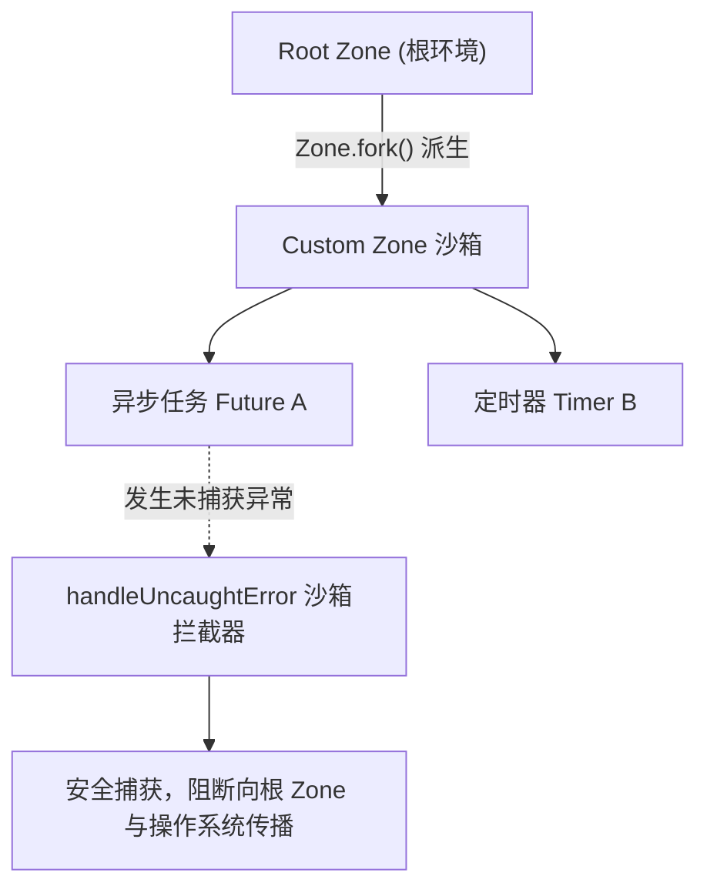

# 资深-线上异常崩溃监控与Zone沙箱捕获及符号表解析

在现代移动开发中，代码即使经过了严格的线下测试，一旦进入包含数千款机型、复杂弱网环境与未知用户操作的生产环境，各种未预料到的异常（NullPointer、类型转换失败、网络超时、内存越界）必然偶现。

如果应用没有搭建完备的**全链路异常捕获与崩溃治理闭环**，一个组件内部的微小异常就可能引发 Flutter 的“红屏崩溃（Red Screen of Death）”，甚至导致整个 App 进程直接闪退退出。

在资深架构师技术面试中，面试官将围绕以下核心痛点进行多维深挖：**Flutter 的同步与异步异常分流捕获机制是什么？`Zone` 执行沙箱的底层原理是什么？Flutter 3.3+ 的 `PlatformDispatcher.onError` 为何被推荐替代传统的 `runZonedGuarded`？线上 AOT 混淆崩溃堆栈如何通过符号表自动化逆向还原？**

---

## 1. 核心底层机制与全景架构

### 1.1 Flutter 生产级三层全方位异常拦截拓扑

Flutter 应用运行在 Native 宿主进程中，异常按照发生层级与线程划分为三大类：

```mermaid
flowchart TD
    subgraph Layer1["1. Framework 同步异常 (Widget 构建/渲染管线)"]
        F1["build() 抛出异常 / 布局断言失败"] --> F2["FlutterError.onError 兜底捕获"]
        F2 --> RedScreen["阻止红屏渲染，展示友好友好降级兜底 UI"]
    end

    subgraph Layer2["2. 异步未捕获异常 (Future / Timer / 微任务)"]
        A1["Future.error() 未 catch / Timer 异常"] --> A2["PlatformDispatcher.instance.onError<br/>或 runZonedGuarded"]
        A2 --> AsyncLog["捕获异常并异步安全上报"]
    end

    subgraph Layer3["3. 底层 Native / C++ Engine 崩溃 (不可恢复)"]
        N1["JNI 异常 / SIGSEGV / OOM 强杀"] --> N2["Native 宿主捕获 (Crashlytics / Sentry / Bugly)"]
        N2 --> NativeDump["生成 Minidump 崩溃快照"]
    end
```



### 1.2 核心监控防线矩阵

| 拦截防线 | 拦截范围 | 核心生效接口与配置 | 是否能阻止闪退 |
| :--- | :--- | :--- | :--- |
| **Framework 错误** | Widget `build`、`performLayout`、`paint` 期间的同步错误 | `FlutterError.onError = (details) => ...` | **能**。避免页面变成红屏，替换为自定义灰度占位卡片。 |
| **异步 Dart 错误** | `Future`、`Timer`、跨 Isolate 事件流中的未捕获异常 | `PlatformDispatcher.instance.onError`（推荐）<br/>或 `runZonedGuarded` | **能**。阻断异常向操作系统抛出，应用继续平稳运行。 |
| **底层 Native 崩溃** | C/C++ 内存越界（`SIGSEGV`）、死锁、系统 OOM 强杀 | 原生 Bugly / Sentry / Firebase Crashlytics 原生 SDK | **不能阻止崩溃**，但能在进程死亡前一瞬间将崩溃现场 Minidump 落地并上传。 |

---

## 2. 源码级/算法物理推导

### 2.1 Zone 异步沙箱执行上下文推导

在 Dart 语言中，`Zone` 代表一个代码执行的**异步沙箱上下文（Execution Context）**。它维护了当前环境的局部变量、错误处理句柄以及 I/O 重定向规则：



#### `runZonedGuarded` 核心源码原理：
```dart
R? runZonedGuarded<R>(R Function() body, void Function(Object error, StackTrace stack) onError, ...) {
  // 1. 从当前 Zone 派生出一个新的子 Zone
  final Zone zone = Zone.current.fork(
    specification: ZoneSpecification(
      // 重写错误捕获钩子
      handleUncaughtError: (Zone self, ZoneDelegate parent, Zone origin, Object error, StackTrace stackTrace) {
        try {
          onError(error, stackTrace); // 执行自定义上报
        } catch (e, s) {
          parent.handleUncaughtError(self, e, s);
        }
      },
    ),
  );
  // 2. 在该沙箱内执行业务代码
  return zone.run(body);
}
```

### 2.2 PlatformDispatcher.onError：现代统一错误路由

在 Flutter 3.3 之后，官方推荐优先使用 `PlatformDispatcher.instance.onError`：

```dart
// 现代统一异步错误捕获范式
PlatformDispatcher.instance.onError = (Object error, StackTrace stack) {
  APMReportService.recordException(error, stack);
  return true; // 返回 true 表示异常已被消费处理，严禁继续向上冒泡崩溃！
};
```
相比 `runZonedGuarded`，`PlatformDispatcher.onError` 具有两大杀手级优势：
1. **零性能损耗**：不需要通过 `Zone.fork()` 在运行时为每一个异步操作包装额外的代理上下文，减少调用栈深度与内存分配。
2. **全局统一捕获**：它是底层 C++ 引擎与 Dart 运行时之间抛出未捕获错误时的**最终集水池**，涵盖所有派生的微任务与事件流。

---

## 3. 社招/阶段必考高频硬核连环追问

### 追问 1：为什么如果在 `build()` 方法中抛出异常，`runZonedGuarded` 抓不到，而只有 `FlutterError.onError` 能抓到？

> **答辩深度闭环**：
> 1. **内部被吞噬与重定向**：在 Flutter Framework 源码中，`ComponentElement.performRebuild` 在调用 `build()` 时，外层包裹了极严谨的内部 `try-catch`：
>    ```dart
>    try {
>      built = build();
>    } catch (e, stack) {
>      built = ErrorWidget.builder(
>        _debugReportException('building $this', e, stack),
>      );
>    }
>    ```
> 2. **`_debugReportException` 走向**：它内部直接调用了 `FlutterError.reportError(details)`，并将错误信息转交给了 `FlutterError.onError`。由于异常在框架层内被主动捕获并消费了，它**根本没有作为未处理异常向上冒泡给当前 Zone**！
> 3. **架构闭环**：因此要想捕获 UI 渲染管线中的构建异常，必须同时监听 `FlutterError.onError`，两者职责完全正交互补。

---

### 追问 2：为什么线上灰度版本抓回来的崩溃堆栈全是十六进制的地址偏移（如 `#00 pc 00000000003b12a8 libapp.so`），完全看不懂？如何搭建自动化反混淆服务？

> **答辩深度闭环**：
> 1. **AOT 混淆与符号剥离**：线上生产包启用了 `--obfuscate --split-debug-info=./symbols`，为了防止代码泄露并缩小包体积，所有类名、函数名与源码行号映射信息被剥离到了独立的 `.symbols` 调试符号表文件中，产物机器码中只剩原始的相对虚拟地址（RVA）。
> 2. **自动化反混淆流水线设计**：
>    - **打包阶段**：CI/CD 打包机在生成 Release 包的同时，自动提取生成的 `symbols` 文件，并附带本次打包的 `Git Commit SHA` 与 `VersionCode` 作为联合主键。
>    - **上传存储**：将 symbols 归档上传至内部的符号表服务器或 APM 平台（如 Sentry / Bugly）。
>    - **消费阶段**：客户端上报崩溃日志时附带当前 App 版本号，APM 后端自动匹配对应版本的 symbols 文件，在后台调用 `flutter symbolize` 离线还原出精确到具体 Dart 文件行号的明文堆栈展示在开发者监控大盘上。

---

### 追问 3：在 Flutter 应用中，如果子 Isolate（后台并发线程）内部抛出了异常，主线程的 `PlatformDispatcher.onError` 能直接捕获到吗？为什么？

> **答辩深度闭环**：
> 1. **物理隔离无法捕获**：绝对捕获不到！
> 2. **独立环境决定**：根据 Dart 虚拟机的物理设计，每个 `Isolate` 拥有完全独立的堆内存和专属的事件循环，它们的异常处理上下文也是完全隔离的。子 Isolate 内未捕获的错误只会导致该子 Isolate 异常终止，绝不会自动穿透到主 Isolate 的错误路由中。
> 3. **解决方案**：
>    - 派生子 Isolate 时，必须通过 `ReceivePort` 监听其错误端口：
>      ```dart
>      final ReceivePort errorPort = ReceivePort();
>      errorPort.listen((message) {
>        // 在此处捕获子 Isolate 的崩溃堆栈并上报
>      });
>      await Isolate.spawn(entryPoint, data, onError: errorPort.sendPort);
>      ```
>    - 如果使用 `Isolate.run`，其内部已自动封装了 `Completer.completeError`，可在调用侧直接通过 `try-catch` 捕获。

---

## 4. 生产级避坑指南与排障 SOP

### 4.1 生产级“四位一体”全链路异常兜底监控中枢

```dart
import 'dart:ui';
import 'package:flutter/material.dart';

void main() {
  // 1. 确保核心 Binding 优先就绪
  WidgetsFlutterBinding.ensureInitialized();

  // 2. 拦截 Framework 层的同步构建/绘制错误 (防红屏)
  FlutterError.onError = (FlutterErrorDetails details) {
    // 打印并上报 APM 监控平台
    APMExceptionReporter.reportFlutterError(details);

    // 生产环境静默处理，避免控制台刷屏
    if (!const bool.fromEnvironment('dart.vm.product')) {
      FlutterError.dumpErrorToConsole(details);
    }
  };

  // 3. 替换默认的灾难性“红屏”，展示优雅友好的品牌兜底页面
  ErrorWidget.builder = (FlutterErrorDetails details) {
    return Material(
      child: Center(
        child: Container(
          padding: const EdgeInsets.all(16),
          child: Column(
            mainAxisSize: MainAxisSize.min,
            children: const [
              Icon(Icons.wifi_off_rounded, size: 48, color: Colors.grey),
              SizedBox(height: 12),
              Text('组件加载异常，请稍后重试', style: TextStyle(color: Colors.grey)),
            ],
          ),
        ),
      ),
    );
  };

  // 4. 拦截全全局未捕获的异步错误 (Future / Timer / EventLoop)
  PlatformDispatcher.instance.onError = (Object error, StackTrace stack) {
    APMExceptionReporter.reportAsyncError(error, stack);
    return true; // 返回 true：标记已处理，防止进程直接被 OS 强杀！
  };

  runApp(const MyApp());
}

class APMExceptionReporter {
  static void reportFlutterError(FlutterErrorDetails details) {
    debugPrint('[APM-Error] Framework Exception: ${details.exceptionAsString()}');
    // 发送至 Sentry / 自建 APM 服务端
  }

  static void reportAsyncError(Object error, StackTrace stack) {
    debugPrint('[APM-Error] Async Uncaught Exception: $error');
    // 发送至 Sentry / 自建 APM 服务端
  }
}
```

### 4.2 符号表解析排障 SOP

当遇到线上用户的混淆报错堆栈时，运维与架构师标准化排查处置手册：

```bash
# 1. 准备好本地归档的对应版本符号表文件
# 路径例如: ./build_archive/v2.1.0_build1024/app.android-arm64.symbols

# 2. 将用户日志中的混淆堆栈存为 crash.txt
cat << 'EOF' > crash.txt
*** *** *** *** *** *** *** *** *** *** *** *** *** *** *** ***
pid: 14210, tid: 14235 >>> com.company.app <<<
backtrace:
  #00 pc 000000000049f2b8 libapp.so
  #01 pc 00000000005a109c libapp.so
EOF

# 3. 执行符号化还原命令
flutter symbolize \
  -s ./build_archive/v2.1.0_build1024/app.android-arm64.symbols \
  -i crash.txt \
  -o restored_crash.txt

# 4. 查看还原结果
cat restored_crash.txt
# 输出清晰明了的代码位置：
# #00 parseOrderResponse (package:company/services/order.dart:89:12)
# #01 initOrderFlow (package:company/pages/order_page.dart:45:5)
```
通过该 SOP，原本如同天书的机器码偏移在 1 秒内还原为具体的 Dart 源码行号，极大提升了生产级重大 Bug 的止血修复时效。
