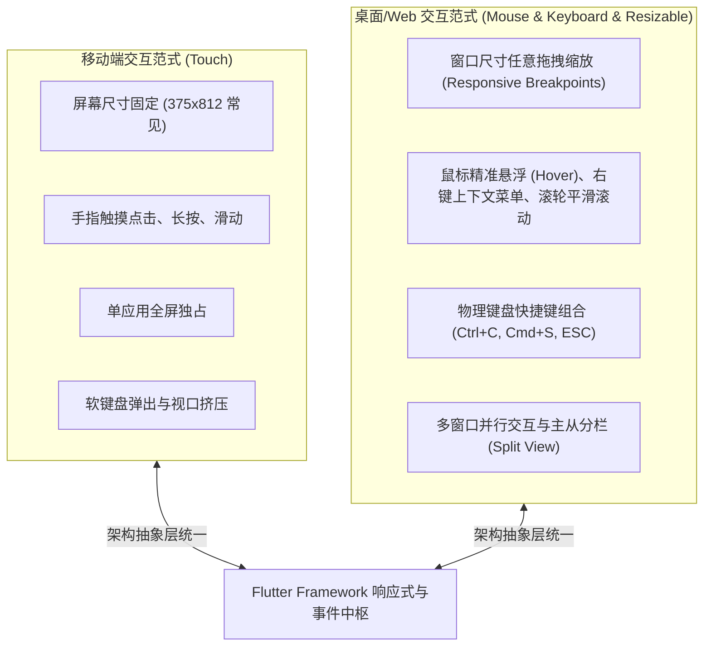
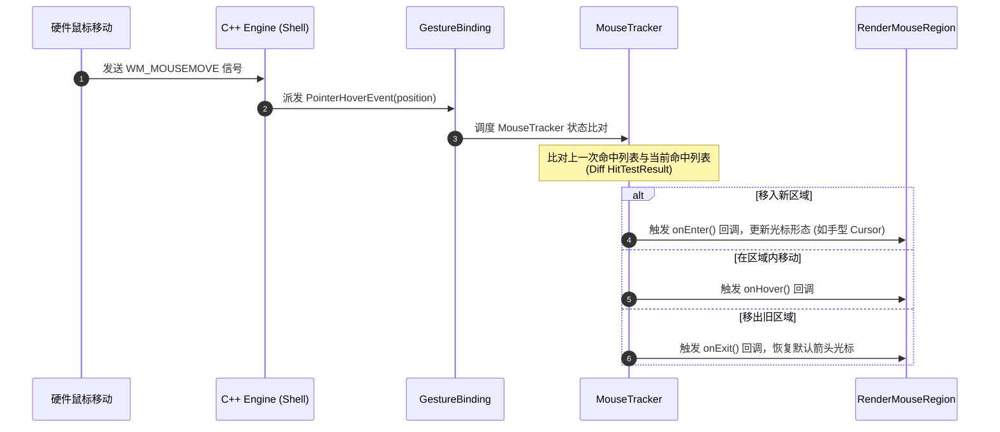

# 资深-跨平台桌面端与Web适配大屏响应式与键盘鼠标交互

随着 Flutter 跨平台愿景的全面落地，Flutter 早已不再局限于手机移动端（iOS / Android），而是深度延伸至 **桌面端（macOS / Windows / Linux）、平板 Pad、折叠屏以及 Web 浏览器端**。“一套代码，六端运行”带来了巨大的生产力红利，但同时也给工程架构带来了极具挑战的跨设备范式差异：从移动端的“纯触控、纵向固定尺寸、单点交互”，跨越到桌面/Web 的 **“大屏窗口随意拖拽调整、响应式断点栅格、鼠标高频悬浮（Hover）与滚轮、复杂全局键盘快捷键系统、以及多级弹出菜单”**。

在资深架构师面试中，面试官将考核你是否具备全平台级系统的设计广度与深度：**Flutter 桌面端鼠标/键盘分发管线原理是什么？`Shortcuts` 与 `Actions` 意图调度系统如何设计？Flutter Web 早期首屏白屏的物理本质与 3.22+ Wasm（WebAssembly）新架构破局点在哪里？大屏多栏响应式架构如何优雅落地？**

---

## 1. 核心底层机制与全景架构

### 1.1 移动端到桌面/Web 端的范式跨越全景



### 1.2 响应式屏幕断点标准（企业级栅格系统）

为了使一套 Widget 能够在大屏、中屏、小屏之间无缝自适应，通常采用以下响应式断点（Breakpoints）：

| 布局档位 | 宽度阈值（dp） | 目标设备类型 | 推荐展示形态 |
| :--- | :--- | :--- | :--- |
| **Compact (紧凑型)** | $< 600\text{dp}$ | 竖屏手机 | 单栏流式卡片，底部导航栏（BottomNavigationBar） |
| **Medium (中等型)** | $600\text{dp} \le w < 1024\text{dp}$ | 折叠屏展开态、iPad / Android 平板 | 双栏主从布局，左侧导航栏抽屉（NavigationRail） |
| **Expanded (扩展型)** | $\ge 1024\text{dp}$ | PC 桌面端（macOS/Windows）、大屏 Web | 三栏复杂工作台（左侧一级菜单 + 中间列表 + 右侧主工作区） |

---

## 2. 源码级/算法物理推导

### 2.1 桌面端鼠标事件系统与 MouseRegion 物理推导

移动端只有 `PointerDown`、`PointerMove`、`PointerUp`。而桌面端引入了鼠标移动（Hover）事件，当用户移动鼠标时，即使**没有任何按键按下**，也会持续产生 `PointerHoverEvent`。



### 2.2 Shortcuts & Actions 键盘意图派发架构

在桌面开发中，硬编码 `onKeyEvent` 会导致代码与具体平台物理按键死耦合。Flutter 设计了一套基于 **命令模式（Command Pattern）** 的意图调度架构：


- **解耦优势**：macOS 映射为 `Cmd + S`，Windows/Linux 映射为 `Ctrl + S`，而底层的业务处理逻辑（`SaveAction`）只需要编写一套，实现了跨平台的物理按键无缝解耦。

### 2.3 Flutter Web 双引擎演进：CanvasKit 到 Wasm (WebAssembly)

| 架构阶段 | 核心技术 | 优点 | 致命缺陷 |
| :--- | :--- | :--- | :--- |
| **早期 HTML 渲染器** | 映射为 DOM + CSS + SVG | 体积极小（~2MB），首屏快 | 极其严重的排版错位，阴影与 Canvas 滤镜效果与移动端严重不一致，性能极低。已废弃。 |
| **CanvasKit 渲染器** | 将 Skia 编译为 WebAssembly，配合 WebGL 绘制 | 像素级 100% 还原移动端表现，性能高 | 需下载额外的 `canvaskit.wasm`（~3MB）与字体，**首屏白屏时间高达 3~8 秒**！ |
| **Flutter 3.22+ Wasm + Skwasm** | **Dart AOT 直编为 WebAssembly (Wasm-GC)**，跳过 JS 桥接 | **运行速度提升 2~3 倍**，大幅削减白屏，支持多线程光栅化渲染 | 依赖现代浏览器对 WasmGC（垃圾回收扩展）的原生支持。 |

---

## 3. 社招/阶段必考高频硬核连环追问

### 追问 1：在桌面端/Web 端，把页面放在 `SingleChildScrollView` 中，为什么鼠标滚轮滑动经常出现“粘滞卡顿”或“嵌套列表无法正常被滚轮滚动”？

> **答辩深度闭环**：
> 1. **滚动物理机制差异（ScrollPhysics）**：移动端的默认物理模拟器是 `BouncingScrollPhysics`（iOS 弹性）或 `ClampingScrollPhysics`（Android 边界波纹）。这些是专为手指拖拽惯性滑动设计的。
> 2. **桌面滚轮信号不同**：桌面端的滚轮产生的是离散的 `PointerScrollEvent`。若未做平台适配，系统无法提供平滑的平移衰减。
> 3. **解决方案**：
>    - 配置全局 `ScrollBehavior`，在桌面端指定使用平台原生的平滑滚动策略。
>    - 针对嵌套滑动冲突，外层滚动视图和内层必须通过 `ScrollConfiguration` 明确滚轮事件的冒泡或捕获机制，或采用统一的 `CustomScrollView` 结合 Sliver 视口消除多控制器打架。

---

## 4. 生产级避坑指南与排障 SOP

### 4.1 生产级大屏响应式脚手架实战（三栏自适应工作台）

```dart
import 'package:flutter/material.dart';

class ResponsiveScaffold extends StatelessWidget {
  final Widget menu;
  final Widget list;
  final Widget detail;

  const ResponsiveScaffold({
    Key? key,
    required this.menu,
    required this.list,
    required this.detail,
  }) : super(key: key);

  @override
  Widget build(BuildContext context) {
    return LayoutBuilder(
      builder: (context, constraints) {
        final double width = constraints.maxWidth;

        // 1. 扩展型大屏 (PC 桌面端 / 大屏 Web >= 1024dp): 三栏并排展示
        if (width >= 1024) {
          return Scaffold(
            body: Row(
              children: [
                SizedBox(width: 240, child: menu),
                const VerticalDivider(width: 1),
                SizedBox(width: 320, child: list),
                const VerticalDivider(width: 1),
                Expanded(child: detail),
              ],
            ),
          );
        }

        // 2. 中等屏 (平板 / 折叠屏 600dp <= width < 1024dp): 双栏展示
        if (width >= 600) {
          return Scaffold(
            body: Row(
              children: [
                SizedBox(width: 280, child: list),
                const VerticalDivider(width: 1),
                Expanded(child: detail),
              ],
            ),
          );
        }

        // 3. 紧凑型小屏 (手机 < 600dp): 单栏导航流展示
        return Scaffold(
          body: list,
        );
      },
    );
  }
}
```

### 4.2 桌面端鼠标 Hover 手型与快捷键绑定工程规范

```dart
import 'package:flutter/material.dart';
import 'package:flutter/services.dart';

// 自定义保存意图
class SaveDocumentIntent extends Intent {
  const SaveDocumentIntent();
}

class DesktopCustomButton extends StatelessWidget {
  final VoidCallback onSave;

  const DesktopCustomButton({Key? key, required this.onSave}) : super(key: key);

  @override
  Widget build(BuildContext context) {
    return Shortcuts(
      // 跨平台快捷键映射 (macOS 为 Cmd+S, 其他平台为 Ctrl+S)
      shortcuts: <ShortcutActivator, Intent>{
        LogicalKeySet(
          LogicalKeyboardKey.meta,
          LogicalKeyboardKey.keyS,
        ): const SaveDocumentIntent(),
        LogicalKeySet(
          LogicalKeyboardKey.control,
          LogicalKeyboardKey.keyS,
        ): const SaveDocumentIntent(),
      },
      child: Actions(
        actions: <Type, Action<Intent>>{
          SaveDocumentIntent: CallbackAction<SaveDocumentIntent>(
            onInvoke: (intent) => onSave(),
          ),
        },
        child: Focus(
          autofocus: true,
          child: MouseRegion(
            // 鼠标悬浮时变为小手形态
            cursor: SystemMouseCursors.click,
            child: GestureDetector(
              onTap: onSave,
              child: Container(
                padding: const EdgeInsets.symmetric(horizontal: 16, vertical: 8),
                decoration: BoxDecoration(
                  color: Colors.blueAccent,
                  borderRadius: BorderRadius.circular(6),
                ),
                child: const Text('保存数据 (Cmd/Ctrl + S)', style: TextStyle(color: Colors.white)),
              ),
            ),
          ),
        ),
      ),
    );
  }
}
```
通过上述标准响应式与硬件外设输入适配规范，一套 Flutter 代码即可在保留移动端敏捷性的同时，在 Windows、macOS 桌面及 Web 端达到媲美专业桌面软件的原生交互水准。
