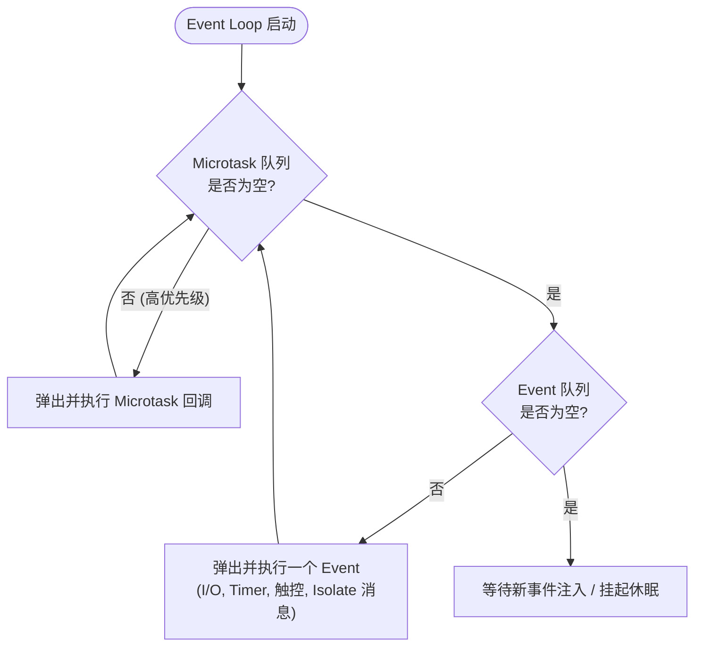
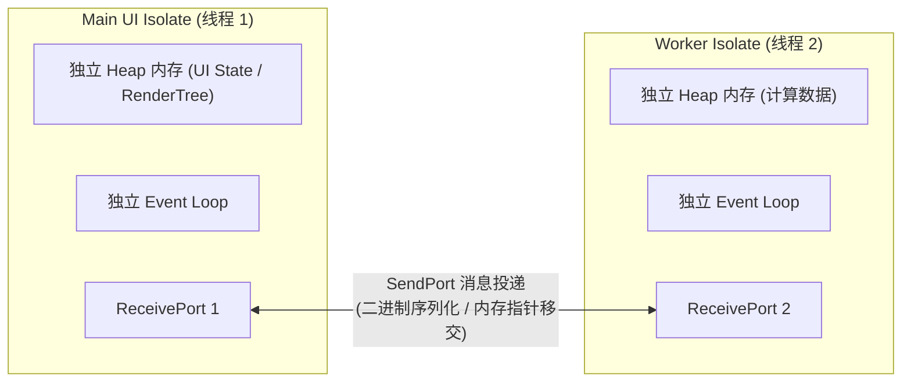

# 高级-Dart多线程并发Isolate机制与compute轻量调度

在移动端高并发与高负载计算场景下，如果主线程被繁重的 CPU 密集型任务（如几十兆超大 JSON 解析、图像离屏滤镜处理、音视频转码、复杂离线加解密）长时间占据，UI 渲染管线将被直接阻塞，产生灾难性的“掉帧甚至 ANR 假死”。

Dart 与 Java/C++ 最根本的差异在于其天然的 **“单线程 + 事件循环（Event Loop）”** 模型。为了实现真正的多核 CPU 并发，Dart 引入了物理内存完全隔离的并发单元——**`Isolate`**。

在高级/资深架构师社招考核中，面试官不仅考察 `compute` 的简易用法，更会深度追问：**Isolate 内存模型的物理本质是什么？多 Isolate 间通信是深拷贝还是内存移动（Zero-copy / TransferableTypedData）？为什么在子 Isolate 中调用原生插件会崩溃？如何设计一个长生命周期的 Worker Isolate 线程池？**

---

## 1. 核心底层机制与全景架构

### 1.1 Dart 单线程事件循环与 Microtask / Event 队列

Dart 线程的核心调度器是一个无限循环泵（Event Loop），内部维护了两个优先级不同的 FIFO 队列：



> **架构黄金定律**：`Future`、`Timer`、I/O 以及来自其他 Isolate 的跨线程消息全部进入 **Event 队列**；而 `scheduleMicrotask` 注入微任务队列，微任务拥有最高打断特权，执行完毕前绝不调度任何 Event。

### 1.2 Isolate 内存模型：零共享内存设计

与 Java/C++ 共享进程内存空间的传统线程不同，Dart 的每个 `Isolate` 拥有：
1. **独立的堆内存空间（Heap）**：绝不与任何其他 Isolate 共享全局变量或静态字段。
2. **独立的垃圾回收器（Garbage Collector）**：GC 过程在各个 Isolate 内部独立运行，子 Isolate 的 Full GC 绝不影响主 UI Isolate 的流畅度。
3. **独立的 Event Loop**。



---

## 2. 源码级/算法物理推导

### 2.1 端口通信（Port Communication）与消息序列化算法

Isolate 之间的唯一通信渠道是 **`ReceivePort`** 和 **`SendPort`**。

当主 Isolate 向子 Isolate 发送数据时：
1. **小对象/基础类型**：系统对对象执行**深拷贝（Deep Copy）**。它递归遍历对象拓扑图，将其转换为内部 C++ 二进制序列化格式，在接收方反序列化重建对象。
2. **底层优化（Zero-Copy Transfer）**：如果传输的是超大型二进制数据（如图片字节流、音视频流），可以使用 `TransferableTypedData`，底层直接**转移内存所有权（Ownership Handover）**，实现 $O(1)$ 常数时间开销的指针移交，发送方原指针立即置空失效，零 CPU 拷贝开销。

### 2.2 compute 与 Isolate.run 源码执行机理

在 Flutter 3.7+ 中，官方推荐优先使用 `Isolate.run`：

```dart
// Flutter 3.7+ 核心机制
Future<R> run<R>(FutureOr<R> Function() computation, {String? debugName}) async {
  final ReceivePort resultPort = ReceivePort();
  
  // 1. 底层快速派生一个短生命周期的 Isolate
  final Isolate isolate = await Isolate.spawn<_IsolateConfiguration<R>>(
    _spawnRunner,
    _IsolateConfiguration<R>(computation, resultPort.sendPort),
    debugName: debugName,
  );

  // 2. 监听子 Isolate 计算结果返回
  final Completer<R> completer = Completer<R>();
  resultPort.listen((dynamic message) {
    resultPort.close();
    isolate.kill(priority: Isolate.beforeNextEvent); // 计算完毕立即自毁释放内存
    if (message is _IsolateError) {
      completer.completeError(message.error, message.stackTrace);
    } else {
      completer.complete(message as R);
    }
  });

  return completer.future;
}
```

---

## 3. 社招/阶段必考高频硬核连环追问

### 追问 1：既然 Isolate 之间物理内存隔离，那在子 Isolate 中会不会发生多线程“死锁（Deadlock）”？

> **答辩深度闭环**：
> 1. **物理免疫死锁**：在传统并发编程中，死锁发生的充分必要条件是“互斥锁竞争”与“持有并等待（Hold and Wait）”。而 Dart Isolate 由于**根本没有共享内存**，没有临界区概念，因此也无需 `synchronized`、`ReentrantLock` 等互斥锁。从根本上杜绝了传统多线程因为竞态条件（Race Condition）和死锁造成的系统假死。
> 2. **逻辑饥饿可能**：虽然没有线程死锁，但如果子 Isolate 陷入了无休止的死循环（如 `while(true)` 没有 `await` 让出时间片），或者两个 Isolate 相互等待对方发送回复消息且都未设置超时机制，在业务逻辑状态机上仍会出现“逻辑死锁”。

---

### 追问 2：为什么在子 Isolate 内部调用 `rootBundle.loadString` 或某些第三方插件（MethodChannel）会报 `MissingPluginException`？

> **答辩深度闭环**：
> 1. **Binding 缺失**：原生通道（Platform Channel）的通信严重依赖 `ServicesBinding` 和底层的 `BinaryMessenger`。主 Isolate 在 `runApp` 启动时已默认初始化了全局 Binding，而新派生的子 Isolate 是一个全新的空白 Dart 环境，并未注入任何 Flutter 运行上下文。
> 2. **解决方案（Flutter 3.7+ 官方根治方案）**：在子 Isolate 入口函数的首行，必须手动调用 `BackgroundIsolateBinaryMessenger.ensureInitialized` 关联主引擎 Token：
>    ```dart
>    void workerEntry(RootIsolateToken token) {
>      // 核心：在后台 Isolate 中激活二进制通信通道
>      BackgroundIsolateBinaryMessenger.ensureInitialized(token);
>      // 此时即可安全调用 MethodChannel 与 rootBundle 资产！
>    }
>    ```

---

### 追问 3：为什么不能无节制地频繁调用 `Isolate.run()` 或 `compute()` 处理高频轻量任务？

> **答辩深度闭环**：
> 1. **派生与销毁开销（Spawning Overhead）**：`Isolate.spawn` 在底层需要向操作系统申请新的系统线程、初始化 Dart VM 运行时上下文、分配独立的堆栈空间，启动开销通常在 **几十毫秒** 量级。
> 2. **算力倒挂（Diminishing Returns）**：如果计算任务本身只需要 2ms，而创建一个短命 Isolate 耗时 30ms，外加深拷贝序列化与反序列化的时间，整体耗时反而比在主线程执行慢了数十倍。
> 3. **架构选型**：低频高耗时任务（如解压 Zip、单次大文件解析）用 `Isolate.run`；高频持续计算（如视频流逐帧滤镜、传感器数据高频滤波）必须使用**常驻 Worker Isolate 线程池**。

---

## 4. 生产级避坑指南与排障 SOP

### 4.1 生产级长生命周期 Worker Isolate 线程池封装实战

```dart
import 'dart:async';
import 'dart:isolate';

class WorkerPool {
  late Isolate _isolate;
  late SendPort _toWorkerPort;
  final Completer<void> _ready = Completer<void>();
  final Map<int, Completer<dynamic>> _taskMap = {};
  int _taskId = 0;

  Future<void> init() async {
    final ReceivePort fromWorkerPort = ReceivePort();

    _isolate = await Isolate.spawn(_workerEntryPoint, fromWorkerPort.sendPort);

    fromWorkerPort.listen((message) {
      if (message is SendPort) {
        // 第一条握手消息：获取子 Isolate 的 SendPort
        _toWorkerPort = message;
        _ready.complete();
      } else if (message is Map) {
        // 任务结果响应消息
        final int id = message['id'];
        final dynamic result = message['result'];
        _taskMap.remove(id)?.complete(result);
      }
    });

    await _ready.future;
  }

  // 提交计算任务到常驻 Worker
  Future<T> execute<T>(dynamic taskData) async {
    await _ready.future;
    final int id = ++_taskId;
    final Completer<T> completer = Completer<T>();
    _taskMap[id] = completer;

    _toWorkerPort.send({'id': id, 'data': taskData});
    return completer.future;
  }

  void dispose() {
    _isolate.kill(priority: Isolate.immediate);
    _taskMap.clear();
  }

  // 子 Isolate 的常驻执行入口
  static void _workerEntryPoint(SendPort toMainPort) {
    final ReceivePort workerReceivePort = ReceivePort();
    toMainPort.send(workerReceivePort.sendPort); // 发送握手信号

    workerReceivePort.listen((message) {
      if (message is Map) {
        final int id = message['id'];
        final dynamic data = message['data'];

        // 执行繁重的高负载计算
        final dynamic result = _heavyCalculation(data);

        toMainPort.send({'id': id, 'result': result});
      }
    });
  }

  static dynamic _heavyCalculation(dynamic data) {
    // 模拟密集矩阵或加解密计算
    return "Processed: $data";
  }
}
```

### 4.2 卡顿与线程阻塞排障 SOP

当用户反馈滑动卡顿或控制台提示 `Skipped 30 frames! The application may be doing too much work on its main thread.` 时：

```bash
# 1. 启动 CPU Profiler
flutter run --profile
```
在 DevTools 的 **CPU Profiler** 面板中：
1. 观察 **Thread** 下拉列表，默认选中 `ui` 线程。
2. 查看 **Flame Chart（火焰图）**：寻找横向极宽的色块（耗时超过 16ms 的长函数）。
3. 如果发现是 `JsonCodec.decode` 或图片解码占据了数十毫秒，直接将其重构移入 `Isolate.run`。
4. 切换到 `isolate-xxx` 查看子线程的 CPU 负载，确保主 UI 线程的火焰图保持清爽（大部分时间处于等待 VSync 的空闲状态）。
