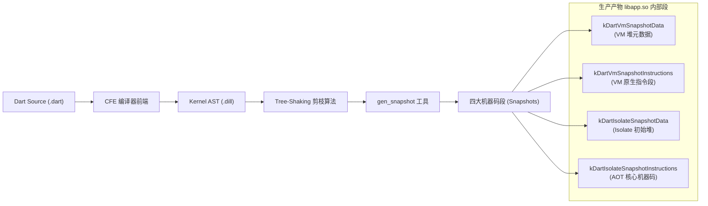

# 高级-Dart编译模式JIT与AOT及底层虚拟机DDC与Snapshot

Dart 语言之所以能够在移动端（iOS / Android）、桌面端（macOS / Windows / Linux）以及 Web 端展现出跨全平台的极致适配力，其根本原因在于其拥有一套高度分层、兼顾开发期极致热重载敏捷度与生产期原生级性能的**编译器与底层运行时架构**。

在高级与资深架构师面试中，面试官经常以“为什么 Flutter 可以在几百毫秒内完成热重载，而在发布时又能达到原生 C++ 级的运行速度？”为由头，顺藤摸瓜考察：**JIT 与 AOT 的物理编译流水线、Kernel AST (`.dill`) 中间表示层、`gen_snapshot` 的机器码生成原理、以及为什么 AOT 必须绝对封杀 `dart:mirrors` 反射？**

---

## 1. 核心底层机制与全景架构

### 1.1 双双轮驱动：JIT 与 AOT 的物理对比

Dart VM 设计了两种截然不同的运行模式：

```mermaid
graph TD
    subgraph Dev_JIT["开发模式 (JIT - Just In Time)"]
        Src1["Dart 源码"] --> CFE1["CFE (Common Front End)"]
        CFE1 --> Dill1["Kernel AST (.dill) 字节码"]
        Dill1 --> VM1["Dart VM 解释器 / JIT 动态编译器"]
        VM1 --> Machine1["运行时动态编译为机器码 (支持 Hot Reload)"]
    end

    subgraph Prod_AOT["生产模式 (AOT - Ahead Of Time)"]
        Src2["Dart 源码"] --> CFE2["CFE (Common Front End)"]
        CFE2 --> Dill2["Kernel AST (.dill)"]
        Dill2 --> GenSnap["gen_snapshot 静态编译器"]
        GenSnap --> NativeLib["原生机器码 (ELF / Mach-O / libapp.so)"]
    end
```



| 维度对比 | JIT 开发模式（Debug） | AOT 生产模式（Release / Profile） |
| :--- | :--- | :--- |
| **编译时机** | 边运行边解释/编译（Just-in-Time） | 静态打包时全量预编译为原生机器码（Ahead-of-Time） |
| **运行容器** | 包含完整的 Dart VM 解释器、类型推断器与调试探针 | 仅包含极精简的 AOT Runtime，无编译器，无 JIT 开销 |
| **开发体验** | **支持亚秒级有状态热重载（Hot Reload）** | 必须全量编译打包，耗时数分钟 |
| **运行性能** | 存在冷启动编译与解释开销，帧率不稳定 | **冷启动极快，执行效率接近纯原生 C/C++** |
| **产物形态** | 内置 Kernel Snapshot 字节码 | 原生动态链接库（Android 为 `libapp.so`，iOS 为 `App.framework`） |

### 1.2 Web 端的双轨编译：DDC 与 dart2js

在 Web 生态中，Dart 同样延续了双编译器设计：
- **DDC (Dart Dev Compiler)**：面向开发调试阶段，利用模块化增量编译技术，支持 Chrome 开发者工具内的源码映射（Source Map）与高速刷新。
- **dart2js**：面向生产发布，将所有 Dart 源码全量分析并压缩（Minified）为高精简的单个 JavaScript 文件，执行深度的死代码剔除（Dead Code Elimination）。

---

## 2. 源码级/算法物理推导

### 2.1 编译流水线与 Snapshot（快照）底层演化

Dart VM 启动时为了避免从头逐行词法解析源码，将内存堆状态序列化为二进制快照（Snapshot）：



### 2.2 Tree-Shaking 静态剪枝算法与反射禁令

为什么 Flutter 生产模式编译（AOT）能将几十兆的代码压缩到极小？其底层依赖基于可达性分析的 **Tree-Shaking（摇树优化）**：
1. **构建调用图谱（Call Graph）**：编译器从主入口 `main()` 出发，通过静态控制流分析（Static Control Flow Analysis），将所有直接和间接被引用的类、方法、字段标记为“活着（Alive）”。
2. **死代码全量剥离**：未被标记的代码节点（如引用的第三方库中 80% 未使用的功能）从编译图中彻底连根拔除，绝不打包进最终的机器码二进制中。

#### 为什么 AOT 模式下坚决禁用 `dart:mirrors`（反射）？
```dart
// 伪代码：如果允许反射
void invokeAny(String className, String methodName) {
  ClassMirror cm = reflectClassByName(className);
  cm.invoke(Symbol(methodName), []);
}
```
由于反射的存在，代码可以在**运行时通过任意动态字符串拼接**调用任意类与函数。如果保留反射，编译器静态阶段根本无法断定哪些代码“永远不会被调用”，导致 **Tree-Shaking 算法彻底失效**，AOT 必须将所有依赖项的全部代码原封不动打包进二进制文件，包体积和内存将呈数量级暴增！

---

## 3. 社招/阶段必考高频硬核连环追问

### 追问 1：为什么在 Debug 模式下测试出来的 FPS 掉帧、启动卡顿数据，在大厂技术评审中被视为“无效数据”？

> **答辩深度闭环**：
> 1. **断言检查开销（Assert Overhead）**：Debug 模式下，框架层内成千上万条 `assert(...)` 校验代码全量生效（如布局边界检查、类型安全断言），每一帧都有数万次条件判定。
> 2. **类型检查与调试探针**：开启了完整的运行时类型检查（Runtime Type Checks）、断点调试服务（Observatory / VM Service）以及未优化的 JIT 解释器。
> 3. **Profile 模式才是唯一基准**：评估性能（帧率、CPU、内存）必须使用 `--profile` 模式。Profile 模式采用与 Release 完全一致的 AOT 原生机器码编译，关闭了所有断言，仅保留最小化的 Tracing 探针以连接 DevTools，其指标才具备真实的生产参考价值。

---

### 追问 2：什么是 Kernel Snapshot (`.dill` 文件)？它在热重载过程中起到了什么桥梁作用？

> **答辩深度闭环**：
> 1. **中间表示标准（IR）**：Kernel AST 是 Dart 官方统一的抽象语法树二进制格式。它将上层的语法糖、空安全解析、泛型具体化全部固化为紧凑的字节码格式，是 CFE 前端与后端 VM / AOT 的交界语言。
> 2. **热重载增量计算**：当开发者在 IDE 中修改代码按 Command+S 时，本机的 `frontend_server`（CFE）仅比对变更的源码，编译出极其小巧的**增量补丁（Kernel Delta `.dill`）**。
> 3. **极速注入**：增量 `.dill` 仅有几十 KB，通过 VM Service 端口瞬间通过 Socket 发送给手机端的 Dart VM，VM 在内存中动态合并 AST 并触发类元数据更新，从而实现 500ms 内的极速有状态热重载。

---

### 追问 3：Dart 3 引入了宏编程（Macros）的实验特性，它与传统代码生成（`build_runner`）有何本质区别？

> **答辩深度闭环**：
> 1. **阶段前移**：`build_runner` 是一个独立的外部进程，需要在编译前扫描全工程并生成静态的 `.g.dart` 物理文件，大型项目中一次代码生成耗时数分钟，极其笨重。
> 2. **编译器原生管道集成**：Dart 3 Macros 直接内嵌在 CFE（Common Front End）编译管线中，在内存中完成 AST 分析并动态注入新的类结构与方法，无需在磁盘上生成中间文件。
> 3. **既要又要**：它兼具了“反射编写的灵活性（如 `@JsonCodable` 一行注解完成序列化）”与“AOT 静态编译与 Tree-Shaking 极高效率”，是未来彻底替代 `dart:mirrors` 与 `build_runner` 的终极架构方案。

---

## 4. 生产级避坑指南与排障 SOP

### 4.1 生产级 AOT 混淆与符号表剥离实战

在 Android / iOS 发布上线时，为了防止应用被逆向工程反编译并进一步缩减体积，必须开启 AOT 符号混淆：

```bash
# 生产环境编译命令 (启用混淆与符号表剥离)
flutter build apk --release \
  --obfuscate \
  --split-debug-info=./build/symbols
```

#### 关键参数解析：
1. `--obfuscate`：通知 `gen_snapshot` 将所有的类名、方法名、字段名重命名为无语义的 `a`, `b`, `c`。
2. `--split-debug-info=./build/symbols`：**极其重要！** 将机器码与符号调试信息剥离，符号表单独保存在 `./build/symbols` 目录中。这不仅使生成的 `libapp.so` 减小约 15%~25% 的体积，更避免了将符号暴露给逆向破解者。

### 4.2 线上混淆崩溃堆栈还原 SOP

当线上 APM 捕获到一段满是十六进制内存偏移地址的混淆堆栈时：

```
*** *** *** *** *** *** *** *** *** *** *** *** *** *** *** ***
pid: 0, tid: 0 >>> app.package.name <<<
backtrace:
  #00 pc 000000000042a1b4 libapp.so
  #01 pc 0000000000438cf8 libapp.so
```

#### 符号化还原命令：
```bash
# 使用 flutter 官方符号化工具将内存偏移还原为具体 dart 文件和行号
flutter symbolize \
  --symbols=./build/symbols/app.android-arm64.symbols \
  --input=./crash_trace.txt

# 还原后输出：
# #00 parseOrderData (package:my_app/order/order_service.dart:142:15)
# #01 checkoutFlow (package:my_app/checkout/checkout_page.dart:88:9)
```
> [!IMPORTANT]
> 必须对每一次发版的 `symbols` 目录进行企业级版本化归档与持久化备份（如上传到内部内部符号表私服或 Sentry / 阿里云平台）。若该版本 symbols 文件丢失，该版本的混淆崩溃堆栈将永久无法逆向还原。
