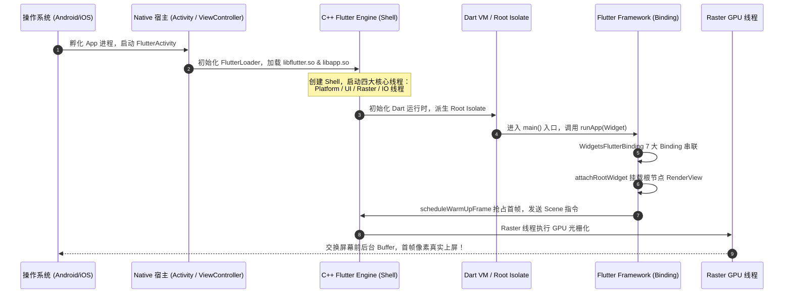
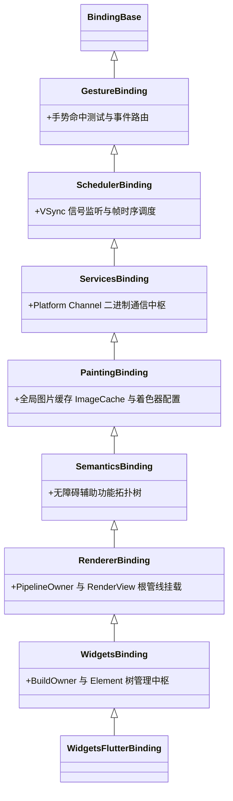

# 高级-Flutter启动全时序从Native引导到首帧RenderView挂载

在移动开发领域，应用的**首屏启动性能（Time to First Interactive / TTFI）** 是用户体验的生命线。从用户手指点击桌面应用图标，到手机屏幕上呈现出第一帧完整的业务 UI，中间跨越了操作系统底层进程孵化、动态链接库加载、C++ Engine 引擎引导、四线程架构启动、Dart VM 运行时初始化、核心 7 大 Binding 装载，直到根节点 `RenderView` 挂载与抢占式管线刷新。

在大厂社招中，掌握这一端到端的完整全链路时序，是衡量候选人是否具备架构级 APM 性能监控排查与混合工程秒开调优能力的黄金标尺。

---

## 1. 核心底层机制与全景架构

### 1.1 Flutter 跨层级启动全链路时序图谱



### 1.2 Flutter C++ 核心四线程架构

Engine 启动后，在底层物理创建了四个专属用途的线程，分工极为严苛：

| 线程名称 | 物理承载职责 | 核心通信与协作机制 |
| :--- | :--- | :--- |
| **Platform 线程** | 运行宿主原生主线程（如 Android UI Thread）。负责处理原生生命周期、平台通道（Platform Channel）、接收系统输入事件。 | 通过 `BinaryMessenger` 与 Dart UI 线程异步中继。 |
| **UI 线程 (Dart)** | 运行 Dart Root Isolate。执行 Widget 构建、RenderTree 布局（Layout）与绘制指令生成（Paint），构建 Layer Tree。 | 将生成的 `LayerTree` 打包为 `Scene` 提交给 Raster 线程。 |
| **Raster 线程 (GPU)** | 以前称为 GPU 线程。负责消费 UI 线程生成的 `Scene`，调用底层的 Skia / Impeller API 将指令转换为具体的 GPU 绘图命令并提交给硬件。 | 绝不能被任何耗时计算阻塞，否则直接引发整屏掉帧。 |
| **IO 线程** | 负责耗时的资源读取、解压缩，尤其是**纹理上传与图片解压缓存**。 | 在后台生成 GPU 共享纹理 Context，准备完毕后直接交接给 Raster 线程使用。 |

---

## 2. 源码级/算法物理推导

### 2.1 WidgetsFlutterBinding 的 7 大 Binding 链式装载

在执行 `runApp()` 时，首行逻辑即是单例初始化 `WidgetsFlutterBinding`：

```dart
void runApp(Widget app) {
  final WidgetsBinding binding = WidgetsFlutterBinding.ensureInitialized();
  binding.scheduleAttachRootWidget(app);
  binding.scheduleWarmUpFrame();
}
```

`WidgetsFlutterBinding` 是一个组合了 7 大核心 Binding 的终极单例类，采用 Dart 的 `mixin` 线性链式装载：



### 2.2 runApp 与 scheduleWarmUpFrame 抢占物理帧推导

#### `WidgetsBinding.attachRootWidget` 挂载过程：
```dart
void scheduleAttachRootWidget(Widget rootWidget) {
  attachRootWidget(rootWidget);
}

void attachRootWidget(Widget rootWidget) {
  final bool isInitialFrame = rootElement == null;
  if (isInitialFrame) {
    // 1. 创建 Element 树与 RenderObject 树的交接根节点
    rootElement = RenderObjectToWidgetAdapter<RenderBox>(
      container: renderView, // 挂载到 RendererBinding 的根 RenderView
      debugShortDescription: '[root]',
      child: rootWidget,
    ).attachToRenderTree(buildOwner!, rootElement as RenderObjectToWidgetElement<RenderBox>?);
  } else {
    rootElement!.newWidget = rootWidget;
  }
}
```

#### 为什么是 `scheduleWarmUpFrame()` 而不是普通的 `scheduleFrame()`？
- `scheduleFrame()` 仅仅是向 VSync 信号注册回调，需要**被动等待下一个硬件垂直同步信号**（通常需要等待 0~16.6ms）。
- **`scheduleWarmUpFrame()` 物理抢占**：在首帧启动时，时间分秒必争！`scheduleWarmUpFrame` 强行无视 VSync 等待，立即在当前微任务中主动触发 `handleBeginFrame()` 和 `handleDrawFrame()`，将整棵树的构建、布局、绘制以最快速度塞满管道，抢在系统下一次 VSync 信号到来时瞬间完成 GPU 提交！

---

## 3. 社招/阶段必考高频硬核连环追问

### 追问 1：为什么在 `main()` 函数中如果有异步初始化代码（如 `await Firebase.initializeApp()`），必须显式先调用 `WidgetsFlutterBinding.ensureInitialized()`？

> **答辩深度闭环**：
> 1. **默认装载时机**：在常规流程中，`WidgetsFlutterBinding` 是在 `runApp()` 的第一行隐式初始化的。
> 2. **异步通道前置依赖**：如果在 `runApp()` 之前调用了包含原生插件调用的异步方法（如 `Firebase.initializeApp()`、`PackageInfo.fromPlatform()`、`SharedPreferences.getInstance()`），底层需要通过 `ServicesBinding` 的 `BinaryMessenger` 向 Native 宿主发送跨进程/跨平台消息。
> 3. **崩溃原因**：如果没有提前初始化，`ServicesBinding.instance` 为 `null`，导致底层无法捕获系统平台消息，抛出致命的 `AssertionError: The "instance" getter on ServicesBinding must be called after initialization`。
> 4. **规范防线**：任何在 `main()` 中包含 `await` 插件调用的场景，首行代码必须无条件声明 `WidgetsFlutterBinding.ensureInitialized()`。

---

### 追问 2：冷启动阶段从原生点击到首帧展示，通常会出现瞬间的“白屏”或“黑屏”，其物理成因是什么？如何达到 0 毫秒无缝过渡？

> **答辩深度闭环**：
> 1. **物理成因**：Android 系统的 `Window` 默认拥有纯白或透明背景。从 Activity 启动，到 C++ 加载 `libapp.so`，再到 Dart 完成首帧绘制，中间存在约 200~600ms 的计算时间差。在首帧 `Surface` 准备好之前，屏幕显示的是宿主 Window 的默认背景色。
> 2. **生产级解决方案（Native Splash Screen 同步）**：
>    - **Android 侧**：在 `styles.xml` 中为 `LaunchTheme` 配置 `android:windowBackground`，设置为 App 的品牌启动图 Drawable。
>    - **视图层过渡**：使用 `flutter_native_splash` 或自定义 `SplashScreenProvider`，让 Android 原生窗口显示启动图，直到 Flutter 框架层首帧 `RenderView` 绘制完毕并通过通道通知原生隐藏 Splash View，实现无缝连贯的像素级过渡。

---

### 追问 3：在混合开发（Add-to-App）架构中，每次打开一个 Flutter 页面如果都重新创建一次 `FlutterEngine`，会引发什么后果？如何破解？

> **答辩深度闭环**：
> 1. **开销剧烈**：单个 `FlutterEngine` 实例的创建需要初始化 Dart VM、四线程以及分配独立的显存 Context，冷启动时间长达 300~800ms，且每个引擎额外吞噬约 30MB+ 的常驻内存。如果多页面多引擎独立创建，不仅页面打开出现严重白屏卡顿，更会导致内存极速耗尽 OOM。
> 2. **破解架构**：
>    - **Engine 预热与单例池化（FlutterEngineCache）**：在 Application 启动时提前 `prewarm` 预热并缓存一个全局共享的 `FlutterEngine`，页面打开时直接秒开 attach。
>    - **FlutterBoost 多栈复用架构**：基于单引擎架构，多原生 Activity 共享同一个 Flutter 引擎与底层渲染 Surface，通过虚拟导航栈切换路由。

---

## 4. 生产级避坑指南与排障 SOP

### 4.1 生产级 Engine 预热与极速秒开实战（Android Native 侧）

```kotlin
// Android Application 启动阶段提前预热 Flutter 引擎
class MyApplication : Application() {
    companion object {
        const val ENGINE_ID = "prewarmed_main_engine"
    }

    override fun onCreate() {
        super.onCreate()
        // 1. 实例化 FlutterEngine 并指定入口
        val flutterEngine = FlutterEngine(this)
        flutterEngine.dartExecutor.executeDartEntrypoint(
            DartExecutor.DartEntrypoint.createDefault()
        )

        // 2. 注入全局缓存池中备用
        FlutterEngineCache.getInstance().put(ENGINE_ID, flutterEngine)
    }
}

// 目标 FlutterActivity 继承并复用预热引擎 (实现 0ms 闪电秒开)
class MainActivity : FlutterActivity() {
    override fun getCachedEngineId(): String? {
        return MyApplication.ENGINE_ID
    }

    override fun shouldDestroyEngineWithHost(): Boolean {
        return false // 页面退出时严禁销毁共享引擎！
    }
}
```

### 4.2 首帧冷启动耗时打点追踪 SOP

精确评估启动各阶段毫秒级开销的规范实践：

```dart
import 'dart:developer';
import 'package:flutter/material.dart';

void main() {
  Timeline.startSync('WidgetsBinding_Init');
  WidgetsFlutterBinding.ensureInitialized();
  Timeline.finishSync();

  Timeline.startSync('Heavy_Preload');
  // 执行必要的高优先级本地配置读取...
  Timeline.finishSync();

  runApp(const MyApp());
}

class MyApp extends StatefulWidget {
  const MyApp({Key? key}) : super(key: key);

  @override
  State<MyApp> createState() => _MyAppState();
}

class _MyAppState extends State<MyApp> {
  @override
  void initState() {
    super.initState();
    // 监听首帧渲染完成上屏回调
    WidgetsBinding.instance.addPostFrameCallback((_) {
      // 此时第一帧已完成光栅化并送往 GPU
      Timeline.instantSync('FIRST_FRAME_RENDERED');
    });
  }

  @override
  Widget build(BuildContext context) {
    return const MaterialApp(home: Scaffold(body: Center(child: Text("Home"))));
  }
}
```

```bash
# 抓取 Profile 模式下的启动 Systrace / Perfetto 日志
flutter run --profile --trace-startup
```
启动完成后，在工程目录 `build/start_up_info.json` 中可直接读取：
- `engineEnterTimestampMicros`：Engine 初始化耗时
- `timeToFirstFrameMicros`：**首帧上屏真实耗时**（核心监控 KPI）。
