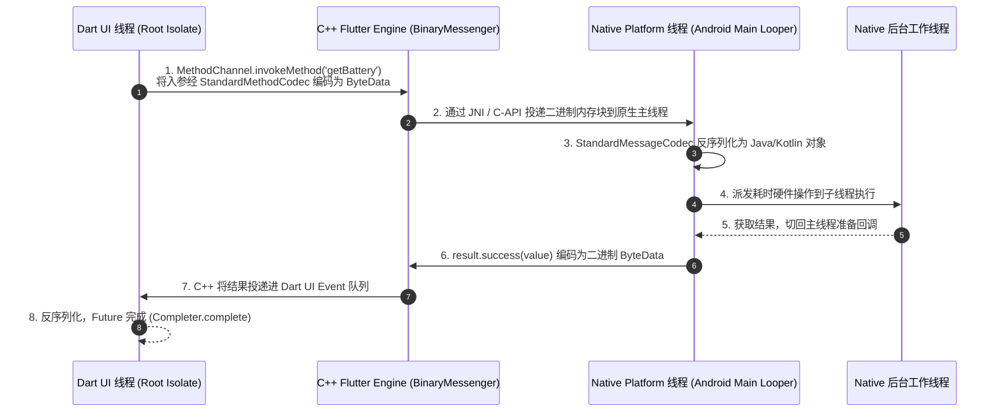

# 高级-原生平台通道PlatformChannel编解码源码与二进制流

在混合移动应用与跨平台工程落地中，Flutter 无论如何强大，都无法脱离底层操作系统的原生能力（如相机硬件调优、蓝牙低功耗通信、深度传感器、系统级安全加密芯片硬件访问、以及已有成熟的原生 SDK 接入）。Flutter 与宿主平台（Android / iOS / macOS / Windows）之间实现功能联通的生命线，就是 **平台通道（Platform Channel）**。

在高级/资深架构师社招面试中，只知晓使用 `MethodChannel.invokeMethod` 属于初级水平。面试官将从底层协议栈与内存流向维度发起多维连环拷问：**Platform Channel 的底层四层通信拓扑是什么？`StandardMessageCodec` 的大端序（Big-Endian）二进制序列化算法如何推导？为什么高频相机视频流绝不能走 MethodChannel？如何在原生后台线程中安全回调 Dart？**

---

## 1. 核心底层机制与全景架构

### 1.1 Platform Channel 三大通道物理选型

Flutter 官方基于底层的统一二进制信使（`BinaryMessenger`），封装了三种针对不同业务形态的上层通道：

| 通道名称 | 核心特征与物理语义 | 典型生产业务场景 |
| :--- | :--- | :--- |
| **`MethodChannel`** | **双向异步 RPC**（单次请求 - 单次响应）。Dart 发起方法调用，原生执行完毕后通过 `Result` 异步回调返回结果。 | 微信/支付宝 SDK 支付调起、设备硬件信息查询、检查权限状态。 |
| **`EventChannel`** | **单向持续数据流**（Stream）。Dart 订阅事件，Native 持续向其喷射无界数据流。 | 陀螺仪/加速度传感器数据持续上报、GPS 位置持续跟踪、电量与网络状态监听。 |
| **`BasicMessageChannel`** | **全双工自定义消息通道**。支持无类型的半结构化数据交互，允许自定义专用的高性能编解码器（如 JSON、String、二进制）。 | 简单跨端字符串透传、混合栈跨端广播通知、自研二进制协议通信。 |

### 1.2 跨进程/跨线程物理分发拓扑图



---

## 2. 源码级/算法物理推导

### 2.1 StandardMessageCodec 大端序二进制协议推导

Platform Channel 之所以拥有高效率，核心在于其自定义的紧凑型二进制编解码器 `StandardMessageCodec`。它绝不是把数据转成臃肿低效的 JSON 文本，而是直接读写内存中的原始字节（Raw Bytes）。

#### 类型标识头（Type Tag Header）：
序列化时，每个字段的第一个字节代表其数据类型常量（大端序写入）：
- `0`：`null`
- `1`：`true`
- `2`：`false`
- `3`：32位整型（`Int32`，占 4 字节）
- `4`：64位整型（`Int64`，占 8 字节）
- `6`：64位双精度浮点（`Float64`，占 8 字节）
- `7`：字符串（`String`，先写 UTF-8 长度，再写字节体）
- `8`：字节数组（`Uint8List`）
- `12`：数组列表（`List`，先写元素个数，再递归写每个元素）
- `13`：键值对映射（`Map`，先写对数，再成对写入 Key 和 Value）

#### 源码逻辑切片（Dart 侧）：
```dart
class StandardMessageCodec implements MessageCodec<dynamic> {
  static const int _valueNull = 0;
  static const int _valueTrue = 1;
  static const int _valueInt32 = 3;
  static const int _valueString = 7;

  @override
  ByteData? encodeMessage(dynamic message) {
    if (message == null) return null;
    final WriteBuffer buffer = WriteBuffer();
    writeValue(buffer, message);
    return buffer.done();
  }

  void writeValue(WriteBuffer buffer, dynamic value) {
    if (value == null) {
      buffer.putUint8(_valueNull);
    } else if (value is bool) {
      buffer.putUint8(value ? _valueTrue : _valueFalse);
    } else if (value is int) {
      // 依据数值大小选择 32 位或 64 位整型大端序存储
      buffer.putUint8(_valueInt32);
      buffer.putInt32(value);
    } else if (value is String) {
      buffer.putUint8(_valueString);
      final Uint8List bytes = utf8.encoder.convert(value);
      writeSize(buffer, bytes.length); // 写入紧凑长度
      buffer.putUint8List(bytes);
    }
    // ... 递归写入容器
  }
}
```

---

## 3. 社招/阶段必考高频硬核连环追问

### 追问 1：Platform Channel 通信是同步的还是异步的？为什么 Dart 侧必须返回 `Future`？能否实现真正的跨端“同步调用”？

> **答辩深度闭环**：
> 1. **全链路异步性**：Platform Channel 底层是**严格异步**的。Dart 代码运行在 Dart UI 线程，而原生代码通常运行在原生主线程（Android UI Thread / iOS Main Queue）。两个线程通过 C++ Engine 进行跨线程消息投递，其通信本质是“发送消息并排入对方的事件循环中等待调度”，因此 Dart 端必须以 `Future` 接收结果，绝不会阻塞当前 UI 线程。
> 2. **实现同步调用的唯一物理路径（Dart FFI）**：如果业务必须在 Dart 侧毫秒级同步获取 C/C++ 或 Native 内存数据（例如音频 DSP 采样、同步获取高精时间戳），绝对不能使用 Platform Channel，而必须使用 **Dart FFI（Foreign Function Interface）**。FFI 允许 Dart 线程直接跳转执行 C 导出符号的汇编指令，实现零延迟、零线程切换的真正同步调用。

---

### 追问 2：高频大数据传输（例如每秒 60 帧的 1080P 相机 YUV 原始视频流）能不能直接走 MethodChannel？为什么？

> **答辩深度闭环**：
> 1. **严禁走通道**：绝对不能走 MethodChannel！
> 2. **三次物理内存拷贝与主线程雪崩**：
>    - 1080P 原始 YUV 图像单帧约 3MB，60FPS 意味着每秒产生 180MB 原始数据！
>    - 走 MethodChannel 需要经历：原生内存 -> C++ 内存拷贝 -> 序列化为 ByteData -> 投递到 Dart 内存反序列化。每秒高达数百兆的跨线程内存拷贝，将直接把 Native 主线程和 Dart UI 线程活活“噎死”，CPU 瞬间满载 100%，内存极速泄露。
> 3. **生产级根治方案（Texture 共享外接纹理）**：使用 Flutter 的 **`Texture`（外接纹理）** 机制。原生相机在后台线程直接将 YUV 图像写入 OpenGL / Vulkan / Metal 的 GPU 纹理或 `SurfaceTexture`，然后仅仅将一个 64 位整型的 `textureId` 传递给 Flutter。Flutter 的 `Texture(textureId: id)` 直接让 GPU 合成器在硬件层面渲染对应纹理，**全链路零 CPU 内存拷贝（Zero-Copy）**！

---

### 追问 3：在原生 Native 侧的子线程（Background Thread）中执行完耗时任务后，直接调用 `result.success()` 为什么会导致严重崩溃？

> **答辩深度闭环**：
> 1. **线程安全断言约束**：在 Android 平台中，`MethodChannel.Result` 内部强依赖 `FlutterJNI` 与 Android 主线程 Handler。如果直接在子线程调用 `result.success()`，底层会触发线程安全断言异常：`Methods marked with @UiThread must be executed on the main thread`。
> 2. **规范解法**：在 Native 侧，必须使用 Handler（Android）或 `DispatchQueue.main.async`（iOS）将执行结果抛回主线程后再调用 `result.success()`：
>    ```kotlin
>    // Android Kotlin 规范回调
>    val mainHandler = Handler(Looper.getMainLooper())
>    thread {
>        val data = doHeavyWork()
>        mainHandler.post {
>            result.success(data) // 安全切回主线程回调
>        }
>    }
>    ```

---

## 4. 生产级避坑指南与排障 SOP

### 4.1 生产级 Platform Channel 双端标准化工程范式

#### 1. Flutter Dart 侧封装（健壮防御）
```dart
class DeviceChannelService {
  static const MethodChannel _channel = MethodChannel('com.tech.enterprise/device');

  static Future<int> getBatteryLevel() async {
    try {
      final dynamic result = await _channel.invokeMethod('getBatteryLevel', {
        'timestamp': DateTime.now().millisecondsSinceEpoch,
      });
      return (result as int?) ?? -1;
    } on PlatformException catch (e) {
      debugPrint('获取电量失败: code=${e.code}, msg=${e.message}');
      return -1;
    } on MissingPluginException {
      debugPrint('原生未实现对应通道');
      return -1;
    }
  }
}
```

#### 2. Android Kotlin 侧宿主规范实现
```kotlin
class DeviceChannelPlugin(binding: FlutterPlugin.FlutterPluginBinding) : MethodChannel.MethodCallHandler {
    private val channel = MethodChannel(binding.binaryMessenger, "com.tech.enterprise/device")
    private val context = binding.applicationContext

    init {
        channel.setMethodCallHandler(this)
    }

    override fun onMethodCall(call: MethodCall, result: MethodChannel.Result) {
        when (call.method) {
            "getBatteryLevel" -> {
                // 安全获取入参
                val timestamp = call.argument<Long>("timestamp")
                val batteryManager = context.getSystemService(Context.BATTERY_SERVICE) as BatteryManager
                val level = batteryManager.getIntProperty(BatteryManager.BATTERY_PROPERTY_CAPACITY)
                
                if (level >= 0) {
                    result.success(level)
                } else {
                    result.error("UNAVAILABLE", "Battery level not available.", null)
                }
            }
            else -> result.notImplemented()
        }
    }

    fun destroy() {
        channel.setMethodCallHandler(null) // 及时解绑防泄露
    }
}
```

### 4.2 通道通信排查 SOP 与常见 Crash 消除

| 异常现象 | 物理根因 | 生产排查与根治 SOP |
| :--- | :--- | :--- |
| **`MissingPluginException(No implementation found for method ...)`** | 1. Channel Name 拼写不一致。<br/>2. Native 侧未在 `configureFlutterEngine` 中注册 Plugin。<br/>3. Hot Restart 之后原生单例未重新绑定。 | 1. 严格使用常量统一声明 Channel Name。<br/>2. 检查 `FlutterEngineCache` 初始化时是否调用了 `GeneratedPluginRegistrant.registerWith(engine)`。 |
| **`IllegalArgumentException: Unknown type ...`** | 传参包含了 `StandardMessageCodec` 无法识别的自定义 Class 对象。 | 传参必须转为 `Map<String, Object?>` 或 `List<Object?>` 等基础集合结构，不可直接传输自定义复杂对象。 |
| **`NullPointerException` 在 Native 退出时触发** | 原生页面已销毁，异步任务返回后依然向已废弃的 Channel 回调 `result.success()`。 | 在 Native 生命周期 `onDestroy` 中调用 `channel.setMethodCallHandler(null)`，并在回调前进行安全判空。 |
