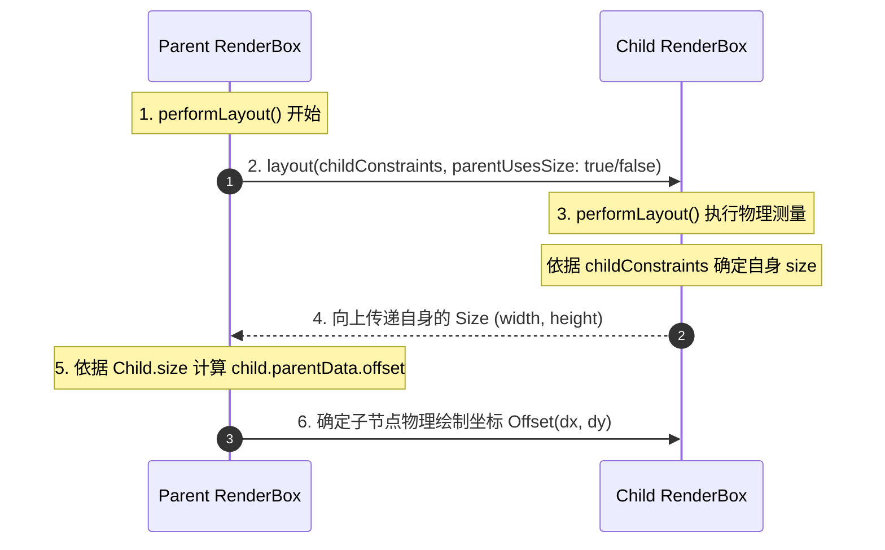
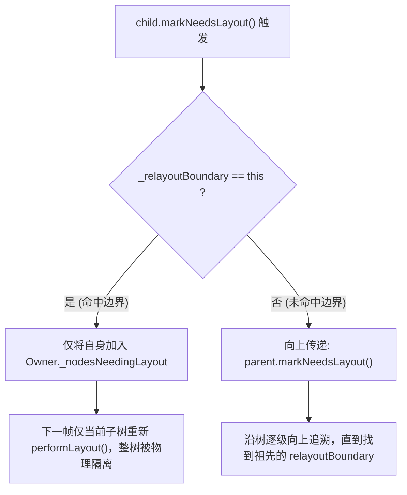

# 高级-布局核心Constraints物理传递向下约束向上确定尺寸

在 Flutter 面试与工程深水区中，布局机制是考察候选人是否真正掌握 Flutter 底层渲染管道的第一道分水岭。经典名言 **“Constraints go down. Sizes go up. Parent sets position.”（向下传递约束，向上传递尺寸，由父节点决定子节点位置）** 人尽皆知，但能够从 `RenderBox.performLayout` 源码物理执行流、紧约束（Tight）与松约束（Loose）数学边界、`relayoutBoundary` 重布局边界判定算法以及极端布局陷阱（Unbounded Height/Width）层面进行端到端闭环推导的工程师凤毛麟角。

---

## 1. 核心底层机制与全景架构

### 1.1 Flutter 布局协议三部曲

Flutter 放弃了传统浏览器（HTML/CSS）与原生平台（如 Android 传统 View 树）复杂的多轮回溯协商与加权测量算法（如 Android `measure` + `layout` 多次 pass），采用了极其严苛高效的 **单次遍历线性布局（One-pass O(N) Layout）**。



### 1.2 约束的分类与数学定义

在 `BoxConstraints` 中，所有的布局约束由 4 个浮点数定义：
$$\text{BoxConstraints}(minWidth, maxWidth, minHeight, maxHeight)$$

| 约束类型 | 数学条件 | 典型组件与行为 |
| :--- | :--- | :--- |
| **紧约束 (Tight)** | $minWidth == maxWidth$ 且 $minHeight == maxHeight$ | `SizedBox.expand`、`Container(width: 100, height: 100)`。子节点无任何尺寸选择权，强制等于父级限定尺寸。 |
| **松约束 (Loose)** | $minWidth == 0.0$ 且 $minHeight == 0.0$ | `Center`、`Align`、`UnconstrainedBox` 的 child。子节点可在 $0 \le size \le max$ 范围内任意决定自身大小。 |
| **有界约束 (Bounded)** | $maxWidth < \infty$ 且 $maxHeight < \infty$ | 普通窗口、固定尺寸父卡片。尺寸计算有明确安全边界。 |
| **无界约束 (Unbounded)** | $maxWidth == \infty$ 或 $maxHeight == \infty$ | `Row` 主轴宽度为 $\infty$，`Column` / `ListView` 主轴高度为 $\infty$。子节点若贪婪扩展（如 `Container()` 没设尺寸）将直接引爆崩溃。 |

---

## 2. 源码级/算法物理推导

### 2.1 RenderBox.layout 执行流程与 relayoutBoundary 边界判定算法

当父 RenderObject 调用 `child.layout(constraints, {bool parentUsesSize = false})` 时，系统底层通过极其精密的脏标记与拓扑隔离机制，避免整棵树的全局级联重布局。

#### `RenderObject.layout` 源码逻辑还原：
```dart
void layout(Constraints constraints, { bool parentUsesSize = false }) {
  RenderObject? relayoutBoundary;
  
  // 1. 判定是否为重布局边界 relayoutBoundary
  if (!parentUsesSize || 
      sizedByParent || 
      constraints.isTight || 
      parent is! RenderObject) {
    // 自身成为新的重布局边界，阻断向上传播
    relayoutBoundary = this;
  } else {
    // 必须依赖父节点，继承父节点的重布局边界
    relayoutBoundary = (parent! as RenderObject)._relayoutBoundary;
  }

  // 2. 如果自身没有标记为脏，且约束未改变，直接命中缓存跳过
  if (!_needsLayout && constraints == _constraints && relayoutBoundary == _relayoutBoundary) {
    return;
  }

  _constraints = constraints;
  _relayoutBoundary = relayoutBoundary;

  // 3. 区分是否仅由父级约束即可完全决定尺寸 (sizedByParent 优化分支)
  if (sizedByParent) {
    try {
      performResize(); // 仅计算尺寸，不递归子节点
    } catch (e, stack) {
      _reportException('performResize', e, stack);
    }
  }

  // 4. 执行核心测量与子节点遍历
  RenderObject? debugPreviousActiveLayout;
  try {
    performLayout();
    _needsLayout = false;
    markNeedsPaint(); // 尺寸变动必然伴随重绘标记
  } catch (e, stack) {
    _reportException('performLayout', e, stack);
  }
}
```

### 2.2 relayoutBoundary 四大触发定理

子节点在满足以下任意一条规则时，其 `_relayoutBoundary` 都会被锁定为自身（`this`）：
1. **`!parentUsesSize`**：父节点在调用 `child.layout` 时声明不需要感知子节点的 `Size`（例如只负责容纳展示，位置不依赖子节点尺寸）。子节点哪怕频繁改变大小，父节点也无需重新布局。
2. **`sizedByParent == true`**：RenderObject 自身声明 `size` 仅由输入的 `constraints` 决定，与子节点的尺寸完全无关（如 `RenderDecoratedBox`、`RenderTransform`）。此时重布局被截断在当前节点。
3. **`constraints.isTight`**：父级传递下来的是绝对紧约束（如宽高固死），子节点再怎么折腾也无法突破该外壳尺寸，因此父节点无需重算。
4. **`parent is! RenderObject`**：该节点是整棵树的根节点（如 `RenderView`）。



---

## 3. 社招/阶段必考高频硬核连环追问

### 追问 1：为什么在 Container 外面包裹了一个 Container(width: 100, height: 100)，里面的 Container(width: 50, height: 50) 依然显示为 100x100？

> **答辩深度闭环**：
> 1. **约束强制性**：外层 `Container(width: 100, height: 100)` 经过解析后，其底层的 `RenderConstrainedBox` 会向下发射一个紧约束 `BoxConstraints.tight(Size(100, 100))`（即 `minWidth=100, maxWidth=100, minHeight=100, maxHeight=100`）。
> 2. **无松绑机制**：子级 `Container(width: 50, height: 50)` 接收到该约束。根据 Flutter 布局定理，子节点计算出的最终尺寸必须严格落在父级约束范围之内：
>    $$\text{finalWidth} = \text{clamp}(50, minWidth=100, maxWidth=100) = 100$$
> 3. **解决方案**：必须在两层之间引入一个能够 **“松绑约束（Relax Constraints）”** 并提供对齐规则的中间组件，如 `Center` 或 `Align`。`Center` 接收到 100x100 紧约束后，会向下传递 `BoxConstraints.loose(Size(100, 100))`（$0 \le w \le 100, 0 \le h \le 100$），允许子节点将尺寸收缩为 50x50，并由 `Center` 计算偏移将其居中摆放。

---

### 追问 2：Row 嵌套 Row 或者 Column 嵌套 ListView 报 `Vertical viewport was given unbounded height` 的物理本质是什么？

> **答辩深度闭环**：
> 1. **无界碰撞**：`Column` 默认在垂直主轴上向子节点传递高度为无限大的约束：`BoxConstraints(minHeight: 0, maxHeight: double.infinity)`。
> 2. **视口滚动死锁**：`ListView`（底层的 `RenderViewport`）是一个沿主轴无限延展的滚动视口。当它接收到 `maxHeight: double.infinity` 时，它无法确定自身应该截断在屏幕多高位置以提供滑动交互。
> 3. **断言拦截**：`RenderViewport.performLayout` 在进入布局循环前，会执行严苛的安全断言：
>    ```dart
>    assert(constraints.hasBoundedHeight, 'Vertical viewport was given unbounded height.');
>    ```
>    由于 `maxHeight` 为 $\infty$，条件不成立，直接抛出 `FlutterError`。
> 4. **修复解法**：
>    - 使用 `Expanded` 或 `Flexible`：将无界约束转化为有界约束（由 `Column` 减去固定子组件高度后剩余的确定高度）。
>    - 设置 `shrinkWrap: true` 配合 `physics: NeverScrollableScrollPhysics()`：强制 `ListView` 放弃无限延展，转而将所有子 Element 提前全部测算完毕并向上传递真实内容总高度（但会丧失 Sliver 虚拟化懒加载性能，慎用）。

---

### 追问 3：`LayoutBuilder` 是如何实现在运行时感知父级约束的？它与普通的 Widget 布局有何本质不同？

> **答辩深度闭环**：
> 1. **延迟子树构建（Deferred Build）**：普通 Widget 的 `build` 方法发生在布局阶段之前，此时没有任何尺寸和约束信息。而 `LayoutBuilder` 对应底层的 `RenderConstrainedLayoutBuilder`。
> 2. **打破常规生命周期**：在布局阶段，父级调用 `RenderConstrainedLayoutBuilder.performLayout()` 时，它已经拿到了父级下发的准确 `constraints`。此时它会调用 `invokeLayoutCallback`，**在布局阶段反向触发 Element 树的构建过程**：
>    ```dart
>    void performLayout() {
>      final BoxConstraints constraints = this.constraints;
>      rebuildWithConstraints(constraints); // 触发 builder 回调
>      if (child != null) {
>        child!.layout(constraints, parentUsesSize: true);
>        size = constraints.constrain(child!.size);
>      } else {
>        size = constraints.biggest;
>      }
>    }
>    ```
> 3. **性能代价**：`LayoutBuilder` 强制打破了“先 Build 后 Layout”的单向渲染流水线，如果内部包含极其复杂的子树或在高频动画中被滥用，会造成局部布局与构建震荡，带来掉帧风险。

---

## 4. 生产级避坑指南与排障 SOP

### 4.1 生产级崩溃：A RenderFlex overflowed by xxx pixels

```
══╡ EXCEPTION CAUGHT BY RENDERING LIBRARY ╞═════════════════════════════════════════════════════════
The following assertion was thrown during layout:
A RenderFlex overflowed by 38.5 pixels on the right.
The relevant error-causing widget was:
  Row inside OrderCardWidget
════════════════════════════════════════════════════════════════════════════════════════════════════
```

#### 排障定位与修复 SOP：
1. **源码审查定位**：检查溢出轴上的文本或容器是否未加自适应保护。
   ```dart
   // ❌ 错误示范：商品名称超长时必然引爆黄色斑马线溢出警告
   Row(
     children: [
       Icon(Icons.shopping_cart),
       Text(order.veryLongProductName), // 宽度无法收缩，超出屏幕
       Text("¥${order.price}"),
     ],
   )
   ```
2. **规范修复范式**：必须通过 `Expanded` 或 `Flexible(fit: FlexFit.loose)` 截断宽度传递，配合 `TextOverflow.ellipsis`：
   ```dart
   // ✅ 生产级规范写法
   Row(
     children: [
       const Icon(Icons.shopping_cart),
       Expanded(
         child: Text(
           order.veryLongProductName,
           maxLines: 1,
           overflow: TextOverflow.ellipsis,
         ),
       ),
       const SizedBox(width: 8),
       Text("¥${order.price}", style: const TextStyle(fontWeight: FontWeight.bold)),
     ],
   )
   ```

### 4.2 Flutter DevTools 布局检查实战

当遇到诡异的尺寸不匹配或无限约束异常时，利用命令行和 DevTools 快速排查：

```bash
# 1. 开启布局调试边界高亮 (在 main.dart 中注入)
import 'package:flutter/rendering.dart';
void main() {
  debugPaintSizeEnabled = true; // 绘制每个 RenderBox 的尺寸边框与基准线
  debugPaintPointersEnabled = true; // 绘制触摸命中区域
  runApp(const MyApp());
}

# 2. 运行 DevTools 查看 RenderTree
flutter pub global activate devtools
flutter run -d chrome --profile
```

在 DevTools 的 **Flutter Inspector** 面板中：
- 观察 **Widget Details Tree** 旁边的 **Render Object Constraints**：确认输入的 `Min/Max Width/Height`。
- 查看 **Layout Explorer**：图形化动态调整 `flex` 分配并直接预览溢出点。
