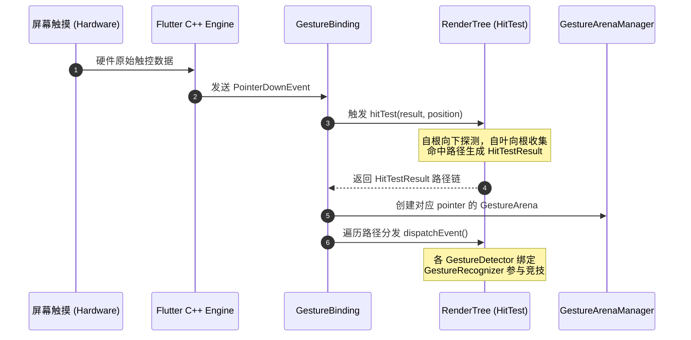
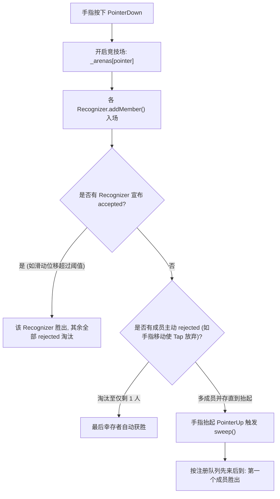

# 高级-手势竞技场GestureArena机制与多手势滑动冲突解决

在移动应用交互中，手势处理的流畅度直接决定了产品的触控体验质感。从底层手指触摸屏幕产生的原始硬件电信号，到框架层的 `PointerEvent`，再到高阶的 `GestureRecognizer` 和手势竞争裁决，Flutter 设计了一套高度抽象而精密的机制——**手势竞技场（Gesture Arena）**。

在大厂社招与高级/资深架构师面试中，面试官不仅考察基础的点击手势绑定，更会直击核心：**命中测试（Hit Testing）的遍历方向是什么？竞技场裁决胜出者的数学与状态机逻辑是什么？面对多重嵌套滑动冲突、同向滑动手势竞争以及“父子同时响应手势”的需求时，如何从源码底层进行破解？**

---

## 1. 核心底层机制与全景架构

### 1.1 从原始指针事件到语义化手势的两阶段分发

Flutter 的手势处理分为两个完全解耦的阶段：
1. **命中测试阶段（Hit Testing）**：自根节点（`RenderView`）向下递归遍历至叶子节点，按“自底向上（从叶子到祖先）”将所有命中的 `RenderBox` 收集到一个有序列表 `HitTestResult` 中。
2. **事件分发与竞技阶段（Event Dispatch & Gesture Arena）**：将指针事件按收集顺序依次派发给各 `RenderBox`。各节点的 `GestureRecognizer` 将自身注册进该指针专属的 `GestureArena` 中展开博弈竞争，胜者获取手势独占权并触发语义化回调（如 `onTap`、`onScale`、`onPanUpdate`）。



### 1.2 命中测试（HitTest）与 HitTestBehavior 物理语义

组件能否参与手势竞争，由 `RenderProxyBoxWithHitTestBehavior` 的 `HitTestBehavior` 决定：

| 行为模式 | 命中判断条件 | 穿透与阻断表现 |
| :--- | :--- | :--- |
| **`deferToChild` (默认)** | 仅当其子节点命中测试成功时才命中 | 如果子节点为空或点击了空白内边距，父节点直接判定未命中。 |
| **`opaque` (不透明)** | 只要点击坐标落在自身矩形区域内即命中 | 无论内部有无子组件，阻断该区域下方（Z 轴下方）所有同坐标组件的事件穿透。 |
| **`translucent` (半透明)** | 自身判定命中，**但同时允许向后传递** | 自身能响应手势，且 Z 轴下方的同坐标层级也能同时接收到命中测试判定。 |

---

## 2. 源码级/算法物理推导

### 2.1 GestureArenaManager 与裁决算法核心

当手指按下（`PointerDownEvent`）时，`GestureArenaManager` 会为该触控点 `pointer` 开启一个竞技场：

```dart
class GestureArenaManager {
  // 维护触控点 pointer -> 竞技场状态对象的映射
  final Map<int, _GestureArena> _arenas = <int, _GestureArena>{};

  // 1. 手势识别器入场
  GestureArenaEntry add(int pointer, GestureArenaMember member) {
    final _GestureArena state = _arenas.putIfAbsent(pointer, () {
      return _GestureArena();
    });
    state.add(member);
    return GestureArenaEntry._(this, pointer, member);
  }

  // 2. 识别器主动宣布接受（或胜出）
  void _resolve(int pointer, GestureArenaMember member, GestureDisposition disposition) {
    final _GestureArena? state = _arenas[pointer];
    if (state == null) return;

    if (disposition == GestureDisposition.rejected) {
      state.members.remove(member);
      member.rejectGesture(pointer);
      // 如果剔除后只剩最后一名成员，最后一名直接自动胜出！
      if (state.members.length == 1) {
        _tryToWin(pointer, state, state.members.first);
      }
    } else {
      // 成员宣布 accepted：直接赢得竞技场，其余成员全部出局！
      _tryToWin(pointer, state, member);
    }
  }

  // 3. 手指抬起时的强制结算 (Sweep)
  void sweep(int pointer) {
    final _GestureArena? state = _arenas[pointer];
    if (state == null) return;
    _arenas.remove(pointer);
    if (state.members.isNotEmpty) {
      // 默认判定第一个注册的识别器胜出（First-in Wins）
      state.members.first.acceptGesture(pointer);
      for (int i = 1; i < state.members.length; i++) {
        state.members[i].rejectGesture(pointer);
      }
    }
  }
}
```



---

## 3. 社招/阶段必考高频硬核连环追问

### 追问 1：在一个组件上同时绑定 `onTap` 和 `onDoubleTap`，点击一下时，`onTap` 会立即触发吗？为什么？

> **答辩深度闭环**：
> 1. **延迟仲裁（Delayed Resolution）**：不会立即触发。当手指第一次按下并抬起时，`TapGestureRecognizer` 想要宣布胜出，但竞技场中同时存在 `DoubleTapGestureRecognizer`。
> 2. **双击等待窗口**：`DoubleTapGestureRecognizer` 会向系统申请一个等待定时器（通常为 400ms）。在定时器到期前，`DoubleTap` 不会放弃竞争；
> 3. **结果判定**：如果用户在 400ms 内没有按第二次，定时器超时，`DoubleTapGestureRecognizer` 宣布 `rejectGesture`，此时唯一幸存的 `TapGestureRecognizer` 才被裁决胜出，`onTap` 随之回调。因此在绑定双击的情况下，单击响应会天然存在数百毫秒的感官延迟。

---

### 追问 2：为什么两个同向滑动的滚动视图（例如竖向 ListView 嵌套在竖向 ListView 中）默认无法实现平滑连贯的联动？

> **答辩深度闭环**：
> 1. **手势独占性**：外层和内层 `ListView` 内部都挂载了 `VerticalDragGestureRecognizer`。当用户在内层列表上竖向滑动时，两个 Recognizer 都接收到坐标位移。
> 2. **阈值抢占**：一旦滑动位移超过系统设定的最小滑动阈值（`kTouchSlop`，通常为 18 逻辑像素），某一个识别器会率先调用 `resolve(GestureDisposition.accepted)`，竞技场机制强制将另一个列表完全剔除（`rejectGesture`）。
> 3. **解决方案**：必须打破独立竞技场的默认阻断。在架构上通常采用 `NestedScrollView`（通过共享底层的 `ScrollCoordinator`，协调由内向外的滚动物理传递）或自定义 `ScrollPhysics` / `RawGestureDetector`。

---

### 追问 3：如何让父组件与子组件“同时”响应同一个点击事件（打破竞技场独占获胜规则）？

> **答辩深度闭环**：
> 1. **默认不可行**：传统的 `GestureDetector` 在某一层 `acceptGesture` 后，同链条上的其他识别器全部会被直接调用 `rejectGesture`。
> 2. **自定义 RawGestureDetector 破解方案**：重写自定义 `GestureRecognizer`，重写其 `rejectGesture` 方法，在被裁判判定“淘汰”时，强行不放弃执行，或者重写分发逻辑不独占退出：
>    ```dart
>    class AllWinTapGestureRecognizer extends TapGestureRecognizer {
>      @override
>      void rejectGesture(int pointer) {
>        // 核心黑魔法：即使被竞技场裁决淘汰，依然强行接受手势并触发回调！
>        acceptGesture(pointer);
>      }
>    }
>    ```
> 3. **监听器层级绕过**：或者直接在父级使用不受竞技场独占裁决影响的原始指针监听器 `Listener(onPointerDown: ...)`，在命中测试阶段即可捕获所有原始硬件点，直接绕开竞技场。

---

## 4. 生产级避坑指南与排障 SOP

### 4.1 生产级多手势滑动冲突解决实战（NestedScrollView 源码级封装）

#### 痛点场景：
页面顶部为折叠 Banner（可上滑折叠），下方为 `TabBarView` 包含多个 `ListView`。用户向上滑动内容时，常常出现“吸顶卡死”或“滑动错位、列表无法无缝滚动”。

```dart
// ✅ 生产级企业标准解决方案：NestedScrollView + SliverOverlapAbsorber
Widget buildSafeNestedScrollPage(BuildContext context) {
  return DefaultTabController(
    length: 2,
    child: NestedScrollView(
      headerSliverBuilder: (BuildContext context, bool innerBoxIsScrolled) {
        return <Widget>[
          SliverOverlapAbsorber(
            handle: NestedScrollView.sliverOverlapAbsorberHandleFor(context),
            sliver: SliverAppBar(
              title: const Text("个人主页"),
              pinned: true,
              expandedHeight: 200.0,
              forceElevated: innerBoxIsScrolled,
              bottom: const TabBar(
                tabs: [Tab(text: "动态"), Tab(text: "相册")],
              ),
            ),
          ),
        ];
      },
      body: TabBarView(
        children: [
          // 必须配合 SliverOverlapInjector 注入重叠尺寸，阻断手势位移死锁
          CustomScrollView(
            slivers: [
              SliverOverlapInjector(
                handle: NestedScrollView.sliverOverlapAbsorberHandleFor(context),
              ),
              SliverList(
                delegate: SliverChildBuilderDelegate(
                  (context, index) => ListTile(title: Text("动态卡片 #$index")),
                  childCount: 30,
                ),
              ),
            ],
          ),
          const Center(child: Text("相册列表")),
        ],
      ),
    ),
  );
}
```

### 4.2 诊断与手势追踪 SOP

当手势无法触发或莫名被吞噬时，使用以下排查命令与工具函数进行定位：

```dart
// 1. 打印手势竞技场裁决日志
import 'package:flutter/gestures.dart';

void main() {
  // 打印所有手势识别器的竞技胜负过程
  debugPrintGestureArenaDiagnostics = true;
  // 打印命中测试收集链
  debugPrintHitTestChildren = true;
  runApp(const MyApp());
}
```

#### 控制台输出诊断范例：
```
GestureArena 12 ---> Added TapGestureRecognizer#1234
GestureArena 12 ---> Added PanGestureRecognizer#5678
GestureArena 12 ---> Resolving: PanGestureRecognizer#5678 (accepted)
GestureArena 12 ---> PanGestureRecognizer#5678 won the arena!
GestureArena 12 ---> Rejecting: TapGestureRecognizer#1234
```
通过控制台输出可以秒级确定：哪个 Recognizer 抢先宣告了 `accepted`，导致你的点击或双击识别器被提早 `rejected`。
