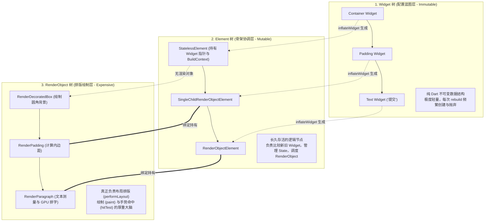
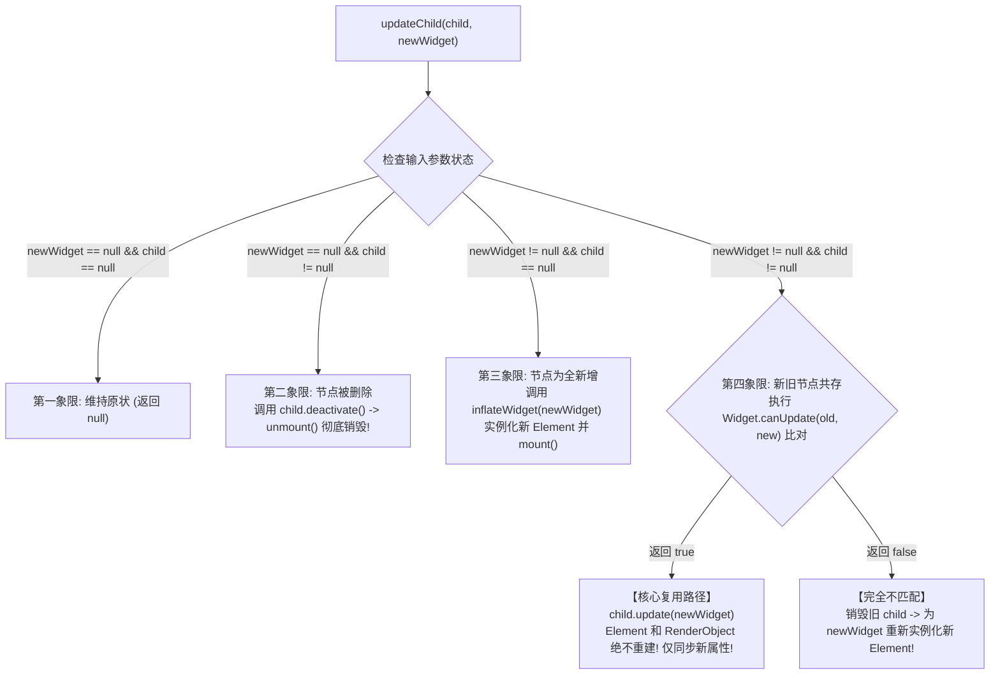

# 高级-渲染核心Widget-Element-RenderObject三棵树全生命周期

在跨平台 UI 渲染框架的设计演进中，Flutter 最为耀眼且最具革命性的内核架构，当属其**“三棵树（Three Trees）”协同渲染系统**。许多初级工程师常误以为屏幕上看到的按钮就是一个 Widget 实例。事实上，Widget 仅仅是一份轻如鸿毛的配置清单。真正支配着移动设备屏幕像素光栅化、手势命中测试与几何计算的，是背后错综复杂的 **`Element` 树**与 **`RenderObject` 树**。本篇专题从源码层面逐行推导三棵树的创建、智能更新（`updateChild` 四象限算法）与物理销毁时序。

---

## 一、核心底层机制与全景架构

### 1.1 三棵树全景物理拓扑与职责分工



---

### 1.2 三大核心基类职责与物理特性对比

| 核心实体 | 物理生命周期 | 内存开销 | 核心职责与设计哲学 |
| :--- | :--- | :--- | :--- |
| **`Widget`** | **极短（瞬时性）**。每次调用 `build()` 都会重新实例化 | **微乎其微（数十字节）**。只包含简单构造字段，由 GC 轻量级垃圾回收 | **不可变的配置蓝图（Configuration Blueprint）**。描述在特定参数下 UI 应该呈现的声明式结构 |
| **`Element`** | **长久存活**。只要节点未被从树中彻底移除，一直常驻内存 | **轻量（数百字节）**。管理其子 Element 数组及对应 RenderObject 指针 | **运行时的逻辑骨架（The Orchestrator）**。实现 `BuildContext`，持有 State，比较新旧 Widget，调度增量更新 |
| **`RenderObject`** | **长久存活**。复用率极高，仅在结构删除时才销毁 | **昂贵厚重（包含排版缓存、矩阵几何数据与图层）** | **真实的物理渲染图元（The Brain）**。严格执行微积分级别的约束传递、布局计算、绘制命令与命中测试 |

---

## 二、源码级/算法物理推导

### 2.1 `Element.updateChild` 四象限核心算法推导

当父组件执行 `rebuild()` 时，Flutter 并非无脑将所有子节点推倒重来，而是由抽象方法 **`Element.updateChild(Element? child, Widget? newWidget, ...)`** 依据四象限矩阵执行严密调度：



#### `Widget.canUpdate` 源码准则
```dart
static bool canUpdate(Widget oldWidget, Widget newWidget) {
  // 仅当类型完全相同且 Key 完全相同，才判定为可以原地复用！
  return oldWidget.runtimeType == newWidget.runtimeType
      && oldWidget.key == newWidget.key;
}
```

---

### 2.2 `ComponentElement` vs `RenderObjectElement` 物理继承差异

并非所有的 Element 都会对应一个真实的 RenderObject：
1. **组合型节点（`ComponentElement`）**：
   - 典型代表：`StatelessElement`、`StatefulElement`；
   - **特点**：它们在屏幕上**完全不可见**，不对应任何 RenderObject。它们的物理职责是包裹其他子组件，通过调用 `build()` 方法不断向下递归展开，直到展开为具体的图元。
2. **渲染型节点（`RenderObjectElement`）**：
   - 典型代表：`SingleChildRenderObjectElement`（对应 Padding、Align）、`MultiChildRenderObjectElement`（对应 Row、Column）；
   - **特点**：直接持有底层的 `RenderObject` 实例，负责在 `mount()` 时将 RenderObject 插入 RenderObject 树，在 `update()` 时将新 Widget 的属性同步给现存的 RenderObject。

---

## 三、社招高频硬核连环追问

### 追问 1：为什么 Flutter 必须设计成“三棵树”物理解耦架构？为什么不能像浏览器 DOM 树一样，把结构、属性和渲染合并成一棵树？
**标杆解答**：
1. **合并成一棵树的历史教训（浏览器 DOM 的沉重代价）**：
   - 原生浏览器 DOM 节点极其臃肿（一个普通的 `HTMLDivElement` 包含数百个原生属性和事件句柄）；
   - 只要用 JS 修改一个属性，浏览器就会重新遍历庞大沉重的 DOM 树执行样式重排与重绘，导致前端性能瓶颈；
2. **三棵树解耦的极致优势**：
   - **将“高频变动的部分”与“昂贵厚重构件”物理剥离**：
     - `Widget` 极度廉价（只有数据字段），允许开发者肆无忌惮地每秒创建数千次，完美支撑声明式编程的纯函数心智；
     - `RenderObject` 极度昂贵，通过中间层 `Element` 作为缓冲区进行智能 Diff 比对，**确保厚重的 RenderObject 实例长久存活、稳定复用**；
   - **架构分层清晰**：UI 声明、生命周期树形结构与底层渲染引擎各自独立演进，使得 Flutter 能极其轻松地支持多套风格基座（Material / Cupertino）与全平台（iOS/Android/Web/macOS/Windows）渲染移植。

---

### 追问 2：如果父组件调用了 `setState()`，它下方的某个子组件即使没有加 `const`，在什么微观条件下其底层的 `RenderObject` 可以绝对免于重新排版（Layout）和重绘（Paint）？
**标杆解答**：
1. **虽然 Widget 重新创建了，但 Element 成功命中复用**：
   - 子组件的 Widget 实例被重新创建，但由于其 `runtimeType` 与 `key` 保持不变，Element 树调用 `canUpdate` 返回 `true`，触发 `element.update(newWidget)`，**底层现存的 `RenderObject` 实例绝对不会被销毁重建**。
2. **脏标记短路保护机制（Dirty Flag Short-circuiting）**：
   - 在 `RenderObject.update()` 中，虽然新参数传递了过来，但如果新旧属性值完全相等（例如新旧 `padding: EdgeInsets.all(8)` 值相同）；
   - RenderObject 会直接判定无需更新，**绝对不会调用 `markNeedsLayout()` 或 `markNeedsPaint()`**；
   - 在当前帧的渲染流水线中，该 RenderObject 会被调度器直接跳过，**CPU 与 GPU 消耗为绝对的 0**！

---

### 追问 3：简述一个 Element 节点从 `deactivate` 到彻底 `unmount` 的垃圾回收时序。
**标杆解答**：
1. **脱离主树（Deactivation）**：
   - 当一个父节点重建不再包含该子节点时，框架调用 `child.deactivate()`，该 Element 节点及其全部子树被从活动主树中物理摘除；
   - 框架将其暂时推入全局的 `BuildOwner._inactiveElements` 临时待决列表；
2. **复活机会（Re-parenting Window）**：
   - 在当前同一帧渲染周期内，若该节点拥有 `GlobalKey`，且在树的另一处被重新插入，框架会从待决列表中将其提取出来重新挂载（`activate()`），避免销毁；
3. **最终处决（Unmount Phase）**：
   - 若在当前帧构建彻底结束时（`buildScope` 执行完毕），该节点仍然停留在 `_inactiveElements` 待决列表中；
   - 框架遍历待决列表，对每一个 Element 深度优先递归调用 **`unmount()`**；
   - `unmount()` 内部彻底切断与 RenderObject 的绑定、置空 State 引用，交由 Dart VM 垃圾回收器进行物理内存释放。

---

## 四、生产级避坑指南与排障 SOP

### 4.1 生产级通过代码验证三棵树各节点的物理内存地址变与不变

在日常开发中，许多人怀疑 `const` 是否真的起到了优化作用。可以通过如下调试代码，在控制台直观打印三棵树的实际内存 HashCode：

```dart
import 'package:flutter/material.dart';

class ThreeTreesVerificationScreen extends StatefulWidget {
  const ThreeTreesVerificationScreen({super.key});

  @override
  State<ThreeTreesVerificationScreen> createState() =>
      _ThreeTreesVerificationScreenState();
}

class _ThreeTreesVerificationScreenState
    extends State<ThreeTreesVerificationScreen> {
  int _counter = 0;

  @override
  Widget build(BuildContext context) {
    return Scaffold(
      appBar: AppBar(title: const Text('三棵树物理内存探秘')),
      body: Center(
        child: Column(
          mainAxisAlignment: MainAxisAlignment.center,
          children: [
            ElevatedButton(
              onPressed: () => setState(() => _counter++),
              child: Text('触发重绘: $_counter'),
            ),
            const SizedBox(height: 24),
            // 探针组件: 用于打印 Widget、Element、RenderObject 的实际物理指针 Hash
            const TreeProbeWidget(),
          ],
        ),
      ),
    );
  }
}

class TreeProbeWidget extends StatelessWidget {
  const TreeProbeWidget({super.key});

  @override
  Widget build(BuildContext context) {
    // 1. 获取当前 Widget 实例自身在内存中的哈希码
    final int widgetHash = identityHashCode(this);

    // 2. 获取当前 Element 实例在内存中的哈希码 (即 context 自身)
    final int elementHash = identityHashCode(context);

    // 3. 获取底层绑定的 RenderObject 实例在内存中的哈希码
    final renderObject = context.findRenderObject();
    final int renderObjectHash = identityHashCode(renderObject);

    debugPrint('----------------------------------------');
    debugPrint('Widget 实例内存 Hash:       $widgetHash');
    debugPrint('Element 实例内存 Hash:      $elementHash');
    debugPrint('RenderObject 实例内存 Hash: $renderObjectHash');
    debugPrint('----------------------------------------');

    return Container(
      padding: const EdgeInsets.all(16),
      color: const Color(0xFFEFF6FF),
      child: const Text('观察控制台日志输出'),
    );
  }
}
```

#### 控制台输出验证结论：
- 当在 `ThreeTreesVerificationScreen` 中连续点击按钮触发 `setState()` 时：
  - 如果 `TreeProbeWidget` 前加了 `const`：三者的 HashCode **完全恒定不变**（Element 彻底跳过 rebuild）；
  - 如果去掉 `const`：每次点击，`Widget` 的 HashCode 会**持续疯狂改变**（每次生成新对象），但 `Element` 和 `RenderObject` 的 HashCode **严格保持不变**！以铁证证明了底层渲染大脑的极致复用机制。
