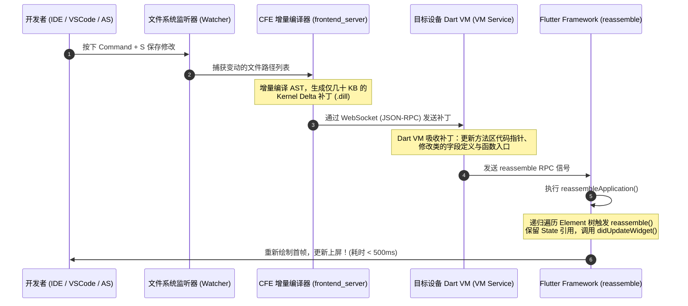
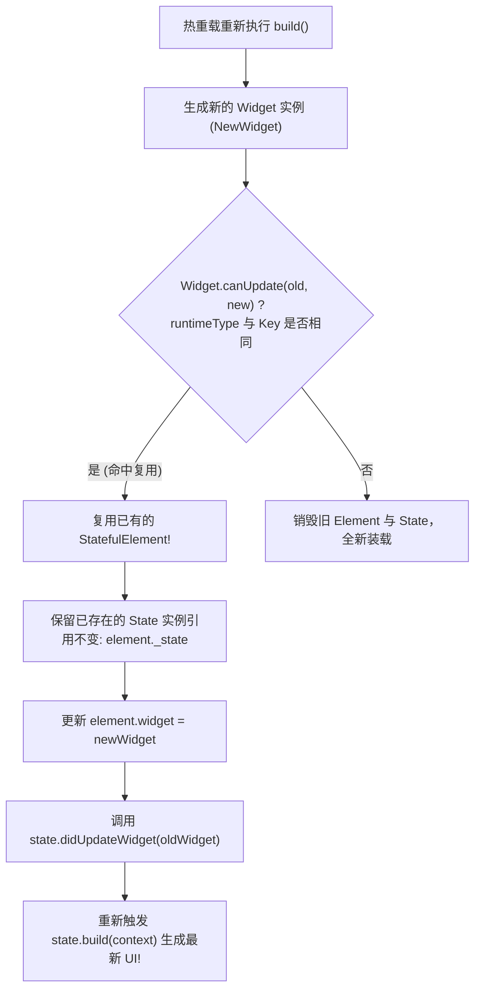

# 高级-热重载HotReload物理原理与状态保留机制源码推导

在所有现代跨平台移动开发框架中，Flutter 最具标志性且极大提升开发生产力的核心特性莫过于**亚秒级有状态热重载（Stateful Hot Reload）**。开发者在修改代码并按下保存后的 500 毫秒内，屏幕即可呈现最新 UI，同时**保留应用当前的页面导航栈、表单输入文字、滚动位置以及全部内存状态（State）**。

在高级/资深技术面试中，面试官绝不会仅仅问“热重载怎么用”，而是会深入计算机体系结构与运行时层面考核：**IDE、CFE 编译器前端、Dart VM 与 Flutter Framework 是如何四方联动的？Kernel Delta 增量文件是如何被 VM 吸收的？Element 树是如何做到“既更新了 UI 又保留了 State 引用”的？哪些代码修改会导致热重载失效？**

---

## 1. 核心底层机制与全景架构

### 1.1 热重载端到端全链路闭环时序

热重载不是魔法，而是编译器前端、网络 RPC 协议与运行时虚拟机高度协同的系统工程：



### 1.2 三种更新模式的本质区别

| 更新模式 | 快捷键 | 涉及阶段 | 状态保留表现 | 底层耗时 |
| :--- | :--- | :--- | :--- | :--- |
| **Hot Reload (热重载)** | `r` | 增量编译 Kernel Delta -> 注入 VM -> 触发 `reassemble` | **完全保留** 当前应用全部内存状态与路由栈 | 200ms ~ 600ms |
| **Hot Restart (热重启)** | `R` | 重置 Dart VM 堆栈 -> 重新加载 Snapshot -> 重跑 `main()` | **清空全部状态**，返回初始首屏，但无需重新编译 C++ 与 Native | 1s ~ 3s |
| **Full Rebuild (全量编译)** | 重新 Run | 重新打包 APK / IPA -> 重新安装并冷启动宿主进程 | 状态重置，重新初始化原生环境 | 30s ~ 数分钟 |

---

## 2. 源码级/算法物理推导

### 2.1 Dart VM 内存更新与类的重塑机制

当 Dart VM 接收到底层 Kernel Delta 二进制补丁后：
1. **代码指针重定向**：VM 遍历所有发生变更的类，将旧方法的机器码/字节码执行函数指针直接指向新编译的方法代码块。
2. **类的形状重塑（Class Reshaping）**：
   - 如果类中新增了方法或修改了方法实现，VM 动态更新其虚函数分发表（VTable）。
   - 如果新增了实例字段，VM 会重新调整该类在堆上的字段偏移布局。

### 2.2 Framework 树级重装配：reassemble 源码推导

VM 完成内存打补丁后，向 `WidgetsBinding` 发送全局重装配通知：

```dart
// WidgetsBinding 核心重装配流程
@override
Future<void> performReassemble() async {
  assert(refocus);
  // 1. 清空全局图片内存缓存，强制重新解析可能修改的本地 assets 资源
  PaintingBinding.instance.imageCache.clear();
  PaintingBinding.instance.imageCache.clearLiveImages();

  // 2. 递归遍历整棵 Element 树
  await super.performReassemble();

  // 3. 触发全量脏节点重走 Build、Layout、Paint 管线
  buildOwner!.reassemble(renderViewElement!);
}
```

#### 为什么 `State` 对象能够奇迹般地保留下来？
深入 `Element.updateChild` 与 `StatefulElement` 源码：

```dart
// Element 树更新判定定理
static bool canUpdate(Widget oldWidget, Widget newWidget) {
  return oldWidget.runtimeType == newWidget.runtimeType
      && oldWidget.key == newWidget.key;
}
```


**关键物理结论**：虽然 `Widget` 每次热重载都会被重新创建（轻量不可变配置），但底层的 `StatefulElement` 和挂载在它内部的 `State` 实例**根本没有被销毁或重新实例化**！因此内存里的业务数据得以原封不动地保留。

---

## 3. 社招/阶段必考高频硬核连环追问

### 追问 1：为什么修改了 `initState()` 里的代码，或者修改了全局静态变量 `static final int count = 10`，热重载后界面“完全没有更新”？

> **答辩深度闭环**：
> 1. **`initState()` 已过执行窗口**：根据生命周期，`initState()` 仅在 `StatefulElement` 挂载到树上时被调用**一次且仅此一次**。热重载时触发的是 `reassemble()` -> `didUpdateWidget()` -> `build()`，根本不会重新执行已经过去的历史生命周期 `initState()`。
> 2. **静态全局变量已常驻内存堆**：全局静态变量（`static final`）在 Dart VM 类初次加载时就已经完成了内存分配与赋值。热重载只更新代码执行体，绝不会去重置、覆盖或擦除已经常驻在 Dart 堆内存中的静态字段值。
> 3. **解决方案**：此类涉及生命周期初次初始化和全局变量修改的操作，必须使用 **Hot Restart（`R`）** 强制重置虚拟机堆。

---

### 追问 2：哪些代码层面的物理改动会导致热重载完全无法支持（Unsupported），并提示必须重启？

> **答辩深度闭环**：
> 1. **修改了枚举类型（`enum`）或改变其定义顺序**：会导致内部引用的索引表断裂。
> 2. **修改了通用泛型类型参数约束**：如 `class Box<T extends Num>` 改为 `class Box<T extends Object>`。
> 3. **修改了原生 Native 代码**：包括修改了 Android 的 `Java/Kotlin`、iOS 的 `ObjC/Swift` 代码或 `pubspec.yaml` 增删原生依赖库。这些代码运行在宿主 OS 层面，不归 Dart VM 管辖。
> 4. **修改了应用主入口 `main()` 函数**：由于 `main()` 仅在进程引导时执行，修改后的 `main` 无法被二次调度。

---

### 追问 3：在大型企业级应用中，如果在页面中写了死循环代码，然后保存触发了热重载，手机界面彻底卡死，此时该如何自救？

> **答辩深度闭环**：
> 1. **Event Loop 饿死**：如果新代码包含 `while(true)` 且在 `build()` 中被执行，Dart UI 线程的事件循环被永久死锁占据，任何后续的 Hot Reload RPC 指令都无法被 VM 调度执行。
> 2. **无法软重启**：此时无论是按 `r` 还是按 `R`，由于主线程无响应，IDE 会报 `Timed out waiting for application to respond`。
> 3. **唯一自救路径**：必须在终端或 IDE 中强制向宿主进程发送 `SIGKILL`（停止调试），修正死循环代码后，重新执行全量编译冷启动。

---

## 4. 生产级避坑指南与排障 SOP

### 4.1 reassemble 钩子在生产与调试中的妙用

在开发复杂业务页面时，我们可以利用 `reassemble` 生命周期钩子，实现在每次热重载时自动重置 Mock 数据或重新拉取调试配置：

```dart
class DebuggableOrderPageState extends State<DebuggableOrderPage> {
  late OrderMockData _mockData;

  @override
  void initState() {
    super.initState();
    _loadData();
  }

  void _loadData() {
    _mockData = OrderMockData.fetchLatestDebugConfig();
  }

  // ✅ 高级调试黑魔法：仅在热重载时被触发的生命周期！
  @override
  void reassemble() {
    super.reassemble();
    // 每次热重载保存时，自动重新加载本地调试配置，无需手动 Hot Restart
    setState(() {
      _loadData();
    });
  }

  @override
  Widget build(BuildContext context) {
    return Scaffold(
      appBar: AppBar(title: Text("调试订单: ${_mockData.orderNo}")),
      body: Center(child: Text("金额: ¥${_mockData.price}")),
    );
  }
}
```

### 4.2 热重载失效排障 SOP 与状态污染清理

当出现“明明改了代码但界面逻辑混乱不符合预期”时：
1. **第一步：判断改动类型**
   - 检查是否改动了 `initState`、构造函数参数默认值、全局 `static` 变量或 `enum`。如果是，立即执行 `Hot Restart`（按键盘大写 `R`）。
2. **第二步：排查热重载警告日志**
   - 查看控制台输出，是否有：
     ```
     Hot reload was rejected:
     'lib/page.dart': modified class has added/removed generic type parameters.
     ```
   - 出现该提示表明本次热重载已被 VM 强行拒绝。
3. **第三步：彻底清除编译缓存重新构建**
   ```bash
   # 当 CFE 增量编译器本地缓存异常损坏时执行
   flutter clean
   flutter pub get
   flutter run
   ```
