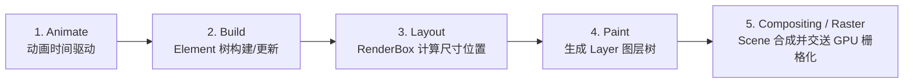
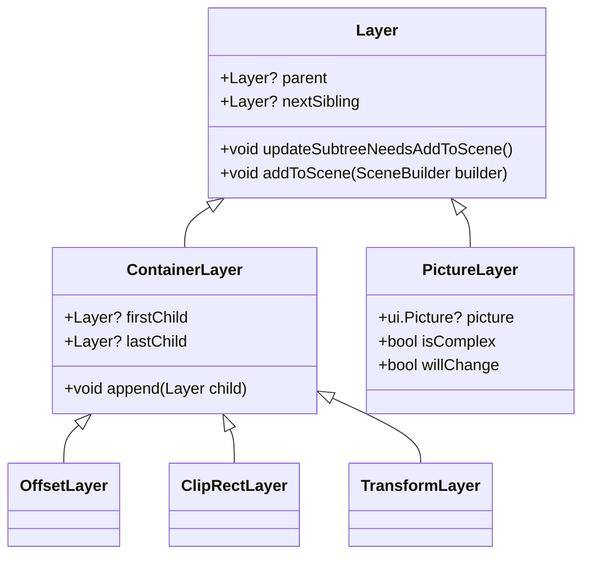
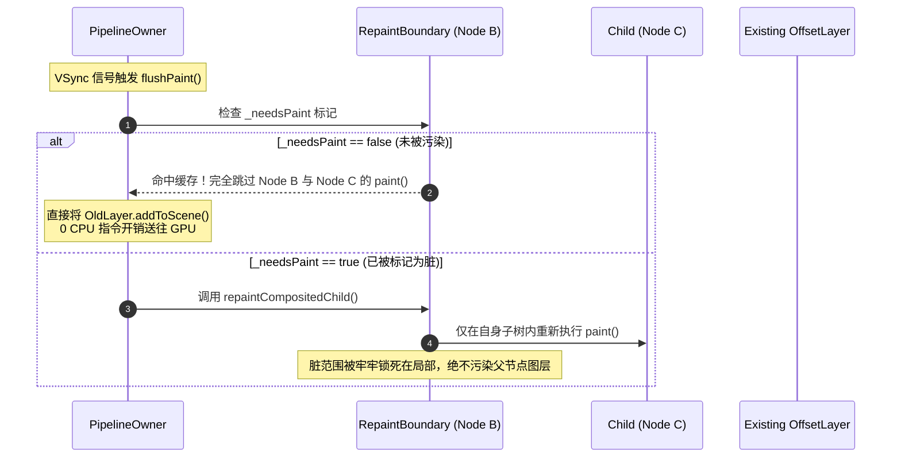

# 高级-绘制管道Layer图层树与RepaintBoundary重绘隔离

在 Flutter 高性能渲染体系中，**绘制管线（Render Pipeline）** 与 **图层树（Layer Tree）** 是衔接 Dart 框架层与 C++ 渲染引擎（Skia / Impeller）的核心桥梁。绝大多数初中级开发者往往只停留在“调用 `setState` 刷新 UI”的宏观认知，而在 60FPS / 120FPS 极致性能优化的社招面试中，面试官必考的深度往往落在：**`PaintingContext` 是如何构建图层树的？`isRepaintBoundary` 的图层复用算法底层机制是什么？如何运用 `RepaintBoundary` 规避全屏级联重绘导致的严重掉帧？**

---

## 1. 核心底层机制与全景架构

### 1.1 Flutter 经典渲染四阶段管线

每一帧硬件垂直同步信号（VSync）到来时，Flutter Engine 驱动整个管线严格按照以下四步单向推进：



### 1.2 三棵树之外的“第四棵树”：Layer 树

RenderObject 并不是直接把像素绘制到屏幕缓冲区的。它只负责生成绘图指令（Draw Commands），并将这些指令记录在 `Layer`（图层）中。



- **`ContainerLayer`**：图层容器节点，可以容纳多个子图层，管理层级矩阵、裁剪及透明度。
- **`OffsetLayer`**：带有偏移属性的基础容器，每一个 `RepaintBoundary` 都会拥有一个独立的 `OffsetLayer`。
- **`PictureLayer`**：叶子节点，真实包裹了底层 SkPicture / Impeller DrawCalls 的实体。

---

## 2. 源码级/算法物理推导

### 2.1 PaintingContext 与 RenderObject.paint 物理推导

当渲染管线推进到 Paint 阶段时，`RenderObject.paint(PaintingContext context, Offset offset)` 开始遍历执行。

#### `PaintingContext` 核心绘制与图层切分逻辑：
```dart
class PaintingContext extends ClipContext {
  // 当前正在记录指令的 Canvas
  ui.PictureRecorder? _recorder;
  Canvas? _canvas;

  // 核心：将子节点绘制到当前上下文，或切入独立 Layer
  void paintChild(RenderObject child, Offset offset) {
    // 1. 如果子节点是重绘边界 (isRepaintBoundary == true)
    if (child.isRepaintBoundary) {
      // 停止当前 Canvas 录制，将子节点推入独立的图层树分支
      stopRecordingIfNeeded();
      _compositeChild(child, offset);
    } else {
      // 2. 普通节点：直接将指令绘制到当前的共享 Canvas 上
      child.paint(this, offset);
    }
  }

  void _compositeChild(RenderObject child, Offset offset) {
    // 检查子节点的 Layer 是否需要重建
    if (child._needsPaint) {
      // 子节点脏了：创建新的 PaintingContext 重新录制 Picture
      repaintCompositedChild(child, debugAlsoPaintedParent: true);
    } else {
      // 子节点未脏：惊人优化！直接复用旧 Layer，完全跳过 child.paint()
      child._layer!.detach();
      appendLayer(child._layer!);
    }
    child._layer!.offset = offset;
  }
}
```

### 2.2 isRepaintBoundary 的图层复用算法

当某个 RenderObject 设置了 `isRepaintBoundary = true` 时，系统底层会为其分配专属的 `OffsetLayer`：



---

## 3. 社招/阶段必考高频硬核连环追问

### 追问 1：既然 `RepaintBoundary` 能隔离重绘提升帧率，为什么 Flutter 不默认给每一个 Widget 都加上它？

> **答辩深度闭环**：
> 1. **内存与显存翻倍（Memory Bloat）**：每一个独立的图层在合成器阶段都需要独立的纹理缓存与图层对象，过多的图层会导致移动设备显存（VRAM）和内存激增，甚至引发 OOM。
> 2. **光栅化合成负担（Compositing Overhead）**：当图层数量从几十个膨胀到几千个时，图层遍历、矩阵变换合并以及发送给 GPU 栅格化时的切换开销（Context Switch）将呈指数级增长，得不偿失。
> 3. **极小重绘代价无须隔离**：对于只有几个静态文字或小图标的简单区域，直接在一个 Canvas 上绘制的性能极高，引入 Layer 的创建与管理成本远大于绘制本身的收益。

---

### 追问 2：`RepaintBoundary` 除了性能优化，在业务功能层面还有哪些必不可少的物理级应用场景？

> **答辩深度闭环**：
> 1. **视图物理截屏（Widget to Image 导出）**：在实现长图分享、海报生成、局部截图功能时，必须通过 `GlobalKey` 获取对应的 `RenderRepaintBoundary`，调用其 `toImage(pixelRatio)` 方法将图层直接光栅化导出为二进制图片数据：
>    ```dart
>    RenderRepaintBoundary boundary = globalKey.currentContext!.findRenderObject() as RenderRepaintBoundary;
>    ui.Image image = await boundary.toImage(pixelRatio: 3.0);
>    ByteData? byteData = await image.toByteData(format: ui.ImageByteFormat.png);
>    ```
> 2. **外接原生纹理与复杂滤镜隔离**：当嵌套高开销的 `BackdropFilter`（高斯模糊）或混合渲染第三方原生地图/视频播放器（Platform View）时，利用边界隔离可切断像素滤镜对外部整体页面的渗透。

---

### 追问 3：在什么极端情况下，即使加了 `RepaintBoundary`，重绘隔离依然会“失效”？

> **答辩深度闭环**：
> 1. **尺寸或位置发生级联改变（Layout 联动）**：如果子组件在触发重绘的同时还改变了自身尺寸（调用了 `markNeedsLayout`），并且该子节点没有成为 `relayoutBoundary`，那么父节点就会被标记为脏并触发全局重新布局，重新布局必然附带强制整体重绘，使得重绘隔离形同虚设。
> 2. **父节点整体透明度/动画覆盖**：如果外层包裹了全局的 `Opacity` 动画或 `Matrix4` 缩放变换，父节点在每一帧都在改变自身传递给子树的变换矩阵，导致每帧必须整体重走 Layer 合成逻辑。

---

## 4. 生产级避坑指南与排障 SOP

### 4.1 生产级灾难案例：秒杀倒计时导致整个商品详情页 60Hz 全量重绘

#### 故障现场：
在商品详情页中，顶部有一个毫秒级变动的“限时秒杀倒计时”，导致整个页面在低端机上出现严重发热、卡顿掉帧，GPU 占用率高达 85%。

```dart
// ❌ 灾难代码：父组件直接 setState 或未隔离的 Timer
class BadDetailPageState extends State<BadDetailPage> {
  int _millisLeft = 100000;

  @override
  Widget build(BuildContext context) {
    return Column(
      children: [
        // 这一行每 16ms 改变一次，未加隔离，导致下方超长商品流每秒重绘 60 次！
        Text("剩余: $_millisLeft ms"), 
        ComplexProductBanner(),
        ComplexRichTextDescription(),
        UserReviewsList(),
      ],
    );
  }
}
```

#### 生产级 SOP 修复规范：
1. **下沉状态与重绘边界双重隔离**：
   ```dart
   // ✅ 生产级规范：将高频更新组件独立，并用 RepaintBoundary 物理阻断
   class SafeCountdownWidget extends StatelessWidget {
     const SafeCountdownWidget({Key? key}) : super(key: key);

     @override
     Widget build(BuildContext context) {
       return RepaintBoundary(
         child: ValueListenableBuilder<int>(
           valueListenable: countdownNotifier,
           builder: (context, value, child) {
             return Text("剩余: $value ms", style: const TextStyle(color: Colors.red));
           },
         ),
       );
     }
   }
   ```

### 4.2 线上重绘排查诊断命令与彩虹图

在开发和 Profile 阶段，通过以下诊断手段精准抓出隐蔽重绘源：

```dart
// 在 main.dart 中注入重绘彩虹模式
import 'package:flutter/rendering.dart';

void main() {
  // 核心利器：开启重绘彩虹边界！
  // 任何发生重绘的 RenderObject 边缘都会循环变换颜色（红->橙->黄->绿->蓝）
  // 如果某个静态组件区域的边框颜色在狂闪，说明正在发生严重的非必要重绘！
  debugRepaintRainbowEnabled = true;

  // 打印重绘命中日志到控制台
  debugProfilePaintsEnabled = true;

  runApp(const MyApp());
}
```

```bash
# 结合 Profile 模式精准分析 GPU Raster 耗时
flutter run --profile --trace-skia
```
在 DevTools 的 **Performance** 选项卡中，开启 **Highlight Repaints**，观察重绘矩形框的变动范围，确保动画区域的重绘线圈被严格封死在其组件内部。
