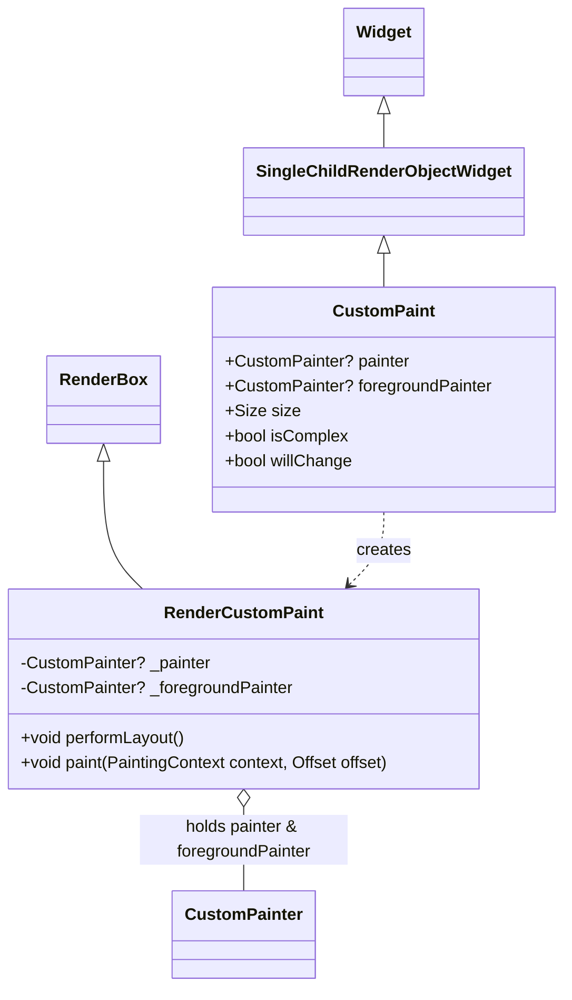
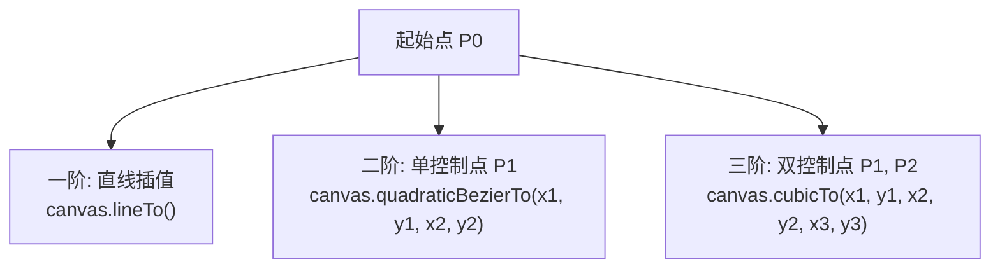

# 高级-自定义绘制CustomPainter与Canvas画笔贝塞尔曲线实战

在常规 Widget 组合无法满足复杂的金融图表、仪表盘、不规则形状剪裁（Clipper）以及高频流体波浪动画时，深入使用 **`CustomPainter`** 与 **`Canvas` 底层绘图 API** 是资深 Flutter 工程师的硬实力体现。

在大厂社招技术面试中，面试官不仅会要求你徒手推导一阶、二阶、三阶贝塞尔曲线（Bézier Curve）的数学方程与插值控制点，还会从底层绘制管线角度严厉考核：**`shouldRepaint` 的比对开销与脏标记传播机制、`canvas.save()` 与 `restore()` 图层状态栈的隔离原理、以及在 `paint()` 循环中高频创建临时对象导致的 GC 内存抖动排查与根治。**

---

## 1. 核心底层机制与全景架构

### 1.1 CustomPaint 与底层 RenderCustomPaint 关联架构

`CustomPaint` 并不是一个普通的 UI 容器，它对应底层的 `RenderCustomPaint`，负责挂载两个独立的画笔：`painter`（前景底色之间）和 `foregroundPainter`（最顶层遮罩）。



### 1.2 Canvas 坐标系与状态栈（State Stack）

Flutter `Canvas` 的原点 `(0, 0)` 默认锚定在当前组件左上角：
- 向右为 X 轴正方向，向下为 Y 轴正方向。
- **状态栈机制**：`canvas.save()` 会将当前的平移（Translate）、旋转（Rotate）、缩放（Scale）和裁剪（Clip）矩阵压入状态栈顶；`canvas.restore()` 则弹出栈顶状态，恢复到上一次保存时的基准矩阵，确保后续的绘制不会发生几何错位。

---

## 2. 源码级/算法物理推导

### 2.1 贝塞尔曲线（Bézier Curve）数学原理与 API 映射

在绘制流畅波浪和曲线图表时，贝塞尔曲线是核心几何工具：



#### 数学物理方程推导：
1. **二阶贝塞尔曲线（Quadratic Bézier）**：由起点 $P_0$、控制点 $P_1$、终点 $P_2$ 组成，时间参数 $t \in [0, 1]$：
   $$B(t) = (1-t)^2 P_0 + 2t(1-t) P_1 + t^2 P_2$$
   对应 API：`canvas.quadraticBezierTo(p1.x, p1.y, p2.x, p2.y)`。

2. **三阶贝塞尔曲线（Cubic Bézier）**：由起点 $P_0$、两个控制点 $P_1, P_2$、终点 $P_3$ 组成：
   $$B(t) = (1-t)^3 P_0 + 3t(1-t)^2 P_1 + 3t^2(1-t) P_2 + t^3 P_3$$
   对应 API：`canvas.cubicTo(p1.x, p1.y, p2.x, p2.y, p3.x, p3.y)`。常用于波峰和波谷连续平滑过渡的流体波纹动效。

### 2.2 shouldRepaint 的脏标记对比机制源码

```dart
// RenderCustomPaint.paint 内部执行逻辑
@override
void paint(PaintingContext context, Offset offset) {
  if (_painter != null) {
    _paintWithPainter(context.canvas, offset, _painter!);
  }
  super.paint(context, offset); // 绘制 child 子树
  if (_foregroundPainter != null) {
    _paintWithPainter(context.canvas, offset, _foregroundPainter!);
  }
}

void _paintWithPainter(Canvas canvas, Offset offset, CustomPainter painter) {
  // 1. 如果有平移，先变换坐标原点
  canvas.save();
  canvas.translate(offset.dx, offset.dy);
  // 2. 调用开发者编写的绘制指令
  painter.paint(canvas, size);
  canvas.restore();
}
```
当 Widget 发生 `rebuild` 重新传入新的 `CustomPainter` 时：
```dart
set painter(CustomPainter? newPainter) {
  if (_painter == newPainter) return;
  final CustomPainter? oldPainter = _painter;
  _painter = newPainter;
  // 核心判定：仅当 shouldRepaint 返回 true 时，才标记 markNeedsPaint()
  if (newPainter == null) {
    markNeedsPaint();
  } else if (oldPainter == null ||
             newPainter.runtimeType != oldPainter.runtimeType ||
             newPainter.shouldRepaint(oldPainter)) {
    markNeedsPaint();
  }
}
```

---

## 3. 社招/阶段必考高频硬核连环追问

### 追问 1：为什么在 `paint()` 方法中严禁直接执行 `final paint = Paint()` 或 `final path = Path()`？

> **答辩深度闭环**：
> 1. **内存抖动与高频 GC（GC Thrashing）**：`paint()` 方法在 60Hz/120Hz 动画渲染或滑动列表时，每秒被调用 60~120 次。
> 2. **堆内存碎片化**：如果在每次 `paint` 调用中都临时实例化大量的 `Paint`、`Path`、`Matrix4`、`Rect` 对象，会在短时间内在 Dart 新生代堆（Young Generation Nursery）中生成数十万个微型对象。
> 3. **丢帧停顿**：新生代内存空间瞬间被打满，高频触发 Dart VM 的 Scavenge GC。GC 阶段产生的 STW（Stop-The-World）微秒级挂起叠加在一起，直接造成 UI 界面不可挽回的掉帧和发热。
> 4. **最佳规范**：将 `Paint`、`Path`、复用矩阵全部作为 `CustomPainter` 的成员变量提前初始化，或者缓存复用，每次进入 `paint()` 仅调用 `path.reset()` 清空路径。

---

### 追问 2：`CustomPaint` 上的 `isComplex` 与 `willChange` 属性有什么物理意义？底层是如何影响 Skia/Impeller 栅格化缓存的？

> **答辩深度闭环**：
> 1. **`isComplex = true`**：向底层的渲染合成器明确声明该绘制极其繁重复杂（如包含数千条曲线、高斯模糊、复杂渐变）。Flutter Engine 会尝试将当前绘制结果作为位图缓存在 GPU 纹理缓存池中（Raster Cache），下次绘制若内容未变可直接复用纹理。
> 2. **`willChange = true`**：明确告诉渲染引擎当前绘制内容在每一帧都会发生改变（例如高频波浪动画、频谱图）。**引擎会因此直接禁用 Raster Cache 栅格化缓存**，避免“每帧写入缓存后立即废弃”带来的无谓内存分配与带宽浪费。

---

### 追问 3：如果 `shouldRepaint(covariant CustomPainter oldDelegate)` 盲目返回 `true` 会造成什么后果？如果盲目返回 `false` 呢？

> **答辩深度闭环**：
> 1. **全量无脑返回 `true`**：任何父级组件树的微小 `rebuild`（甚至无关兄弟组件的状态变化）都会强制导致该 `CustomPainter` 重新生成 Picture 指令，导致大量的 CPU 重绘开销。
> 2. **全量无脑返回 `false`**：当外部通过构造函数传入新的业务数据（如折线图新传入了股票最新点位），由于 `shouldRepaint` 返回 `false`，底层 `RenderCustomPaint` 不会调用 `markNeedsPaint()`，界面将直接处于假死和脏数据状态，UI 无法刷新。
> 3. **正确做法**：必须对所有参与绘制的关键属性（如进度、颜色、点位数组）进行逐一值对比或浅对比。

---

## 4. 生产级避坑指南与排障 SOP

### 4.1 生产级实战：零内存抖动动态波浪加载进度球

```dart
import 'dart:math' as math;
import 'package:flutter/material.dart';

class WaveProgressWidget extends StatefulWidget {
  final double progress; // 0.0 ~ 1.0
  const WaveProgressWidget({Key? key, required this.progress}) : super(key: key);

  @override
  State<WaveProgressWidget> createState() => _WaveProgressWidgetState();
}

class _WaveProgressWidgetState extends State<WaveProgressWidget>
    with SingleTickerProviderStateMixin {
  late AnimationController _animController;

  @override
  void initState() {
    super.initState();
    _animController = AnimationController(
      vsync: this,
      duration: const Duration(seconds: 2),
    )..repeat();
  }

  @override
  void dispose() {
    _animController.dispose();
    super.dispose();
  }

  @override
  Widget build(BuildContext context) {
    return AnimatedBuilder(
      animation: _animController,
      builder: (context, _) {
        return CustomPaint(
          size: const Size(160, 160),
          willChange: true, // 明确告知高频改变，禁用 GPU 光栅缓存
          painter: WavePainter(
            progress: widget.progress,
            wavePhase: _animController.value * 2 * math.pi,
          ),
        );
      },
    );
  }
}

class WavePainter extends CustomPainter {
  final double progress;
  final double wavePhase;

  // ✅ 生产级规范：将 Paint 和 Path 提前创建并复用，绝不在 paint 中 new！
  static final Paint _wavePaint = Paint()
    ..color = Colors.blue.withOpacity(0.6)
    ..style = PaintingStyle.fill;

  static final Paint _circleBorderPaint = Paint()
    ..color = Colors.blueAccent
    ..strokeWidth = 3.0
    ..style = PaintingStyle.stroke;

  static final Path _path = Path();

  WavePainter({required this.progress, required this.wavePhase});

  @override
  void paint(Canvas canvas, Size size) {
    final double radius = size.width / 2;
    final Offset center = Offset(radius, radius);

    // 1. 裁剪为圆形画布
    canvas.save();
    _path.reset();
    _path.addOval(Rect.fromCircle(center: center, radius: radius));
    canvas.clipPath(_path);

    // 2. 二阶/三阶正弦波模拟绘制
    _path.reset();
    final double waterLevel = size.height * (1.0 - progress);
    const double waveAmplitude = 10.0; // 振幅
    const double waveFrequency = 0.04; // 频率

    _path.moveTo(0, waterLevel);
    for (double x = 0; x <= size.width; x++) {
      final double y = waterLevel + math.sin(x * waveFrequency + wavePhase) * waveAmplitude;
      _path.lineTo(x, y);
    }
    _path.lineTo(size.width, size.height);
    _path.lineTo(0, size.height);
    _path.close();

    canvas.drawPath(_path, _wavePaint);
    canvas.restore(); // 恢复无裁剪状态

    // 3. 绘制外层装饰圆环
    canvas.drawCircle(center, radius, _circleBorderPaint);
  }

  @override
  bool shouldRepaint(covariant WavePainter oldDelegate) {
    return oldDelegate.progress != progress || oldDelegate.wavePhase != wavePhase;
  }
}
```

### 4.2 内存分配与 GC 抖动排查 SOP

在 DevTools 中精准抓出绘制循环中的高频分配点：
1. 启动 Profile 模式：`flutter run --profile`
2. 打开浏览器 DevTools，进入 **Memory** 选项卡。
3. 点击 **Record Allocations**，让动态绘制运行 10 秒后停止。
4. 过滤搜索 `dart.ui.Paint` 或 `dart.ui.Path`：
   - 观察 **Allocations Delta**（增量分配计数）。
   - 如果计数在 10 秒内增长上千次且大部分被 GC，顺藤摸瓜即可揪出没有抽离实例化的劣质自定义绘制代码。
