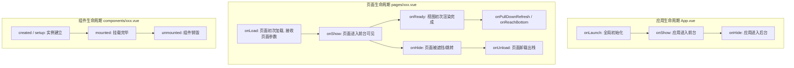

# Uni-App 核心架构与跨端开发体系

## 使用入口：先解决问题，再做验证

组织多端页面、配置与平台能力。

**先做基本操作**：先注册页面、配置路由和真机请求，验证生命周期和条件编译，再比较各端运行形态。初次学习可先完成[本模块基础实践](/doc/uniapp/页面开发登录与支付基本实践)。

**再逐步深入**：基本 API 与输入输出 → 常见失败和使用边界 → 场景排查与优化 → 本文机制分析与源码。面试先讲用途和自己的操作过程，再回答场景与原理追问。

## 🎯 核心技术原理与架构心智模型

在评估和使用 Uni-App 时，开发者最核心的疑问通常在于：
1. **“Uni-App 是如何在各个平台跑起来的？为什么小程序里不能操作 `window` 和 `document`？”**
2. **“为什么同样是 Vue 语法，Uni-App 的生命周期、组件和标准 Web 开发存在差异？”**
3. **“条件编译的底层原理是什么？它是如何在编译期剔除无用代码的？”**

---

## 一、 底层渲染架构：双线程模型与 uni-app x 演进

### 1. 经典双线程模型（小程序与 App-Vue 模式）

在传统的浏览器网页中，**UI 渲染线程**与 **JavaScript 引擎线程**是互斥的单线程执行模型。如果 JS 计算过重，会导致页面掉帧甚至假死。

为了安全隔离和管控，各大宿主环境（微信小程序等）以及 Uni-App 采用了**双线程架构（Double-Thread Architecture）**：

```text
┌───────────────────────────────────────┐
│        逻辑层 (Logic / Service)        │
│  - 运行在独立 JS 引擎 (JSCore / V8)    │
│  - 运行 Vue 响应式状态、Pinia、网络请求 │
│  - 无法直接访问 DOM/BOM (无 window)    │
└──────────────────┬────────────────────┘
                   │
                   │ JSON 序列化数据 (setData / Bridge 通信)
                   │
┌──────────────────▼────────────────────┐
│          视图层 (View / Webview)       │
│  - 运行 Webview 渲染引擎               │
│  - 负责真实 HTML/CSS 的绘制与交互      │
│  - 捕获用户手势事件，反向通知逻辑层    │
└───────────────────────────────────────┘
```

#### 双线程的核心特征：
* **DOM 隔离**：逻辑层与视图层完全物理隔离，逻辑层根本没有 `window`、`document`、`navigator` 对象。这也是为什么所有的 DOM 库（如 jQuery、标准 ECharts）不能在小程序中直接使用的根本原因。
* **通信成本**：任何视图的刷新，本质上是逻辑层将变化的数据通过 `JSON.stringify` 序列化，经过原生桥接（JSBridge）传递给视图层，再由视图层反序列化并驱动 Virtual DOM 做 Diff。**高频跨线程通信是移动端掉帧的罪魁祸首**。

### 2. 进化路线：uni-app x（UTS 原生直译）
为了解决 WebView 渲染管线的性能天花板，官方推出了 **uni-app x** 架构：
* **UTS 语言**：基于 TypeScript 扩展的原生语言。
* **零 JS 引擎开销**：在 Android 端直接直译为 **Kotlin** 代码编译为 DEX，在 iOS 端直译为 **Swift** 编译为二进制机器码，彻底舍弃了 WebView 和 JS 引擎。
* **渲染引擎**：原生端采用平台原生的控件排版与渲染管线，性能和原生开发完全一致。

---

## 二、 基础组件与统一 API 设计体系

### 1. 跨端标签映射法则

Uni-App 抛弃了传统 HTML 标签，采用小程序标准的组件规范：

| HTML 标签 | Uni-App 组件 | 特性说明 |
| :--- | :--- | :--- |
| `<div>`, `<section>` | `<view>` | 最基础的块级容器，支持 `hover-class` 点击态反馈。 |
| `<span>`, `<p>` | `<text>` | 行内元素。**注意：只有 text 组件内的文字才能长按选中（`selectable`）。** |
| `` | `<image>` | 默认具有固定宽高（320px * 240px），提供 `mode="aspectFill"` 等丰富的裁剪缩放模式。 |
| `<a>` | `<navigator>` | 声明式页面跳转，支持控制跳转类型（`navigate`, `redirect`, `switchTab`）。 |
| `<ul>`, `<li>` | `<scroll-view>` | 滚动视图容器，内置下拉刷新、触底加载、横向/竖向滚动支持。 |
| `<input>` | `<input>` | 映射到系统原生键盘控件，支持 `type="nickname"`、`confirm-type` 等特性。 |

### 2. 跨端 API 统一封装（`uni.xxx`）

为了抹平各大厂商小程序的 API 差异（微信 `wx.`、支付宝 `my.`、百度 `swan.`），Uni-App 进行了统一抽象：

```ts
// 1. 异步 API 全面支持 Promise
uni.request({
  url: 'https://api.example.com/data',
  method: 'GET'
}).then(res => {
  console.log('数据：', res.data);
}).catch(err => {
  console.error('请求失败：', err);
});

// 2. 现代 async/await 写法
const fetchUserInfo = async () => {
  try {
    const res = await uni.getUserProfile({ desc: '用于完善会员资料' });
    console.log('用户信息:', res.userInfo);
  } catch (e) {
    uni.showToast({ title: '用户取消授权', icon: 'none' });
  }
};
```

---

## 三、 全局架构底座：`pages.json` 配置实战

`pages.json` 是整个 Uni-App 项目的“导航图与骨架清单”，它决定了路由跳转规则、窗口标题、页面样式和包体积拆分。

### 1. 核心结构与分包配置示例

```json
{
  // 1. 基础页面列表（主包）
  "pages": [
    {
      "path": "pages/index/index",
      "style": {
        "navigationBarTitleText": "首页",
        "enablePullDownRefresh": true,
        "navigationStyle": "custom" // 开启自定义导航栏（沉浸式顶部）
      }
    },
    {
      "path": "pages/mine/mine",
      "style": {
        "navigationBarTitleText": "个人中心"
      }
    }
  ],

  // 2. 分包加载配置（突破 2MB 限制）
  "subPackages": [
    {
      "root": "packageOrder", // 分包根目录
      "pages": [
        {
          "path": "detail/detail",
          "style": { "navigationBarTitleText": "订单详情" }
        }
      ]
    }
  ],

  // 3. 分包预下载策略（提升用户进入分包时的秒开率）
  "preloadRule": {
    "pages/index/index": {
      "network": "all", // 在所有网络或 wifi 下
      "packages": ["packageOrder"] // 进入首页后，在后台悄悄预载订单分包
    }
  },

  // 4. 底部 Tab 栏配置
  "tabBar": {
    "color": "#999999",
    "selectedColor": "#007AFF",
    "borderStyle": "black",
    "backgroundColor": "#FFFFFF",
    "list": [
      {
        "pagePath": "pages/index/index",
        "iconPath": "static/tabbar/home.png",
        "selectedIconPath": "static/tabbar/home-active.png",
        "text": "首页"
      },
      {
        "pagePath": "pages/mine/mine",
        "iconPath": "static/tabbar/mine.png",
        "selectedIconPath": "static/tabbar/mine-active.png",
        "text": "我的"
      }
    ]
  },

  // 5. 全局默认窗口外观
  "globalStyle": {
    "navigationBarTextStyle": "black",
    "navigationBarTitleText": "我的应用",
    "navigationBarBackgroundColor": "#F8F8F8",
    "backgroundColor": "#F8F8F8"
  }
}
```

---

## 四、 三套生命周期协同机制

开发 Uni-App 必须分清三种生命周期的生效范围与时机：



### 实战中的生命周期使用守则：
1. **参数传递获取**：路由传参（如 `uni.navigateTo({ url: '/pages/detail?id=100' })`）**只能在页面的 `onLoad(options)` 中获取**，不要在 Vue 的 `mounted()` 或 `setup()` 里去读路由对象，各端兼容性最稳的是：
   ```vue
   <script setup>
   import { onLoad } from '@dcloudio/uni-app';

   onLoad((query) => {
     console.log('获取到的商品ID:', query.id);
   });
   </script>
   ```
2. **触底加载更多与下拉刷新**：必须使用页面级生命周期 `onReachBottom` 与 `onPullDownRefresh`，普通组件内部无法监听原生视口的滚动事件。

---

## 五、 跨端条件编译（`#ifdef` / `#ifndef`）

条件编译是 Uni-App 抹平平台差异、兼顾各平台专属能力的终极武器。**它是在编译构建阶段由 Webpack/Vite 预处理器完成的，未匹配平台的代码会被彻底移除，不增加打包体积。**

### 1. 语法规范格式

| 语法关键字 | 作用 |
| :--- | :--- |
| `#ifdef PLATFORM` | **仅** 在对应平台生效 |
| `#ifndef PLATFORM` | **除了** 对应平台，其他平台都生效 |
| `// #endif` | 结束条件编译块 |

### 2. 常见平台标识符清单

| 平台标识符 | 说明 |
| :--- | :--- |
| `MP-WEIXIN` | 微信小程序 |
| `MP-ALIPAY` | 支付宝小程序 |
| `MP-TOUTIAO` / `MP-DOUYIN` | 字节跳动 / 抖音小程序 |
| `APP-PLUS` | 手机端原生 App（iOS / Android） |
| `H5` | 普通移动端网页 / 浏览器 |
| `MP` | 所有小程序平台（微信、支付宝、百度等通用） |

### 3. 多场景实战示例

#### ① 在 `<script>` 逻辑层中使用
```ts
const handleShare = () => {
  // #ifdef MP-WEIXIN
  console.log("微信平台：依赖右上角原生菜单或 open-type='share' 按钮");
  // #endif

  // #ifdef APP-PLUS
  plus.share.sendWithSystem({
    content: '快来看看这个精彩内容！',
    href: 'https://example.com'
  });
  // #endif

  // #ifdef H5
  if (navigator.clipboard) {
    navigator.clipboard.writeText(window.location.href);
    uni.showToast({ title: '链接已复制到剪贴板', icon: 'success' });
  }
  // #endif
};
```

#### ② 在 `<template>` 视图层中使用
```vue
<template>
  <view class="container">
    <!-- 微信小程序端使用开放能力按钮获取用户信息 -->
    <!-- #ifdef MP-WEIXIN -->
    <button open-type="chooseAvatar" @chooseavatar="onChooseAvatar">获取微信头像</button>
    <!-- #endif -->

    <!-- App 和 H5 端使用常规文件上传 -->
    <!-- #ifndef MP-WEIXIN -->
    <button @click="uploadAvatar">选择相册图片</button>
    <!-- #endif -->
  </view>
</template>
```

#### ③ 在 `<style>` 样式层中使用
```css
/* 针对不同平台的顶部导航高度差异做微调 */
.header-bar {
  /* #ifdef H5 */
  top: 44px;
  /* #endif */

  /* #ifdef MP-WEIXIN */
  top: 0;
  /* #endif */
}
```
