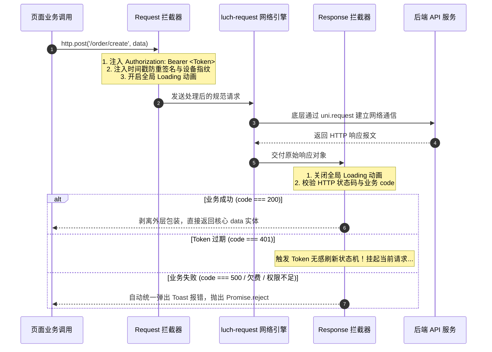
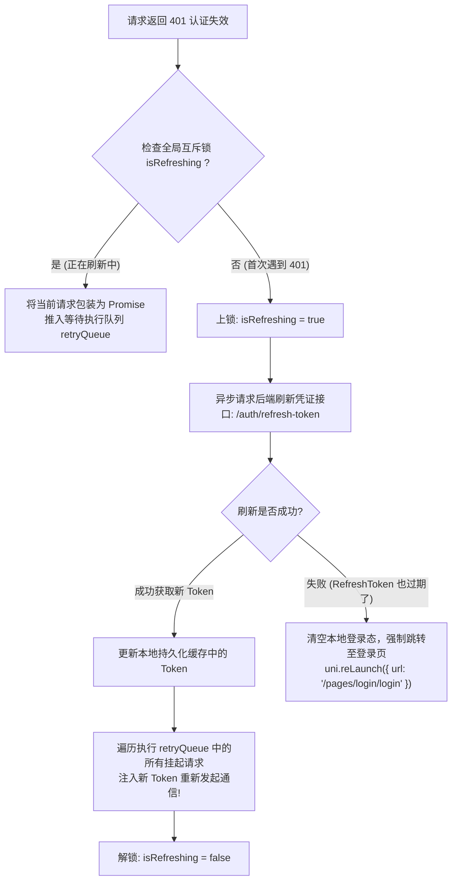

# 中级-企业级网络层封装luch-request拦截器与Token无感刷新

在生产级跨端应用中，单纯使用底层的 `uni.request` 裸调接口是远远无法满足工业级业务诉求的。随着业务复杂度攀升，网络层必须具备：**全局 BaseURL 动态切换、请求与响应拦截器链（Interceptors）、统一公共 Header 注入、全局防重复点击（CancelToken）、业务错误码自动归一过滤、以及用户体验生命线——“Token 过期无感静默刷新与并发请求排队挂起重发”**。

在 Uni-App 生态中，**`luch-request`** 凭借高度对齐 Axios 的优秀设计、全平台协议适配及强类型支持，成为中大型企业首选的事实标准网络库。

在社招中级到高级面试中，网络层几乎是必考的核心大题：**请手写/推导一个支持高并发防重的 Token 无感刷新状态机；当首屏 5 个并发请求同时遭遇 401 时，如何保证刷新接口仅调用一次，且其余 4 个请求无感恢复？**

---

## 1. 核心底层机制与全景架构

### 1.1 企业级全链路网络拦截拓扑图



---

## 2. 源码级/算法物理推导

### 2.1 高并发下“Token 无感静默刷新”核心状态机推导

当用户停留在页面上导致 Token 自然过期，或者在首屏冷启动时**并发发起了 5 个网络请求**：
- 如果没有状态机并发锁，5 个请求会同时检测到 401，并向后端**并发发起 5 次刷新 Token 请求**，直接把服务端打垮，并导致后续返回的 Token 发生严重的覆盖错乱！



---

## 3. 社招/阶段必考高频硬核连环追问

### 追问 1：在无感刷新 Token 期间，原本已经失败的第 1 个请求以及后面被挂起的 4 个并发请求，在拿到新 Token 后，底层是如何“重新发射”并将正确结果返还给原始调用方的？

> **答辩深度闭环**：
> 1. **利用闭包与未决 Promise（Pending Promise）**：
>    在响应拦截器捕获到 401 时，**严禁立即调用 `Promise.reject` 放弃执行**。
> 2. **存入队列函数（Subscriber Function）**：
>    返回一个新的 `new Promise((resolve) => { ... })`。在该 Promise 内部，将一个接收最新 `newToken` 的函数闭包存入全局数组 `retryQueue` 中：
>    ```javascript
>    retryQueue.push((newToken) => {
>      // 重写之前失败请求的 Header
>      response.config.header['Authorization'] = `Bearer ${newToken}`;
>      // 重新发起请求，并将重发的结果 resolve 给最原始的业务调用方！
>      resolve(http.request(response.config));
>    });
>    ```
> 3. **结果交接**：当刷新接口成功返回最新 Token 时，依次调用队列里的函数，每个请求携带新 Token 重新发包，业务调用方的 `await` 丝滑拿到正确数据，用户在视觉上完全零感知！

---

### 追问 2：为什么在响应拦截器中调用 `uni.showToast()` 弹出错误提示时，很多时候屏幕上连闪烁都没有就直接消失了？

> **答辩深度闭环**：
> 1. **微信小程序底层单例冲突（Toast 与 Loading 共享同一个原生视窗）**：在微信小程序原生实现中，`uni.showLoading()` 和 `uni.showToast()` **在底层使用的是同一个原生浮层单例组件**！
> 2. **意外覆盖**：如果请求前调用了 `uni.showLoading()`，请求响应拦截器中在执行 `uni.showToast({ title: '密码错误' })` 之后，又执行了一句 `uni.hideLoading()`；**`hideLoading()` 会粗暴地将刚刚弹出的 `showToast` 连带一同强行关闭清除**！
> 3. **生产级规避原则**：必须在调用 `showToast` 之前，**显式且优先执行 `uni.hideLoading()`**；或者给 `showToast` 增加微小的延时保护。

---

### 追问 3：在 RESTful API 规范中，如何避免用户在弱网环境下由于暴击快速点击，导致同一个创建订单接口向后端重复提交两次（防重复提交）？

> **答辩深度闭环**：
> 1. **客户端请求指纹锁（Pending Request Map）**：
>    根据请求的 `method + url + JSON.stringify(data)` 计算一个 MD5 哈希作为该请求的唯一指纹（Request Key）。
> 2. **拦截器自动去重**：
>    在请求拦截器中检查该 Key 是否已存在于全局 `pendingMap` 中：
>    - 若已存在：说明上一个相同请求仍在网络传输中，直接调用 `CancelToken` 中止当前重复请求或直接阻止发包；
>    - 若不存在：将该 Key 存入 Map，并在响应返回或发生错误时在 `finally` 阶段安全移除该 Key。

---

## 4. 生产级避坑指南与排障 SOP

### 4.1 生产级 `luch-request` 完整封装实战代码（含静默刷新与请求队列）

```typescript
// api/request.ts
import Request from 'luch-request';

const http = new Request({
  baseURL: import.meta.env.VITE_API_BASE_URL || 'https://api.company.com',
  timeout: 10000,
});

// 全局静默刷新互斥锁与挂起队列
let isRefreshing = false;
let retryQueue: Array<(token: string) => void> = [];

// ======================== 1. 请求拦截器 ========================
http.interceptors.request.use(
  (config) => {
    const token = uni.getStorageSync('ACCESS_TOKEN');
    if (token) {
      config.header = {
        ...config.header,
        Authorization: `Bearer ${token}`,
      };
    }
    return config;
  },
  (error) => Promise.reject(error)
);

// ======================== 2. 响应拦截器 ========================
http.interceptors.response.use(
  async (response) => {
    const resData = response.data;

    // 假设业务状态码 200 为绝对成功
    if (resData.code === 200) {
      return resData.data; // 剥离多余层级，直达核心业务对象
    }

    // 命中 Token 过期错误码 (例如 40101)
    if (resData.code === 40101) {
      const config = response.config;

      // 场景 A: 已经在刷新中，将当前请求排队挂起
      if (isRefreshing) {
        return new Promise((resolve) => {
          retryQueue.push((newToken: string) => {
            config.header['Authorization'] = `Bearer ${newToken}`;
            resolve(http.request(config));
          });
        });
      }

      // 场景 B: 首次遇到 401，立即上锁并执行异步刷新
      isRefreshing = true;
      try {
        const refreshToken = uni.getStorageSync('REFRESH_TOKEN');
        if (!refreshToken) throw new Error('No RefreshToken');

        // 调用专用刷新凭证接口 (必须绕开通用拦截器，避免死循环)
        const refreshRes = await uni.request({
          url: `${http.config.baseURL}/auth/refresh`,
          method: 'POST',
          data: { refreshToken }
        });

        if (refreshRes.statusCode === 200 && (refreshRes.data as any).code === 200) {
          const newToken = (refreshRes.data as any).data.accessToken;
          uni.setStorageSync('ACCESS_TOKEN', newToken);

          // 1. 重新发射并消费当前第一个请求
          config.header['Authorization'] = `Bearer ${newToken}`;
          const currentResult = await http.request(config);

          // 2. 批量释放队列中排队等待的并发请求
          retryQueue.forEach((callback) => callback(newToken));
          retryQueue = [];

          return currentResult;
        } else {
          throw new Error('Refresh Token Expired');
        }
      } catch (err) {
        // RefreshToken 彻底过期失效，清空所有凭证并强制重定向登录页
        retryQueue = [];
        uni.removeStorageSync('ACCESS_TOKEN');
        uni.removeStorageSync('REFRESH_TOKEN');
        uni.showToast({ title: '登录态失效，请重新登录', icon: 'none' });
        uni.reLaunch({ url: '/pages/login/login' });
        return Promise.reject(err);
      } finally {
        isRefreshing = false;
      }
    }

    // 其他业务错误统一弹出弱提示
    uni.showToast({ title: resData.message || '业务处理失败', icon: 'none' });
    return Promise.reject(new Error(resData.message));
  },
  (error) => {
    // 处理物理网络超时或 500
    uni.showToast({ title: '网络连接异常，请稍后重试', icon: 'none' });
    return Promise.reject(error);
  }
);

export default http;
```

### 4.2 拦截器排障速查表

| 故障现象 | 物理根因 | 生产排查与根治 SOP |
| :--- | :--- | :--- |
| **Token 刷新接口陷入无限死循环** | 刷新 Token 的请求本身也返回了 401，再次进入同一个拦截器触发自身刷新。 | 刷新请求必须单独使用纯净的 `uni.request` 发起，严禁经过主拦截器。 |
| **重发的请求 Header 依然是旧 Token** | 在挂起重发时，未重新覆写 `response.config.header.Authorization`。 | 重新执行前必须强制将新 Token 赋值给 config 的 Header。 |
| **上传文件未走拦截器** | `http.upload` 的配置项未正确挂载全局 Header。 | 检查 `luch-request` 上传方法的配置，手动调用拦截器链。 |
