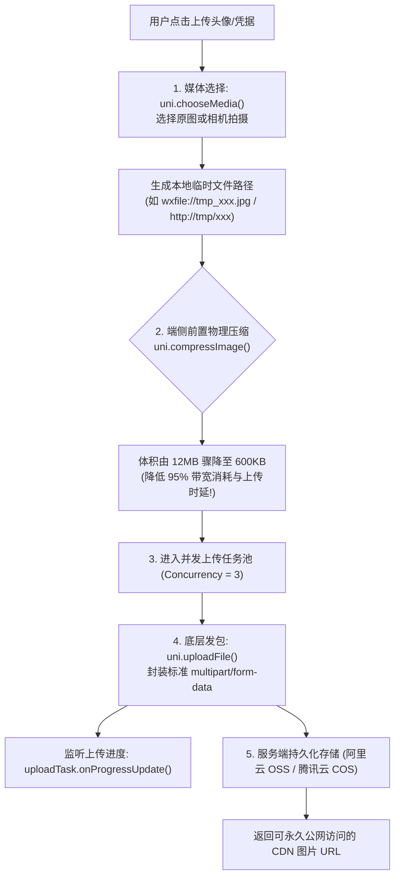

# 中级-多端文件上传uni-uploadFile与图片选择压缩实战

在移动端电商售后维权、实名身份证认证、用户头像更换以及社交动态发布等高频业务中，多媒体文件的选择、端侧前置压缩与网络上传是极为关键的核心链路。Uni-App 提供了统一的媒体选择与文件上传套件：**`uni.chooseMedia`** 与 **`uni.uploadFile`**。

然而在真实生产环境中，文件上传是多端兼容性问题最集中、网络失败率最高的环节：**如今智能手机拍摄的一张 4K/超清照片体积高达 10MB~20MB，未压缩直接上传将导致移动网络严重超时甚至引发小程序内存爆死；一次性选择 9 张大图并发上传直接触碰微信网络并发连接数红线；对临时文件路径 `wxfile://` 的生命周期缺乏认知导致图片无法持久展示**。

在社招中级技术面试中，面试官将深入工程落地考查：**临时文件与持久化文件的物理差异、端侧无损压缩算法与 Canvas 降采样策略、以及如何手写一个带有最大并发限制（Concurrency Pool）的多图上传任务池？**

---

## 1. 核心底层机制与全景架构

### 1.1 移动端文件选择与全链路上传拓扑图



### 1.2 核心 API 物理选型与演进

| 功能阶段 | 推荐现代化 API | 淘汰/过时 API | 核心优势与选型理由 |
| :--- | :--- | :--- | :--- |
| **媒体采集** | **`uni.chooseMedia`** | `uni.chooseImage`<br/>`uni.chooseVideo` | 微信官方全量推荐新接口。统一合并了图片与视频选择，**支持直接指定拍摄前后置摄像头、支持直接在选择器内压缩（`sizeType`）**。 |
| **端侧压缩** | **`uni.compressImage`** | 纯前端 HTML Canvas 绘制 | 优先调用宿主平台原生的图像硬件解码器与压缩库（Android libjpeg-turbo / iOS ImageIO），速度比前端 Canvas 快 10 倍且零内存泄漏。 |
| **网络上传** | **`uni.uploadFile`** | 自行将文件转为 Base64 发 `request` | **以流式二进制数据传输**，走标准 `multipart/form-data` 协议，完全不占用 JS 逻辑层堆内存。 |

---

## 2. 源码级/算法物理推导

### 2.1 临时文件路径（Temp File Path）的生命周期黑盒推导

当调用 `uni.chooseMedia` 成功后，返回的数组中包含 `tempFilePath: "wxfile://tmp_a8f9c1...jpg"`。
- **物理成因**：为了避免一次性将 10MB 的文件全部读入 JavaScript 内存堆中引发 OOM，小程序和 App 底层仅将图片保存在操作系统的**临时缓存目录（Sandbox Tmp Directory）**中，并向前端返回一个虚拟的引用协议路径（URI）。
- **生命周期物理陷阱**：
  - 临时文件**绝对不是永久存在的**！在小程序退出、内存不足被系统清理、或热重启后，该物理文件**随时可能被操作系统静默删除**！
  - **严重事故**：若前端开发者将 `tempFilePath` 直接作为头像地址通过接口保存到了服务端的 MySQL 数据库中，下次重新打开应用时，头像将必然变成一片空白，报 404 找不到本地文件！
  - **铁律**：临时路径只能用于前端本地 `image` 组件的临时预览；**必须通过 `uni.uploadFile` 上传至服务端 OSS，获取到形如 `https://oss.company.com/avatar.jpg` 的公网永久 URL 后，才可持久化存储！**

### 2.2 multipart/form-data 二进制协议结构推导

`uni.uploadFile` 在底层将数据打包为符合 RFC 7578 标准的 HTTP 报文：
```http
POST /api/upload HTTP/1.1
Host: api.company.com
Content-Type: multipart/form-data; boundary=----WebKitFormBoundary7MA4YWxkTrZu0gW

------WebKitFormBoundary7MA4YWxkTrZu0gW
Content-Disposition: form-data; name="userId"

10086
------WebKitFormBoundary7MA4YWxkTrZu0gW
Content-Disposition: form-data; name="file"; filename="avatar.jpg"
Content-Type: image/jpeg

[... 原始图片的二进制字节流 (Binary Stream) ...]
------WebKitFormBoundary7MA4YWxkTrZu0gW--
```

---

## 3. 社招/阶段必考高频硬核连环追问

### 追问 1：用户一次性从手机相册选择了 9 张图片，如果直接用 `Promise.all` 循环发起 9 个 `uni.uploadFile`，在微信小程序中为什么经常出现有一部分图片直接上传失败？

> **答辩深度闭环**：
> 1. **小程序底层并发连接数硬限制（Max Concurrency Limit）**：微信小程序底层对同时间处于活跃状态的 `uploadFile` 严格限制了**最大并发数（通常为 10 个，某些低版本环境甚至限制为 5 个）**。
> 2. **网络拥堵与资源竞争**：9 个几兆的高清大图同时抢占手机的上行无线带宽，不仅导致整体传输耗时被拉长数倍，更极易因底层 TCP 连接超时或触碰微信并发阈值直接被平台内核抛出 `uploadFile:fail exceed max upload connection count` 强行阻断。
> 3. **解决方案（并发任务池调度）**：必须手写一个并发队列控制器，将并发数严格限制在 **2~3 个**，完成一张再消费下一张，实现平滑、稳定、高可靠的分批有序上传。

---

### 追问 2：在上传图片前，为什么必须在移动端进行“前置无损压缩”？它给企业架构带来了哪些不可替代的价值？

> **答辩深度闭环**：
> 1. **上行带宽与时延缩减 90%**：现代手机原图单张通常为 5MB~15MB。在 4G/弱网环境下上传 10MB 耗时可能超过 15 秒，极易引发上传超时；而经过合理的有损/无损压缩（将分辨率限制在 1920 宽以内，quality 设为 80%），图片体积可直接骤降至 **300KB ~ 600KB**，上传时间压缩至 1 秒以内，成功率大幅跃升至 99.8%！
> 2. **巨额云存储与 CDN 成本节省**：若千万级用户的 App 每天上传数百万张未压缩的原图，企业在对象存储（OSS/COS）和回源流量上的账单将呈现指数级暴增，端侧前置压缩是架构降本增效的核心抓手。

---

### 追问 3：在调用 `uni.uploadFile` 时，想要在请求头中携带 Token（`Authorization: Bearer ...`），该写在哪个参数里？如果传参漏写会导致什么？

> **答辩深度闭环**：
> 1. **独立配置项**：必须显式写在 `header` 对象中：
>    ```javascript
>    uni.uploadFile({
>      url: 'https://api.company.com/upload',
>      filePath: tempPath,
>      name: 'file',
>      header: {
>        'Authorization': `Bearer ${token}`
>      }
>    });
>    ```
> 2. **易犯低级错误**：切勿将 Token 错写在 `formData` 中。`formData` 里的参数会被打包进表单字段体内（Body Form-Field），而后端的 JWT 拦截网关通常在 HTTP 请求头中提取凭证；若写错位置，网关会直接返回 HTTP 401 认证失败！

---

## 4. 生产级避坑指南与排障 SOP

### 4.1 生产级多图“前置压缩 + 并发控制任务池”完整封装

```typescript
// utils/uploadManager.ts

interface UploadTaskOptions {
  urls: string[]; // 临时路径数组
  maxConcurrent?: number; // 最大并发数，默认 3
  onProgress?: (completed: number, total: number) => void;
}

export class BatchUploadManager {
  /**
   * 1. 单张图片端侧前置压缩
   */
  static async compress(srcPath: string, quality = 80): Promise<string> {
    return new Promise((resolve) => {
      // #ifdef MP-WEIXIN || APP-PLUS
      uni.compressImage({
        src: srcPath,
        quality,
        compressedWidth: 1280, // 限制最大宽度，高度等比缩放
        success: (res) => resolve(res.tempFilePath),
        fail: () => resolve(srcPath), // 压缩失败优雅降级使用原图
      });
      // #endif

      // #ifdef H5
      // H5 端直接返回，或使用 Canvas 压缩
      resolve(srcPath);
      // #endif
    });
  }

  /**
   * 2. 单文件上传封装
   */
  static async uploadSingle(filePath: string): Promise<string> {
    const token = uni.getStorageSync('ACCESS_TOKEN');
    return new Promise((resolve, reject) => {
      uni.uploadFile({
        url: `${import.meta.env.VITE_API_BASE_URL}/common/upload`,
        filePath,
        name: 'file',
        header: {
          Authorization: `Bearer ${token}`,
        },
        success: (res) => {
          if (res.statusCode === 200) {
            const data = JSON.parse(res.data);
            if (data.code === 200) {
              resolve(data.data.url); // 返回服务端永久 CDN 地址
            } else {
              reject(new Error(data.message));
            }
          } else {
            reject(new Error(`HTTP ${res.statusCode}`));
          }
        },
        fail: reject,
      });
    });
  }

  /**
   * 3. 核心：带并发限制的批处理任务池调度算法
   */
  static async uploadBatch(options: UploadTaskOptions): Promise<string[]> {
    const { urls, maxConcurrent = 3, onProgress } = options;
    const results: string[] = new Array(urls.length);
    let currentIndex = 0;
    let completedCount = 0;

    // 前置执行全量压缩
    const compressedPaths = await Promise.all(
      urls.map((path) => this.compress(path))
    );

    // 工作线程调度器
    const worker = async (): Promise<void> => {
      while (currentIndex < compressedPaths.length) {
        const taskIdx = currentIndex++;
        const path = compressedPaths[taskIdx];

        try {
          const remoteUrl = await this.uploadSingle(path);
          results[taskIdx] = remoteUrl;
        } catch (err) {
          console.error(`第 ${taskIdx} 张图片上传失败:`, err);
          results[taskIdx] = ''; // 标记失败
        } finally {
          completedCount++;
          if (onProgress) {
            onProgress(completedCount, compressedPaths.length);
          }
        }
      }
    };

    // 启动指定并发数的并发工作组
    const poolSize = Math.min(maxConcurrent, compressedPaths.length);
    const workers = Array.from({ length: poolSize }, () => worker());
    await Promise.all(workers);

    return results;
  }
}
```

#### 业务页面消费示范：
```vue
<script setup lang="ts">
import { ref } from 'vue';
import { BatchUploadManager } from '@/utils/uploadManager';

const uploadedUrls = ref<string[]>([]);
const uploadProgress = ref(0);

async function handleChooseAndUpload() {
  // 1. 调用现代 API 选择图片
  uni.chooseMedia({
    count: 9,
    mediaType: ['image'],
    sourceType: ['album', 'camera'],
    sizeType: ['compressed'],
    success: async (res) => {
      const tempPaths = res.tempFiles.map((file) => file.tempFilePath);

      uni.showLoading({ title: '正在上传中...' });

      // 2. 调起并发压缩任务池 (限制最大 3 个并发)
      const remoteUrls = await BatchUploadManager.uploadBatch({
        urls: tempPaths,
        maxConcurrent: 3,
        onProgress: (done, total) => {
          uploadProgress.value = Math.floor((done / total) * 100);
        },
      });

      uploadedUrls.value = remoteUrls.filter((url) => !!url);
      uni.hideLoading();
      uni.showToast({ title: '全部图片上传完成！' });
    },
  });
}
</script>
```

### 4.2 媒体上传排错速查表

| 报错现象 | 物理根因 | 生产排查与根治 SOP |
| :--- | :--- | :--- |
| **`uploadFile:fail exceed max upload connection count`** | 同时发起的并发上传连接数超过了宿主平台的硬阈值（10个）。 | 引入上述 `BatchUploadManager` 将最大并发数限制为 2~3 个。 |
| **上传成功但返回的 data 无法直接用** | `uni.uploadFile` 返回的 `res.data` 是**未解析的 JSON 字符串**。 | 必须手动执行 `JSON.parse(res.data)` 提取业务数据。 |
| **App 端相册选择权限被拒** | 未在 `manifest.json` 中配置相机与相册权限声明。 | 在 `manifest.json` 的 `app-plus` 模块配置中勾选相机与相册读写权限。 |
