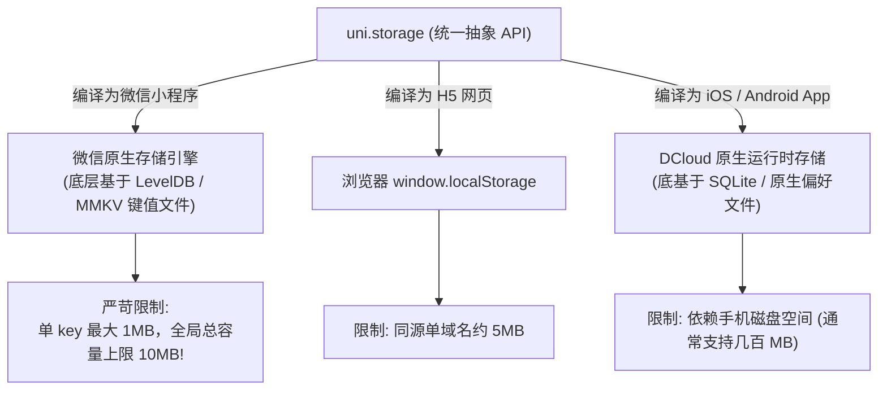

# 中级-本地数据持久化uni-storage与异步同步选型实战

在跨端应用架构中，**本地数据持久化（Local Storage）** 是保证应用离线可用性、降低高频重复网络请求、维护用户登录凭据（Token）以及记录搜索历史的核心基石。Uni-App 对各大底层平台的存储机制进行了统一的抽象封装——**`uni.storage`**。

然而，跨端存储绝非简单地“存进去、取出来”。不同宿主平台在存储物理介质、存储容量上限、以及同步与异步 I/O 调度上存在极其显著的物理差异。

在社招中级面试中，面试官将深入存储底层考核：**`uni.setStorage`（异步）与 `uni.setStorageSync`（同步）在底层线程调度上有何本质优劣？微信小程序 10MB 存储硬顶如何设计 LRU 淘汰与防崩自愈？如何优雅封装一个带有 TTL（过期时间）的高性能缓存管理器？**

---

## 1. 核心底层机制与全景架构

### 1.1 Uni-App 多端存储物理介质与容量矩阵



### 1.2 异步与同步 API 核心对比

| API 类型 | 核心方法 | 底层物理执行机制 | 优缺点与适用场景 |
| :--- | :--- | :--- | :--- |
| **同步 API** | `uni.setStorageSync`<br/>`uni.getStorageSync`<br/>`uni.removeStorageSync` | **阻塞逻辑层 JavaScript 线程**，等待磁盘文件 I/O 完成后才返回。 | **优点**：代码直观无回调；**缺点**：若读写超大数据（如上百 KB）会导致主线程严重掉帧。适合读写小数据（如 Token、单个用户 ID）。 |
| **异步 API** | `uni.setStorage`<br/>`uni.getStorage`<br/>`uni.removeStorage` | 将 I/O 任务抛入操作系统后台工作线程，完成后通过 Promise 或 Callback 唤醒。 | **优点**：零阻塞 UI 渲染管线，极其流畅；**缺点**：存在微小的回调时序等待。适合离线草稿、大型列表缓存写入。 |

---

## 2. 源码级/算法物理推导

### 2.1 为什么 Uni-App 存储无需像原生 Web 那样手动序列化？

在传统浏览器 Web 开发中：
```javascript
// 原生 Web localStorage 必须手动转换
localStorage.setItem('user', JSON.stringify({ name: '张三' }));
const user = JSON.parse(localStorage.getItem('user'));
```
而在 Uni-App 中，开发者可以直接存入复杂对象与原生数据类型：
```javascript
uni.setStorageSync('user', { name: '张三', age: 18 });
const user = uni.getStorageSync('user'); // 直接返回原生 Object，无需 parse！
```

#### 底层编译与包装推导：
- Uni-App 和小程序底层在执行存储时，会自动读取传入数据的原生 `typeof`。
- 如果数据是 `Object` 或 `Array`，引擎在将其写入磁盘前，在底层自动包装了一层元数据标记：
  $$\text{StoragePayload} = \{ \text{data: JSON.stringify(val)}, \text{type: "Object"} \}$$
- 当调用 `getStorageSync` 时，引擎根据 `type` 标记**在底层透明地自动执行了 `JSON.parse`**，并将反序列化后的 JavaScript 对象无缝返回，大幅降低了开发者的心智负担。

---

## 3. 社招/阶段必考高频硬核连环追问

### 追问 1：在应用启动加载时，读取本地存储的 Token，应该使用同步 `getStorageSync` 还是异步 `getStorage`？为什么？

> **答辩深度闭环**：
> 1. **时序关键性**：应用启动时，首屏页面的网络请求（如加载商品流、个人资产）强依赖请求头中的 `Authorization: Bearer <Token>`。
> 2. **异步陷阱**：如果使用异步 `getStorage`，由于异步回调进入事件循环排队调度，当首屏组件在 `onLoad` 发起网络请求时，异步 Token 赋值可能**尚未完成**，导致首批并发接口以“未登录状态（No Token）”发出，引发大面积 401 报错。
> 3. **正确选型**：对于全局强依赖的关键状态凭证（Token、租户 ID），**必须使用同步 `uni.getStorageSync`**；由于 Token 字符串仅有百余字节，同步耗时微秒级，完全不会造成任何感知性卡顿。

---

### 追问 2：微信小程序本地存储触碰 10MB 上限后，再次调用 `setStorage` 会发生什么？资深架构师如何设计“存储防崩与自愈治理”？

> **答辩深度闭环**：
> 1. **错误发生**：当存储数据总和超过 10MB 时，底层直接抛出异常 `setStorage:fail exceed storage quota`，新数据物理写入失败。
> 2. **生产级治理四重防线**：
>    - **容量监控**：在应用启动或特定阶段，调用 `uni.getStorageInfoSync()`，读取当前的 `currentSize` 与 `limitSize`。
>    - **LRU 淘汰算法（Least Recently Used）**：建立缓存元数据表，记录每个 Key 的最后访问时间戳（`lastAccessedTime`）。当 `currentSize > 8MB`（达到 80% 警戒线）时，自动触发淘汰策略，优先将最早未被访问的非核心缓存（如商品搜索历史、浏览足迹）物理清理。
>    - **核心凭证白名单保护**：Token、用户信息等核心认证数据打上 `isProtected: true` 标签，任何清理算法严禁误删。

---

### 追问 3：原生 `uni.setStorage` 并不支持设置“过期时间（TTL）”，如何设计一个轻量高效的带有过期失效机制的缓存管理器？

> **答辩深度闭环**：
> 1. **元数据包装设计**：将真实业务数据封装为一个包含失效时间戳的对象：
>    $$\text{CacheRecord} = \{ \text{value: targetData}, \text{expireAt: Date.now()} + \text{ttlMilliseconds} \}$$
> 2. **惰性过期检查（Lazy Expiration）**：读取时通过 `Date.now() > expireAt` 进行比对。若已过期，立即在底层调用 `uni.removeStorageSync(key)` 物理销毁并返回 `null`，避免过期脏数据堆积在磁盘中。

---

## 4. 生产级避坑指南与排障 SOP

### 4.1 生产级带有 TTL 过期时间与防崩的 Storage 服务类实战

```typescript
// utils/storage.ts

interface CacheWrapper<T> {
  data: T;
  expireAt: number; // 绝对过期时间戳 (毫秒)
}

class StorageService {
  /**
   * 存储数据并支持设置过期时长
   * @param key 存储键名
   * @param data 真实数据
   * @param expireSeconds 有效期 (单位: 秒，默认 0 为永不过期)
   */
  static set<T = any>(key: string, data: T, expireSeconds: number = 0): boolean {
    try {
      const expireAt = expireSeconds > 0 ? Date.now() + expireSeconds * 1000 : 0;
      const payload: CacheWrapper<T> = {
        data,
        expireAt,
      };
      uni.setStorageSync(key, payload);
      return true;
    } catch (err) {
      console.error(`[Storage Error] 写入 ${key} 失败:`, err);
      // 容灾策略：若因配额超标报错，执行紧急安全清理
      this.clearExpiredCaches();
      return false;
    }
  }

  /**
   * 读取数据并自动执行过期校验
   */
  static get<T = any>(key: string, defaultValue: T | null = null): T | null {
    try {
      const payload: CacheWrapper<T> = uni.getStorageSync(key);
      if (!payload) return defaultValue;

      // 检查是否存在过期时间戳
      if (payload.expireAt && payload.expireAt > 0) {
        if (Date.now() > payload.expireAt) {
          // 惰性删除已过期缓存
          console.warn(`[Storage Cache] 缓存 ${key} 已过期，执行物理清理`);
          uni.removeStorageSync(key);
          return defaultValue;
        }
      }
      return payload.data;
    } catch (err) {
      console.error(`[Storage Error] 读取 ${key} 失败:`, err);
      return defaultValue;
    }
  }

  /**
   * 安全移除
   */
  static remove(key: string): void {
    try {
      uni.removeStorageSync(key);
    } catch (e) {
      console.error(`[Storage Error] 移除 ${key} 失败:`, e);
    }
  }

  /**
   * 检查当前存储空间健康度
   */
  static checkHealth(): void {
    try {
      const info = uni.getStorageInfoSync();
      console.log(`[Storage Health] 当前占用: ${info.currentSize}KB / 上限: ${info.limitSize}KB`);
    } catch (e) {
      // 忽略
    }
  }

  /**
   * 紧急兜底清理 (可配合业务定期清理非核心缓存)
   */
  private static clearExpiredCaches(): void {
    try {
      const info = uni.getStorageInfoSync();
      info.keys.forEach((k) => {
        // 尝试触发惰性校验清理
        this.get(k);
      });
    } catch (e) {
      // 忽略
    }
  }
}

export default StorageService;
```

#### 业务中使用示范：
```typescript
// 写入缓存，有效时间设为 2 小时 (7200 秒)
StorageService.set('USER_VIP_STATUS', { isVip: true, level: 3 }, 7200);

// 读取缓存 (若已过 2 小时自动返回 null)
const vipStatus = StorageService.get('USER_VIP_STATUS');
```

### 4.2 存储排障速查表

| 报错现象 | 物理根因 | 生产排查与根治 SOP |
| :--- | :--- | :--- |
| **`setStorage:fail exceed storage quota`** | 微信小程序本地缓存总计超过了 10MB 硬限制。 | 排查是否存在超大图片 Base64 或全量商品流缓存，将其移出 storage。 |
| **H5 端页面关闭后数据全部丢失** | 误用了 `sessionStorage` 或在隐私无痕模式下禁用了存储。 | 统一使用 Uni-App 标准 API，并对写入失败做 `try-catch` 降级兜底。 |
| **应用更新版本后旧数据格式错乱** | 新旧数据结构不兼容，旧缓存污染了新代码字段。 | 在本地存储中记录 `APP_CACHE_VERSION`，大版本升级时主动清空旧数据。 |
