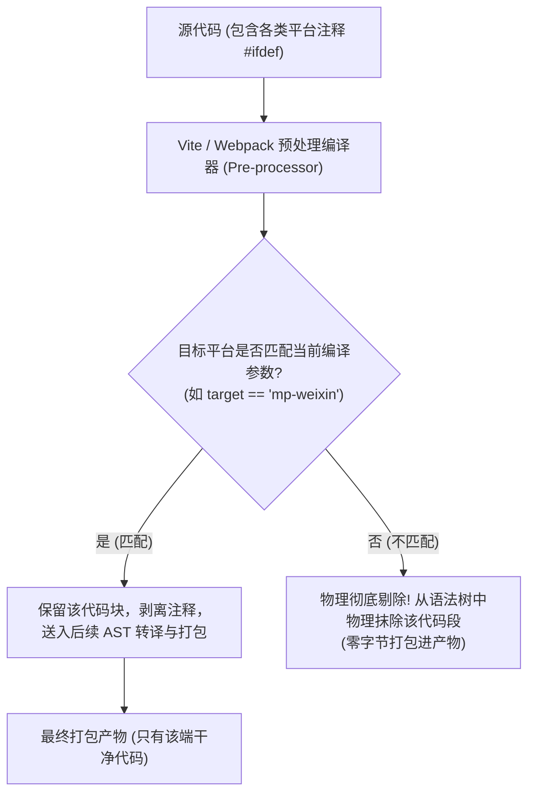

# 中级-条件编译ifdef核心语法与多端差异化代码治理

跨端开发最理想的状态是“一次编写，处处运行（Write Once, Run Anywhere）”；但在真实的商业级工程中，各大宿主平台天然存在无法抹平的**物理特异性**：微信小程序特有的开放能力（如微信登录、小程序码、消息订阅）、App 原生特有的扫码推送与蓝牙硬件访问、以及 H5 浏览器专属的 SEO 与 URL 历史栈操作。

Uni-App 解决多端差异的核心武器就是 **条件编译（Conditional Compilation）**。

在很多初中级开发者的代码中，条件编译常常被滥用成“意大利面条式”的混乱代码块，甚至有人错误地使用运行时 `if` 判断替代条件编译，导致其他端专用的敏感代码泄露进小程序包体。在社招中高级面试中，面试官将重点考核：**条件编译在编译期 AST 阶段的物理剔除原理是什么？为什么不能用 `process.env` 替代？如何在 JS、模板、样式与 `pages.json` 中全场景规范应用？大型工程中如何通过“平台适配器模式”优雅根治条件编译污染？**

---

## 1. 核心底层机制与全景架构

### 1.1 条件编译的物理处理流水线

与运行时动态判断平台不同，Uni-App 的条件编译是在**代码构建预处理阶段（Pre-processing Stage）**直接起效的：



### 1.2 主流平台标识符与逻辑操作符全览

| 平台标识符 | 真实物理对应宿主 |
| :--- | :--- |
| **`MP-WEIXIN`** | 微信小程序 |
| **`MP-ALIPAY`** | 支付宝小程序 |
| **`MP-TOUTIAO`** | 抖音/今日头条小程序 |
| **`MP`** | 所有平台小程序的集合通配符 |
| **`H5`** | 现代 Web 浏览器端 |
| **`APP-PLUS`** | iOS / Android 原生 App 客户端 |
| **`APP-PLUS-NVUE`** | App 端基于原生 Weex/NVue 的原生渲染页 |

- **逻辑操作符**：
  - `#ifdef PLATFORM`：仅在指定平台生效（If Defined）。
  - `#ifndef PLATFORM`：除了指定平台外，其他所有平台均生效（If Not Defined）。
  - `||` 逻辑或：`#ifdef MP-WEIXIN || MP-ALIPAY`（微信或支付宝平台均生效）。

---

## 2. 源码级/算法物理推导

### 2.1 四大上下文环境的语法规范与 AST 处理

Uni-App 针对不同的代码语法树格式，设计了严格对应的注释标记语法：

#### 1. JavaScript / TypeScript 脚本环境（单行注释语法）
```typescript
// #ifdef MP-WEIXIN
wx.login({
  success: (res) => console.log('微信临时登录凭证:', res.code)
});
// #endif

// #ifdef APP-PLUS
plus.runtime.setBadgeNumber(5); // App 设置角标原生能力
// #endif
```

#### 2. HTML 模板环境（XML 注释语法）
```html
<template>
  <view class="container">
    <!-- #ifdef MP-WEIXIN -->
    <button open-type="share">分享到微信群</button>
    <!-- #endif -->

    <!-- #ifdef H5 -->
    <view class="copy-link">点击复制网页分享链接</view>
    <!-- #endif -->
  </view>
</template>
```

#### 3. CSS / SCSS 样式环境（块级注释语法）
```scss
/* #ifdef H5 */
.navbar-title {
  /* 仅在 H5 端生效的鼠标手型 */
  cursor: pointer;
}
/* #endif */

/* #ifdef MP-WEIXIN */
.navbar-title {
  /* 避开微信右侧胶囊按钮 */
  padding-right: 200rpx;
}
/* #endif */
```

#### 4. `pages.json` 配置文件环境
```json
{
  "pages": [
    {
      "path": "pages/index/index",
      "style": {
        "navigationBarTitleText": "首页"
        // #ifdef MP-WEIXIN
        , "navigationStyle": "custom"
        // #endif
      }
    }
  ]
}
```

### 2.2 静态文件级条件编译（零侵入式目录映射）

除了在文件内部写注释，Uni-App 还支持更高级的 **“按文件后缀静态匹配”**：
- `user.h5.vue` $\to$ 仅在编译 H5 时被打包。
- `user.mp-weixin.vue` $\to$ 仅在编译微信小程序时生效。
- `platform.app-plus.js` $\to$ App 端专用的原生调用桥接。

**编译算法**：在模块引入解析阶段，编译器会优先查找 `[filename].[platform].[ext]`。若命中，则直接使用专用实现替换通用的 `[filename].[ext]`，从根本上消灭了单文件内数百行 `#ifdef` 的脏代码。

---

## 3. 社招/阶段必考高频硬核连环追问

### 追问 1：为什么不能在代码中写 `if (process.env.UNI_PLATFORM === 'mp-weixin')` 来替代 `#ifdef`？两者在底层有何致命差异？

> **答辩深度闭环**：
> 1. **执行时机完全不同**：`#ifdef` 是在**构建预处理阶段**起效，非目标平台的代码直接从源码中抹除，**根本不会被打包进编译产物中**；而 `if (process.env.UNI_PLATFORM === '...')` 是**运行时的逻辑分支判断**。
> 2. **包体积膨胀**：如果使用运行时 `if`，App 端的原生代码、H5 端的庞大第三方库依然会被原封不动打包进微信小程序的包体内，极易引爆 2MB 主包红线。
> 3. **语法报错与崩溃**：某些平台特定的全局变量（例如 App 端的 `plus.storage`、微信端的 `wx.createInnerAudioContext`）在其他平台上根本不存在。如果使用运行时 `if`，JS 解释器在语法解析阶段就会直接抛出 `ReferenceError: plus is not defined` 崩溃！

---

### 追问 2：在 `pages.json` 中使用条件编译时，为什么经常因为一个“多余的逗号”导致构建直接报错崩溃？

> **答辩深度闭环**：
> 1. **JSON 规范的严苛语法约束**：标准 JSON 不允许存在末尾多余逗号（Trailing Comma）。
> 2. **语法切片缺陷**：
>    ```json
>    // ❌ 灾难示范：编译到 H5 时，逗号被保留，导致 JSON 格式损坏报错！
>    {
>      "navigationBarTitleText": "首页",
>      // #ifdef MP-WEIXIN
>      "navigationStyle": "custom"
>      // #endif
>    }
>    ```
> 3. **标准前置逗号规范**：必须将逗号写在条件编译的**内部开头**：
>    ```json
>    // ✅ 生产级正确写法：逗号与属性一同被剔除，JSON 永远保持合法！
>    {
>      "navigationBarTitleText": "首页"
>      // #ifdef MP-WEIXIN
>      , "navigationStyle": "custom"
>      // #endif
>    }
>    ```

---

### 追问 3：在大型互联网应用中，如果业务代码到处充满 `#ifdef`，会导致项目无法维护、代码腐化严重。资深架构师如何治理条件编译？

> **答辩深度闭环**：
> 1. **抽象平台适配层（Platform Adapter Pattern）**：业务页面严禁直接散落 `#ifdef`。
> 2. **接口契约归一化**：在 `utils/platform/` 目录下定义统一的抽象接口（如 `share.ts`，定义 `export function doShare(title, path)`）。
> 3. **多态物理分发**：
>    - `share.mp-weixin.ts`：内部封装微信小程序的分享逻辑；
>    - `share.app-plus.ts`：内部封装 App 调起原生微信 SDK 分享；
>    - `share.h5.ts`：内部封装复制网页链接。
> 4. **业务层纯洁性**：业务组件直接引用 `import { doShare } from '@/utils/platform/share'`，业务代码实现 **零 `#ifdef` 污染**。

---

## 4. 生产级避坑指南与排障 SOP

### 4.1 生产级多平台差异化适配器工程实战

#### 1. 跨平台分享模块（文件级条件编译）

```typescript
// utils/share/index.ts (跨端默认降级实现 / H5 端)
export function openPlatformShare(title: string, url: string) {
  // 复制链接到剪贴板
  uni.setClipboardData({
    data: url,
    success: () => uni.showToast({ title: '分享链接已复制到剪贴板', icon: 'none' })
  });
}
```

```typescript
// utils/share/index.mp-weixin.ts (微信小程序专属实现)
export function openPlatformShare(title: string, url: string) {
  // 小程序引导用户点击右上角三个点转发
  uni.showModal({
    title: '微信分享',
    content: '请点击右上角【...】直接发送给微信好友或朋友圈',
    showCancel: false
  });
}
```

```typescript
// utils/share/index.app-plus.ts (App 原生端专属实现)
export function openPlatformShare(title: string, url: string) {
  // #ifdef APP-PLUS
  plus.share.sendWithSystem({
    type: 'text',
    content: `${title} ${url}`,
    href: url
  }, () => {
    console.log('App 系统原生分享成功');
  }, (err) => {
    console.error('App 原生分享失败:', err);
  });
  // #endif
}
```

#### 2. 业务页面直接调用（完全无 `#ifdef`）
```vue
<script setup lang="ts">
import { openPlatformShare } from '@/utils/share';

function onShareClick() {
  // 无论编译到哪一端，自动精准匹配对应实现，业务代码整洁优雅！
  openPlatformShare('超值特惠商品', 'https://shop.company.com/goods/1');
}
</script>
```

### 4.2 条件编译排错速查表

| 报错现象 | 物理根因 | 生产排查与根治 SOP |
| :--- | :--- | :--- |
| **样式注释被当作选择器报错** | CSS 中使用了 `//` 单行注释写条件编译。 | CSS/SCSS 中必须且只能使用 `/* #ifdef ... */` 块级注释。 |
| **变量未定义报 ReferenceError** | 引用了某端专属 SDK，但条件编译漏写了 `#endif` 闭合标签。 | 全局搜索匹配 `#ifdef` 与 `#endif` 数量是否绝对一致。 |
| **H5 端打包异常膨胀** | 使用了运行时 `if` 代替了静态条件编译，将 App 原生体积带入了 Web。 | 彻底重构为 `#ifdef` 或静态文件级条件编译。 |
