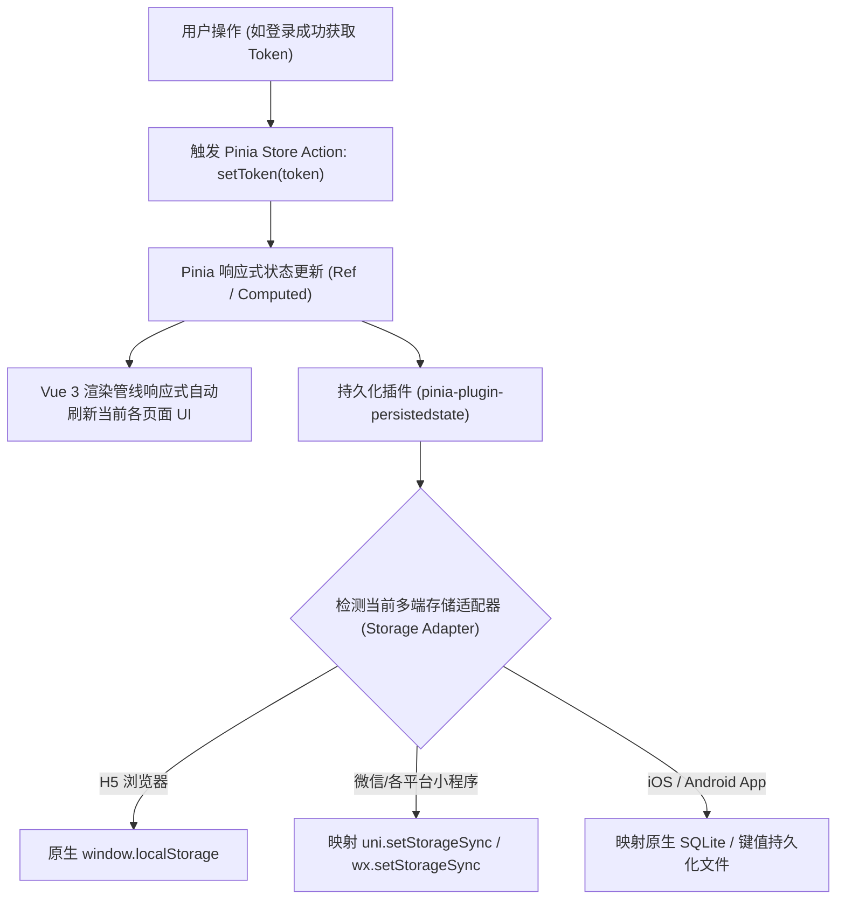
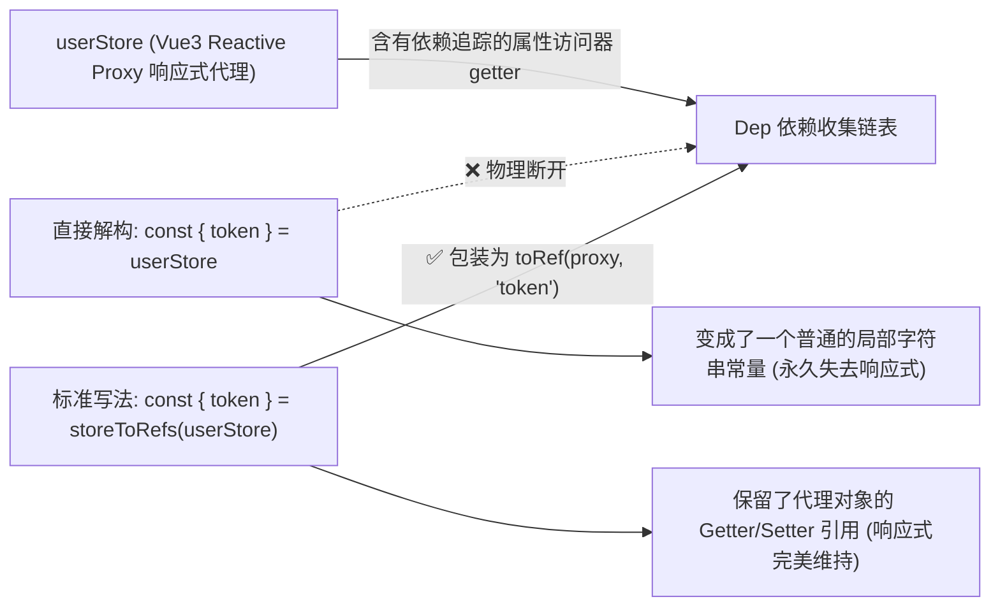

# 中级-状态管理Pinia在UniApp中的多端持久化适配实战

在 Vue 3 与 Uni-App 现代化生态中，**Pinia** 已全面取代过时繁琐的 Vuex4，成为官方推荐的全局状态管理事实标准。Pinia 凭借纯正的 TypeScript 类型推导、与组合式 API（`<script setup>`）天然契合的心智模型、以及极度轻量的打包体积，极大提升了多端共享状态的管理效率。

然而，当将 Web 端的 Pinia 经验直接搬到小程序与 App 跨端工程中时，开发者往往会遭遇严重的“水土不服”：**小程序底层根本没有浏览器标准的 `localStorage`，直接引入持久化插件会导致 `ReferenceError: localStorage is not defined` 崩溃；解构 Store 状态导致响应式瞬间丢失；将整个 Store 全量无脑持久化导致触发小程序 10MB 存储上限**。

在社招中级面试中，面试官将围绕状态管理的架构设计考核：**Pinia 的多端底层存储适配器实现原理、`storeToRefs` 的响应式代理机制、以及如何实现“细粒度、高性能”的跨端持久化状态机？**

---

## 1. 核心底层机制与全景架构

### 1.1 Pinia 在 Uni-App 多端环境中的持久化架构全景



### 1.2 核心选型与核心痛点矩阵

| 架构维度 | 传统 Vuex 4 | 现代 Pinia + 跨端适配 |
| :--- | :--- | :--- |
| **代码组织** | 嵌套繁琐的 `mutations`、`actions`、`modules` | **纯函数组合式封装**，直接使用 `ref`、`computed`，零样板代码 |
| **TypeScript 支持** | 复杂的字符串命名空间，类型推导极弱 | **自动完整的类型推断**，字段重命名有编译期全量提示 |
| **多端持久化机制** | 依赖针对 Web 的插件，易在小程序端崩溃 | **自定义统一 Storage 适配器**，全平台自动抹平存储差异 |
| **打包体积** | 约 10KB 左右 | **仅约 1KB**，且天然支持深度 Tree-Shaking 剪枝 |

---

## 2. 源码级/算法物理推导

### 2.1 为什么直接解构 Store 会导致响应式断裂？

初学者最常写出的错误代码：
```typescript
const userStore = useUserStore();
// ❌ 致命错误：直接解构导致响应式引用物理断裂！
const { token, userInfo } = userStore;
```

#### 物理底层原理解析：
- `userStore` 本质上是一个被 Vue 3 `reactive` 包裹的高阶代理对象（Proxy）。
- 当执行 ES6 解构赋值 `const { token } = userStore` 时，底层相当于执行了 `const token = userStore.token`。这只是简单地将当前时刻 Proxy 内部持有的原始基本类型值（如普通字符串）拷贝赋值给了局部变量 `token`。
- **断裂结果**：后续 Store 内部的 `token` 无论如何变动，局部变量 `token` 仅仅是一个固定的旧字符串，**其与 Vue 的依赖收集系统（Effect / Dep）彻底失去了指针关联**，界面永远无法自动刷新！



---

## 3. 社招/阶段必考高频硬核连环追问

### 追问 1：在 Uni-App 中直接使用 `pinia-plugin-persistedstate` 时，为什么在 H5 运行正常，一编译到微信小程序就直接报错 `ReferenceError: localStorage is not defined`？如何根治？

> **答辩深度闭环**：
> 1. **默认存储引擎绑定浏览器**：`pinia-plugin-persistedstate` 默认配置的持久化存储介质是浏览器的 `window.localStorage`。
> 2. **小程序沙箱缺失 BOM**：在微信小程序和 App 的逻辑层（JSCore/V8）沙箱中，根本没有浏览器的全局 `window` 和 `localStorage` 对象。
> 3. **工业级根治解法（桥接自定义 Storage）**：
>    必须在持久化配置中，将存储对象显式重写为基于 **`uni.getStorageSync`** 与 **`uni.setStorageSync`** 的适配器接口：
>    ```typescript
>    persist: {
>      storage: {
>        getItem(key) { return uni.getStorageSync(key); },
>        setItem(key, value) { uni.setStorageSync(key, value); }
>      }
>    }
>    ```

---

### 追问 2：微信小程序本地缓存有严格的“单 key 1MB、总容量 10MB”物理红线，如果将一个包含超大列表数据的 Store 全量持久化，会导致什么严重后果？

> **答辩深度闭环**：
> 1. **存储溢出崩溃（Storage Limit Exceeded）**：当存储数据总和超过 10MB 时，后续调用 `uni.setStorageSync` 会直接抛出异常，导致新缓存写入失败。
> 2. **主线程卡顿掉帧**：`uni.setStorageSync` 是**同步阻塞 I/O**。如果每次状态改变都将一个几十 KB 甚至上百 KB 的庞大 JSON 进行全量序列化并写入磁盘，会严重抢占逻辑层执行时间片，造成明显的界面卡顿。
> 3. **解决方案（按字段白名单局部持久化）**：
>    必须配置 `paths` 白名单切片：**严禁将整个 Store 无脑全部持久化**！只持久化极其核心的轻量凭据字段（如 `token`、`userId`），而庞大的商品列表、临时搜索结果只保存在内存中，重启后按需重新向接口请求。

---

### 追问 3：在多页面频繁调用 `useUserStore()` 时，Pinia 会不会在内存中创建多个相互独立的 Store 实例？其单例机制是如何实现的？

> **答辩深度闭环**：
> 1. **绝对保证单例（Singleton Pattern）**：Pinia 在底层维护了一个全局 Map 映射表（`pinia._s`）。
> 2. **寻址复用算法**：当开发者在页面 A 或组件 B 中调用 `useUserStore()` 时，底层根据传入的唯一 StoreId（如 `'user'`）先去 Map 中查找：
>    - 若已存在：**直接返回已有的单例 Store 引用**；
>    - 若不存在：才会执行初次初始化并注册进 Map 中。
> 3. **结论**：无论在多少个子组件或不同页面中调用 `useUserStore()`，它们读写的永远是内存中同一份绝对共享的响应式数据源。

---

## 4. 生产级避坑指南与排障 SOP

### 4.1 生产级多端通用 Pinia 用户状态管理与按需持久化模板

#### 1. 全局持久化插件配置与 Pinia 挂载（`main.ts`）
```typescript
import { createSSRApp } from 'vue';
import * as Pinia from 'pinia';
import { createPersistedState } from 'pinia-plugin-persistedstate';
import App from './App.vue';

export function createApp() {
  const app = createSSRApp(App);
  const pinia = Pinia.createPinia();

  // 核心：配置全平台通用的持久化存储适配器
  pinia.use(
    createPersistedState({
      storage: {
        getItem: (key) => uni.getStorageSync(key),
        setItem: (key, value) => uni.setStorageSync(key, value),
      },
    })
  );

  app.use(pinia);
  return { app, Pinia };
}
```

#### 2. 用户状态 Store 工业级定义（`stores/user.ts`）
```typescript
import { defineStore } from 'pinia';
import { ref, computed } from 'vue';

interface UserProfile {
  id: string;
  nickname: string;
  avatar: string;
}

export const useUserStore = defineStore(
  'user',
  () => {
    // 1. 响应式核心状态
    const token = ref<string>('');
    const profile = ref<UserProfile | null>(null);

    // 2. Getters 计算属性
    const isLogin = computed(() => !!token.value);

    // 3. Actions 业务逻辑
    function setToken(newToken: string) {
      token.value = newToken;
    }

    function setProfile(newProfile: UserProfile) {
      profile.value = newProfile;
    }

    function logout() {
      token.value = '';
      profile.value = null;
      // 显式清理本地物理持久化
      uni.removeStorageSync('user');
    }

    return {
      token,
      profile,
      isLogin,
      setToken,
      setProfile,
      logout,
    };
  },
  {
    // 核心优化：按需白名单持久化！
    // 仅将核心的 token 和 profile 持久化到本地，杜绝内存垃圾沉淀
    persist: {
      paths: ['token', 'profile'],
    },
  }
);
```

#### 3. 业务页面中响应式安全消费（`pages/my/index.vue`）
```vue
<template>
  <view class="user-page">
    <view v-if="isLogin">
      <image class="avatar" :src="profile?.avatar" />
      <text class="name">{{ profile?.nickname }}</text>
      <button @click="handleLogout">退出登录</button>
    </view>
    <view v-else>
      <button @click="goToLogin">去登录</button>
    </view>
  </view>
</template>

<script setup lang="ts">
import { storeToRefs } from 'pinia';
import { useUserStore } from '@/stores/user';

const userStore = useUserStore();

// ✅ 生产级规范：使用 storeToRefs 安全解构，响应式 100% 维持！
const { isLogin, profile } = storeToRefs(userStore);

function handleLogout() {
  userStore.logout();
}

function goToLogin() {
  uni.navigateTo({ url: '/pages/login/login' });
}
</script>
```

### 4.2 状态管理排障速查表

| 故障现象 | 物理根因 | 生产排查与根治 SOP |
| :--- | :--- | :--- |
| **`storeToRefs` 解构 actions 报错** | `storeToRefs` 仅能解构状态（state）和计算属性（getters），不能解构函数。 | actions 函数必须直接从 store 实例上解构：`const { logout } = userStore;`。 |
| **刷新页面后状态全部恢复为初始值** | 未配置 `persist: true` 或自定义 Storage 适配器中未实现正确的读写回调。 | 检查 `main.ts` 中的 `createPersistedState` 是否正确挂载至 `pinia` 实例。 |
| **本地存储内容变成了 `[object Object]`** | 误用了未序列化的字符串读写逻辑。 | 确保 `pinia-plugin-persistedstate` 在将对象写入 `uni.setStorageSync` 时自动完成了 JSON 序列化。 |
