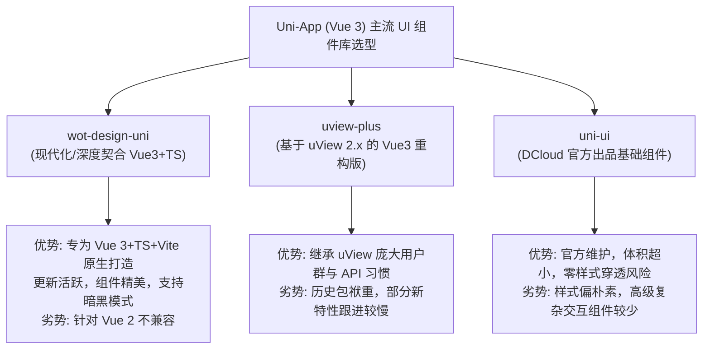
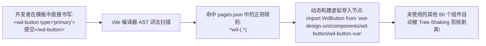

# 中级-现代化UI组件库wot-design-uni与uview-plus选型集成

在商业化前端交付中，纯靠手写基础组件不仅研发效率低下，且难以保证跨移动端各机型视觉与交互细节的一致性。一套成熟、完备且支持多端自适应的移动端 **UI 组件库** 是每个团队必不可少的基础设施。

然而，随着 Uni-App 全面拥抱 **Vue 3、TypeScript 与 Vite 现代构建流水线**，传统基于 Vue 2 构建的老牌组件库面临着严峻的架构淘汰。

在社招中高级面试中，面试官不仅考查开发者是否具备组件库集成实操经验，更会深入底层考量：**在 Vue 3 时代，`wot-design-uni`、`uview-plus` 与官方 `uni-ui` 各自的底层优劣与维护度现状如何？`easycom` 自动按需引入的正则匹配算法是什么？为什么在小程序中覆写第三方组件样式使用 `:deep()` 会失效？如何通过 CSS 变量和主题令牌（Theme Tokens）实现整套 App 的动态换肤？**

---

## 1. 核心底层机制与全景架构

### 1.1 Vue 3 跨端组件库三强技术全景对比



| 选型对比维度 | `wot-design-uni`（推荐度极高） | `uview-plus` | 官方 `uni-ui` |
| :--- | :--- | :--- | :--- |
| **原生设计语言** | **原生针对 Vue 3 + TS 全量重构**，全面拥抱 `<script setup>` | 由 Vue 2 时代的 uView 升级重构而来 | 官方基础跨端规范 |
| **样式覆盖体验** | 支持 CSS 变量（CSS Variables）与主题定制，组件开放度高 | 依赖 SCSS 变量与传统覆盖 | 样式较为基础固定 |
| **维护活跃度** | **GitHub 极其活跃**，文档详尽，更新迭代迅猛 | 社区驱动维护，中规中矩 | 官方保守维护，改动小 |
| **按需加载能力** | 完美契合 Vite 的 Tree-Shaking 与 easycom | 支持 easycom | 深度支持 easycom 与 uni_modules |

---

## 2. 源码级/算法物理推导

### 2.1 easycom 自动匹配与按需剪枝算法推导

在大型工程中，若通过 `import { WdButton } from '...'` 全量引入，极易把几十个未使用的组件连带打包进微信小程序，造成主包体积爆炸。

Uni-App 提供了革命性的 **`easycom` 按需加载编译器中间件**：



#### `pages.json` 中的标准匹配规则：
```json
{
  "easycom": {
    "autoscan": true,
    "custom": {
      "^wd-(.*)": "wot-design-uni/components/wd-$1/wd-$1.vue",
      "^u-(.*)": "uview-plus/components/u-$1/u-$1.vue"
    }
  }
}
```

---

## 3. 社招/阶段必考高频硬核连环追问

### 追问 1：引入组件库后，想要把一个第三方按钮（如 `<wd-button>`）的圆角改为 50px，在页面中使用 `:deep(.wd-button)` 修改，为什么在 H5 生效但在微信小程序端死活不生效？

> **答辩深度闭环**：
> 1. **微信小程序的组件样式物理隔离（Shadow DOM Isolation）**：微信小程序底层对自定义组件强行开启了类似 Web Components 的影子树样式隔离。页面中编译出的选择器（哪怕通过 `:deep()` 增加了后代选择器），**小程序渲染引擎在匹配选择器时会直接在组件边界截断，严禁任何外部类名渗透修改组件内部的原生节点**！
> 2. **H5 端生效原因**：H5 编译后所有节点平铺在同一个全局 DOM 树中，`:deep()` 仅是生成了 `[data-v-xxx] .wd-button` 的普通 CSS 级联选择器，因此能直接穿透命中。
> 3. **生产级两大破局解法**：
>    - **解法 A（官方推荐：解除隔离）**：在页面的 `<script>` 中显式配置 `styleIsolation: 'shared'`，主动解除隔离；
>    - **解法 B（利用 CSS 自定义属性/变量）**：`wot-design-uni` 在底层使用了 CSS Variables。直接在父容器覆写其变量：`--wot-button-border-radius: 50px;`，由于 CSS 变量具有天然的**跨 Shadow DOM 穿透继承特性**，在所有平台均能完美生效！

---

### 追问 2：在引入 UI 组件库后，初学者有时会发现页面首次启动速度明显变慢，包体积增加了 500KB~1MB，如何排查与优化？

> **答辩深度闭环**：
> 1. **全量全局挂载引发悲剧**：排查 `main.ts` 中是否错误地执行了全量注册（如 `import WotDesign from 'wot-design-uni'; app.use(WotDesign);`）。这会导致 Vite 的 Tree-Shaking 机制彻底瘫痪，迫使编译器将整个组件库的所有组件及内置图标字体全部打包进主包！
> 2. **正确规范**：**完全禁止在 `main.ts` 中全量 `app.use`！**
> 3. 严格依赖 `pages.json` 的 `easycom` 规则。Vite 只会在页面模板真实出现 `<wd-xxx>` 标签时才按需提取对应文件，未使用的组件零代码打包进包体。

---

### 追问 3：如何在企业级工程中，实现一套 UI 组件库一键切换“品牌主题色（Theme Primary Color）”？

> **答辩深度闭环**：
> 1. **全局 SCSS 变量覆盖**：在项目根目录的 `uni.scss` 中，在引入组件库样式之前，提前定义并覆盖其主题色变量：
>    ```scss
>    /* uni.scss */
>    // 覆写第三方组件库默认的主题色 (如由蓝色覆写为企业专有品牌绿)
>    $--wot-color-theme: #2B9939 !default;
>    ```
> 2. **动态运行时换肤（CSS 变量驱动）**：
>    利用现代组件库内置的 ConfigProvider（配置提供者容器），在页面根节点包裹 `<wd-config-provider :theme-vars="customThemeVars">`，通过响应式变量在运行时毫秒级动态切换白昼/暗黑模式及节日定制主题色。

---

## 4. 生产级避坑指南与排障 SOP

### 4.1 生产级 `wot-design-uni` 高效集成实战规范

#### 1. 依赖安装（使用 pnpm）
```bash
pnpm add wot-design-uni
```

#### 2. 全局样式变量注入（`uni.scss`）
```scss
/* 引入 wot-design-uni 核心主题样式 */
@import 'wot-design-uni/components/common/abstracts/variable.scss';

/* 自定义覆盖品牌主题色 */
$color-theme: #2B9939;
```

#### 3. 业务页面直接使用（零手动 import）
```vue
<template>
  <view class="demo-page">
    <!-- 直接书写标签，easycom 自动按需识别导入 -->
    <wd-button type="primary" size="large" @click="handleAction">
      提交订单
    </wd-button>

    <wd-toast id="wd-toast" />
  </view>
</template>

<script setup lang="ts">
import { useToast } from 'wot-design-uni';

const toast = useToast();

function handleAction() {
  toast.success('订单提交成功！');
}
</script>

<style lang="scss" scoped>
.demo-page {
  padding: 32rpx;

  /* 生产级样式覆盖：利用 CSS 变量安全修改，全端 100% 穿透生效 */
  :deep(.wd-button) {
    --wot-button-large-height: 96rpx;
    --wot-button-large-radius: 48rpx;
  }
}
</style>
```

### 4.2 组件库样式排错速查表

| 故障现象 | 物理根因 | 生产排查与根治 SOP |
| :--- | :--- | :--- |
| **组件样式丢失、错乱变形** | 忘记在 `App.vue` 或 `uni.scss` 中引入组件库的全局基础样式。 | 检查 `App.vue` 中的 `@import 'wot-design-uni/components/common/style/index.scss';`。 |
| **微信开发者工具报 `Component not found`** | `pages.json` 的 `easycom` 正则配置错误或依赖未成功安装。 | 重新执行 `pnpm install` 并核对 `pages.json` 正则表达式。 |
| **组件内文字图标显示为方块或问号** | 字体文件（IconFont）在小程序端因跨域或路径错误未成功加载。 | 检查组件库配置，开启 Base64 图标内联或配置外部可访问的 CDN 字体地址。 |
