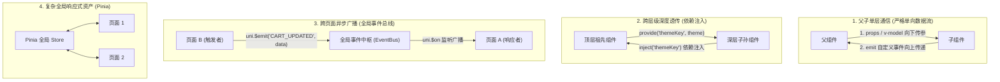

# 中级-组件通信全方案props-emit与全局事件总线uni-emit

在组件化与模块化开发架构中，各组件和页面绝不是孤立存在的静态岛屿。从父子组件的数据交互、祖孙层级的跨层透传，到跨越独立页面栈的通知广播（如“在个人中心修改头像后，首页和聊天列表同步刷新”、“在商品详情页加入购物车后，底栏 TabBar 购物车红点数字实时自增”），**组件通信体系的设计质量**直接决定了应用数据流的可预测性与内存健康度。

在社招中级技术面试中，面试官不仅考查基础的 `props`/`emit`，更会深入剖析事件生命周期：**`uni.$emit` 与 `uni.$on` 底层发布订阅模型的内存驻留机制是什么？为什么在目标页面的 `onLoad` 中派发 `uni.$emit` 上一级页面经常无法接收到？深层组件嵌套传参如何避免跨线程 `setData` 性能爆炸？**

---

## 1. 核心底层机制与全景架构

### 1.1 Uni-App 全场景组件通信拓扑阵列

根据组件之间的关系层级，通信方案可清晰划分为四大维度：



### 1.2 核心通信方案选型权衡表

| 通信方式 | 适用物理拓扑 | 优势 | 潜在缺陷 / 物理边界 |
| :--- | :--- | :--- | :--- |
| **`props` / `emit`** | 紧密直接父子组件 | 遵循 Vue 严格单向数据流，链路清晰明了 | 跨越 3 层以上组件时产生繁重的“参数逐层透传（Prop Drilling）”。 |
| **`provide` / `inject`** | 顶层与深层后代组件 | 避免中间多层组件无意义的 props 传递 | 追踪数据源头较困难，不宜用于高频变动的非关联业务。 |
| **`uni.$emit` / `uni.$on`** | **跨越完全不同的物理页面** | 任意页面随处可调，无需强耦合依赖关系 | **必须严谨手动注销 `uni.$off`**，极易引发严重闭包内存泄漏与多次重复执行。 |
| **Pinia 全局 Store** | 全局核心业务资产（用户态/购物车） | 强类型安全、多端响应式、支持 DevTools 时间旅行调试 | 极简局部通知引入 Store 显得过重，需设计合理的 Store 模块。 |

---

## 2. 源码级/算法物理推导

### 2.1 uni.$emit 与 uni.$on 底层发布订阅模型推导

`uni.$on` 与 `uni.$emit` 挂载在全局单例上，其物理本质是标准的 **发布-订阅模式（Pub/Sub Pattern）**：

```javascript
// Uni-App 底层事件中心核心数据结构还原
class EventBus {
  constructor() {
    // 维护一个事件名 -> 回调函数数组的全局哈希表
    this._events = Object.create(null);
  }

  $on(eventName, callback) {
    if (!this._events[eventName]) {
      this._events[eventName] = [];
    }
    // 将监听闭包推入数组 (强引用当前组件上下文)
    this._events[eventName].push(callback);
  }

  $emit(eventName, ...args) {
    const callbacks = this._events[eventName];
    if (callbacks && callbacks.length > 0) {
      // 循环遍历执行所有注册的回调
      callbacks.forEach(fn => fn.apply(this, args));
    }
  }

  $off(eventName, callback) {
    if (!this._events[eventName]) return;
    if (!callback) {
      // 若未传具体函数，清空该事件名下的所有监听器
      this._events[eventName] = [];
    } else {
      // 过滤移除指定的回调函数
      this._events[eventName] = this._events[eventName].filter(fn => fn !== callback);
    }
  }
}
```

#### 内存泄漏与重复执行的物理成因：
- 当用户进入页面 A 时，`onLoad` 中执行了 `uni.$on('USER_UPDATE', fn)`。
- 用户点击返回离开页面 A，如果**没有执行 `uni.$off`**，由于全局 `_events` 哈希表依然强引用着 `fn`，而 `fn` 内部闭包捕获了页面 A 的 `this` 或响应式作用域，导致**页面 A 的整棵组件树无法被 GC 垃圾回收**！
- 当用户第 10 次进入页面 A 时，`_events['USER_UPDATE']` 数组中已经堆积了 10 个未销毁的旧闭包。一旦任意页面触发一次 `$emit`，控制台和逻辑将**瞬间并发执行 10 次**，造成严重的重复提示与接口雪崩！

---

## 3. 社招/阶段必考高频硬核连环追问

### 追问 1：页面 A 使用 `uni.navigateTo` 跳转到页面 B，页面 B 在 `onLoad` 中立即调用 `uni.$emit('EVENT_X', data)`，页面 A 为什么经常根本收不到该通知？

> **答辩深度闭环**：
> 1. **时钟时序断裂（Event Timing Mismatch）**：
>    - 页面 A 的监听注册通常在自身 `onLoad` 中完成。
>    - 当 `navigateTo` 打开页面 B 时，页面 A 触发 `onHide` 进入后台挂起态。
>    - 如果在页面 B 的 `onLoad` 执行 `$emit`，此时页面 B 刚刚初次加载，可能页面 A 的异步监听尚未准备好或逻辑处理被阻塞；
> 2. **更普遍的时序陷阱**：反过来，如果“页面 A 派发，页面 B 接收”：如果在页面 A `navigateTo` 之后立即 `$emit`，此时**页面 B 甚至根本还没有完成初始化与挂载，页面 B 的 `$on` 监听函数尚未注册进全局哈希表**！事件被空发丢失。
> 3. **解决方案**：跨页面传参必须使用标准 URL Query（`?id=xxx`）或 `EventChannel`；若必须使用全局事件，必须由**接收方先注册就绪后，通知方在确定接收方存活时再派发**。

---

### 追问 2：为什么在小程序架构中，严禁将一个包含数千行商品数据的大型对象通过 `props` 向深层子组件递归传递？

> **答辩深度闭环**：
> 1. **逻辑层到视图层的序列化开销**：在微信小程序和 App 的双线程架构中，父组件向子组件通过 `props` 传值，底层需要将数据通过 `setData` 跨线程拷贝传递给视图层。
> 2. **深度复制与冗余拷贝**：如果父组件持有一个 2MB 的全量数据树并透传给子组件，系统会为子组件的虚拟 DOM 节点再次进行全量深拷贝与序列化。层级越深，跨线程通信通道传输的字节量呈倍数暴增，导致 JS 线程瞬间卡死，出现严重掉帧。
> 3. **最佳工程规范**：严格遵守**最小特权与接口隔离原则**。子组件仅通过 `props` 接收其展示所需的最小字段（如 `goodsId`、`title`、`price`），或者直接在子组件内部通过 ID 从 Pinia Store 中精准提取切片数据。

---

### 追问 3：在 Vue 3 `<script setup>` 组合式写法中，`uni.$on` 绑定的匿名箭头函数，调用 `uni.$off('EVENT_NAME')` 为什么经常出现“误伤其他页面”或“无法精准注销”？

> **答辩深度闭环**：
> 1. **误伤大坑**：若调用 `uni.$off('EVENT_NAME')` 但不传具体函数引用，底层会将该事件名下的**所有监听器全部清空**，导致其他页面（如首页、个人中心）预埋的同名监听器瞬间全部暴毙失效。
> 2. **无法注销大坑**：若写成了匿名箭头函数：
>    ```typescript
>    onLoad(() => {
>      uni.$on('EVENT_NAME', (data) => { ... }); // 匿名函数无法溯源
>    });
>    onUnload(() => {
>      uni.$off('EVENT_NAME', (data) => { ... }); // 传的是一个全新的匿名函数引用，物理比对 fn !== callback，根本删不掉！
>    });
>    ```
> 3. **标准规范**：必须在外部定义具名函数（Named Function），在 `$on` 和 `$off` 中传入完全相同的函数引用指针。

---

## 4. 生产级避坑指南与排障 SOP

### 4.1 生产级自动注销事件总线 Hook（`useEventBus`）

为了彻底消灭人为漏写 `uni.$off` 引发的内存泄漏，结合 Vue 3 与 Uni-App 生命周期封装自动化清理 Hook：

```typescript
// composables/useEventBus.ts
import { onUnload } from '@dcloudio/uni-app';

type EventCallback = (...args: any[]) => void;

export function useEventBus() {
  // 维护当前页面注册的事件清单
  const registeredEvents: Array<{ name: string; handler: EventCallback }> = [];

  // 安全注册监听
  function on(name: string, handler: EventCallback) {
    registeredEvents.push({ name, handler });
    uni.$on(name, handler);
  }

  // 派发事件
  function emit(name: string, ...args: any[]) {
    uni.$emit(name, ...args);
  }

  // 核心：在页面卸载生命周期自动执行 100% 逆向注销，防泄漏兜底！
  onUnload(() => {
    registeredEvents.forEach(({ name, handler }) => {
      uni.$off(name, handler);
    });
    registeredEvents.length = 0;
  });

  return { on, emit };
}
```

#### 业务组件中使用（零心智负担）：
```vue
<script setup lang="ts">
import { useEventBus } from '@/composables/useEventBus';

const { on, emit } = useEventBus();

// 自动绑定，页面销毁时底层自动 uni.$off，绝无内存泄漏风险！
on('CART_COUNT_UPDATED', (newCount: number) => {
  console.log('购物车数量更新为:', newCount);
});
</script>
```

### 4.2 跨组件通信排错速查表

| 故障现象 | 物理成因 | 生产级秒级根治 SOP |
| :--- | :--- | :--- |
| **事件响应了多次（如 Toast 弹了 5 次）** | 退出页面未注销，每次进入重复 `$on` 累加了多个闭包。 | 使用具名函数，在 `onUnload` 中精准调用 `uni.$off(name, fn)` 或使用上述 Hook。 |
| **props 修改报警 `Avoid mutating a prop directly`** | 子组件直接修改了父组件通过 props 传入的变量。 | 子组件通过 `emit('update:modelValue')` 通知父组件修改，严格遵循单向数据流。 |
| **provide 注入的数据在子组件中失去响应式** | `provide` 传递的是一个普通变量，而非 `ref` 或 `reactive`。 | 必须使用 `provide('key', readonly(reactiveData))` 传递响应式包装对象。 |
