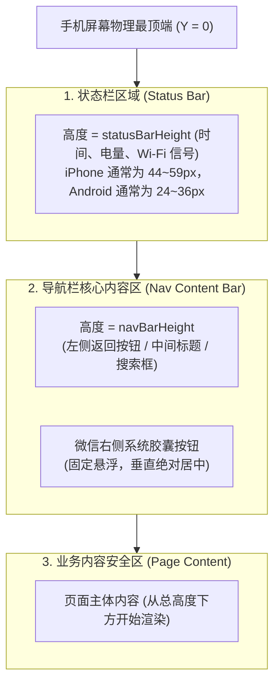
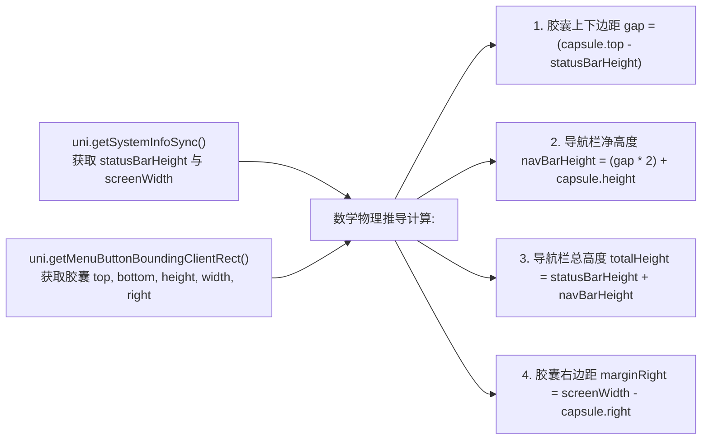

# 中级-自定义顶部导航栏CustomNavBar与状态栏胶囊对齐实战

在追求极致视觉冲击力与品牌质感的现代移动应用中，系统原生默认的粗暴顶部导航栏（白色/黑色底色 + 单纯居中文字）早已无法满足大厂设计规范。无论是在商城的沉浸式半透明背景图吸顶、复杂搜索框内嵌、还是个性化返回与主页双按钮，实现一个**像素级精准对齐的自定义顶部导航栏（Custom Navigation Bar）** 是中级前端开发者的必修硬核技能。

然而在多端开发中，顶部状态栏（Status Bar）高度因设备千差万别（iPhone 刘海屏、灵动岛、各类 Android 挖孔屏、水滴屏），而在微信小程序端，右侧还悬浮着系统强制常驻且无法消除的**“胶囊按钮（Capsule Button / MenuButton）”**。

在社招技术面试中，面试官将直击核心计算法则：**自定义导航栏的总高度、内容净高度与胶囊的物理对齐数学方程是什么？如果直接写死 `44px` 会在哪些机型上瞬间崩盘？在 H5 和 App 端如何优雅兼容 `getMenuButtonBoundingClientRect` 的缺失？**

---

## 1. 核心底层机制与全景架构

### 1.1 手机屏幕顶部的几何分层解构

当在 `pages.json` 中配置 `"navigationStyle": "custom"` 隐藏原生导航栏后，自定义组件必须按以下三层空间进行严格的几何占位：



---

## 2. 源码级/算法物理推导

### 2.1 像素级胶囊对齐的核心数学物理方程

在微信小程序端，右上角的胶囊按钮是绝对的基准坐标系。要让中间的页面标题和左侧的返回箭头与胶囊在视觉上处于**同一水平中心线**，必须推导出以下几何方程：



#### 核心推导公式：
1. **胶囊距离状态栏底部的垂直间隙（Gap）**：
   $$\text{gap} = \text{capsule.top} - \text{statusBarHeight}$$
2. **导航栏内容区净高度（$H_{\text{navContent}}$）**：
   $$H_{\text{navContent}} = (\text{gap} \times 2) + \text{capsule.height}$$
3. **自定义导航栏总占位高度（$H_{\text{total}}$）**：
   $$H_{\text{total}} = \text{statusBarHeight} + H_{\text{navContent}}$$

---

## 3. 社招/阶段必考高频硬核连环追问

### 追问 1：很多开发者图省事，在 CSS 里直接写死 `height: 44px; padding-top: 44px;`，这种写法在生产环境会造成什么严重灾难？

> **答辩深度闭环**：
> 1. **状态栏高度跨机型剧烈跳动**：
>    - iPhone 14 Pro（灵动岛）的状态栏高度高达 **`54px`**，iPhone 13 为 **`47px`**；
>    - 普通 Android 水滴屏状态栏通常仅有 **`24px ~ 32px`**。
> 2. **灾难现场**：
>    - 在灵动岛 iPhone 上写死 44px：自定义标题会被黑色的物理灵动岛**直接大面积遮挡截断**，返回箭头被挤在右上角无法点击；
>    - 在 Android 机型上写死 44px：状态栏下方会留出极宽的丑陋空隙，标题与右侧胶囊完全错位，视觉重心严重下沉。
> 3. **规避原则**：严禁硬编码任何数字，所有尺寸必须在组件挂载前**通过系统 API 动态实时计算**。

---

### 追问 2：在 H5 浏览器端或 App 端运行相同的自定义导航栏组件时，代码执行到 `uni.getMenuButtonBoundingClientRect()` 为什么会报 `undefined` 导致整页崩溃？

> **答辩深度闭环**：
> 1. **小程序专属 API 陷阱**：`getMenuButtonBoundingClientRect()` 是微信等小程序平台的**专属 API**。在 H5 浏览器或标准原生 App 中，由于根本没有所谓的“右上角系统胶囊”，调用该方法在 H5 会直接返回 `undefined`，紧接着读取 `capsule.top` 会瞬间抛出经典的 `Cannot read property 'top' of undefined` 致命空指针异常！
> 2. **工业级防御机制（平台回退降级）**：
>    必须使用条件编译或防御性判空：在 H5 和 App 端，直接降级采用行业标准的默认固定高度（通常为状态栏高度 + $44\text{px}$ 标准高度）。

---

### 追问 3：在页面顶部实现了自定义导航栏后，当页面向下滚动时，背景如何实现从“透明”平滑渐变为“高亮实体白色”？

> **答辩深度闭环**：
> 1. **监听页面级滚动事件（`onPageScroll`）**：在页面生命周期中捕获滚动的物理垂直位移 `e.scrollTop`。
> 2. **计算透明度归一化插值（Opacity Alpha）**：
>    设定滚动阈值（如 $150\text{px}$）：
>    $$\text{alpha} = \min(1, \max(0, \text{scrollTop} / 150))$$
> 3. **动态更新背景样式**：将动态计算出的 `alpha` 赋给导航栏背景：`backgroundColor: ` `rgba(255, 255, 255, ${alpha})`，同时当 `alpha > 0.5` 时，动态将标题文字和返回箭头的颜色从白色切换为黑色，实现平滑转场。

---

## 4. 生产级避坑指南与排障 SOP

### 4.1 生产级多端全自适应 `CustomNavBar` 组件完整源码

```vue
<template>
  <view class="custom-navbar-wrapper">
    <!-- 1. 真实的固定定位导航栏 -->
    <view
      class="navbar-fixed-container"
      :style="{
        height: `${totalHeight}px`,
        backgroundColor: bgColor
      }"
    >
      <!-- 状态栏占位层 (避开时间电量) -->
      <view :style="{ height: `${statusBarHeight}px` }"></view>

      <!-- 核心内容行 (高度等于 navBarContentHeight，垂直精准居中) -->
      <view
        class="navbar-content-row"
        :style="{
          height: `${navBarContentHeight}px`,
          paddingRight: `${capsuleRightMargin}px`
        }"
      >
        <!-- 左侧操作区 (返回 / 主页按钮) -->
        <view class="left-action" @click="handleBack">
          <slot name="left">
            <text class="back-arrow">‹</text>
          </slot>
        </view>

        <!-- 中间标题 / 搜索框 -->
        <view class="center-title">
          <slot>
            <text class="title-text" :style="{ color: titleColor }">{{ title }}</text>
          </slot>
        </view>

        <!-- 右侧胶囊避让空白占位 (仅小程序端需要) -->
        <view
          class="right-capsule-placeholder"
          :style="{ width: `${capsuleWidth}px` }"
        ></view>
      </view>
    </view>

    <!-- 2. 文档流物理占位块 (防止页面主体内容被 fixed 导航栏遮挡) -->
    <view v-if="placeholder" :style="{ height: `${totalHeight}px` }"></view>
  </view>
</template>

<script setup lang="ts">
import { ref } from 'vue';

const props = withDefaults(
  defineProps<{
    title?: string;
    bgColor?: string;
    titleColor?: string;
    placeholder?: boolean;
  }>(),
  {
    title: '页面标题',
    bgColor: '#ffffff',
    titleColor: '#000000',
    placeholder: true, // 默认开启物理高度占位
  }
);

const statusBarHeight = ref(20);
const navBarContentHeight = ref(44);
const totalHeight = ref(64);
const capsuleWidth = ref(0);
const capsuleRightMargin = ref(0);

// 初始化各平台精确物理几何数据
function initNavBarDimensions() {
  const sysInfo = uni.getSystemInfoSync();
  statusBarHeight.value = sysInfo.statusBarHeight || 20;

  let calculatedContentHeight = 44; // 默认标准 44px

  // #ifdef MP-WEIXIN || MP-ALIPAY || MP-TOUTIAO
  // 微信/平台小程序：精准读取胶囊几何信息
  try {
    const capsule = uni.getMenuButtonBoundingClientRect();
    if (capsule) {
      // 核心公式计算
      const gap = capsule.top - statusBarHeight.value;
      calculatedContentHeight = gap * 2 + capsule.height;
      capsuleWidth.value = capsule.width;
      capsuleRightMargin.value = sysInfo.screenWidth - capsule.right;
    }
  } catch (e) {
    console.warn('获取胶囊矩形失败，降级使用默认 44px');
  }
  // #endif

  navBarContentHeight.value = calculatedContentHeight;
  totalHeight.value = statusBarHeight.value + calculatedContentHeight;
}

initNavBarDimensions();

function handleBack() {
  const pages = getCurrentPages();
  if (pages.length > 1) {
    uni.navigateBack();
  } else {
    // 只有 1 层页面时返回首页
    uni.switchTab({ url: '/pages/index/index' });
  }
}
</script>

<style lang="scss" scoped>
.navbar-fixed-container {
  position: fixed;
  top: 0;
  left: 0;
  right: 0;
  z-index: 999;
  box-sizing: border-box;
}

.navbar-content-row {
  display: flex;
  align-items: center;
  box-sizing: border-box;
  padding-left: 20rpx;
  position: relative;
}

.left-action {
  min-width: 60rpx;
  display: flex;
  align-items: center;
  z-index: 10;

  .back-arrow {
    font-size: 54rpx;
    font-weight: 300;
    line-height: 1;
  }
}

.center-title {
  flex: 1;
  display: flex;
  align-items: center;
  justify-content: center;
  text-align: center;

  .title-text {
    font-size: 32rpx;
    font-weight: bold;
    max-width: 360rpx;
    overflow: hidden;
    text-overflow: ellipsis;
    white-space: nowrap;
  }
}
</style>
```

### 4.2 导航栏排障速查表

| 故障现象 | 物理根因 | 生产排查与根治 SOP |
| :--- | :--- | :--- |
| **标题被灵动岛或状态栏严重遮挡** | 忘记在 `pages.json` 中配置 `"navigationStyle": "custom"`，导致两层导航栏冲突。 | 检查当前页面在 `pages.json` 中的 `style` 配置。 |
| **H5/PC 端预览时胶囊间距极大** | 在 H5 运行时强行执行了胶囊逻辑。 | 必须使用 `#ifdef MP` 包裹 `getMenuButtonBoundingClientRect`。 |
| **页面主体内容被导航栏盖住** | 自定义导航栏设置了 `position: fixed`，但底部**漏写了等高的占位标签**。 | 确保 `placeholder` 占位块的高度完全等于 `totalHeight`。 |
