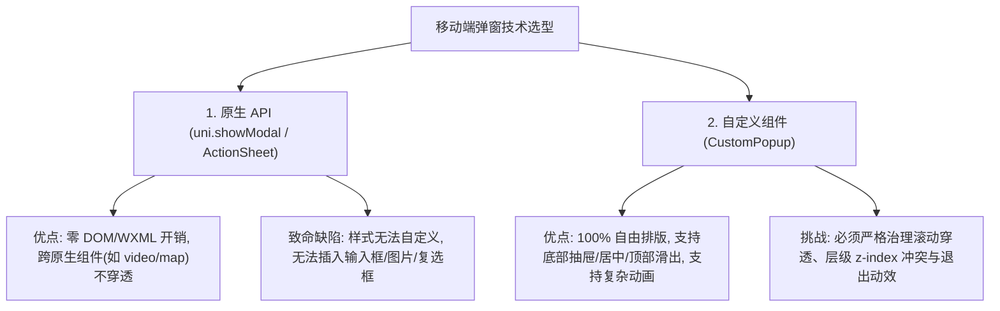
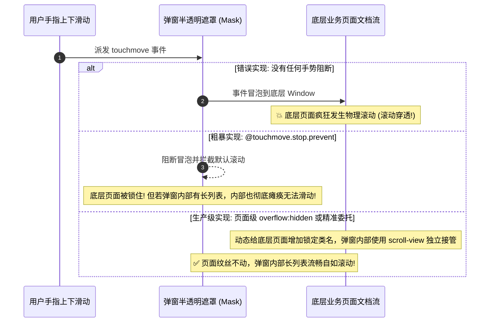

# 中级-通用弹窗体系Popup-Modal与ActionSheet优雅封装

在移动端人机交互中，**浮层与弹窗体系（Modal / Popup / ActionSheet / Drawer）** 是引导用户聚焦核心决策（如优惠券领取、规格选择 SKU、二次确认删除、协议授权）不可或缺的组件。Uni-App 虽然提供了系统级的命令式 API（如 `uni.showModal`、`uni.showActionSheet`），但其样式与布局高度受制于各家操作系统的原生规范，无法自定义复杂表单、图片及个性化动效。

因此，自研或封装一套高质量、跨端自适应的**自定义弹窗体系**是中级前端工程师的必备硬实力。

在社招技术面试中，面试官将围绕弹窗中最恶名昭彰的痛点发起考核：**移动端最经典的“滚动穿透（Scroll Penetration）”物理成因是什么？在蒙层上加了 `@touchmove.stop.prevent` 为什么会导致弹窗内部的 `scroll-view` 也跟着无法滑动？直接使用 `v-if` 为什么会导致弹窗退出动画瞬间丢失？**

---

## 1. 核心底层机制与全景架构

### 1.1 原生系统弹窗 vs 自定义组件弹窗全维度对比



### 1.2 移动端三大核心弹窗形态

| 弹窗形态 | 物理动画方向 | 典型业务场景 | 体验核心诉求 |
| :--- | :--- | :--- | :--- |
| **居中模态框（Center Modal）** | 从屏幕中央微弱缩放（Scale: 0.8 $\to$ 1.0）+ 淡入 | 营销新人大礼包、注销账号二次警告确认 | 视觉聚焦，强制阻塞用户其他操作。 |
| **底部操作抽屉（Bottom Sheet）** | 从屏幕底部平滑向上滑入（TranslateY: 100% $\to$ 0%） | 电商商品 SKU 规格选择、支付方式选择、分享面板 | 贴合单手拇指操作热区，高度自适应内容。 |
| **顶部消息通知（Top Toast）** | 从屏幕顶端向下滑出（TranslateY: -100% $\to$ 0%） | 订单状态变更提醒、即时消息推送通知 | 弱侵入性，不阻断主屏幕正常浏览。 |

---

## 2. 源码级/算法物理推导

### 2.1 移动端滚动穿透（Scroll Penetration）的物理本质

什么是滚动穿透？
- 当自定义弹窗展开并覆盖全屏遮罩时，用户用手指在遮罩或弹窗空白处上下滑动。
- **底层事件冒泡与默认行为**：触控事件（Touch Event）穿透了半透明遮罩，并继续向底层 Webview 文档流冒泡派发。操作系统底层的滚动渲染引擎接收到位移信号，**驱动遮罩下方的页面列表在后台疯狂滚动**！当用户关闭弹窗后，发现原本浏览的列表位置早已不知所踪，体验极其恶劣。



### 2.2 为什么直接 `v-if` 会导致关闭退出动画瞬间丢失？

在 Vue 模板中，若直接绑定 `v-if="show"`：
- 当用户点击关闭按钮将 `show = false` 时，Vue 的渲染器会**在当前宏任务帧中瞬间将 DOM 节点彻底卸载物理销毁**。
- **灾难结果**：CSS 中配置的 `transition: all 0.3s ease-out` 退出过渡动画**根本来不及执行**，弹窗如同掉帧一般生硬地瞬间从屏幕上凭空消失。
- **解法（双状态解耦机制）**：维护两个状态变量：
  1. `rendered`：控制 DOM 的真实挂载与卸载（保证性能）；
  2. `active`：控制 CSS 类名的切换（驱动淡入淡出和位移动画）。关闭时先将 `active = false` 播放 300ms 动画，动画结束后再将 `rendered = false` 彻底卸载节点。

---

## 3. 社招/阶段必考高频硬核连环追问

### 追问 1：在蒙层上绑定了 `@touchmove.stop.prevent` 确实阻止了底层页面滚动，但为什么如果弹窗内部自身包含一个商品规格长列表，内部也跟着完全无法滚动了？如何破解？

> **答辩深度闭环**：
> 1. **事件冒泡阻断的物理副作用**：如果在弹窗根节点上使用了全局的 `.stop.prevent`，内部子节点派发的 touchmove 事件在向上冒泡时同样会被拦截，导致移动端内核判定所有触控位移均为非法操作，内部滚动条被强行冻结死锁。
> 2. **工业级破局解法**：
>    - **局部阻断法**：仅在半透明的黑色遮罩层（Mask）上单独绑定 `@touchmove.stop.prevent`，而**弹窗内部的内容容器严禁绑定该拦截指令**。
>    - **独立滚动接管**：弹窗内部的长列表必须显式使用 **`scroll-view`** 承载并设置固定的最大高度（如 `max-height: 60vh;`）。这样遮罩层负责阻断外层，内部 `scroll-view` 自主消化局部滑动。

---

### 追问 2：为什么有些弹窗在设置了 `z-index: 999` 之后，在页面中依然会被底部的某个输入框或某些特定组件遮挡覆盖？

> **答辩深度闭环**：
> 1. **CSS 层叠上下文（Stacking Context）陷阱**：`z-index` 的比较仅在**同一个层叠上下文内部**有效。如果弹窗组件的父级容器配置了 `position: relative; z-index: 1;`，那么无论弹窗自身写成 `z-index: 99999`，在全局视角中它的层级依然受制于父级的 `1`。
> 2. **同层渲染原生组件差异**：若底层页面包含原生 `video`、`map` 或某些老旧机型中的 `textarea`，由于原生组件脱离了普通 Webview 的图层堆栈，普通 CSS 节点很容易被其覆盖。
> 3. **最佳规范**：弹窗组件必须挂载在页面的最外层根节点，或者直接使用传送门（Teleport / 顶层浮层）挂载。

---

## 4. 生产级避坑指南与排障 SOP

### 4.1 生产级多端通用抽屉与模态弹窗组件（`CustomPopup`）完整源码

```vue
<template>
  <view v-if="rendered" class="custom-popup-root">
    <!-- 1. 半透明遮罩层 (独占绑定 @touchmove.stop.prevent 彻底阻断穿透) -->
    <view
      class="popup-mask"
      :class="{ 'mask-active': isAnimating }"
      @click="handleMaskClick"
      @touchmove.stop.prevent
    ></view>

    <!-- 2. 核心内容容器 (依据 position 动态挂载进入/退出动效) -->
    <view
      class="popup-content-box"
      :class="[
        `position-${position}`,
        { 'content-active': isAnimating }
      ]"
    >
      <!-- 弹窗顶部栏 -->
      <view v-if="title" class="popup-header">
        <text class="title">{{ title }}</text>
        <view class="close-btn" @click="close">✕</view>
      </view>

      <!-- 内部安全滚动容器 (解决弹窗内部长内容滑动) -->
      <scroll-view class="popup-inner-scroll" scroll-y>
        <slot></slot>
      </scroll-view>
    </view>
  </view>
</template>

<script setup lang="ts">
import { ref, watch } from 'vue';

const props = withDefaults(
  defineProps<{
    modelValue: boolean;
    title?: string;
    position?: 'center' | 'bottom' | 'top';
    closeOnClickMask?: boolean;
  }>(),
  {
    modelValue: false,
    position: 'bottom',
    closeOnClickMask: true,
  }
);

const emit = defineEmits(['update:modelValue', 'close', 'open']);

const rendered = ref(false);
const isAnimating = ref(false);

watch(
  () => props.modelValue,
  (val) => {
    if (val) {
      // 打开时：先挂载 DOM，在下一微任务帧激活 CSS 动效
      rendered.value = true;
      setTimeout(() => {
        isAnimating.value = true;
        emit('open');
      }, 20);
    } else {
      // 关闭时：先播放淡出动画，300ms 动画结束后再彻底卸载 DOM
      isAnimating.value = false;
      setTimeout(() => {
        rendered.value = false;
        emit('close');
      }, 300);
    }
  },
  { immediate: true }
);

function close() {
  emit('update:modelValue', false);
}

function handleMaskClick() {
  if (props.closeOnClickMask) {
    close();
  }
}
</script>

<style lang="scss" scoped>
.custom-popup-root {
  position: fixed;
  top: 0;
  left: 0;
  right: 0;
  bottom: 0;
  z-index: 999;
}

.popup-mask {
  position: absolute;
  width: 100%;
  height: 100%;
  background-color: rgba(0, 0, 0, 0.6);
  opacity: 0;
  transition: opacity 0.3s ease-out;

  &.mask-active {
    opacity: 1;
  }
}

.popup-content-box {
  position: absolute;
  background-color: #ffffff;
  transition: transform 0.3s cubic-bezier(0.16, 1, 0.3, 1), opacity 0.3s ease-out;
  box-sizing: border-box;

  /* 底部抽屉形态 */
  &.position-bottom {
    left: 0;
    right: 0;
    bottom: 0;
    border-radius: 24rpx 24rpx 0 0;
    transform: translateY(100%);
    padding-bottom: env(safe-area-inset-bottom);

    &.content-active {
      transform: translateY(0);
    }
  }

  /* 居中模态框形态 */
  &.position-center {
    top: 50%;
    left: 50%;
    width: 600rpx;
    border-radius: 20rpx;
    transform: translate(-50%, -50%) scale(0.85);
    opacity: 0;

    &.content-active {
      transform: translate(-50%, -50%) scale(1);
      opacity: 1;
    }
  }
}

.popup-header {
  height: 96rpx;
  display: flex;
  align-items: center;
  justify-content: space-between;
  padding: 0 32rpx;
  border-bottom: 1rpx solid #f0f0f0;

  .title {
    font-size: 32rpx;
    font-weight: bold;
    color: #333;
  }

  .close-btn {
    font-size: 36rpx;
    color: #999;
    padding: 10rpx;
  }
}

.popup-inner-scroll {
  max-height: 65vh; /* 避免撑满全屏，保留视口呼吸感 */
  padding: 24rpx 32rpx;
  box-sizing: border-box;
}
</style>
```

### 4.2 弹窗排错速查表

| 故障现象 | 物理根因 | 生产排查与根治 SOP |
| :--- | :--- | :--- |
| **关闭弹窗时没有动画直接闪退** | 错误地直接在最外层使用单状态 `v-if="visible"`。 | 引入上述双状态解耦机制（`rendered` + `isAnimating`）。 |
| **底部抽屉被手机全面屏小黑条遮挡** | 容器底部未适配安全区内边距。 | 在底部容器中注入 `padding-bottom: env(safe-area-inset-bottom);`。 |
| **弹窗弹出后底层页面仍然能滑动** | 蒙层漏写了 `@touchmove.stop.prevent`。 | 必须在黑色透明遮罩标签上显式声明手势拦截。 |
