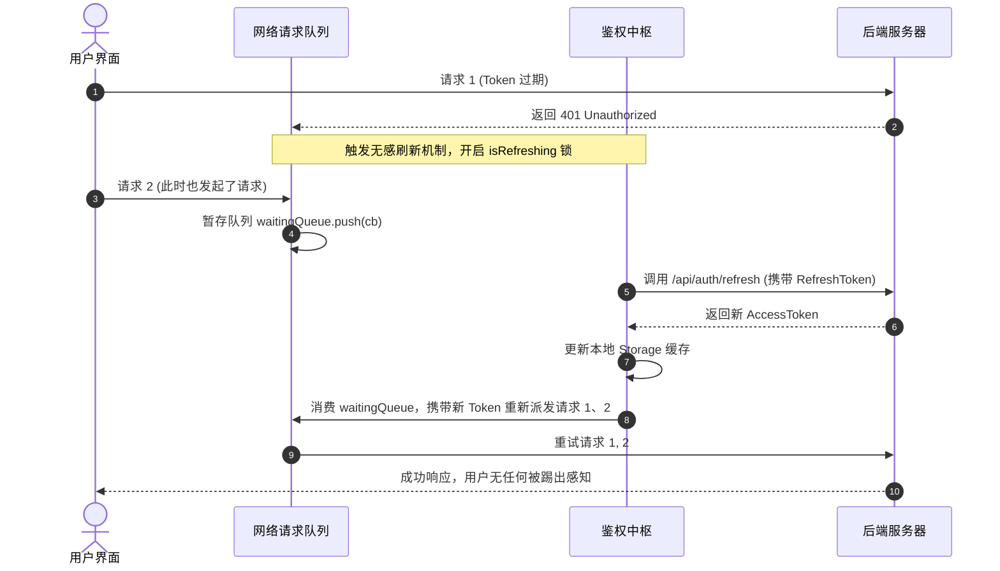

# 企业级网络封装与状态管理实战

## 使用入口：先解决问题，再做验证

统一多端请求、登录刷新和共享状态。

**先做基本操作**：先完成请求/错误/持久化与退出，验证并发 401 和账号切换，再组织拦截器和请求重放。初次学习可先完成[本模块基础实践](/doc/uniapp/页面开发登录与支付基本实践)。

**再逐步深入**：基本 API 与输入输出 → 常见失败和使用边界 → 场景排查与优化 → 本文机制分析与源码。面试先讲用途和自己的操作过程，再回答场景与原理追问。

在移动端和跨端项目中，**网络请求（HTTP/HTTPS）** 与 **全局状态管理（State Management）** 是支撑业务运转的两个最核心支柱。由于移动端环境（小程序、App、H5）存在不同的存储机制、域名鉴权与生命周期，必须有一套高度鲁棒、具备容错自愈能力的基础设施。

---

## 一、 企业级网络请求封装（基于 `uni.addInterceptor`）

传统的封装方式往往是在 `uni.request` 外包一层自定义 Promise。但在 Uni-App 规范中，**官方推荐使用 `uni.addInterceptor`（拦截器机制）**。它的优势在于：
1. **全局透明覆盖**：不仅能拦截你自己代码里的 `uni.request`，还能统一拦截第三方 SDK 或插件内部调用的网络请求。
2. **统一配置生命周期**：像 Axios 一样拥有 `invoke`（请求前）、`success`（成功返回）、`fail`（网络异常）、`complete`（完成）钩子。

### 1. 生产级网络客户端完整实现

```ts
// src/utils/request.ts
export interface RequestOptions extends UniApp.RequestOptions {
  /** 是否需要附带 Token，默认 true */
  needAuth?: boolean;
  /** 发生业务错误时是否自动弹出 Toast，默认 true */
  showToast?: boolean;
}

interface ApiResponse<T = any> {
  code: number;
  message: string;
  data: T;
}

const BASE_URL = import.meta.env.VITE_APP_API_BASE_URL || 'https://api.example.com';

// 1. 请求拦截器安装
uni.addInterceptor('request', {
  invoke(args: RequestOptions) {
    // 自动补齐基础域名（若非完整 http 地址）
    if (!args.url.startsWith('http')) {
      args.url = BASE_URL + args.url;
    }

    // 设置默认超时时间 15s
    args.timeout = args.timeout || 15000;

    // 默认请求头
    args.header = {
      'Content-Type': 'application/json',
      ...args.header,
    };

    // 注入身份凭证
    const needAuth = args.needAuth !== false;
    if (needAuth) {
      const token = uni.getStorageSync('ACCESS_TOKEN');
      if (token) {
        args.header['Authorization'] = `Bearer ${token}`;
      }
    }
  },
});

// 2. 导出类型安全的请求方法
export const request = <T = any>(options: RequestOptions): Promise<T> => {
  return new Promise((resolve, reject) => {
    uni.request({
      ...options,
      success: (res) => {
        // HTTP 状态码校验
        if (res.statusCode >= 200 && res.statusCode < 300) {
          const body = res.data as ApiResponse<T>;
          
          // 业务状态码断言（假设 200 为成功）
          if (body.code === 200) {
            resolve(body.data);
          } else if (body.code === 401) {
            // Token 过期处理
            handleTokenExpired();
            reject(new Error(body.message || '登录失效'));
          } else {
            // 业务级失败提示
            if (options.showToast !== false) {
              uni.showToast({ title: body.message || '业务处理失败', icon: 'none' });
            }
            reject(new Error(body.message));
          }
        } else {
          // HTTP 错误（404, 500, 502 等）
          uni.showToast({ title: `网络异常: ${res.statusCode}`, icon: 'none' });
          reject(res);
        }
      },
      fail: (err) => {
        // 网络不通、断网、超时等原生异常
        uni.showToast({ title: '网络连接异常，请检查网络设置', icon: 'none' });
        reject(err);
      },
    });
  });
};

function handleTokenExpired() {
  uni.removeStorageSync('ACCESS_TOKEN');
  uni.showToast({ title: '登录已过期，请重新登录', icon: 'none' });
  setTimeout(() => {
    uni.reLaunch({ url: '/pages/login/login' });
  }, 1200);
}
```

---

## 二、 高级进阶：双 Token“无感刷新”并发请求队列

在移动端高体验场景下，如果 `accessToken` 过期（比如有效期 2 小时），不能简单粗暴直接踢出用户重新登录，而是应当使用长效 `refreshToken`（比如 7 天）在后台静默换取新 Token，并**将期间并发进来的请求挂起等待，刷新成功后自动重放**。



### 关键代码落地实现：
```ts
let isRefreshing = false;
let retryQueue: Array<(token: string) => void> = [];

export const handleRefreshToken = async (originalRequest: RequestOptions) => {
  const refreshToken = uni.getStorageSync('REFRESH_TOKEN');
  if (!refreshToken) {
    handleTokenExpired();
    return Promise.reject('无刷新令牌');
  }

  // 如果已经有请求在刷新 Token，后续请求压入等待队列
  if (isRefreshing) {
    return new Promise((resolve) => {
      retryQueue.push((newToken: string) => {
        originalRequest.header = {
          ...originalRequest.header,
          Authorization: `Bearer ${newToken}`
        };
        resolve(request(originalRequest));
      });
    });
  }

  isRefreshing = true;

  try {
    const res = await uni.request({
      url: BASE_URL + '/api/auth/refresh',
      method: 'POST',
      data: { refreshToken }
    });

    const { accessToken, refreshToken: newRefreshToken } = (res.data as any).data;
    uni.setStorageSync('ACCESS_TOKEN', accessToken);
    uni.setStorageSync('REFRESH_TOKEN', newRefreshToken);

    // 释放队列并重新执行
    retryQueue.forEach((cb) => cb(accessToken));
    retryQueue = [];

    // 重放当前原始请求
    return request(originalRequest);
  } catch (e) {
    // 连 RefreshToken 都失效了，彻底退出
    retryQueue = [];
    handleTokenExpired();
    return Promise.reject(e);
  } finally {
    isRefreshing = false;
  }
};
```

---

## 三、 跨端全局状态管理：Pinia + 统一持久化

在 Vue 3 开发体系下，**Pinia** 是官方推荐的全局状态管理器。  
但标准的 `pinia-plugin-persistedstate` 默认是基于浏览器的 `localStorage`。**在小程序或 App 端执行 `localStorage` 会直接报错**。必须自定义其 `storage` 适配器，使其映射到 Uni-App 的 `uni.setStorageSync` / `uni.getStorageSync`。

### 1. 配置 Pinia 统一跨端持久化插件

```ts
// src/store/index.ts
import { createPinia } from 'pinia';
import { createPersistedState } from 'pinia-plugin-persistedstate';

const pinia = createPinia();

pinia.use(
  createPersistedState({
    // 自定义 Storage 适配器，兼容 Web、小程序、App
    storage: {
      getItem(key: string) {
        return uni.getStorageSync(key);
      },
      setItem(key: string, value: string) {
        uni.setStorageSync(key, value);
      },
    },
  })
);

export default pinia;
```

### 2. 业务 Store 实战（用户状态与购物车）

```ts
// src/store/modules/user.ts
import { defineStore } from 'pinia';
import { ref, computed } from 'vue';

export const useUserStore = defineStore(
  'user',
  () => {
    const token = ref<string>('');
    const profile = ref<{ id: number; nickname: string; avatar: string } | null>(null);

    const isLogin = computed(() => !!token.value);

    const setToken = (newToken: string) => {
      token.value = newToken;
    };

    const clearUser = () => {
      token.value = '';
      profile.value = null;
      uni.removeStorageSync('ACCESS_TOKEN');
    };

    return {
      token,
      profile,
      isLogin,
      setToken,
      clearUser,
    };
  },
  {
    // 开启持久化存储
    persist: {
      paths: ['token', 'profile'], // 仅持久化指定关键字段
    },
  }
);
```

---

## 四、 跨端主流 UI 组件库选型与实战

在多端编译项目中，UI 组件库不能选普通的桌面端/Web 库，必须选用针对小程序和 App 适配的组件库。

| 组件库 | 特点与优势 | 适用场景 |
| :--- | :--- | :--- |
| **Wot Design Uni** (`wot-design-uni`) | 基于 Vue 3 + TS 深度开发，颜值高，原生支持全端，TypeScript 支持极佳，目前社区最活跃。 | **（首选推荐）** 现代化 Vue 3 跨端项目 |
| **uview-plus** (uView 3.x) | 经典 uView 的 Vue 3 版本，业务级组件极其丰富（包含城市选择器、倒计时、验证码输入框等）。 | 复杂业务型小程序、电商商城 |
| **uni-ui** | DCloud 官方维护，体积小，兼容性最好，零外部依赖。 | 轻量级工具小程序、内嵌 H5 页面 |

### 快速引入推荐方案：`uni-app` 自动导入配置（`easycom`）
在 `pages.json` 中配置 `easycom` 规则，可以直接在页面中写 `<wd-button>` 而**无需手动 `import` 引入和注册**：

```json
{
  "easycom": {
    "autoscan": true,
    "custom": {
      "^wd-(.*)": "wot-design-uni/components/wd-$1/wd-$1.vue"
    }
  }
}
```
配置好后，直接在任何 `.vue` 页面使用：
```vue
<template>
  <view class="container">
    <wd-button type="primary" @click="onSubmit">提交订单</wd-button>
  </view>
</template>
```
编译时 Vite 会自动按需打包，绝不引入多余组件代码。
