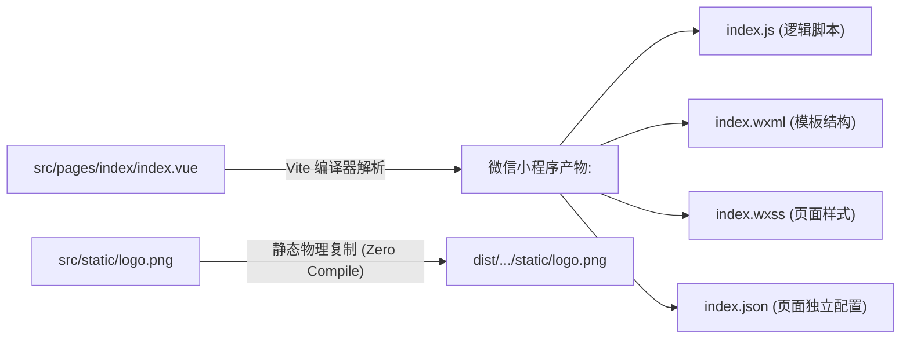

# 初级-UniApp工程架构目录规范与CLI对比HBuilderX选型

在跨平台小程序与混合 App 开发技术栈中，**Uni-App** 凭借对 Vue 语法的无缝继承以及针对各大平台（微信、支付宝、抖音、快手、百度、Web H5、iOS/Android App）的深度抽象，成为大前端工程化落地的核心选型之一。然而很多初学者在刚接触 Uni-App 时，往往陷入“只会使用 HBuilderX 可视化点击运行，脱离 GUI 就不会打包构建、不理解工程底层文件映射机制”的被动局面。

在企业级社招与规范化研发流程中，面试官首先考查的就是候选人的**工程底座驾驭能力**：**HBuilderX 可视化工程与基于 Vite 的现代化 CLI 模板有何本质差异？各大标准目录的编译映射规则是什么？团队在持续集成（CI/CD）与自动化打包中如何进行工程选型？**

---

## 1. 核心底层机制与全景架构

### 1.1 HBuilderX 可视化体系 vs 现代化 CLI 架构对比

Uni-App 在工程创建和编译运行上提供了两条截然不同的开发工作流：

```mermaid
graph TD
    subgraph HBuilderX_Workflow["HBuilderX 可视化流 (内置集成环境)"]
        H_IDE["HBuilderX IDE 客户端"] --> H_Plugin["内置集成 Node.js / uni-app 编译器插件"]
        H_Plugin --> H_Run["GUI 菜单点击: 运行到小程序模拟器 / 手机"]
        H_Run --> H_Out["输出至 unpackage/dist/dev/..."]
    end

    subgraph Vite_CLI_Workflow["现代化 CLI 流 (基于 Vite / npm)"]
        CLI_Term["开发者终端 / VS Code / WebStorm"] --> CLI_Cmd["npm run dev:mp-weixin / build:app"]
        CLI_Cmd --> CLI_Pkg["package.json 显式声明的 vite + @dcloudio/vite-plugin-uni"]
        CLI_Pkg --> CLI_Dist["输出至 dist/dev/mp-weixin 或 dist/build/..."]
        CLI_Dist --> CLI_CI["无缝接入 Jenkins / GitHub Actions / GitLab CI"]
    end
```



| 选型对比维度 | HBuilderX 可视化工程 | 现代 Vite CLI 工程 (`create-uni`) |
| :--- | :--- | :--- |
| **开发工具绑定** | 强绑定 HBuilderX IDE，换用 VS Code 体验受限 | **完全解耦 IDE**，全面支持 VS Code、WebStorm、Cursor |
| **依赖管理机制** | 依赖 IDE 内置的插件与 Node 环境，版本随 IDE 升级而隐式变化 | **显式 `package.json` 与 `pnpm-lock.yaml`**，依赖版本绝对锁定 |
| **TypeScript / ESlint / Prettier** | 依赖 IDE 内部配置与插件，团队多人协作易产生格式冲突 | **完整的现代化工程前端工具链**，CI 阶段统一执行 Lint 守门 |
| **CI/CD 自动化构建** | 官方 cli 较重，在 Linux Docker 无界面服务器中搭建复杂 | **天生支持无头（Headless）编译**，一行 `pnpm build:mp-weixin` 搞定 |
| **App 云端/离线打包支持** | 原生集成 DCloud 云打包，一键生成 APK/IPA | 侧重小程序与 H5，App 端通常配合离线原生工程 SDK 或本地打静态资源包 |

---

## 2. 源码级/算法物理推导

### 2.1 Uni-App 标准目录拓扑与编译映射算法

在经过 `@dcloudio/vite-plugin-uni` 编译时，不同目录根据预设规则分别被静态复制、语法转译或编译为目标平台特定产物：

```
my-uni-project/
├── src/ (CLI工程通常包含src，HBuilderX工程通常平铺在根目录)
│   ├── pages/               <-- 页面目录 (必须在 pages.json 中声明路由)
│   │   ├── index/
│   │   │   └── index.vue
│   │   └── user/
│   │       └── user.vue
│   ├── static/              <-- 静态资源目录 (图片、本地字体等，直接原样复制)
│   ├── components/          <-- 通用组件目录 (支持 easycom 自动免引入按需加载)
│   ├── uni_modules/         <-- DCloud 插件市场模块目录 (独立插拔式模块规范)
│   ├── api/                 <-- 接口请求封装
│   ├── store/               <-- Pinia 状态管理
│   ├── App.vue              <-- 应用根组件，管理应用生命周期 (onLaunch, onShow)
│   ├── main.js / main.ts    <-- 应用入口脚本，初始化 Vue 实例与全局插件
│   ├── manifest.json        <-- 应用跨端全景元数据配置文件 (AppId、版本、原生权限)
│   ├── pages.json           <-- 全局页面路由拓扑与窗口样式配置文件
│   └── uni.scss             <-- 全局预置 SCSS 变量与样式库 (无需手动 import 自动注入)
```



### 2.2 easycom 组件自动引入算法推导

在传统 Vue 开发中，使用子组件通常需要经历繁琐的“三部曲”：
1. `import MyCard from '@/components/MyCard.vue'`
2. `components: { MyCard }`
3. 模板中使用 `<MyCard />`

Uni-App 引入了革命性的 **easycom** 机制。其底层基于 Vite 的 AST 虚拟模块解析：
```json
// pages.json 中默认激活的 easycom 规则 (符合规范无需显式配置)
{
  "easycom": {
    "autoscan": true,
    "custom": {
      "^uni-(.*)": "@dcloudio/uni-ui/lib/uni-$1/uni-$1.vue",
      "^custom-(.*)": "@/components/custom-$1/custom-$1.vue"
    }
  }
}
```
- **匹配算法**：当模板中出现未显式导入的标签 `<custom-dialog />` 时，编译期通过正则扫描 `@/components/custom-dialog/custom-dialog.vue` 物理路径。
- **按需打包**：如果组件仅被声明在 `components/` 目录下但从未在任何页面的模板中被引用，Vite 会自动执行 Tree-Shaking，**该组件绝对不会被打包进最终的小程序或 App 安装包中**。

---

## 3. 社招/阶段必考高频硬核连环追问

### 追问 1：在团队开发中，为什么强烈建议将静态资源图片放在 `static/` 目录下，而不是随意建一个 `assets/` 目录？

> **答辩深度闭环**：
> 1. **物理复制与编译策略差异**：`static/` 目录是 Uni-App 规范中明确约定的**静态只读目录**。编译器对其采取直接拷贝策略（Passthrough），且在多端编译时路径保持绝对稳定（如小程序端统一输出到 `/static/`）。
> 2. **Base64 内联陷阱**：如果随意建立 `assets/` 目录并通过相对路径引用图片，Webpack / Vite 的 `url-loader` 或 `asset/resource` 可能会根据阈值（如小于 8KB）将图片自动转换为超长的 `data:image/base64;...` 字符串内联到 JS 或 CSS 文件中。在微信小程序中，这会导致 `pages.js` 或 WXSS 体积暴增，极易触碰单文件与包体积红线。
> 3. **规避建议**：纯静态展示类大图统一规范放在 `static/`，或者直接托管在 CDN 服务器上通过网络 URL 访问。

---

### 追问 2：为什么初学者在 `main.js` 或页面中直接写 `window.location` 或 `document.getElementById` 在 H5 端运行正常，一到微信小程序或 App 端就会报 `ReferenceError: document is not defined`？

> **答辩深度闭环**：
> 1. **双线程架构差异**：H5 端运行在标准的浏览器单线程环境中，拥有完整的 DOM 和 BOM 宿主 API。
> 2. **小程序与 App 逻辑层隔离**：在微信小程序和 App 端，代码运行在独立的**逻辑层（JSCore / V8）**。为了安全性与渲染性能，逻辑层是一个纯粹的 JavaScript 运行时沙箱，**根本没有挂载浏览器标准的 `window`、`document`、`navigator` 对象**！
> 3. **架构规范**：在跨端开发中，严禁直接操作任何浏览器 DOM。测量节点尺寸必须使用官方抽象的 `uni.createSelectorQuery()`，跳转页面必须使用 `uni.navigateTo()`。

---

### 追问 3：HBuilderX 创建的项目与 Vue-CLI / Vite 创建的项目，在引入第三方 npm 包（如 `lodash-es`、`dayjs`）时，编译行为有何不同？

> **答辩深度闭环**：
> 1. **HBuilderX 早期机制**：早期 HBuilderX 根目录下默认没有 `package.json`，需要开发者在根目录手动 `npm init -y` 并安装包，且在编译为小程序时偶现无法自动进行 node_modules 模块扁平化（Flatten）和树摇优化。
> 2. **Vite CLI 现代机制**：基于纯正的前端模块标准（ESM），具备深度的 Tree-Shaking 剪枝能力。安装 `dayjs` 后，仅打包实际引用的格式化函数，极大缩减产物体积。
> 3. **小程序适配红线**：引入的 npm 包内部绝不能包含对 Node.js 原生模块（如 `fs`、`path`、`crypto`）或浏览器全局 DOM（如 `document`）的硬编码依赖，否则在小程序编译阶段会直接崩溃。

---

## 4. 生产级避坑指南与排障 SOP

### 4.1 生产级标准 Vite + Vue 3 CLI 项目搭建 SOP

企业级多人协作项目推荐统一采用官方推荐的 Vite 模板构建：

```bash
# 1. 使用 pnpm 初始化官方 Vue 3 + TypeScript 模板
pnpm create uni-app -p dcloudio/uni-preset-vue#vite-ts my-uni-app

# 2. 进入项目并安装依赖
cd my-uni-app
pnpm install

# 3. 极速启动微信小程序端开发调试
pnpm dev:mp-weixin

# 4. 极速启动 H5 端浏览器调试
pnpm dev:h5
```

### 4.2 生产级 `.gitignore` 过滤排查避坑

很多初学者容易将庞大的编译输出和本地环境配置文件错误提交到 Git 仓库，造成团队代码冲突。企业级必须配置标准的忽略清单：

```text
# 依赖目录
node_modules/
.pnpm-store/

# 编译产物目录 (严禁提交!)
dist/
unpackage/

# 本地调试临时文件
.local
*.log

# HBuilderX 本地配置文件
.hbuilderx/
```
通过上述标准工程规范，团队在开发的第一天即可确立高稳定性、高复用性的跨端开发基线。
