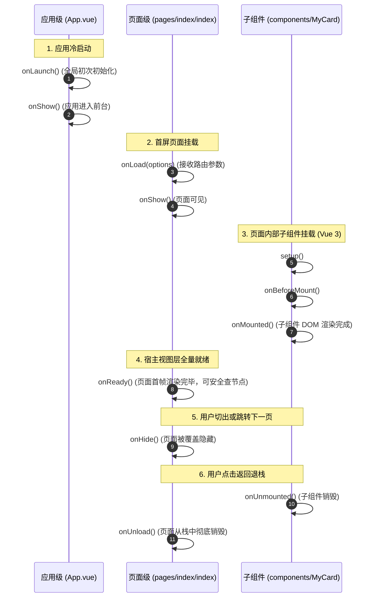
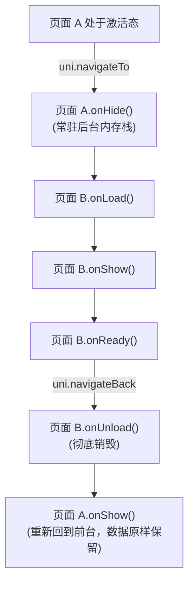

# 初级-三套生命周期执行全时序应用-页面与Vue组件生命周期

在 Uni-App 开发与面试中，生命周期是衡量开发者是否真正理解小程序与 Vue 双核运行时运行机制的核心试金石。与传统纯 Vue 单页应用仅有 Vue 组件生命周期不同，Uni-App 内部同时交织并存着**三套完全不同的生命周期体系**：
1. **应用生命周期（App Lifecycle）**：管理整个跨端应用的启动、前后台切换。
2. **页面生命周期（Page Lifecycle）**：由小程序/App 宿主页面栈驱动。
3. **Vue 组件生命周期（Component Lifecycle）**：由 Vue 3 核心运行时驱动。

初学者若对三者的先后调用顺序与作用域边界缺乏清晰认知，极易在开发中写出“在子组件里监听 `onLoad` 导致死活不触发”、“节点尚未渲染就在 `onLoad` 中查 DOM 导致返回 null”、或者“在 `onUnload` 中漏解绑全局事件引发严重内存泄漏”的低级 Bug。

---

## 1. 核心底层机制与全景架构

### 1.1 三套生命周期全时序物理映射图



### 1.2 三套生命周期核心职责矩阵表

| 生命周期类型 | 寄生承载文件 | 核心钩子函数 | 典型适用业务场景 |
| :--- | :--- | :--- | :--- |
| **应用生命周期** | 仅能在 `App.vue` 中生效 | `onLaunch`<br/>`onShow`<br/>`onHide`<br/>`onError` | 全局版本热更新检查、全局登录态预热、收集应用全局崩溃日志、冷热启动数据统计。 |
| **页面生命周期** | 仅在 `pages.json` 注册的页面有效 | `onLoad`<br/>`onShow`<br/>`onReady`<br/>`onHide`<br/>`onUnload` | 接收 URL 路由传参（`onLoad`）、页面每次可见时刷新红点数据（`onShow`）、原生下拉刷新与触底监听。 |
| **Vue 组件生命周期** | 适用于所有 `.vue` 自定义子组件 | `setup`<br/>`onMounted`<br/>`onUpdated`<br/>`onUnmounted` | 组件内部状态机初始化、定时器与事件总线挂载及清理、ECharts 图表本地实例化。 |

---

## 2. 源码级/算法物理推导

### 2.1 页面跳转时的生命周期状态流转推导

在业务跳转时，不同导航 API 会引发截然不同的页面栈生命周期交替执行：

#### 场景 A：从页面 A 执行 `uni.navigateTo` 跳转到页面 B
1. **页面 A**：触发 `onHide()`（页面依然常驻在内存栈中，并未销毁）。
2. **页面 B**：触发 `onLoad(options)` $\to$ `onShow()` $\to$ 子组件挂载 $\to$ `onReady()`。

#### 场景 B：在页面 B 点击返回（`uni.navigateBack`）退回页面 A
1. **页面 B**：触发 `onUnload()`（从页面栈中彻底弹出并销毁，内存回收）。
2. **页面 A**：**仅触发 `onShow()`**（**绝对不会重新触发 `onLoad` 和 `onReady`**！因为页面 A 从未被销毁过）。



---

## 3. 社招/阶段必考高频硬核连环追问

### 追问 1：为什么在抽离的通用子组件（如 `components/GoodsCard.vue`）中，直接写 `onLoad` 或 `onPullDownRefresh` 永远不会执行？

> **答辩深度闭环**：
> 1. **设计边界约束**：`onLoad`、`onPullDownRefresh`、`onReachBottom` 属于**页面生命周期**。微信小程序和 App 底层仅仅会将这些原生事件通知给当前在 `pages.json` 中明确登记过的**页面根实例**，根本不会向下递归广播给普通的子组件。
> 2. **正确解法**：
>    - 子组件若只需在初始化时获取数据，应该写在 Vue 标准的 `onMounted()` 或 `setup()` 中。
>    - 子组件如果需要感知宿主页面的可见性变化，页面根节点必须在自身的 `onShow()` 中通过 `ref` 调用子组件暴露的方法，或者在子组件中引入 `@dcloudio/uni-app` 提供的辅助钩子进行穿透监听。

---

### 追问 2：页面请求数据，应该放在 `onLoad` 还是 `onShow`？两者的核心分工是什么？

> **答辩深度闭环**：
> 1. **`onLoad`（初次参数装配与一次性加载）**：
>    - 优势：能第一时间接收 URL 传递的参数（如 `onLoad(options)` 中的 `options.id`），且在页面生命周期中**只执行一次**。
>    - 适用：详情页根据 ID 加载商品静态信息、表单编辑页拉取初始数据。
> 2. **`onShow`（高频每次前台曝光）**：
>    - 特性：从下一级页面返回、或者小程序从后台切回前台时，都会被**反复触发**。
>    - 适用：购物车数量刷新、用户未读消息红点同步、订单状态轮询。
> 3. **避坑警示**：若把耗时且不变的详情页请求无脑写在 `onShow` 中，用户每跳去别的页面再返回，页面都会莫名重新 loading 闪烁一次，严重浪费网络带宽与算力。

---

### 追问 3：为什么在 `onLoad` 中直接执行 `uni.createSelectorQuery()` 查询视图节点高度经常返回 `null`？

> **答辩深度闭环**：
> 1. **双线程渲染时序差**：`onLoad` 仅仅是逻辑层（JSCore）接收到路由指令开始初始化数据，此时渲染层（WebView）的 WXML/HTML 模板结构**根本还没有完成初次布局与绘制（Layout & Paint）**。
> 2. **正确时机**：必须在 **`onReady()`**（对应原生小程序的 `Page.onReady`）之后执行！`onReady` 标志着视图层已经完成首帧物理渲染，此时调用 `uni.createSelectorQuery()` 才能 100% 确保能够命中物理节点并读取其准确宽高。

---

## 4. 生产级避坑指南与排障 SOP

### 4.1 生产级 Vue 3 `<script setup>` 生命周期标准编写范式

```vue
<template>
  <view class="container">
    <text>订单编号: {{ orderId }}</text>
    <OrderSummaryCard ref="summaryCardRef" />
  </view>
</template>

<script setup lang="ts">
import { ref } from 'vue';
import { onLoad, onShow, onReady, onUnload } from '@dcloudio/uni-app';
import OrderSummaryCard from '@/components/OrderSummaryCard.vue';

const orderId = ref<string>('');
const summaryCardRef = ref<InstanceType<typeof OrderSummaryCard> | null>(null);

// 1. 仅在首次打开页面时触发，接收路由参数并拉取核心静态数据
onLoad((options) => {
  orderId.value = options?.id || '';
  fetchOrderDetail(orderId.value);
  
  // 注册全局通知
  uni.$on('ORDER_STATUS_CHANGED', handleOrderStatusUpdate);
});

// 2. 每次页面从后台切回或从子页面返回时触发，刷新动态数据
onShow(() => {
  refreshLiveBadge();
});

// 3. 视图层完全渲染完毕，可安全查询节点尺寸或操作图表
onReady(() => {
  const query = uni.createSelectorQuery();
  query.select('.container').boundingClientRect((data) => {
    console.log('容器物理高度:', data?.height);
  }).exec();
});

// 4. 页面从栈顶弹出销毁时，必须严格注销监听，防止内存泄漏！
onUnload(() => {
  uni.$off('ORDER_STATUS_CHANGED', handleOrderStatusUpdate);
});

function fetchOrderDetail(id: string) { /* 请求逻辑 */ }
function refreshLiveBadge() { /* 刷新状态 */ }
function handleOrderStatusUpdate(event: any) { /* 响应全局通知 */ }
</script>
```

### 4.2 全局事件总线 `uni.$on` 未解绑内存泄漏排查 SOP

#### 故障现场：
用户在订单列表反复进出 10 次，支付成功后，控制台弹出了 10 次相同的提示弹窗，且应用随着使用变得越来越卡顿，最终崩溃。

#### 排查与根治 SOP：
1. **源码审查**：搜索页面代码中是否存在 `uni.$on`。
2. **事故根因**：页面在 `onLoad` 中注册了全局监听，但在 `onUnload` 中**漏写了 `uni.$off`**。由于全局事件中心持有着当前已销毁页面的闭包强引用，导致旧页面无法被 GC 垃圾回收，形成了严重的内存泄漏与重复触发。
3. **根治规范**：**凡是出现 `uni.$on` 的地方，必须成对在 `onUnload` 中执行 `uni.$off` 清理！**
