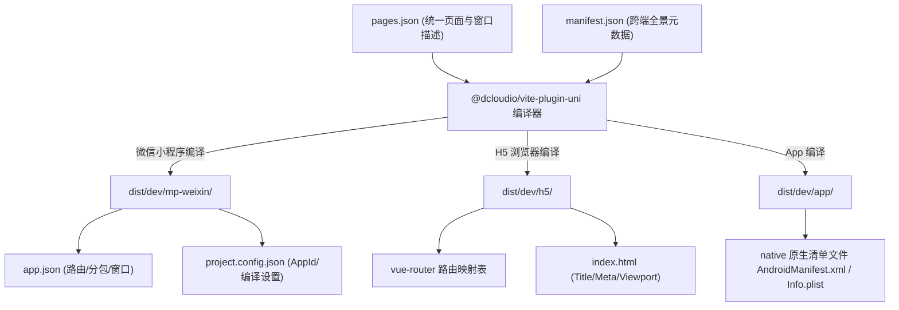
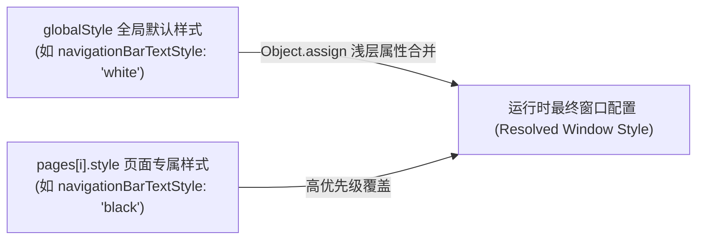

# 初级-全局配置文件pages与manifest核心配置与分包声明

在 Uni-App 跨端体系中，**`pages.json`** 与 **`manifest.json`** 是支配整个工程全局运行时行为与多端编译产物的“神经中枢”。与传统 Web 页面由代码动态注册路由（如 `vue-router`）不同，Uni-App 采用**静态元数据声明式路由与窗口配置**。

在社招初级面试与工程实践中，面试官不仅考查开发者是否会配置基础的 TabBar 和页面路径，更会深挖底层编译逻辑：**`pages.json` 是如何被转译为微信小程序的 `app.json` 或 H5 的 `vue-router` 路由表的？配置在 `pages[0]` 的首项有什么决定性物理意义？初学者为什么经常在 `uni.navigateTo` 跳转 TabBar 页面时遭遇静默失败？**

---

## 1. 核心底层机制与全景架构

### 1.1 全局配置到多端编译映射全景

Uni-App 编译器在打包时，会将 `pages.json` 和 `manifest.json` 静态解析为对应平台的原生配置文件：



### 1.2 核心配置项物理职责矩阵

| 配置文件 | 核心节点 | 物理职责与运行表现 |
| :--- | :--- | :--- |
| **`pages.json`** | `pages` | 数组结构，注册主包内的所有页面。**数组的第一个元素 `pages[0]` 默认为整个应用的启动首屏**。 |
| **`pages.json`** | `globalStyle` | 全局默认窗口外观（导航栏背景色、文字颜色、下拉刷新开关）。 |
| **`pages.json`** | `tabBar` | 底部常驻导航栏（最少 2 个，最多 5 个 Tab），支持自定义图标与切换高亮色。 |
| **`pages.json`** | `subPackages` | **分包加载规则声明**。将非核心页面从 2MB 主包中物理剥离，降低冷启动耗时。 |
| **`manifest.json`** | `mp-weixin` | 微信小程序专属 AppId、微信原生插件引入、地理位置授权声明。 |
| **`manifest.json`** | `app-plus` | App 原生打包配置（CPU 架构、启动屏 Splash、极光推送/高德地图 SDK Key）。 |

---

## 2. 源码级/算法物理推导

### 2.1 样式继承与页面级覆盖算法

在 Uni-App 中，窗口样式的生效遵循 **“局部优先于全局（Local Overrides Global）”** 的覆盖逻辑：



```json
// pages.json 典型结构
{
  "globalStyle": {
    "navigationBarTextStyle": "white",
    "navigationBarTitleText": "我的商城",
    "navigationBarBackgroundColor": "#2B9939",
    "backgroundColor": "#F8F8F8"
  },
  "pages": [
    {
      "path": "pages/index/index",
      "style": {
        // 覆盖全局标题
        "navigationBarTitleText": "商城首页",
        // 开启页面级原生下拉刷新
        "enablePullDownRefresh": true
      }
    },
    {
      "path": "pages/user/index",
      "style": {
        // 开启自定义导航栏 (隐藏原生系统导航栏)
        "navigationStyle": "custom"
      }
    }
  ]
}
```

### 2.2 静态路由表与动态权限的矛盾与解决

与传统 Web 中通过 `router.beforeEach` 动态往路由表添加路由（`addRoute`）不同：
- **小程序底层物理死规定**：微信小程序的 `app.json` 必须在**静态编译期**完全声明所有可能访问的页面路径，**运行时严禁动态注入任何不存在的页面路径**！
- **权限路由方案**：所有页面路径必须全部在 `pages.json` 中静态登记完毕，页面鉴权（如检测是否已登录）必须在页面的 `onLoad()`、统一请求拦截器或全局自定义路由拦截器中进行逻辑重定向。

---

## 3. 社招/阶段必考高频硬核连环追问

### 追问 1：为什么在 `pages.json` 中配置了 TabBar 的页面，使用 `uni.navigateTo({ url: '/pages/index/index' })` 跳转时会毫无反应或控制台报错？

> **答辩深度闭环**：
> 1. **底层导航栈机制约束**：`uni.navigateTo` 的物理语义是**保留当前页面，将新页面压入普通导航栈顶（Push）**。
> 2. **TabBar 页面是独立常驻实体**：TabBar 属于应用的根级容器页面，系统底层对其实行**单例常驻保活与切换隐藏机制**。TabBar 页面绝不能作为普通子页面被无限次重复压栈，否则会导致页面栈深度不可控并引发内存暴增。
> 3. **规范解法**：跳转到配置在 TabBar 列表中的页面，必须严格使用 **`uni.switchTab({ url: '/pages/index/index' })`**；该方法在底层会清空所有非 TabBar 的压栈页面，并切换激活目标 Tab。

---

### 追问 2：如果在 `pages.json` 的 `pages` 数组中，将登录页 `pages/login/login` 放在第 1 位，还是将首页 `pages/index/index` 放在第 1 位？如何优雅处理“未登录强制先看登录页”的需求？

> **答辩深度闭环**：
> 1. **首项物理规则**：`pages[0]` 是整个小程序或 App 的**冷启动唯一默认入口**。
> 2. **错误做法**：若直接将 `pages/login/login` 设为 `pages[0]`，即使老用户已经处于登录有效状态，每次冷启动都会先闪现一瞬间登录页面，体验极其糟糕。
> 3. **生产级标准实践**：
>    - 依然将**业务首页（如 `pages/index/index`）设为 `pages[0]`**。
>    - 在 `App.vue` 的 `onLaunch` 或首页的 `onLoad` 中，快速读取本地存储中的 Token 缓存。
>    - 若 Token 不存在或已过期，立即执行 `uni.reLaunch({ url: '/pages/login/login' })` 重定向至登录页，配合骨架屏实现无感优雅过渡。

---

### 追问 3：在页面中配置 `"navigationStyle": "custom"`（自定义导航栏）后，页面内容顶部为什么会直接插到手机系统的状态栏（电量、时间）和刘海屏下面？如何排错？

> **答辩深度闭环**：
> 1. **物理成因**：原生导航栏原本承担了撑开系统状态栏（Status Bar）高度的物理占位职责。当设置为 `custom` 时，原生导航栏被完全销毁隐藏，页面的 Webview 视口原点 `(0,0)` 直接紧贴手机物理屏幕的最顶端。
> 2. **规避与修复**：
>    - 必须在自定义导航栏组件中，通过 `uni.getSystemInfoSync().statusBarHeight` 获取当前机型精确的状态栏高度（px）。
>    - 并在组件顶部放置一个高度等于 `statusBarHeight` 的空白占位 `view`，将实际的业务标题和按钮向下推入安全展示区域。

---

## 4. 生产级避坑指南与排障 SOP

### 4.1 生产级多模块分包（subPackages）配置示范

微信小程序对主包体积有严苛的 **2MB 物理上限**。在项目初始阶段就必须对大模块进行分包规划：

```json
// pages.json 生产级分包配置范式
{
  "pages": [
    // 主包页面仅放置: 首页、分类、购物车、个人中心 (核心 TabBar 页面)
    {
      "path": "pages/index/index",
      "style": { "navigationBarTitleText": "首页" }
    },
    {
      "path": "pages/user/index",
      "style": { "navigationBarTitleText": "我的" }
    }
  ],
  "subPackages": [
    {
      // 业务分包 1: 订单模块
      "root": "subpkg_order",
      "pages": [
        {
          "path": "order-list/index",
          "style": { "navigationBarTitleText": "订单列表" }
        },
        {
          "path": "order-detail/index",
          "style": { "navigationBarTitleText": "订单详情" }
        }
      ]
    },
    {
      // 业务分包 2: 营销与秒杀模块
      "root": "subpkg_activity",
      "pages": [
        {
          "path": "seckill/index",
          "style": { "navigationBarTitleText": "限时秒杀" }
        }
      ]
    }
  ],
  // 分包预下载规则 (用户浏览首页时静默预加载订单分包)
  "preloadRule": {
    "pages/index/index": {
      "network": "all",
      "packages": ["subpkg_order"]
    }
  }
}
```

### 4.2 小程序 AppId 敏感信息防泄露排查 SOP

在开源或团队协作开发中，`manifest.json` 中的微信 AppId 容易被硬编码提交并导致权限冲突：

```json
// manifest.json
{
  "mp-weixin": {
    // ❌ 错误示范：将公司线上正式 AppId 硬编码，提交到公共仓库产生安全风险
    "appid": "wx1234567890abcdef",
    "setting": {
      "urlCheck": false
    }
  }
}
```

#### 生产级 SOP 规范防线：
1. 在基于 Vite 的 CLI 工程中，使用环境变量 `.env.development` 与 `.env.production`：
   ```ini
   # .env.development
   VITE_WX_APPID=wx_test_11111111

   # .env.production
   VITE_WX_APPID=wx_prod_99999999
   ```
2. 在构建脚本中动态注入 AppId，或将本地开发配置加入 `.gitignore` 过滤，确保生产级凭据的绝对安全。
