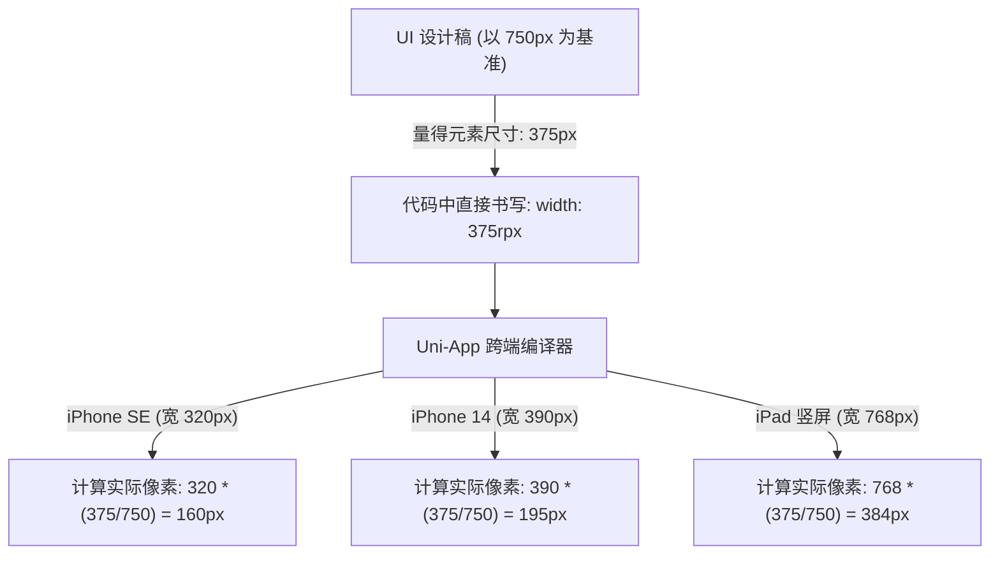

# 初级-响应式单位rpx物理计算原理与多端屏幕自适应实战

在多端移动应用开发中，设备碎片化是前端工程师必须直面的技术挑战：从早期的 iPhone 5（320px 宽）到 iPhone 14 Pro Max（430px 宽），再到各类 Android 旗舰机、折叠屏乃至 iPad 平板，屏幕物理宽度千差万别。如果单纯使用传统的 `px` 绝对像素布局，界面在不同机型上必然出现大面积留白或布局挤压变形。

Uni-App 引入并标准化了 **`rpx`（Responsive Pixel，响应式像素）** 体系。

在初中级社招面试中，面试官不仅考查开发者是否会在设计稿与代码之间换算单位，更会深入底层考察：**`rpx` 的底层数学物理换算公式是什么？在小程序、H5、App 端分别是如何编译转换的？面对 iPad 大屏和折叠屏展开态时，纯 `rpx` 布局为什么会导致“元素暴增失真”？如何构建健壮的企业级自适应兜底架构？**

---

## 1. 核心底层机制与全景架构

### 1.1 rpx 的数学定义与物理基准

`rpx` 是微信小程序首创、Uni-App 全端统一实现的响应式物理单位：
- **设计基准**：规定**无论任何手机屏幕，其屏幕总宽度在物理逻辑上始终等分为 750 份（即屏幕总宽永远为 $750\text{rpx}$）**。
- **与设计稿无缝对应**：UI 设计师通常以 iPhone 6/7/8（物理像素为 $750 \times 1334\text{px}$）为基准出图。此时**设计稿上量出多少 px，代码中直接写多少 rpx**（如量得按钮宽 $200\text{px}$，代码直接写 `width: 200rpx`），实现了 1:1 的零心智转换成本。



### 1.2 跨端底层编译实现机制差异

不同平台底层对 `rpx` 的处理机制截然不同：

| 运行平台 | 底层转换技术 | 编译时机与物理产物 |
| :--- | :--- | :--- |
| **微信 / 平台小程序** | 小程序原生内置支持 | 编译器直接将 `rpx` 原封不动透传输出到 WXSS 中，由微信原生 C++ 渲染层依据设备屏幕宽度实时进行 GPU 缩放计算。 |
| **H5 网页端** | PostCSS 插件转译 | 在打包阶段通过 `postcss-pxtransform` 静态转译，将 `rpx` 转换为浏览器的 **`rem` 或 `vw`** 相对单位。 |
| **App 原生端 (NVue/Vue)** | 原生渲染器动态求值 | NVue 原生排版引擎在加载 CSS 样式表时，依据原生硬件屏幕绝对宽度动态转换为 Android dp / iOS pt 逻辑像素。 |

---

## 2. 源码级/算法物理推导

### 2.1 物理像素换算数学公式推导

$$1\text{rpx} = \frac{\text{screenWidth}}{750}\text{px}$$

$$\text{TargetPx} = \text{SourceRpx} \times \left( \frac{\text{screenWidth}}{750} \right)$$

#### 换算矩阵推导示例：
- 在宽度为 **$375\text{px}$** 的屏幕上（如 iPhone 12/13/14）：
  $$1\text{rpx} = \frac{375}{750} = 0.5\text{px} \quad \implies \quad 750\text{rpx} = 375\text{px}$$
- 在宽度为 **$414\text{px}$** 的屏幕上（如 iPhone 11 Pro Max）：
  $$1\text{rpx} = \frac{414}{750} = 0.552\text{px} \quad \implies \quad 200\text{rpx} \approx 110.4\text{px}$$

### 2.2 动态内联样式中 rpx 的换算丢失大坑

在 Vue 模板中，类名样式（Class）由静态编译器处理；但如果写动态绑定样式：
```vue
<!-- ⚠️ 危险写法：部分端内联样式无法被 PostCSS 正确匹配处理 -->
<view :style="{ width: dynamicWidth + 'rpx' }"></view>
```
在 H5 或某些特定小程序端，动态拼接的字符串无法触发 PostCSS 编译插件的静态 AST 正则替换，导致浏览器直接收到无法识别的 `rpx` 属性值从而发生样式失效。

#### 生产级 JS 动态换算算法：
```javascript
// 封装通用的 rpx 转换为真实 px 工具函数
export function rpx2px(rpx) {
  const systemInfo = uni.getSystemInfoSync();
  const screenWidth = systemInfo.screenWidth;
  return (rpx * screenWidth) / 750;
}
```

---

## 3. 社招/阶段必考高频硬核连环追问

### 追问 1：在 iPad、折叠屏展开态或 PC 浏览器大屏上，为什么纯 `rpx` 布局会导致文字、图标和按钮变得巨大失真？如何从架构层面设防？

> **答辩深度闭环**：
> 1. **等比无限膨胀陷阱**：`rpx` 的底层算法是“宽度强等分”。在宽屏设备上（例如 PC 浏览器全屏宽度 $1920\text{px}$ 或 iPad 宽 $1024\text{px}$），原本在手机上占屏幕一半（375rpx）的按钮，在 PC 上会被强制计算为 $1920 \times 0.5 = 960\text{px}$，产生荒谬的“巨型按钮”，严重破坏排版审美。
> 2. **大屏设防治理标准**：
>    - **限制页面最大宽度**：在 `App.vue` 或全局样式中，为根视图设置最大宽度并居中：
>      ```css
>      /* 针对平板与 PC 端的样式保护 */
>      body, uni-page-body {
>        max-width: 480px !important;
>        margin: 0 auto !important;
>      }
>      ```
>    - **字号与微小间距慎用 rpx**：基础排版文字（如正文 14px、16px）、边框粗细（1px）以及极小的内边距建议**直接使用固定 `px`**，避免因屏幕过大而过度拉伸变形。

---

### 追问 2：什么是高分屏下的“1px 细线边框模糊问题”？为什么直接写 `border: 1rpx solid #ccc` 容易变成虚线或粗线？

> **答辩深度闭环**：
> 1. **物理像素小数舍入问题**：在 iPhone 6（宽 375px）上，$1\text{rpx} = 0.5\text{px}$。但在不同平台与不同浏览器内核中，对小于 1px 的小数渲染存在兼容性差异：有的内核支持直接渲染 0.5px，而有的老旧 Android 内核会将其四舍五入为 0（线条完全消失不见）或者强制向上取整为 1px（线条变得很粗）。
> 2. **标准根治方案（CSS 伪元素缩放）**：
>    ```css
>    /* 生产级 1px 细线标准实现 */
>    .hairline-border {
>      position: relative;
>    }
>    .hairline-border::after {
>      content: "";
>      position: absolute;
>      left: 0;
>      bottom: 0;
>      width: 100%;
>      height: 1px;
>      background-color: #e5e5e5;
>      transform: scaleY(0.5); /* 缩放实现真正的发丝级细线 */
>      transform-origin: 0 0;
>    }
>    ```

---

### 追问 3：Uni-App 早期文档中的 `upx` 与当前的 `rpx` 是什么关系？现代工程为什么坚决废弃 `upx`？

> **答辩深度闭环**：
> 1. **历史沿革**：早期 Uni-App 团队为了区分微信小程序的 `rpx`，曾自研并主推 `upx`（Universal Pixel）。
> 2. **生态归一**：随着各大小程序厂商（微信、支付宝、百度、字节跳动）全量普及并官方拥抱了 `rpx` 标准，Uni-App 官方顺应开源生态，全面将单位收敛统一至 **`rpx`**。
> 3. **工程现状**：虽然当前编译器为了向后兼容依然支持 `upx`，但第三方现代 UI 组件库（如 wot-design-uni、uview-plus）以及各类 Lint 规范已全量统一为 `rpx`，新工程严禁继续使用过时的 `upx`。

---

## 4. 生产级避坑指南与排障 SOP

### 4.1 生产级多端屏幕与安全区（Safe Area）适配规范

在全面屏手机中，除了横向宽度自适应，底部的操作横条（Home Indicator）遮挡同样致命：

```vue
<template>
  <view class="page-wrapper">
    <!-- 主体业务卡片 (使用 rpx 响应式自适应) -->
    <view class="content-card">
      <text class="title">自适应商品卡片</text>
    </view>

    <!-- 底部固定吸底操作条 (配合 env(safe-area-inset-bottom) 安全避让) -->
    <view class="fixed-bottom-bar">
      <button class="submit-btn">立即结算</button>
    </view>
  </view>
</template>

<style lang="scss" scoped>
.page-wrapper {
  padding: 24rpx;
  /* 预留出底部固定栏与全面屏安全距离的高度，防止内容被遮挡 */
  padding-bottom: calc(120rpx + env(safe-area-inset-bottom));
}

.content-card {
  width: 100%;
  border-radius: 16rpx;
  background-color: #ffffff;
  padding: 32rpx;
  box-shadow: 0 4rpx 16rpx rgba(0, 0, 0, 0.05);

  .title {
    /* 核心文字建议使用稳健的 px 或常规 rpx */
    font-size: 32rpx;
    font-weight: bold;
    color: #333333;
  }
}

.fixed-bottom-bar {
  position: fixed;
  left: 0;
  right: 0;
  bottom: 0;
  background-color: #ffffff;
  padding: 16rpx 24rpx;
  /* 关键：安全区底部内边距自适应 */
  padding-bottom: calc(16rpx + env(safe-area-inset-bottom));
  box-shadow: 0 -2rpx 10rpx rgba(0, 0, 0, 0.05);

  .submit-btn {
    width: 100%;
    height: 88rpx;
    line-height: 88rpx;
    border-radius: 44rpx;
    background-color: #2b9939;
    color: #ffffff;
    font-size: 28rpx;
  }
}
</style>
```

### 4.2 适配排障 Checklist

| 排查检查项 | 常见故障隐患 | 生产修复规范 |
| :--- | :--- | :--- |
| **文字字号过小** | 小于 12px 的文字在某些 Android 浏览器或 Chrome 中强制放大至 12px 导致布局错位。 | 涉及关键提示文字，最小不得低于 `24rpx`（即 12px）。 |
| **全面屏底部贴死** | iPhone 底部黑条盖住了按钮，用户无法点击。 | 底部固定悬浮条必须使用 `env(safe-area-inset-bottom)` 兜底。 |
| **PC/Pad 预览变形** | 页面在大屏浏览器里被拉扯得面目全非。 | 根容器配置 `max-width: 480px; margin: 0 auto;` 锁定移动端视图比例。 |
