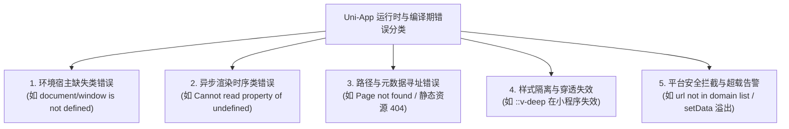
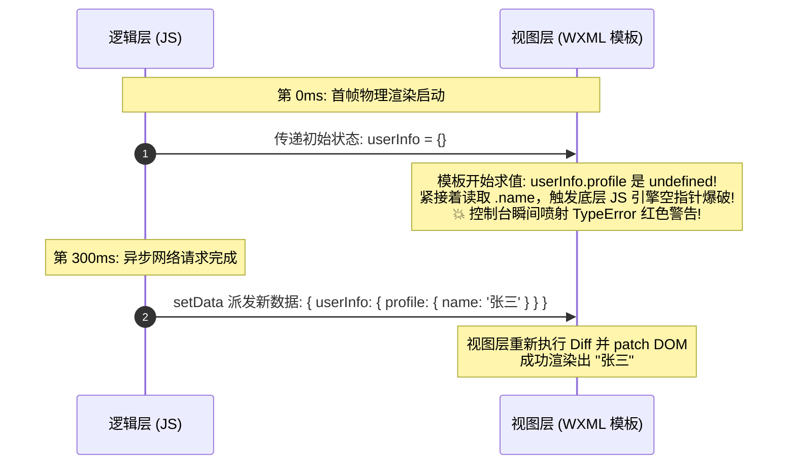

# 初级-新手常见报错排查指南与多端控制台Error根治SOP

在 Uni-App 跨端工程的日常迭代中，开发者不仅需要面对纯前端的语法报错，更要应对跨越 **“微信/各平台小程序沙箱内核、浏览器 DOM/BOM 环境、App 原生 Android/iOS 容器”** 所产生的各类奇特错误。初学者若缺乏系统的多端错误根因图谱，常常陷入“代码在 H5 上跑得好好的，一编到微信就红屏报错；在模拟器正常，一到真机就白屏”的焦虑泥潭。

在初中级社招面试中，排错能力是衡量候选人是否具备“独立交付与自主闭环能力”的核心指标。面试官将围绕最常见的高频报错展开技术拷问：**为什么模板取值报错但在数据返回后界面又能正常展示？修改组件样式在 H5 生效但在小程序失效的物理本质是什么？真机白屏且无报错信息时如何通过调试 SOP 快速抓出现场日志？**

---

## 1. 核心底层机制与全景架构

### 1.1 Uni-App 多端错误分类全景图谱



---

## 2. 源码级/算法物理推导

### 2.1 异步数据首帧白屏与属性访问报错推导

很多新手最困惑的灵异现象：
```vue
<template>
  <view>用户名: {{ userInfo.profile.name }}</view>
</template>

<script setup>
import { ref } from 'vue';
import { onLoad } from '@dcloudio/uni-app';

const userInfo = ref({}); // 初始值为空对象

onLoad(async () => {
  const res = await fetchUser(); // 异步网络请求 (耗时 300ms)
  userInfo.value = res.data;
});
</script>
```

#### 控制台必然出现大红字报错：
```
TypeError: Cannot read properties of undefined (reading 'name')
```
但令人不解的是：300ms 后网络数据返回，**界面上竟然又神奇地把名字正常渲染出来了！**



#### 物理根治方案：
1. **可选链操作符（Optional Chaining）**：
   ```vue
   <view>用户名: {{ userInfo.profile?.name }}</view>
   ```
2. **前置条件渲染防线（`v-if`）**：
   ```vue
   <view v-if="userInfo.profile">用户名: {{ userInfo.profile.name }}</view>
   ```

---

## 3. 社招/阶段必考高频硬核连环追问

### 追问 1：引入第三方 UI 组件库（如 wot-design-uni 或 uni-ui）后，使用 `::v-deep` 修改内部样式，在 H5 浏览器端完美生效，为什么在微信小程序端毫无反应？

> **答辩深度闭环**：
> 1. **微信组件样式隔离机制（Shadow DOM Isolation）**：微信小程序的自定义组件默认开启了强隔离机制。页面的 WXSS 样式**绝对不会渗透生效到子组件内部**，即使使用了 Vue 编译器的 `::v-deep` 或 `:deep()`。
> 2. **H5 与小程序的本质差异**：H5 编译后所有样式都混在同一个全局 CSS 树中，`::v-deep` 编译为带有属性选择器的后代选择器（如 `[data-v-xxx] .van-button`），能直接命中 DOM；而在小程序中，各自定义组件是受沙箱物理隔离的。
> 3. **生产级根治方案**：
>    在页面的 `<script>` 中，显式为组件声明解除样式隔离配置：
>    ```vue
>    <script>
>    export default {
>      options: {
>        // 解除样式隔离，允许外部样式穿透进入组件内部
>        styleIsolation: 'shared'
>      }
>    }
>    </script>
>    ```

---

### 追问 2：为什么把图片放在本地写 `<image src="../../assets/logo.png" />` 时，编译到微信小程序经常控制台报 `Failed to load local image resource`？

> **答辩深度闭环**：
> 1. **相对路径解析断裂**：小程序在编译后，页面文件与静态资源的目录拓扑被扁平化重组。如果使用深入的相对路径（`../../`），在复杂的嵌套目录或分包环境下极易因为相对路径层级计算错误而找不到文件。
> 2. **静态规范**：Uni-App 官方明确规定：所有静态本地图片**必须统一存放在根目录的 `static/` 目录下**。
> 3. **绝对路径书写准则**：代码中引用时，必须统一使用以 `/static/` 开头的**绝对根路径**（如 `<image src="/static/logo.png" />`），编译器能 100% 确保在任何平台、任何分包中均能精准寻址。

---

### 追问 3：在手机真机预览或体验版中，页面突然出现白屏，但又没有电脑连接线，控制台也看不到任何日志，资深工程师如何快速抓出真机报错？

> **答辩深度闭环**：
> 1. **开启微信原生调试浮窗**：点击小程序右上角的“三个点（...）”菜单，在底部弹出面板中找到 **“打开调试（vConsole）”**，点击后小程序会自动热重启，并在屏幕右下角出现一个绿色的 `vConsole` 按钮。
> 2. **捕获异常现场**：点击 `vConsole` 按钮，直接查看真机物理环境下的 `Log`、`Error` 与 `Network` 面板，秒级揪出引发白屏的未捕获 JS 异常（如空指针、域名未备案拦截等）。

---

## 4. 生产级避坑指南与排障 SOP

### 4.1 新手高频报错与根治 SOP 速查手册

| 常见报错信息 | 物理故障根因 | 生产级秒级根治 SOP |
| :--- | :--- | :--- |
| **`ReferenceError: document is not defined`** | 在小程序或 App 中使用了浏览器专属的 DOM API。 | 严禁使用 `document`/`window`，测量尺寸改用 `uni.createSelectorQuery()`。 |
| **`Page not found: pages/...`** | 1. 路径拼写错误。<br/>2. 忘记在 `pages.json` 中声明。 | 检查 `pages.json` 的 `pages` 数组，路径开头**不要带**前导斜杠 `/`。 |
| **`request:fail url not in domain list`** | 生产环境请求的域名未在微信公众后台配置白名单。 | 登录微信公众平台，在“开发设置”的 `request合法域名` 中添加目标 HTTPS 域名。 |
| **`Component is not found in path ...`** | 自定义组件命名或路径不符合 easycom 规范。 | 检查组件目录是否符合 `components/组件名/组件名.vue` 的标准映射规则。 |
| **`setData 数据传输长度为 xxx KB`** | 一次性往 `setData` 塞入了超大型列表或图片 Base64。 | 剥离无用字段，仅将参与模板渲染的最小字段集绑定在响应式变量上。 |

### 4.2 生产级全局未捕获异常监控防御模板

在 `App.vue` 中配置全链路异常兜底，避免线上故障死无对证：

```vue
<script setup lang="ts">
import { onLaunch, onError } from '@dcloudio/uni-app';

onLaunch(() => {
  console.log('App Launch Success');
});

// 核心：全平台全局未捕获 JS 脚本异常监听
onError((err: string) => {
  console.error('[Global App Error 捕获]:', err);

  // 生产环境自动收集机型上下文并上报自建日志平台
  const systemInfo = uni.getSystemInfoSync();
  const errorReport = {
    errorMsg: err,
    platform: systemInfo.platform,
    model: systemInfo.model,
    system: systemInfo.system,
    timestamp: Date.now()
  };

  // 异步静默上报后台
  // apiReportCrash(errorReport);
});
</script>
```
通过本篇排查 SOP，开发者可在遇到任何多端编译与运行时报错时，秒级定位物理诱因并按照工业级规范完成根治止血。
