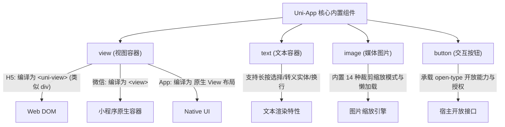
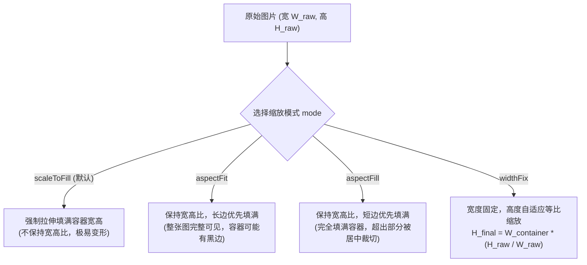

# 初级-核心内置基础组件view-text-image与button实战

在跨端开发中，Uni-App 彻底抛弃了 HTML5 传统的 `div`、`span`、`img` 等浏览器原生标签，而是提供了一套全平台规范化的**内置核心组件（Built-in Components）**。这套组件抹平了微信小程序原生 WXML 标签、Web DOM 标签与 App 原生渲染控件的语法鸿沟。

在初中级社招面试与日常业务中，`view`、`text`、`image`、`button` 四大基础组件占据了 80% 以上的代码编写量。面试官在考察基础时，往往通过极其刁钻的细节题甄别候选人的真实实战功底：**为什么在 `view` 内部写 `\n` 无法换行而必须包裹在 `text` 中？`button` 默认自带的灰色边框如何通过伪元素彻底消除？`image` 的 `mode="widthFix"` 在慢网下为什么会引发页面剧烈的“高度跳动（Layout Shift）”？**

---

## 1. 核心底层机制与全景架构

### 1.1 四大核心基础组件物理映射表



| 组件名称 | 替代的 HTML 标签 | 关键专属属性 | 物理核心能力 |
| :--- | :--- | :--- | :--- |
| **`view`** | `div` | `hover-class`<br/>`hover-stop-propagation` | 基础块级容器。支持触摸按下态高亮（避免使用 `:active` 伪类），支持手势冒泡阻断。 |
| **`text`** | `span` | `user-select`（或 `selectable`）<br/>`space`<br/>`decode` | 行内文本。**全平台唯一支持长按复制、唯一能解析 `\n` 换行符的组件**。 |
| **`image`** | `img` | `mode`<br/>`lazy-load`<br/>`show-menu-by-longpress` | 图片组件。默认宽高为 $320 \times 240\text{px}$（与原生 HTML img 默认 0 宽高不同！），内置 14 种裁剪缩放模式。 |
| **`button`** | `button` | `open-type`<br/>`plain`<br/>`loading` | 核心交互组件。不仅承载点击事件，更是触发微信分享、获取手机号授权、唤起客服会话的物理载体。 |

---

## 2. 源码级/算法物理推导

### 2.1 image 组件核心 mode 缩放算法推导

`image` 组件的默认尺寸固定为宽 $320\text{px}$、高 $240\text{px}$。如果不设置 `mode` 很容易导致图片被强行压扁或拉伸变形：



### 2.2 text 组件换行解析机制

为什么在 `view` 中写换行符失效？
- 在底层编译中，`view` 映射为块级容器。根据小程序的底层渲染规范，逻辑层通过 `setData` 传递给视图层的文本内容，在普通容器节点中**默认折叠空白符与换行符**（遵循 CSS `white-space: normal`）。
- 唯有 **`text` 组件** 在底层样式中硬编码配置了：
  ```css
  /* text 组件底层私有样式 */
  uni-text, wx-text {
    white-space: pre-wrap; /* 保留空白符与换行符并自动折行 */
  }
  ```
  因此，只有将文本包裹在 `text` 标签中，字符串中的 `\n` 换行符才会被原生渲染引擎解析并执行换行。

---

## 3. 社招/阶段必考高频硬核连环追问

### 追问 1：为什么写了 `border: none` 依然无法清除微信小程序中 `button` 按钮自带的灰色边框？底层机制是什么？

> **答辩深度闭环**：
> 1. **伪元素机制（`::after`）**：在微信小程序原生基础样式库中，`button` 的灰色 1px 边框并不是直接写在 `button` 标签自身样式上的，而是**通过 `button::after` 伪元素绝对定位生成的**：
>    ```css
>    /* 微信原生底层默认注入的样式 */
>    button::after {
>      content: " ";
>      width: 200%;
>      height: 200%;
>      position: absolute;
>      top: 0;
>      left: 0;
>      border: 1px solid rgba(0, 0, 0, 0.2);
>      transform: scale(0.5);
>      transform-origin: 0 0;
>      box-sizing: border-box;
>      border-radius: 10px;
>    }
>    ```
> 2. **正确消除方案**：必须显式清除伪元素边框：
>    ```css
>    /* 生产级消除 button 边框标准写法 */
>    .custom-button {
>      background: transparent;
>      padding: 0;
>      margin: 0;
>      line-height: inherit;
>    }
>    .custom-button::after {
>      border: none !important;
>    }
>    ```

---

### 追问 2：为什么在电商列表或瀑布流中大量使用 `mode="widthFix"` 时，页面加载瞬间会出现严重的“布局跳动（CLS / Cumulative Layout Shift）”与列表卡顿？

> **答辩深度闭环**：
> 1. **未加载完成前高度为 0 或默认高度**：当 `mode="widthFix"` 时，组件只有在图片从网络完全下载并触发解码、读取到图片的真实原始宽高后，才能按比例反算并重设当前容器的实际高度。
> 2. **异步回流（Reflow）冲击**：在图片下载期间，容器高度可能为默认的 0；一旦图片加载完毕，高度瞬间撑开（如从 0 撑大到 300px），导致下方所有列表元素被强制瞬间下推。几百张图片同时完成下载将引发密集的**级联页面重排与回流**，产生严重的视觉闪烁与掉帧。
> 3. **解决方案**：接口服务端下发数据时，必须同时返回图片的原始宽高（`width` / `height`）。前端在渲染前计算好比例，直接为图片容器设置固定占位比例（如 `padding-bottom: (H/W)%` 或固定高度）或骨架屏占位。

---

### 追问 3：在微信小程序中，如何实现一个能够同时支持“用户长按识别小程序码”与“长按保存到手机”的图片组件？

> **答辩深度闭环**：
> 1. **配置 `show-menu-by-longpress`**：直接在 `image` 组件上添加该布尔属性：
>    ```html
>    <image src="https://example.com/qrcode.png" :show-menu-by-longpress="true" mode="widthFix" />
>    ```
> 2. **微信原生能力底层唤起**：该属性会触发微信原生客户端底层的图片交互面板，自动识别图片内的二维码或小程序码，并弹出原生 ActionSheet，提供“转发给朋友”、“收藏”、“保存图片”、“识别小程序码”四大原生系统菜单，零需前端手动编写任何授权与保存逻辑。

---

## 4. 生产级避坑指南与排障 SOP

### 4.1 生产级零侵入开放能力按钮封装

在实际业务中，我们经常需要利用普通卡片或图标触发微信分享，但微信规定分享必须由 `button[open-type="share"]` 物理点击唤起。

#### 生产级“无边框透明按钮穿透”封装实战：
```vue
<template>
  <button class="share-trigger-button" open-type="share">
    <slot>
      <!-- 默认插槽内容：支持任意图标或自定义样式卡片 -->
      <view class="default-share-box">
        <text class="icon">📤</text>
        <text class="text">分享给微信好友</text>
      </view>
    </slot>
  </button>
</template>

<style lang="scss" scoped>
.share-trigger-button {
  /* 1. 彻底清除原生默认样式与外边距 */
  margin: 0;
  padding: 0;
  background-color: transparent;
  border-radius: 0;
  font-size: inherit;
  color: inherit;
  text-align: inherit;
  line-height: inherit;
  display: inline-block;
  overflow: visible;

  /* 2. 彻底抹平伪元素灰色边框 */
  &::after {
    border: none !important;
  }
}

.default-share-box {
  display: flex;
  align-items: center;
  gap: 8rpx;
}
</style>
```

### 4.2 图片防高度塌陷与懒加载排错 SOP

在长列表商品流中加载海量图片时的防御规范：

```vue
<template>
  <view class="image-wrapper" :style="{ aspectRatio: `${width} / ${height}` }">
    <!-- 开启微信原生懒加载 lazy-load -->
    <image
      class="product-img"
      :src="imageUrl"
      mode="aspectFill"
      :lazy-load="true"
      @error="handleImageError"
    />
  </view>
</template>

<script setup lang="ts">
import { ref } from 'vue';

const props = defineProps({
  src: { type: String, required: true },
  width: { type: Number, default: 300 },
  height: { type: Number, default: 300 }
});

const imageUrl = ref(props.src);

function handleImageError() {
  // 图片加载失败时优雅降级为本地预置的默认占位图
  imageUrl.value = '/static/images/fallback_placeholder.png';
}
</script>

<style scoped>
.image-wrapper {
  width: 100%;
  background-color: #f5f5f5; /* 骨架底色，防止未加载时白屏闪烁 */
  overflow: hidden;
  border-radius: 12rpx;
}
.product-img {
  width: 100%;
  height: 100%;
}
</style>
```
通过上述标准实践，可彻底根治长列表加载图片时的页面上下抖动与白屏坏体验。
