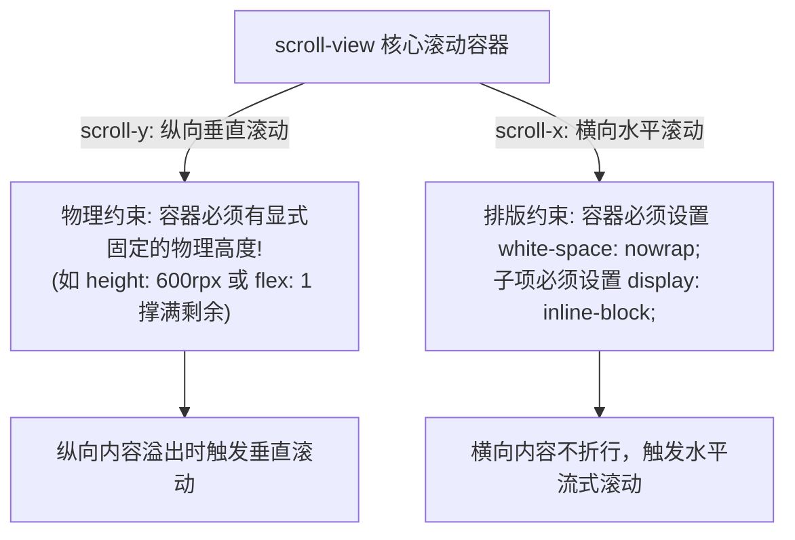

# 初级-滚动容器scroll-view基础用法与横向纵向滚动实战

在各类移动端商城、资讯类 App 与小程序中，局部视口滑动是极高频的界面模式：如顶部的横向分类标签栏（Tabs）、左右滑动的卡片流、以及左右双栏联动的分类筛选页面。Uni-App 提供了专用的局部滚动容器——**`scroll-view`**。

然而，许多初学者在初次使用 `scroll-view` 时经常遭遇“翻车”：**“明明设置了 `scroll-y` 内容超出却无法滚动”、“开启了 `scroll-x` 子元素却强行折行排在下面”、“在长列表中滥用 scroll-view 导致卡顿掉帧”**。

在社招技术面试中，面试官不仅考查基础 API 的熟练度，更会深入底层考量：**`scroll-view` 能够正常滚动的绝对物理约束条件是什么？页面级原生滚动与 `scroll-view` 局部组件滚动在性能上有何本质优劣？如何利用 `scroll-into-view` 优雅实现左右双联动的点餐菜单？**

---

## 1. 核心底层机制与全景架构

### 1.1 scroll-view 滚动方向与排版规则

`scroll-view` 在底层通过设置专属的 CSS 溢出控制与手势拦截器，驱动子元素的视口位移：



### 1.2 页面级滚动 vs scroll-view 组件级滚动架构对比

在项目架构中，究竟什么时候该用系统默认的页面级滚动？什么时候必须使用 `scroll-view`？

| 对比维度 | 页面级原生滚动（Page Scroll） | 组件级滚动（`scroll-view`） |
| :--- | :--- | :--- |
| **底层实现** | 宿主 WebView 原生默认滚动 | 由组件内部封装的局部可滚动 `view` 容器 |
| **高度约束** | **无需任何高度限制**，内容自适应自然撑长 | **必须显式限定固定高度（Explicit Height）** |
| **下拉刷新/触底** | 页面级 `onPullDownRefresh`、`onReachBottom` | 组件级 `@refresherrefresh`、`@scrolltolower` |
| **渲染性能** | **极高**。原生内核优化，GPU 加速更充沛 | 局部滚动，过多嵌套会增加手势冲突与图层计算开销 |
| **典型适用场景** | 全屏单列表浏览（商品流、动态瀑布流、长文章） | **局部滚动**（横向分类栏、模态弹窗内滚动、左右双联动） |

---

## 2. 源码级/算法物理推导

### 2.1 纵向无法滚动的“物理高度缺失”推导

为什么设置了 `scroll-y="true"` 依然无法滚动？
1. **浏览器/内核溢出定理**：一个容器能够产生滚动条（`overflow: scroll`）的充要条件是：
   $$\text{容器的物理高度 (Container Height)} < \text{内部所有子元素的高度总和 (Content Height)}$$
2. **高度塌陷与自适应陷阱**：如果开发者没有给 `scroll-view` 显式设置固定 `height`，它在默认情况下遵循标准流块级元素的特性：**自身高度自动被子元素撑大到与内容完全一致**！
3. **结论**：因为 $\text{Container Height} == \text{Content Height}$，系统判定内容根本没有超出容器范围，因此**绝对不会触发任何物理滚动逻辑**！

### 2.2 横向滚动排版断裂推导

为什么开启了 `scroll-x="true"` 子元素却上下折行？
- 普通 HTML/小程序块级元素默认拥有 `display: block` 与 `white-space: normal` 特性，当元素到达容器右边缘时，浏览器的排版算法会**自动执行折行（Line Wrap）**。
- **物理规避**：必须在外层 `scroll-view` 强制设置 `white-space: nowrap;`，禁止任何内部换行；同时将所有子项强制声明为 `display: inline-block;`，使它们在单一行内水平横向无限延展，从而触发横向溢出滚动。

---

## 3. 社招/阶段必考高频硬核连环追问

### 追问 1：在实现全屏商品长列表时，为什么很多资深架构师强烈建议使用页面级滚动，而不是在页面里塞一个占满全屏的 `scroll-view`？

> **答辩深度闭环**：
> 1. **双线程渲染性能开销**：在小程序端，页面级滚动是由原生视图层直接处理的，滚动极其平滑，且能无缝触发原生的 `onReachBottom` 触底加载与顶部状态栏点击回顶（`enableBackToTop`）。
> 2. **嵌套滚动与手势冲突**：全屏 `scroll-view` 作为一个局部组件，会抢占页面的触摸事件监听。若内部再嵌套输入框或轮播图（Swiper），容易在不同机型上引发诡异的手势打架或卡顿。
> 3. **内存与虚拟化**：页面级滚动在小程序原生底层的滚动优化更为激进，而普通的 `scroll-view` 若包含数千个复杂 DOM 节点，其内存占用会显著高于原生页面滚动。

---

### 追问 2：使用 `scroll-into-view` 实现锚点滚动时，为什么给子元素设置的 id 不能以数字开头？

> **答辩深度闭环**：
> 1. **W3C 规范与小程序标识符约束**：`scroll-into-view` 的底层实现原理依赖于小程序的节点标识符选择器。根据 W3C 标准和微信小程序内部选择器解析规则，元素的 `id` 属性**严禁以数字或特殊符号开头**（如 `id="101"` 是非法的）。
> 2. **正确规范**：所有用于定位的锚点 id 必须以英文字母开头（如 `id="category_101"` 或 `id="section_header"`），否则底层的节点查找算法将直接匹配失败，锚点无法跳转。

---

### 追问 3：在开启了自定义下拉刷新（`:refresher-enabled="true"`）的 `scroll-view` 中，为什么数据刷新完毕后，顶部的下拉圆环死活不缩回去？

> **答辩深度闭环**：
> 1. **双向受控状态未复位**：`scroll-view` 的下拉刷新状态由属性 **`:refresher-triggered="isRefreshing"`** 控制。
> 2. **死锁成因**：当用户下拉时，该属性会被内部置为 `true`。开发者在 `@refresherrefresh` 回调中发起异步网络请求，请求成功后，**若忘记在代码中手动将绑定的响应式变量 `isRefreshing.value = false`**，系统就会判定数据仍在加载中，导致顶部下拉刷新动画永久悬挂在半空。

---

## 4. 生产级避坑指南与排障 SOP

### 4.1 生产级实战：外卖/电商左右双联动二级分类菜单

```vue
<template>
  <view class="category-page">
    <!-- 左侧主分类导航 (固定宽度 180rpx，纵向独立滚动) -->
    <scroll-view class="left-menu" scroll-y>
      <view
        v-for="(item, index) in categoryList"
        :key="item.id"
        class="menu-item"
        :class="{ active: currentActiveIndex === index }"
        @click="switchCategory(index)"
      >
        <text>{{ item.name }}</text>
      </view>
    </scroll-view>

    <!-- 右侧商品列表流 (自适应占据剩余空间，支持 scroll-into-view 锚点滚动) -->
    <scroll-view
      class="right-content"
      scroll-y
      :scroll-into-view="targetSectionId"
      :scroll-with-animation="true"
    >
      <view
        v-for="(cat, index) in categoryList"
        :key="cat.id"
        :id="`cat_section_${cat.id}`"
        class="category-group"
      >
        <view class="group-header">{{ cat.name }}</view>
        <view v-for="product in cat.products" :key="product.id" class="product-item">
          <image class="thumb" :src="product.thumb" mode="aspectFill" />
          <view class="info">
            <text class="title">{{ product.name }}</text>
            <text class="price">¥{{ product.price }}</text>
          </view>
        </view>
      </view>
    </scroll-view>
  </view>
</template>

<script setup lang="ts">
import { ref } from 'vue';

interface Product { id: number; name: string; price: number; thumb: string; }
interface Category { id: number; name: string; products: Product[]; }

const currentActiveIndex = ref(0);
const targetSectionId = ref('');

const categoryList = ref<Category[]>([
  {
    id: 1,
    name: '热销榜单',
    products: [{ id: 101, name: '招牌拿铁', price: 18, thumb: '/static/logo.png' }]
  },
  {
    id: 2,
    name: '精选手冲',
    products: [{ id: 201, name: '耶加雪菲', price: 28, thumb: '/static/logo.png' }]
  }
]);

function switchCategory(index: number) {
  currentActiveIndex.value = index;
  // 必须以英文开头！联动右侧锚点滚动
  targetSectionId.value = `cat_section_${categoryList.value[index].id}`;
}
</script>

<style lang="scss" scoped>
.category-page {
  display: flex;
  height: 100vh; /* 极其重要：父级必须有固定 100vh 满屏高度 */
  overflow: hidden;
}

.left-menu {
  width: 180rpx;
  height: 100%; /* 撑满父级 100% 高度 */
  background-color: #f8f8f8;

  .menu-item {
    height: 96rpx;
    display: flex;
    align-items: center;
    justify-content: center;
    font-size: 26rpx;
    color: #666;

    &.active {
      background-color: #ffffff;
      color: #2b9939;
      font-weight: bold;
      border-left: 6rpx solid #2b9939;
    }
  }
}

.right-content {
  flex: 1; /* 弹性填满右侧所有宽度 */
  height: 100%; /* 撑满高度，使内容超出时产生局部滚动 */
  background-color: #ffffff;
  padding: 0 20rpx;

  .group-header {
    height: 60rpx;
    line-height: 60rpx;
    font-weight: bold;
    font-size: 28rpx;
    color: #333;
    background-color: #fff;
  }

  .product-item {
    display: flex;
    padding: 20rpx 0;
    border-bottom: 1rpx solid #f0f0f0;

    .thumb {
      width: 140rpx;
      height: 140rpx;
      border-radius: 8rpx;
    }

    .info {
      flex: 1;
      margin-left: 20rpx;
      display: flex;
      flex-direction: column;
      justify-content: space-between;

      .title { font-size: 28rpx; color: #333; }
      .price { font-size: 30rpx; color: #e64340; font-weight: bold; }
    }
  }
}
</style>
```

### 4.2 排障速查防线

| 故障现象 | 根因核查 | 修复操作 |
| :--- | :--- | :--- |
| **高度 flex: 1 无法滚动** | 父容器缺少 `height: 100%` 或 `height: 100vh` 声明。 | 沿着 DOM 树检查父容器链条，确保高度有明确的基准限制。 |
| **横向滚动条显示出来影响美观** | 默认样式未隐藏原生滚动条。 | 添加样式：`::-webkit-scrollbar { display: none; width: 0; height: 0; }`。 |
| **滚动时卡顿掉帧** | 在 `@scroll` 事件中频繁执行耗时计算或高频 `setData`。 | 对 `@scroll` 回调进行节流（Throttle）处理，绝不在滚动中直接更新大对象。 |
