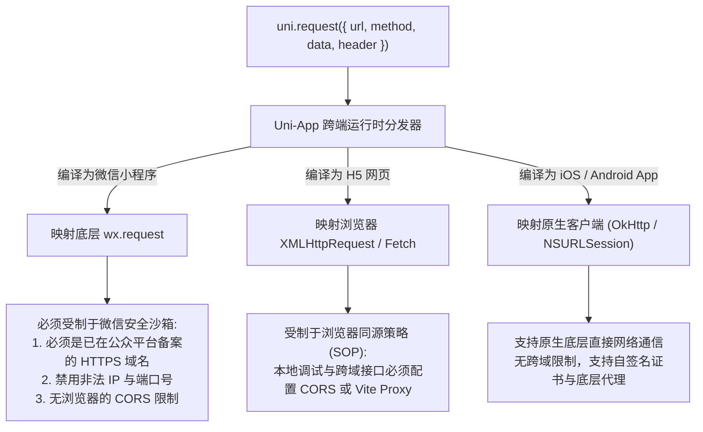

# 初级-网络请求uni-request基础封装与跨端域名白名单配置

在任何移动端业务体系中，数据是界面的生命之源。从用户登录鉴权、商品数据拉取到表单提交，前端应用无时无刻不在与后端 RESTful API 进行网络数据交换。Uni-App 提供了抹平各大平台差异的底层网络 API——**`uni.request`**。

然而在多端开发中，网络层的复杂性远超传统纯 Web 前端：**微信小程序的严苛“合法域名白名单与强制 HTTPS”安全约束、H5 浏览器环境下的 CORS 跨域拦截、以及 `uni.request` 在遇到 HTTP 404/500 时“依然触发 `success` 回调”的设计陷阱**。

在初中级社招面试中，面试官将围绕这些生产级痛点考核候选人的网络层排障经验与底层网络安全认知。

---

## 1. 核心底层机制与全景架构

### 1.1 uni.request 多端底层运行时映射全景

`uni.request` 并不是自己写了一套底层 TCP 套接字，而是根据当前编译平台动态路由到底层的原生网络堆栈：



### 1.2 微信小程序域名安全白名单四大铁律

在微信小程序生产环境中，网络请求受制于平台极其严苛的物理合规安全机制：
1. **强制 HTTPS 协议**：所有的网络请求 URL 必须以 `https://` 开头，全面禁用明文传输的 `http://`（本地开发局域网除外），且 TLS 版本必须支持 1.2 或更高。
2. **提前配置合法域名**：请求的二级域名（如 `https://api.company.com`）必须提前在微信公众平台后台的 **“开发管理 -> 开发设置 -> 服务器域名 -> request合法域名”** 中显式登记。
3. **严禁包含非法端口号与局域网 IP**：线上版本禁止向 `192.168.x.x` 或带有 `:8080`、`:3000` 等非标准端口发起请求（标准 HTTPS 默认 443 端口）。
4. **每月修改次数受限**：生产环境服务器域名修改有每月次数限制，团队必须提前规划统一网关域名。

---

## 2. 源码级/算法物理推导

### 2.1 uni.request 的 success 与 fail 判定机制

初学者最容易犯的低级错误：**误以为只有 HTTP 200 才会进 `success`，HTTP 404 或 500 会自动进 `fail`。**

#### 底层物理判定逻辑还原：
```javascript
// uni.request 底层回调映射逻辑伪代码
function executeRequest(options) {
  nativeHttpEngine.send({
    url: options.url,
    onResponse(nativeResponse) {
      // 只要底层 TCP 成功握手且 HTTP 服务器成功返回了报文 (即使 statusCode 是 404、500、502)
      // 只要不是断网、DNS 寻址失败或超时，全部判定为 success！
      options.success({
        statusCode: nativeResponse.statusCode,
        data: nativeResponse.body,
        header: nativeResponse.headers
      });
    },
    onPhysicalError(error) {
      // 仅在极其底层的网络物理故障时，才会触发 fail 回调！
      // 例如：用户手机飞行模式断网、域名解析失败 (DNS Lookup Fail)、连接超时 (Timeout)
      options.fail(error);
    }
  });
}
```
**关键推导结论**：业务层如果不校验 `res.statusCode === 200`，一旦服务器宕机返回 500 HTML 错误页，代码依然会继续向下执行并在读取 `res.data.userInfo` 时瞬间抛出空指针异常崩溃！

---

## 3. 社招/阶段必考高频硬核连环追问

### 追问 1：在微信开发者工具中调试时网络请求完全正常，为什么一旦发布到“手机真机体验版”或“正式版”，接口就全部报错且页面空白？

> **答辩深度闭环**：
> 1. **本地调试开关掩盖了安全漏洞**：在微信开发者工具中，开发者通常在“详情 -> 本地设置”中勾选了 **“不校验合法域名、web-view（业务域名）、TLS 版本以及 HTTPS 证书”**。在这个模式下，小程序跳过了微信的安全拦截，连 `http://192.168.x.x` 都能请求成功。
> 2. **真机环境强制执行安全沙箱**：当上传发布到体验版或正式版时，微信客户端内核**强行激活合法域名校验**。如果接口域名没有在微信公众平台配置，或者接口使用了 HTTP 协议、或者服务器 SSL 证书链不完整，微信底层会立即无情阻断该请求，抛出 `request:fail url not in domain list`！
> 3. **解决方案**：正式测试必须关闭开发者工具的“不校验合法域名”开关，并严格在公众后台登记配置标准的公网 HTTPS 域名。

---

### 追问 2：为什么同一个 Uni-App 工程，打包成微信小程序时可以随意调用 `https://api.a.com` 和 `https://api.b.com`，但在跑 H5 本地浏览器调试时却报错 `Access to XMLHttpRequest has been blocked by CORS policy`？

> **答辩深度闭环**：
> 1. **宿主环境安全机制差异**：
>    - **微信小程序端**：运行在微信定制的双线程沙箱中，逻辑层直接调用 Native 原生网络库发包，**根本不存在浏览器的同源策略（Same-Origin Policy）**，因此天然免疫跨域。
>    - **H5 网页端**：运行在标准的 Chrome/Safari 浏览器中。浏览器安全模型强制要求：只要请求的协议、域名或端口与当前页面不一致，且服务端未返回 `Access-Control-Allow-Origin: *` 响应头，浏览器就会单方面粗暴拦截响应并抛出 CORS 异常。
> 2. **工程解法**：在开发 H5 时，必须在 `vite.config.ts` 中配置开发服务器反向代理（`server.proxy`），将 `/api` 请求转发到真实后端，绕过浏览器跨域。

---

### 追问 3：在移动端弱网环境下，用户乘坐地铁进隧道网络断开，`uni.request` 会发生什么？如何设计健壮的超时与重试机制？

> **答辩深度闭环**：
> 1. **默认超时期过长**：`uni.request` 默认超时时间为 60000ms（60 秒）。在弱网下，如果不设置超时，页面 Loading 转圈会挂起长达 1 分钟，用户体验极差。
> 2. **物理断开触发 `fail`**：网络中断时，TCP 握手无法建立，底层抛出 `request:fail abort` 或 `timeout` 进入 `fail` 回调。
> 3. **架构防护**：
>    - 将默认 `timeout` 强制压缩至合理的 **10000ms（10秒）**。
>    - 在封装的 Request 工具中实现指数退避重试（Exponential Backoff Retry）：在请求遇到网络超时失败时，间隔 1s、2s 自动重试 1~2 次，重试仍失败后再弹出友好的网络异常弱提示与重试按钮。

---

## 4. 生产级避坑指南与排障 SOP

### 4.1 生产级基础 Promise 化 Request 工具函数封装实战

```typescript
// utils/request.ts
interface RequestConfig {
  url: string;
  method?: 'GET' | 'POST' | 'PUT' | 'DELETE';
  data?: any;
  header?: Record<string, string>;
  timeout?: number;
}

interface ApiResponse<T = any> {
  code: number;
  message: string;
  data: T;
}

// 基础统一域名 (结合环境变量)
const BASE_URL = import.meta.env.VITE_API_BASE_URL || 'https://api.company.com';

export function request<T = any>(config: RequestConfig): Promise<T> {
  return new Promise((resolve, reject) => {
    // 1. 动态注入鉴权凭证 Token
    const token = uni.getStorageSync('ACCESS_TOKEN');
    const headers: Record<string, string> = {
      'Content-Type': 'application/json',
      ...config.header,
    };
    if (token) {
      headers['Authorization'] = `Bearer ${token}`;
    }

    // 2. 发起底层调用
    uni.request({
      url: BASE_URL + config.url,
      method: config.method || 'GET',
      data: config.data,
      header: headers,
      timeout: config.timeout || 10000, // 强制 10 秒超时
      success: (res) => {
        // 关键第一防线：校验 HTTP 网络状态码
        if (res.statusCode >= 200 && res.statusCode < 300) {
          const apiRes = res.data as ApiResponse<T>;
          // 关键第二防线：校验业务状态码 (假设 200 为业务成功)
          if (apiRes.code === 200) {
            resolve(apiRes.data);
          } else {
            // 业务逻辑错误 (如密码错误、库存不足)
            uni.showToast({ title: apiRes.message || '业务异常', icon: 'none' });
            reject(new Error(apiRes.message));
          }
        } else if (res.statusCode === 401) {
          // Token 过期失效，清空缓存并跳转登录
          uni.removeStorageSync('ACCESS_TOKEN');
          uni.showToast({ title: '登录态失效，请重新登录', icon: 'none' });
          uni.reLaunch({ url: '/pages/login/login' });
          reject(new Error('Unauthorized'));
        } else {
          // 服务器返回 404, 500 等异常
          uni.showToast({ title: `网络服务开小差了 (${res.statusCode})`, icon: 'none' });
          reject(new Error(`HTTP Error: ${res.statusCode}`));
        }
      },
      fail: (err) => {
        // 物理断网、超时、域名校验失败
        console.error('[Network Error]:', err);
        uni.showToast({ title: '请检查网络连接后重试', icon: 'none' });
        reject(err);
      }
    });
  });
}
```

### 4.2 H5 开发环境反向代理配置（`vite.config.ts`）

解决在浏览器本地运行 H5 时遭遇 CORS 跨域报错的标准配置：

```typescript
import { defineConfig } from 'vite';
import uni from '@dcloudio/vite-plugin-uni';

export default defineConfig({
  plugins: [uni()],
  server: {
    port: 5173,
    proxy: {
      // 当请求路径以 /api 开头时，代理到目标真实服务器
      '/api': {
        target: 'https://dev-api.company.com',
        changeOrigin: true, // 开启跨域虚假源头注入
        rewrite: (path) => path.replace(/^\/api/, '') // 路径重写
      }
    }
  }
});
```
通过上述标准封装与跨端代理，实现了开发期与生产期零差异、各端安全平稳的网络通信保障。
