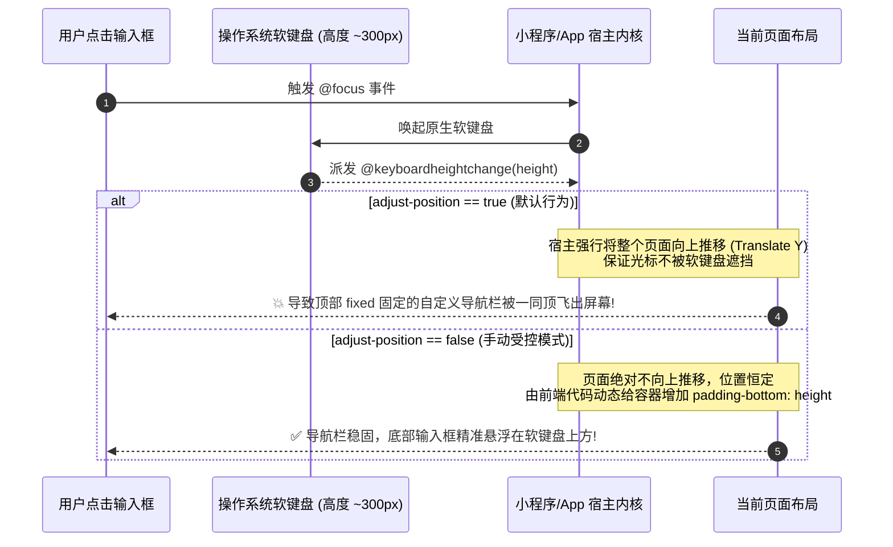
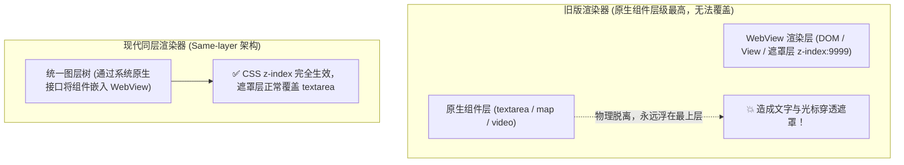

# 初级-表单输入组件input与textarea软键盘交互避坑

在移动端与小程序业务中，用户表单输入（如登录注册、收货地址、订单备注、聊天输入框）是离核心转化最近的高频场景。然而，由于移动操作系统的虚拟软键盘（Soft Keyboard）弹出时会动态挤压或推移屏幕窗口，**`input`（单行输入）** 与 **`textarea`（多行输入）** 往往是跨端开发中出现“样式灾难”与交互故障的重灾区。

在社招技术面试中，面试官经常以真实的线上血泪故障切入考察：**为什么弹窗弹出时底部的 textarea 文字会离奇穿透遮罩层？软键盘弹起时如何防止页面被强行向上顶起导致顶部自定义导航栏移位？在 iOS 端键盘收起后页面底部留下一大块空白无法回弹的底层机制与根治 SOP 是什么？**

---

## 1. 核心底层机制与全景架构

### 1.1 软键盘弹起时的视口挤压全景时序

当用户点击输入框获取焦点（`focus`）时，操作系统从屏幕底部呼出软键盘：



### 1.2 核心输入属性与配置矩阵

| 属性名称 | 类型 | 默认值 | 物理控制能力 |
| :--- | :--- | :--- | :--- |
| **`adjust-position`** | `Boolean` | `true` | **核心大坑属性**。键盘弹起时，是否自动将页面上推。建议在吸底输入框或自定义导航栏页面显式设为 `false`。 |
| **`cursor-spacing`** | `Number` | `0` | 指定光标与键盘之间的垂直物理距离（单位 px）。防止键盘直接贴死在文字底边缘。 |
| **`confirm-type`** | `String` | `done` | 设置键盘右下角完成按钮文字（`send` 发送、`search` 搜索、`next` 下一个、`go` 前往）。 |
| **`hold-keyboard`** | `Boolean` | `false` | 点击键盘右下角按钮时，是否保持键盘不收起（常用于即时聊天室连续发送消息）。 |

---

## 2. 源码级/算法物理推导

### 2.1 原生组件同层渲染（Same-layer Rendering）与穿透物理推导

在早期的微信小程序中，`textarea` 属于由客户端操作系统直接接管的 **原生组件（Native Component）**：
- **层级最高死规定**：在早期的渲染引擎中，原生组件脱离了普通 WebView 的 DOM 渲染树，其在屏幕上的层级（Z-Index）永远是最高的，任何通过 CSS 设置的 `z-index: 9999` 普通浮层都无法覆盖它！
- **穿透故障现场**：当业务弹出一个提示弹窗或底部 Drawer 抽屉时，底部的 `textarea` 文本内容会如同拥有“透视眼”一般直接浮在遮罩层最顶端，造成严重 UI 穿模。



> **现代工程现状**：微信小程序现已全面普及 **同层渲染（Same-layer Rendering）**，常规场景下穿透问题已大幅减少；但在某些低版本 Android 宿主或复杂 App 原生容器中，依然推荐在弹窗弹出时**条件性隐藏或禁用 textarea（如替换为纯文本占位卡片）**以实现 100% 安全兜底。

---

## 3. 社招/阶段必考高频硬核连环追问

### 追问 1：在带有吸底操作栏的页面中，手机软键盘弹起时，整个页面向上跳动甚至把顶部的自定义导航栏顶出了屏幕，如何实现优雅固定？

> **答辩深度闭环**：
> 1. **物理根因**：`input` 和 `textarea` 默认配置了 `:adjust-position="true"`。当输入框获取焦点时，系统检测到输入框被键盘遮挡，会粗暴地将整个 WebView 视口向上整体平移（Translate），导致顶部的导航栏被顶出视口外。
> 2. **标准根治方案**：
>    - 第一步：强制在输入框上显式设置 **`:adjust-position="false"`**，禁用系统默认的整体暴力上推。
>    - 第二步：在输入框上监听 **`@keyboardheightchange`** 事件，获取当前机型软键盘弹出的实时精确高度（`event.detail.height`）。
>    - 第三步：通过响应式变量，动态给底部吸底容器增加平移变换（`transform: translateY(-${keyboardHeight}px)`）或增加底部内边距，实现输入框精准贴合在软键盘上方，而顶部导航栏纹丝不动。

---

### 追问 2：在 iOS 设备中，当用户点击输入框键盘弹出、输入完毕后点击空白处收起键盘，页面底部为什么经常留出一大块灰色空白，且整个页面被卡住无法向下滚动复位？

> **答辩深度闭环**：
> 1. **iOS WebKit 内核经典 Bug**：在 iOS 12~15 系统中，软键盘弹起时会将整个浏览器的视口滚上去；但在键盘收起时，iOS 底层的滚动容器并没有自动触发 `window.scrollTo` 进行复位，导致物理渲染视口与逻辑视口发生错位，底部留下等同于键盘高度的假死空白区。
> 2. **生产级根治 SOP（失焦主动复位法）**：
>    在输入框的 `@blur` 失焦事件中，通过微小的定时器，主动触发一次轻量滚动复位：
>    ```javascript
>    function handleInputBlur() {
>      // 仅在 iOS 平台触发复位
>      if (uni.getSystemInfoSync().platform === 'ios') {
>        setTimeout(() => {
>          uni.pageScrollTo({
>            scrollTop: 0,
>            duration: 0 // 瞬间无感复位
>          });
>        }, 100);
>      }
>    }
>    ```

---

### 追问 3：在实现搜索框时，用户每敲一个字都会触发 `@input` 事件，如果直接在此发起网络请求会导致什么灾难？如何用防抖（Debounce）解决？

> **答辩深度闭环**：
> 1. **竞态问题与网络雪崩（Race Condition）**：如果用户连续输入“MacBook”，1 秒内会触发 7 次请求。由于移动网络波动，先发出的请求（如搜索“Mac”）可能晚于后发出的请求（搜索“MacBook”）返回，导致旧数据覆盖新数据，呈现严重的搜索结果错乱。
> 2. **防抖算法解决**：必须引入 `debounce`，设置 300ms 等待窗口。只有在用户停止输入的 300ms 后才正式向后端发起搜索请求。

---

## 4. 生产级避坑指南与排障 SOP

### 4.1 生产级吸底聊天输入框（Chat Input Bar）键盘联动实战

```vue
<template>
  <view class="chat-container">
    <!-- 消息滚动列表 -->
    <scroll-view class="message-list" scroll-y>
      <!-- 聊天消息项... -->
    </scroll-view>

    <!-- 底部输入操作栏 (显式禁用 adjust-position 并精准受控高度) -->
    <view
      class="input-bar"
      :style="{
        transform: `translateY(-${keyboardHeight}px)`,
        paddingBottom: keyboardHeight === 0 ? 'env(safe-area-inset-bottom)' : '16rpx'
      }"
    >
      <input
        class="text-input"
        type="text"
        v-model="inputText"
        :adjust-position="false"
        :cursor-spacing="16"
        confirm-type="send"
        placeholder="输入聊天内容..."
        @focus="handleFocus"
        @blur="handleBlur"
        @confirm="sendMessage"
        @keyboardheightchange="handleKeyboardHeightChange"
      />
      <button class="send-btn" @click="sendMessage">发送</button>
    </view>
  </view>
</template>

<script setup lang="ts">
import { ref } from 'vue';

const inputText = ref('');
const keyboardHeight = ref(0);

// 监听键盘高度精确改变
function handleKeyboardHeightChange(e: any) {
  keyboardHeight.value = e.detail.height;
}

function handleFocus(e: any) {
  // 某些机型 focus 回调携带键盘高度
  if (e.detail.height) {
    keyboardHeight.value = e.detail.height;
  }
}

function handleBlur() {
  keyboardHeight.value = 0;
}

function sendMessage() {
  if (!inputText.value.trim()) return;
  console.log('发送消息:', inputText.value);
  inputText.value = '';
}
</script>

<style lang="scss" scoped>
.chat-container {
  display: flex;
  flex-direction: column;
  height: 100vh;
  background-color: #f7f7f7;
}

.message-list {
  flex: 1;
  overflow: hidden;
}

.input-bar {
  display: flex;
  align-items: center;
  padding: 16rpx 24rpx;
  background-color: #ffffff;
  border-top: 1rpx solid #e5e5e5;
  transition: transform 0.15s ease-out; /* 丝滑平移动画跟随键盘 */

  .text-input {
    flex: 1;
    height: 72rpx;
    background-color: #f0f0f0;
    border-radius: 36rpx;
    padding: 0 24rpx;
    font-size: 28rpx;
  }

  .send-btn {
    margin-left: 16rpx;
    width: 120rpx;
    height: 72rpx;
    line-height: 72rpx;
    border-radius: 36rpx;
    background-color: #2b9939;
    color: #ffffff;
    font-size: 26rpx;
  }
}
</style>
```

### 4.2 表单排障速查手册

| 异常现象 | 物理根因 | 生产排查与根治 SOP |
| :--- | :--- | :--- |
| **输入框文字输入延迟严重** | 在 `@input` 频繁调用 `setData` 或进行了大对象的深度响应式更新。 | 避免在 `@input` 中执行重计算；简单表单直接使用原生 `v-model` 即可。 |
| **密码明文切换时光标跳到最前面** | 动态切换 `password: true/false` 时，组件内部重新挂载了原生输入框。 | 切换类型后，手动将光标位置重设为文本末尾：`cursor: inputText.length`。 |
| **textarea 自动增高卡顿** | 开启了 `auto-height` 并在外层设置了相互冲突的 `height` 约束。 | 开启 `auto-height` 时，严禁给 textarea 显式写死固定 `height` 样式。 |
