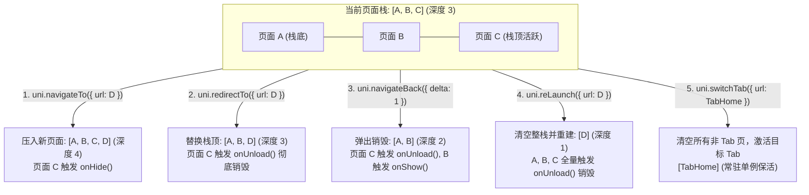

# 初级-页面路由导航uni-navigateTo全系列跳转与参数传递

在跨端应用架构中，页面间的流转与状态衔接是组织业务流程的核心骨架。与传统 Web 开发基于浏览器无界历史栈（History API）或 Hash 模式不同，小程序与混合 App 端严格受制于宿主操作系统和运行时的 **页面栈（Page Stack）模型**。

Uni-App 提供了 5 种不同物理行为的导航 API。在社招初中级面试中，面试官绝不会仅仅停留在“跳转用哪个 API”的表层，而是直击核心：**`navigateTo`、`redirectTo`、`reLaunch`、`switchTab`、`navigateBack` 对底层页面栈的物理操作有何本质区别？小程序 10 层页面栈上限如何从架构上防爆？复杂对象跨页面传参为什么直接拼 URL 会发生数据截断？页面返回时如何安全逆向回传数据？**

---

## 1. 核心底层机制与全景架构

### 1.1 五大导航 API 与底层页面栈物理状态机

通过 `getCurrentPages()` 可以获取当前运行时的页面栈数组。5 个导航方法对该数组的物理修改行为如下：



### 1.2 5 大核心导航 API 选型矩阵

| API 名称 | 页面栈物理行为 | 目标页面限制 | 典型业务场景 |
| :--- | :--- | :--- | :--- |
| **`uni.navigateTo`** | 保留当前页，将新页面**压栈（Push）** | 严禁跳转至 TabBar 页面 | 列表点进详情页、表单填写下一页（允许用户无缝返回）。 |
| **`uni.redirectTo`** | 关闭当前页，以新页面**替换（Replace）** | 严禁跳转至 TabBar 页面 | 登录成功后替换登录页进入实名认证页（防止用户按返回键重回登录页）。 |
| **`uni.reLaunch`** | **清空并销毁所有历史页面**，全新打开 | 可以是任意页面（包括 TabBar） | 用户退出登录重置首屏、切换多租户/大版本重载应用。 |
| **`uni.switchTab`** | 关闭所有非 TabBar 页面，切换至 TabBar | **仅能跳转至 `pages.json` 中配置的 TabBar 页面** | 从任意深层业务页快速回到“首页”或“个人中心”。 |
| **`uni.navigateBack`** | 弹出并销毁栈顶一个或多个页面（`delta`） | 仅在页面栈深度 $> 1$ 时有效 | 详情页点击左上角箭头返回上一页。 |

---

## 2. 源码级/算法物理推导

### 2.1 路由参数序列化与类型强制降级推导

通过 URL 查询字符串传参时：
```javascript
// 发起端
uni.navigateTo({
  url: '/pages/detail/index?id=1001&isVip=true&score=98.5'
});
```
在目标页面的 `onLoad(options)` 中：
```javascript
// 接收端
onLoad((options) => {
  console.log(typeof options.id);    // "string" (并非 number!)
  console.log(typeof options.isVip); // "string" (并非 boolean!)
  console.log(options.isVip === true); // false! (因为 "true" !== true)
});
```
- **物理推导**：所有拼接在 URL 后的查询参数，经过底层的 URL 协议解析器提取后，**一律被强行降级为 `String` 字符串类型**！在业务中进行布尔判断或数值运算时，必须显式转换（`Number(options.id)` 或 `options.isVip === 'true'`）。

### 2.2 复杂对象传参截断与 URI 编码原理

如果直接将 JSON 对象字符串拼在 URL 中：
```javascript
// ❌ 危险写法：如果对象内部包含 '&', '=', '?' 或中文字符
const user = { name: "张三&李四", avatar: "https://example.com/a.png?token=123" };
uni.navigateTo({
  url: `/pages/detail/index?user=${JSON.stringify(user)}`
});
```
- **截断事故**：由于 URL 规范使用 `&` 作为参数分隔符，`avatar` 内部自带的 `?` 和 `&` 会导致微信小程序的 URL 解析器**发生提前切割**，最终导致目标页面取到的 JSON 字符串残缺不全，调用 `JSON.parse` 瞬间抛出语法异常引发白屏崩溃！
- **生产级编解码标准方程**：
  $$\text{EncodedURL} = \text{url} + \text{"?data="} + \text{encodeURIComponent}(\text{JSON.stringify}(obj))$$
  目标页面接收时：
  $$\text{ParsedObject} = \text{JSON.parse}(\text{decodeURIComponent}(options.data))$$

---

## 3. 社招/阶段必考高频硬核连环追问

### 追问 1：微信小程序等平台对页面栈有最大 10 层的物理硬顶（Max 10 Stack Limit），如果用户不断点击下一页触碰红线会发生什么？如何防爆？

> **答辩深度闭环**：
> 1. **事故现场**：当页面栈深度达到 10 层后，再次调用 `uni.navigateTo`，底层系统会直接**静默拦截并抛出错误（`fail: limit exceed 10`）**，界面毫无反应，用户操作被永久卡死。
> 2. **工程治理方案**：
>    - 封装全局导航中间件：在跳转前通过 `getCurrentPages().length` 实时检查当前栈深。
>    - 若栈深接近阈值（如已达到 8 或 9 层），自动将后续的 `navigateTo` 降级为 **`redirectTo`**，替换当前栈顶页面，避免栈深度进一步恶化溢出。
>    - 对于长流程业务（如问卷调研每题一页、购物结账多步表单），强制使用组件切换或单页路由驱动，严禁每一步都 `navigateTo` 新页面。

---

### 追问 2：从页面 B 返回页面 A（`navigateBack`）时，如何将页面 B 选中的数据优雅逆向回传给页面 A？有哪几种方式？各自优缺点是什么？

> **答辩深度闭环**：
> 生产中共有三大回传范式：
> 1. **方式一：通过 `getCurrentPages()` 直接修改上一个页面的响应式数据（推荐度高）**：
>    ```javascript
>    const pages = getCurrentPages();
>    const prevPage = pages[pages.length - 2]; // 获取上一页实例
>    prevPage.$vm.selectedAddress = targetAddress; // 直接修改上一页 Vue 数据
>    uni.navigateBack();
>    ```
>    *优点：无需建立事件通道，精准定向，零残留。*
> 2. **方式二：通过 EventChannel 专属事件通道（官方推荐）**：
>    利用 `navigateTo` 成功回调返回的 `res.eventChannel`，在页面 B 调用 `getOpenerEventChannel().emit('onSelect', data)`。
> 3. **方式三：全局事件总线 `uni.$emit`**：上一页在 `onShow` 监听，返回前派发。*缺点是容易出现未解绑导致的重复触发。*

---

### 追问 3：用户在手机上快速连续双击一个跳转按钮，界面经常一下子连续打开两个一模一样的详情页，如何从底层根治？

> **答辩深度闭环**：
> 1. **物理成因**：移动端触控事件响应与路由异步压栈之间存在几十毫秒的时间差。在第一个跳转的路由尚未完成渲染挂载之前，按钮未被置灰，用户第二次快速点击再次发起了 `uni.navigateTo`。
> 2. **根治方案（全局防重路由封装）**：
>    在全局路由工具类中注入节流锁（Throttle Lock）：
>    ```javascript
>    let isNavigating = false;
>    export function safeNavigateTo(options) {
>      if (isNavigating) return;
>      isNavigating = true;
>      uni.navigateTo({
>        ...options,
>        complete: () => {
>          setTimeout(() => { isNavigating = false; }, 500); // 500ms 后释放锁
>        }
>      });
>    }
>    ```

---

## 4. 生产级避坑指南与排障 SOP

### 4.1 生产级双向通信 EventChannel 优雅实战

#### 1. 页面 A（发起端：等待接收所选联系人）
```vue
<script setup lang="ts">
import { ref } from 'vue';

const selectedContact = ref<any>(null);

function chooseContact() {
  uni.navigateTo({
    url: '/pages/contact-picker/index',
    events: {
      // 注册专属事件通道监听，等待子页面反向回调
      acceptChosenContact(contactData: any) {
        console.log('成功接收到子页面回传的数据:', contactData);
        selectedContact.value = contactData;
      }
    }
  });
}
</script>
```

#### 2. 页面 B（选择端：选中后回传并退栈）
```vue
<script setup lang="ts">
import { getCurrentInstance } from 'vue';

const instance = getCurrentInstance();

function handleItemClick(item: any) {
  // #ifdef MP-WEIXIN || APP-PLUS || H5
  // 获取当前页面的通信通道实例
  const eventChannel = instance?.proxy?.getOpenerEventChannel();
  if (eventChannel) {
    // 触发页面 A 预埋的事件
    eventChannel.emit('acceptChosenContact', item);
  }
  // #endif

  // 返回上一页
  uni.navigateBack();
}
</script>
```

### 4.2 路由跳转排错速查手册

| 报错信息 / 故障表象 | 物理根因 | 生产排查与根治 SOP |
| :--- | :--- | :--- |
| `navigate:fail page not found` | 1. 目标页面路径拼写错误。<br/>2. 忘记在 `pages.json` 的 `pages` 或 `subPackages` 中声明。 | 检查 `pages.json` 确保路径绝对吻合，注意开头无需加 `/` 相对路径。 |
| `can not navigate to a tab bar page` | 试图使用 `navigateTo` 或 `redirectTo` 打开配置在 TabBar 中的页面。 | 统一替换为 `uni.switchTab({ url: '...' })`。 |
| 携带的中文在目标页面乱码 | URL 参数中的中文字符未经标准 URI 编码处理。 | 传递前使用 `encodeURIComponent()`，接收后使用 `decodeURIComponent()`。 |
