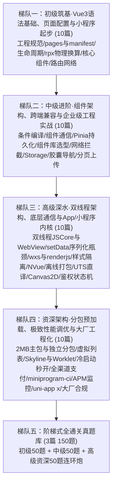

# Uni-App 全阶梯技术图谱与社招通关前言

在移动跨平台与小程序生态演进中，**Uni-App** 凭借其统一的 Vue 语法心智、丰富的大陆平台矩阵覆盖（微信/支付宝/抖音/快手小程序、iOS/Android App、Web/H5）以及极致的工程开发效率，成为各大大厂与泛互联网企业在移动端快速布局商业矩阵的核心基础设施。

然而，跨端并不意味着“一劳永逸”。面对小程序的双线程隔离、2MB 主包物理红线、`setData` 序列化跨线程通信瓶颈、多端平台的 API 行为壁垒，很多开发者往往止步于“调用 API 拼页面，一问底层架构就哑火、遇到线上掉帧与包体积超标束手无策”。

本知识库深度参照一线大厂（腾讯、阿里、字节、美团、快手）**社招 2~5 年+ 资深/架构师级别面试与生产实战标杆**，构建了由浅入深、五层递进的**43 篇硬核实战体系**。

---

## 🌟 知识图谱五层梯队全景规划

---

## 📚 43 篇核心专题索引导航

### 梯队一：初级筑基·Vue3语法基础、页面配置与小程序起步（10篇）
1. [01. UniApp工程架构目录规范与CLI对比HBuilderX选型](/doc/uniapp/初级-UniApp工程架构目录规范与CLI对比HBuilderX选型)
2. [02. 全局配置文件pages与manifest核心配置与分包声明](/doc/uniapp/初级-全局配置文件pages与manifest核心配置与分包声明)
3. [03. 三套生命周期执行全时序应用-页面与Vue组件生命周期](/doc/uniapp/初级-三套生命周期执行全时序应用-页面与Vue组件生命周期)
4. [04. 响应式单位rpx物理计算原理与多端屏幕自适应实战](/doc/uniapp/初级-响应式单位rpx物理计算原理与多端屏幕自适应实战)
5. [05. 核心内置基础组件view-text-image与button实战](/doc/uniapp/初级-核心内置基础组件view-text-image与button实战)
6. [06. 表单输入组件input与textarea软键盘交互避坑](/doc/uniapp/初级-表单输入组件input与textarea软键盘交互避坑)
7. [07. 滚动容器scroll-view基础用法与横向纵向滚动实战](/doc/uniapp/初级-滚动容器scroll-view基础用法与横向纵向滚动实战)
8. [08. 页面路由导航uni-navigateTo全系列跳转与参数传递](/doc/uniapp/初级-页面路由导航uni-navigateTo全系列跳转与参数传递)
9. [09. 网络请求uni-request基础封装与跨端域名白名单配置](/doc/uniapp/初级-网络请求uni-request基础封装与跨端域名白名单配置)
10. [10. 新手常见报错排查指南与多端控制台Error根治SOP](/doc/uniapp/初级-新手常见报错排查指南与多端控制台Error根治SOP)

### 梯队二：中级进阶·组件架构、跨端兼容与企业级工程实战（10篇）
11. [11. 条件编译ifdef核心语法与多端差异化代码治理](/doc/uniapp/中级-条件编译ifdef核心语法与多端差异化代码治理)
12. [12. 组件通信全方案props-emit与全局事件总线uni-emit](/doc/uniapp/中级-组件通信全方案props-emit与全局事件总线uni-emit)
13. [13. 状态管理Pinia在UniApp中的多端持久化适配实战](/doc/uniapp/中级-状态管理Pinia在UniApp中的多端持久化适配实战)
14. [14. 现代化UI组件库wot-design-uni与uview-plus选型集成](/doc/uniapp/中级-现代化UI组件库wot-design-uni与uview-plus选型集成)
15. [15. 企业级网络层封装luch-request拦截器与Token无感刷新](/doc/uniapp/中级-企业级网络层封装luch-request拦截器与Token无感刷新)
16. [16. 本地数据持久化uni-storage与异步同步选型实战](/doc/uniapp/中级-本地数据持久化uni-storage与异步同步选型实战)
17. [17. 自定义顶部导航栏CustomNavBar与状态栏胶囊对齐实战](/doc/uniapp/中级-自定义顶部导航栏CustomNavBar与状态栏胶囊对齐实战)
18. [18. 下拉刷新onPullDownRefresh与上拉触底加载分页封装](/doc/uniapp/中级-下拉刷新onPullDownRefresh与上拉触底加载分页封装)
19. [19. 通用弹窗体系Popup-Modal与ActionSheet优雅封装](/doc/uniapp/中级-通用弹窗体系Popup-Modal与ActionSheet优雅封装)
20. [20. 多端文件上传uni-uploadFile与图片选择压缩实战](/doc/uniapp/中级-多端文件上传uni-uploadFile与图片选择压缩实战)

### 梯队三：高级深水·双线程架构、底层通信与App/小程序内核（10篇）
21. [21. 小程序双线程架构逻辑层JSCore与渲染层WebView原理](/doc/uniapp/高级-小程序双线程架构逻辑层JSCore与渲染层WebView原理)
22. [22. setData底层序列化通信瓶颈与局部差量更新推导](/doc/uniapp/高级-setData底层序列化通信瓶颈与局部差量更新推导)
23. [23. 极速视图交互wxs与renderjs零跨线程通信实战](/doc/uniapp/高级-极速视图交互wxs与renderjs零跨线程通信实战)
24. [24. 无DOM环境下跨端节点查询uni-createSelectorQuery](/doc/uniapp/高级-无DOM环境下跨端节点查询uni-createSelectorQuery)
25. [25. 自定义组件样式隔离styleIsolation与virtualHost配置](/doc/uniapp/高级-自定义组件样式隔离styleIsolation与virtualHost配置)
26. [26. App原生运行时架构Weex-NVue与WebView双渲染引擎](/doc/uniapp/高级-App原生运行时架构Weex-NVue与WebView双渲染引擎)
27. [27. App离线打包全流程Android-Studio与Xcode原生工程集成](/doc/uniapp/高级-App离线打包全流程Android-Studio与Xcode原生工程集成)
28. [28. 原生插件开发机制与新一代UTS语言直译内核](/doc/uniapp/高级-原生插件开发机制与新一代UTS语言直译内核)
29. [29. 跨端Canvas2D动态海报绘制与离屏光栅化导出](/doc/uniapp/高级-跨端Canvas2D动态海报绘制与离屏光栅化导出)
30. [30. 多端登录鉴权状态机微信静默登录与手机号授权闭环](/doc/uniapp/高级-多端登录鉴权状态机微信静默登录与手机号授权闭环)

### 梯队四：资深架构·分包预加载、极致性能调优与大厂工程化（10篇）
31. [31. 突破2MB主包限制subPackages分包与独立分包架构](/doc/uniapp/资深-突破2MB主包限制subPackages分包与独立分包架构)
32. [32. 小程序性能极限压榨setData频率合并与虚拟列表实战](/doc/uniapp/资深-小程序性能极限压榨setData频率合并与虚拟列表实战)
33. [33. 新一代渲染引擎Skyline架构适配与Worklet手势动画](/doc/uniapp/资深-新一代渲染引擎Skyline架构适配与Worklet手势动画)
34. [34. 冷启动性能全链路优化代码注入懒加载与骨架屏](/doc/uniapp/资深-冷启动性能全链路优化代码注入懒加载与骨架屏)
35. [35. 全渠道跨端支付架构微信-支付宝与Apple-IAP实战](/doc/uniapp/资深-全渠道跨端支付架构微信-支付宝与Apple-IAP实战)
36. [36. 企业级自动化构建流水线miniprogram-ci与多租户分包](/doc/uniapp/资深-企业级自动化构建流水线miniprogram-ci与多租户分包)
37. [37. APM实时日志监控wx-getRealtimeLogManager与崩溃还原](/doc/uniapp/资深-APM实时日志监控wx-getRealtimeLogManager与崩溃还原)
38. [38. 多端兼容全矩阵微信-支付宝-抖音-App行为差异与抹平](/doc/uniapp/资深-多端兼容全矩阵微信-支付宝-抖音-App行为差异与抹平)
39. [39. 新一代uni-app-x技术革命纯原生编译与性能飞跃](/doc/uniapp/资深-新一代uni-app-x技术革命纯原生编译与性能飞跃)
40. [40. 大厂级小程序工程治理隐私协议合规与多团队协同规范](/doc/uniapp/资深-大厂级小程序工程治理隐私协议合规与多团队协同规范)

### 梯队五：阶梯式全通关真题库·社招高频150题标准对标（3篇）
41. [41. UniApp全阶段面试通关-初级基础50题标准对标](/doc/uniapp/UniApp全阶段面试通关-初级基础50题标准对标)
42. [42. UniApp全阶段面试通关-中级实战50题标准对标](/doc/uniapp/UniApp全阶段面试通关-中级实战50题标准对标)
43. [43. UniApp全阶段面试通关-高级资深架构50道连环炮全景通关](/doc/uniapp/UniApp全阶段面试通关-高级资深架构50道连环炮全景通关)

---

## 💡 存量精选专题集锦

除 43 篇阶梯式主干专题外，本板块保留了早期沉淀的实战专题：
- [页面开发登录与支付基本实践](/doc/uniapp/页面开发登录与支付基本实践)
- [UniApp 高频面试题与项目实战](/doc/uniapp/UniApp高频面试题与项目实战)
- [UniApp 第三方库选型与实战](/doc/uniapp/UniApp第三方库选型与实战)
- [UniApp 核心架构与跨端开发体系](/doc/uniapp/UniApp核心架构与跨端开发体系)
- [企业级网络封装与状态管理实战](/doc/uniapp/企业级网络封装与状态管理实战)
- [性能优化与多端避坑全景指南](/doc/uniapp/性能优化与多端避坑全景指南)
