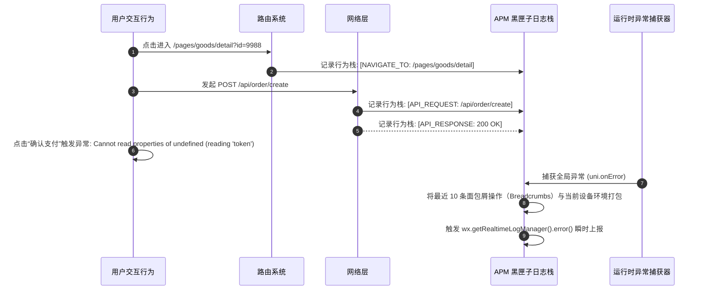

# 资深-APM实时日志监控wx-getRealtimeLogManager与崩溃还原

在移动端海量用户的生产环境中，应用崩溃（Crash）、JS 未捕获异常（Uncaught Exception）、白屏死锁以及接口大面积 5xx 往往具有偶发性和高度机型特异性。没有完备的**应用性能监控（APM - Application Performance Monitoring）**体系，线上客诉就会沦为“抓瞎排查”。本文深度拆解微信原生**实时日志管理器（RealtimeLogManager）**机制、跨端未捕获异常统一捕获链路、SourceMap 错误堆栈反解算法，以及高可用日志削峰与上下文还原体系。

---

## 一、核心底层机制与全景架构

### 1.1 生产级 APM 实时监控与错误还原全景流转

```mermaid
graph TD
    subgraph 客户端多维度异常探针 (Uni-App)
        A1[全局 JS 运行时异常: uni.onError / window.onerror]
        A2[Promise 未处理拒绝: uni.onUnhandledRejection]
        A3[网络层接口故障: 4xx / 5xx / 业务 Code 异常]
        A4[性能劣化指标: 页面白屏检测 / 首屏超长]
    end

    A1 & A2 & A3 & A4 --> B[统一 APM 监控中枢 MonitorManager]

    subgraph 日志富化与缓冲削峰
        B --> C1[采集设备上下文: 机型 / OS / 基础库版本 / 网络类型]
        B --> C2[挂载用户画像: UserID / 页面路由栈 / 最近 10 次行为轨迹]
        B --> C3[写入环形内存缓冲区 Circular Buffer]
    end

    subgraph 双通道分发与上报
        C3 -->|微信原生实时日志| D1[wx.getRealtimeLogManager: 秒级直达微信公众后台]
        C3 -->|自研日志服务端| D2[批量压缩上报 POST /apm/report]
    end

    D2 --> E[企业级 APM 后台 / Sentry / ELK]
    E --> F[基于 SourceMap 反解压缩代码为原始 TS/Vue 源码与行号]
    F --> G[实时告警卡片触发: 飞书/企业微信群机器人通知]
```

### 1.2 异常现场上下文“黑匣子（Flight Recorder）”还原模型

线上报错往往不是单个文件孤立发生的，必须还原崩溃前用户的**微观操作时序**：



---

## 二、源码级实战推导：企业级 APM 探针与实时日志管理器封装

### 2.1 高性能 APM 监控中枢实现

```typescript
// services/apm/Logger.ts
class APMMonitor {
  private static instance: APMMonitor;
  private realtimeLogger: any = null;
  private breadcrumbs: Array<{ time: number; type: string; message: string }> = [];
  private readonly MAX_BREADCRUMBS = 15;

  private constructor() {
    this.initRealtimeLogger();
    this.registerGlobalErrorHooks();
  }

  public static getInstance(): APMMonitor {
    if (!APMMonitor.instance) {
      APMMonitor.instance = new APMMonitor();
    }
    return APMMonitor.instance;
  }

  // 1. 初始化微信原生实时日志收集器
  private initRealtimeLogger() {
    // #ifdef MP-WEIXIN
    if (typeof wx !== 'undefined' && wx.getRealtimeLogManager) {
      this.realtimeLogger = wx.getRealtimeLogManager();
    }
    // #endif
  }

  // 2. 注册全端未捕获异常探针
  private registerGlobalErrorHooks() {
    // 监听全平台未捕获 JS 脚本异常
    uni.onError((err: string) => {
      this.captureException('UNCAUGHT_EXCEPTION', err);
    });

    // 监听 Promise 未捕获 Rejection
    uni.onUnhandledRejection((res: any) => {
      const reason = res.reason ? (res.reason.stack || res.reason.message || res.reason) : 'Unknown Promise Rejection';
      this.captureException('UNHANDLED_REJECTION', reason);
    });

    // 监听小程序内存告警
    // #ifdef MP-WEIXIN
    wx.onMemoryWarning((level) => {
      this.warn('SYSTEM_MEMORY_WARNING', `设备内存告警等级: ${level.level}`);
    });
    // #endif
  }

  // 3. 用户行为记录（面包屑机制）
  public addBreadcrumb(type: 'CLICK' | 'NAVIGATE' | 'NETWORK', message: string) {
    this.breadcrumbs.push({
      time: Date.now(),
      type,
      message
    });
    if (this.breadcrumbs.length > this.MAX_BREADCRUMBS) {
      this.breadcrumbs.shift();
    }
  }

  // 4. 关键信息日志输出
  public info(tag: string, ...args: any[]) {
    console.info(`[${tag}]`, ...args);
    this.realtimeLogger?.info?.(tag, ...args);
  }

  public warn(tag: string, ...args: any[]) {
    console.warn(`[${tag}]`, ...args);
    this.realtimeLogger?.warn?.(tag, ...args);
  }

  // 5. 核心：异常现场富化与上报
  public captureException(type: string, errorDetail: any) {
    const sysInfo = uni.getSystemInfoSync();
    
    // 构建全维度排障现场上下文
    const payload = {
      type,
      error: typeof errorDetail === 'object' ? (errorDetail.stack || JSON.stringify(errorDetail)) : errorDetail,
      timestamp: new Date().toISOString(),
      breadcrumbs: [...this.breadcrumbs],
      device: {
        brand: sysInfo.brand,
        model: sysInfo.model,
        system: sysInfo.system,
        platform: sysInfo.platform,
        version: sysInfo.version,
        SDKVersion: (sysInfo as any).SDKVersion || 'N/A'
      },
      currentRoute: this.getCurrentPageUrl()
    };

    console.error('[APM 异常捕获]', payload);

    // 微信实时日志上报（支持设置 FilterMsg 便于后台精准过滤）
    if (this.realtimeLogger) {
      this.realtimeLogger.addFilterMsg('Error');
      this.realtimeLogger.addFilterMsg(type);
      this.realtimeLogger.error(payload);
    }

    // 触发自研后台或 Sentry 上报
    this.reportToServer(payload);
  }

  private getCurrentPageUrl(): string {
    const pages = getCurrentPages();
    if (pages.length > 0) {
      const currentPage = pages[pages.length - 1];
      return currentPage.route || (currentPage as any).$page?.fullPath || '';
    }
    return 'AppLaunch';
  }

  private async reportToServer(payload: any) {
    try {
      await uni.request({
        url: 'https://apm.corp.com/api/v1/client/error-report',
        method: 'POST',
        data: payload
      });
    } catch (e) {
      // 容错：上报本身失败绝不能引发二次崩溃
    }
  }
}

export const apm = APMMonitor.getInstance();
```

---

## 三、社招高频硬核连环追问

### 追问 1：为什么在微信公众平台实时日志后台看报错，堆栈全是类似 `app-service.js:1:34852` 的压缩混淆代码？如何精准反解到源码文件和行列号？

> **考官意图**：考察前端工业级 SourceMap 原理与线上错误逆向工程实践。

**回答硬核要点**：
1. **压缩混淆本质**：
   - 生产环境发布时，Vite / Webpack 对代码进行了变量重命名（Uglify/Terser）和死代码剔除，所有业务代码被高度打平成单行超长 JS，导致原生报错堆栈丢失了原始可读性。
2. **SourceMap 逆向映射机制**：
   - 构建产物会伴随生成 `.map` 文件（如 `app-service.js.map`），内部通过 **VLQ（Variable-length quantity）编码** 记录了压缩代码行/列与原始 TS/Vue 文件的精确映射关系。
3. **安全治理规范**：
   - **绝不能将 `.map` 文件发布到生产 CDN**，否则等同于开源商业源码。
   - 构建流水线在生成产物后，将 `.map` 文件自动同步备份至企业内网私有存储，自研 APM 系统或 Sentry 接收到 `app-service.js:1:34852` 后，在内网调用 `source-map` 模块进行离线反解，自动输出清晰的原始文件名（如 `stores/useUserStore.ts:42:15`）。

---

### 追问 2：微信官方提供的 `wx.getRealtimeLogManager()` 有哪些物理配额限制？生产中如何避免超频失效？

> **考官意图**：考察微信官方 API 底层约束与防打爆日志治理方案。

**回答硬核要点**：
- **微信官方物理配额铁律**：
  1. 单个小程序每日最多产生 **500 万条** 实时日志条目。
  2. 单次调用日志大小限制在 **7KB** 以内（超出部分会被底层强行截断）。
  3. 日志在微信公众平台后台仅保留 **7 天**，过期自动滚动覆盖。
- **高可用削峰与限流设计**：
  - 严禁在滚动事件（`onScroll`）或高频轮询中调用实时日志；
  - 设置前端采样率：对于普通的 `info` 级排查日志，仅对全量用户的 1%~5% 随机采样上报；
  - 针对 `error` 级别错误，引入本地 10 秒时间窗口去重锁（Error Fingerprint Deduplication），相同的异常在 10 秒内只上报一次，杜绝死循环日志击垮配额。

---

### 追问 3：在小程序页面出现白屏且没有任何报错抛出（Silent White Screen）时，APM 如何自动检测并告警？

> **考官意图**：考察静默白屏检测算法与前端可用性兜底机制。

**回答硬核要点**：
- **无报错白屏的根因**：
  - 数据接口成功返回了空数组或异常结构，导致模板渲染了空节点；
  - CSS 样式错误（如 `opacity: 0`、`z-index: -999` 遮挡、高度塌陷为 0）；
  - 双线程通信中断或死锁。
- **白屏自动探针方案**：
  1. **路由跳转超时检测**：在页面 `onShow` 时启动 3 秒定时器。
  2. **关键锚点节点采样检测**：3 秒后，调用 `uni.createSelectorQuery()` 查询页面最核心的根容器节点或内容卡片节点的渲染高度与子节点数量：
     ```typescript
     uni.createSelectorQuery().select('#app-content-root').boundingClientRect((rect) => {
       if (!rect || rect.height === 0) {
         // 判定为疑似白屏事故，触发专项白屏报警
         apm.captureException('SILENT_WHITE_SCREEN', { route: currentRoute });
       }
     }).exec();
     ```

---

## 四、生产级避坑指南与排障 SOP

### 4.1 生产级 APM 监控排障矩阵

| 异常现象 | 根因深度剖析 | 排障与解决 SOP |
| :--- | :--- | :--- |
| **实时日志中全是乱码或 JSON 截断** | 上报对象包含了循环引用的 Vue 响应式代理（Proxy）或超大数据结构 | 上报前通过自定义深克隆函数剔除循环引用，限制单个 Payload 体积在 4KB 以内 |
| **iOS 端报错报 Script error. 没有任何堆栈** | 跨域脚本加载异常，浏览器内核出于安全同源策略屏蔽了详细报错 | 小程序环境通常无跨域脚本；若在 H5 端，需在 `<script>` 标签增加 `crossorigin` 属性并在服务端配置 CORS |
| **大量网络超时误报** | 用户手机锁屏或切换到后台导致网络挂起被客户端取消 | 监听 `uni.onAppHide` 与 `uni.onAppShow`，在应用处于后台挂起期间挂起网络异常判定 |

### 4.2 微信公众平台运维中心日志检索与排查 SOP

当用户客服反馈偶发故障时，通过微信运维后台进行秒级定位：

```bash
# 1. 登录微信公众平台 -> 开发 -> 运维中心 -> 实时日志
# 2. 筛选指定用户的微信号或 OpenID (需在代码中设置 setFilterMsg / setUserIdentifier)
# 3. 设置时间范围 (如最近 2 小时)
# 4. 检索关键字: Error 或 报错业务状态码
# 5. 展开日志详情，查看关联的 Breadcrumbs 行为时序链，迅速复现用户操作路径
```
