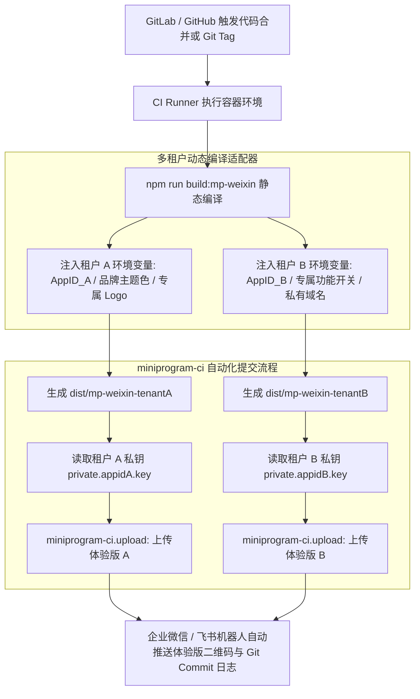
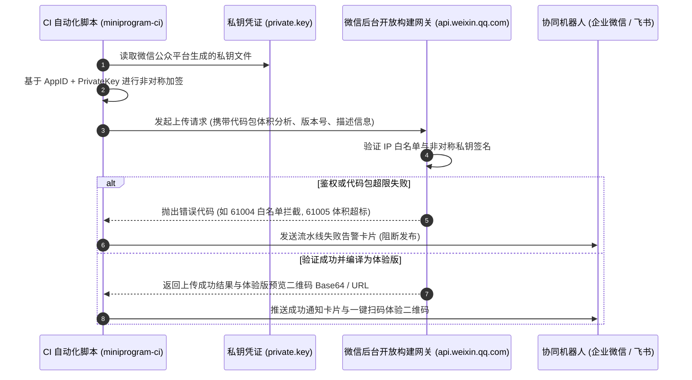

# 资深-企业级自动化构建流水线miniprogram-ci与多租户分包

在现代企业级移动开发团队中，依赖开发人员打开微信开发者工具“手动点击编译、手动点击上传体验版、手动修改版本号与备注”的作坊式流程，存在致命的缺陷：构建环境脏态不可控、版本发布缺乏审计归档、私钥权限分散、且无法满足**多租户（White-label / 多品牌定制）一键矩阵化打包**的需求。利用微信官方提供的 **`miniprogram-ci`** 模块，结合 CI/CD（GitHub Actions / GitLab CI / Jenkins）打造企业级全自动流水线，是团队技术负责人与架构师的必修硬核技能。

---

## 一、核心底层机制与全景架构

### 1.1 企业级自动化构建与多租户矩阵发布流水线



### 1.2 `miniprogram-ci` 底层通信与鉴权流转



---

## 二、源码级实战推导：企业级 miniprogram-ci 脚本与多租户注入

### 2.1 自动化构建脚本（`scripts/ci-upload.js`）

```javascript
// scripts/ci-upload.js
const ci = require('miniprogram-ci');
const path = require('path');
const fs = require('fs');

// 1. 读取环境参数 (从 CI 环境变量或命令行注入)
const tenant = process.env.TENANT || 'default';
const version = process.env.APP_VERSION || require('../package.json').version;
const desc = process.env.CI_COMMIT_MESSAGE || '日常功能迭代与性能优化发布';

// 租户多品牌矩阵配置表
const tenantConfigs = {
  default: {
    appid: 'wx1111111111111111',
    privateKeyPath: path.resolve(__dirname, '../keys/private.wx11111111.key')
  },
  tenant_vip: {
    appid: 'wx2222222222222222',
    privateKeyPath: path.resolve(__dirname, '../keys/private.wx22222222.key')
  }
};

const currentConfig = tenantConfigs[tenant];
if (!currentConfig) {
  console.error(`未识别的租户类型: ${tenant}`);
  process.exit(1);
}

// 2. 动态改写 manifest.json 中的 appid (保证编译产物与目标租户严格一致)
const manifestPath = path.resolve(__dirname, '../src/manifest.json');
const manifest = JSON.parse(fs.readFileSync(manifestPath, 'utf-8'));
manifest['mp-weixin'].appid = currentConfig.appid;
fs.writeFileSync(manifestPath, JSON.stringify(manifest, null, 2));

console.log(`[CI] 正在为租户 [${tenant}] 构建小程序, AppID: ${currentConfig.appid}, 版本号: ${version}`);

async function runUpload() {
  // 3. 初始化 miniprogram-ci 项目实例
  const project = new ci.Project({
    appid: currentConfig.appid,
    type: 'miniProgram',
    projectPath: path.resolve(__dirname, '../dist/build/mp-weixin'),
    privateKeyPath: currentConfig.privateKeyPath,
    ignores: ['node_modules/**/*', 'README.md']
  });

  try {
    // 4. 执行体验版上传
    const uploadResult = await ci.upload({
      project,
      version: version,
      desc: desc.substring(0, 30), // 微信限制描述在 30 字符内
      setting: {
        es6: true,
        minify: true,
        autoPrefixWXSS: true,
        minifyWXML: true,
        minifyWXSS: true
      },
      onProgressUpdate: (task) => {
        console.log(`[CI 进度] ${task.message}`);
      }
    });

    console.log('[CI 成功] 小程序体验版上传完成！产物分析:', uploadResult);

    // 5. 自动生成并输出体验版二维码
    const qrcodeDest = path.resolve(__dirname, `../dist/qrcode-${tenant}.jpg`);
    await ci.preview({
      project,
      desc: 'CI 自动构建预览版',
      setting: { es6: true, minify: true },
      qrcodeFormat: 'image',
      qrcodeOutputDest: qrcodeDest
    });
    console.log(`[CI 二维码已生成]: ${qrcodeDest}`);

  } catch (error) {
    console.error('[CI 失败] 上传过程中发生阻断性错误:', error);
    process.exit(1);
  }
}

runUpload();
```

---

### 2.2 GitLab CI 流水线编排配置（`.gitlab-ci.yml`）

```yaml
stages:
  - lint
  - build
  - deploy_mp

variables:
  NODE_ENV: production

job_upload_weixin:
  stage: deploy_mp
  image: node:18-alpine
  only:
    - tags       # 仅在打 Git Tag 时自动触发发布
    - main
  before_script:
    - npm ci
  script:
    - npm run build:mp-weixin
    # 动态注入 CI 私钥变量 (安全存储在 GitLab Settings -> CI/CD -> Variables)
    - mkdir -p ./keys
    - echo "$WX_PRIVATE_KEY_DEFAULT" > ./keys/private.wx11111111.key
    # 触发自动化发布脚本
    - node ./scripts/ci-upload.js
  after_script:
    # 调用 Webhook 向飞书或企业微信推送构建卡片
    - node ./scripts/notify-bot.js
```

---

## 三、社招高频硬核连环追问

### 追问 1：在配置 `miniprogram-ci` 时，为什么经常遭遇 `61004: ip not in whitelist` 错误？在动态 IP 的 Docker/K8s CI 集群中如何优雅解决？

> **考官意图**：考察微信开放平台网络安全防御策略与企业级动态云原生基础设施排错能力。

**回答硬核要点**：
1. **微信安全机制**：
   - 微信公众平台为了防范私钥泄露，在“开发设置”中强制要求开启“小程序代码上传 IP 白名单”。如果执行 `ci.upload()` 的机器 IP 不在列表中，会被直接拦截并抛出 `61004`。
2. **云原生动态 IP 痛点**：
   - 企业级 GitLab CI Runner 或 GitHub Actions 容器构建机通常采用动态公网 IP（每次运行 IP 随机变动），无法在微信后台一一枚举。
3. **企业级最佳实践**：
   - **方案 A（私有固定出口代理）**：在 CI 脚本中配置全局网络 HTTP 代理（`HTTP_PROXY`），所有 CI 容器的外网请求统一经由公司固定的公网 NAT 网关跳板机转发，将该跳板机固定公网 IP 填入微信白名单。
   - **方案 B（微信后台关闭 IP 白名单限制）**：对于企业内部自建物理机私有部署的 Runner，且严格落实了 GitLab Protected Variables 凭证隔离的场景，可在后台直接将“IP 白名单校验”关闭（需管理员扫码）。

---

### 追问 2：一个统一代码库如何做到“一套源码，根据不同租户打出拥有完全不同 AppID、独立主题风格、甚至不同页面功能结构的小程序”？

> **考官意图**：考察前端高级工程化、多租户（White-label）动态编译架构设计。

**回答硬核要点**：
- **三层动态注入架构**：
  1. **配置层解耦**：使用 `dotenv`（如 `.env.tenantA`、`.env.tenantB`），在构建命令中传入 `TENANT=tenantA`，动态切换环境变量（接口 BaseURL、AppID、品牌名）。
  2. **样式与主题变量覆盖**：在 Vite/Webpack 预处理器中，通过 `preprocessorOptions.scss.additionalData` 动态引入对应租户的主题变量文件（`@import "@/styles/theme-${process.env.TENANT}.scss";`），实现全局主题色、字体排版的原子级替换。
  3. **条件编译与路由动态生成**：在编译前通过 Node 脚本动态改写 `pages.json`，根据租户的采购模块配置，动态剔除不需要的页面路由与分包，做到租户级定制代码零冗余泄露。

---

### 追问 3：上传成功后，如何自动化获取“当前体验版的访问路径”与二维码，实现即时通知团队验收？

> **考官意图**：考察 CI/CD 自动化全闭环交付与协作效率赋能。

**回答硬核要点**：
- 调用 `miniprogram-ci` 的 `ci.preview()` 方法，可将二维码直接以本地图片（`image`）或 Base64 字符串形式导出到 CI 工作区。
- CI 脚本读取导出的二维码图片，调用企业微信/飞书机器人的图文卡片上传接口（`POST /upload_media`），将当前 Commit SHA、提交者、更新日志以及体验版二维码拼装成富文本卡片广播到研发/测试群。
- 此外，可利用微信 Scheme 规范生成体验版直跳 URL（`weixin://dl/business/?appid=...`），移动端测试人员在群内点击链接可直接一键静默拉起小程序，彻底省去手动发码截图的人力损耗。

---

## 四、生产级避坑指南与排障 SOP

### 4.1 miniprogram-ci 生产构建踩坑矩阵

| 异常现象 | 根因深度剖析 | 排障与解决 SOP |
| :--- | :--- | :--- |
| **错误 61005: package size out of limit** | 构建产物主包或分包体积超标，被微信平台强制拒绝 | 在 CI 脚本前置加入体积校验函数，计算 `dist/mp-weixin` 各分包大小，超标提前报错并输出大文件分析图 |
| **私钥泄露告警** | 开发者将 `private.key` 随代码直接提交至 Git 公共仓库 | 立即登录微信后台使旧私钥作废并重置；将私钥加入 `.gitignore`，且仅通过 CI Secret 环境变量注入 |
| **npm 构建依赖缺失** | 小程序若依赖微信原生 npm 组件未正确构建 | 在 `ci.upload` 配置项中显式开启 `compileOptions.componentFramework` 与构建配置 |
| **CI 环境并发冲突** | 多个分支同时触发构建，使用了同一个版本号覆盖体验版 | 版本号生成规则规范化：`package.json 版本号 + . + GitCommit 短哈希`（如 `2.1.0.a3f89b`） |

### 4.2 CI 代码包体积自检与阻断脚本 SOP

在执行 `ci.upload` 前，运行轻量化自检逻辑，防止触发微信平台拒绝：

```javascript
// scripts/check-size.js
const fs = require('fs');
const path = require('path');

function getFolderSize(dirPath) {
  let totalSize = 0;
  const files = fs.readdirSync(dirPath);
  for (const file of files) {
    const fullPath = path.join(dirPath, file);
    const stats = fs.statSync(fullPath);
    if (stats.isDirectory()) {
      totalSize += getFolderSize(fullPath);
    } else {
      totalSize += stats.size;
    }
  }
  return totalSize;
}

const mainPackSize = getFolderSize(path.resolve(__dirname, '../dist/build/mp-weixin/common')) + 
                     getFolderSize(path.resolve(__dirname, '../dist/build/mp-weixin/pages'));

const MAX_MAIN_SIZE = 2 * 1024 * 1024; // 2MB
if (mainPackSize > MAX_MAIN_SIZE) {
  console.error(`[CI 阻断] 主包体积已达 ${(mainPackSize / 1024 / 1024).toFixed(2)}MB，超出微信 2MB 限制！`);
  process.exit(1);
} else {
  console.log(`[CI 体积体检通过] 主包体积: ${(mainPackSize / 1024 / 1024).toFixed(2)}MB`);
}
```
