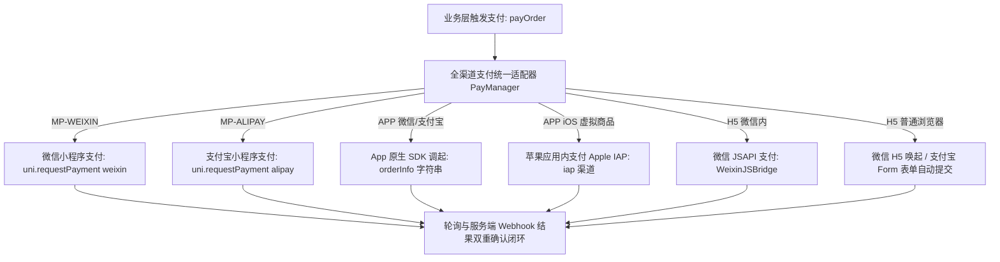
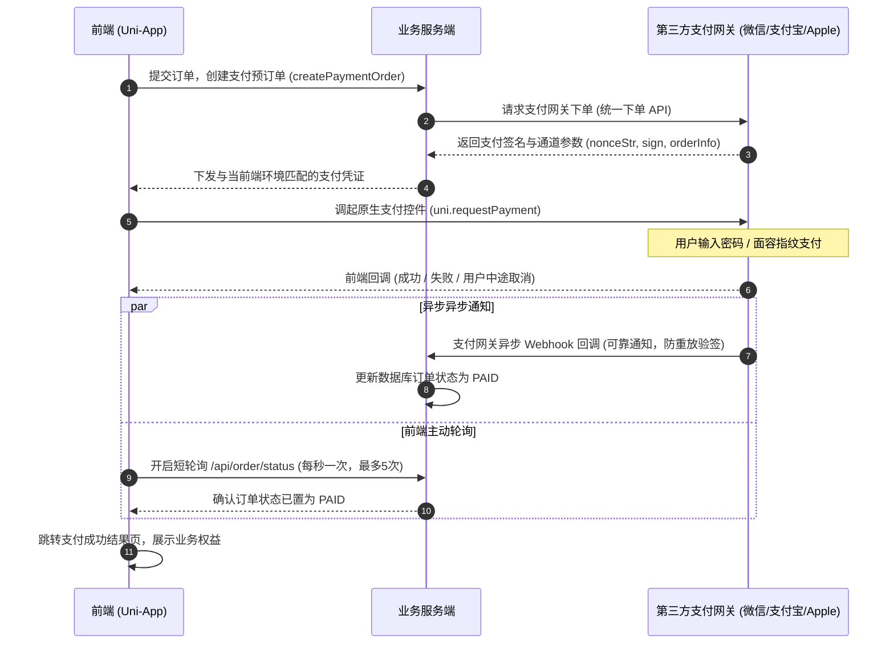

# 资深-全渠道跨端支付架构微信-支付宝与Apple-IAP实战

在商业化跨平台项目中，支付系统是核心资产交易的终点。然而由于生态壁垒，不同终端宿主所支持的支付通道与规范截然不同：微信小程序内只允许微信支付；支付宝小程序仅支持支付宝；App 端需调用原生微信/支付宝 SDK；iOS App 端涉及虚拟商品时受到苹果 **IAP（In-App Purchase）30% 苹果税**的铁律约束；H5/Web 端则涉及微信 JSAPI 与支付宝手机网站支付跳转。构建一套**统一抽象、渠道解耦、状态可靠的全渠道跨端支付架构**是资深前端与移动端架构师的必考课题。

---

## 一、核心底层机制与全景架构

### 1.1 全渠道跨端支付抽象分发矩阵



### 1.2 跨端支付交易与状态双重确认时序

前端调起支付控件成功，**并不等于交易最终成功**。前端必须通过“SDK 回调感知 + 后端主动轮询对账”完成交易状态闭环：



---

## 二、源码级实战推导：企业级全渠道支付适配器实现

### 2.1 统一支付管理适配器（PayManager）

通过面向对象与适配器模式，抹平多端差异：

```typescript
// services/pay/PayManager.ts

export type PayChannel = 'wxpay' | 'alipay' | 'appleiap';

export interface PayParams {
  orderId: string;
  channel: PayChannel;
}

export class PayManager {
  /**
   * 统一支付入口
   */
  public static async executePay(params: PayParams): Promise<boolean> {
    // 1. 请求服务端换取针对当前终端环境的专有支付凭据
    const prepayData = await this.fetchPrepayInfo(params);

    // 2. 根据终端平台与渠道执行差异化调起
    // #ifdef MP-WEIXIN
    return this.payInWeixinMP(prepayData);
    // #endif

    // #ifdef MP-ALIPAY
    return this.payInAlipayMP(prepayData);
    // #endif

    // #ifdef APP-PLUS
    return this.payInApp(params.channel, prepayData);
    // #endif

    // #ifdef H5
    return this.payInH5(params.channel, prepayData);
    // #endif

    throw new Error('当前运行环境不支持支付');
  }

  // 微信小程序端支付调起
  private static payInWeixinMP(prepay: any): Promise<boolean> {
    return new Promise((resolve, reject) => {
      uni.requestPayment({
        provider: 'wxpay',
        timeStamp: prepay.timeStamp,
        nonceStr: prepay.nonceStr,
        package: prepay.package,
        signType: prepay.signType || 'RSA',
        paySign: prepay.paySign,
        success: () => resolve(true),
        fail: (err) => {
          if (err.errMsg && err.errMsg.includes('cancel')) {
            reject(new Error('用户取消支付'));
          } else {
            reject(err);
          }
        }
      });
    });
  }

  // App 端原生微信/支付宝支付
  private static payInApp(channel: PayChannel, prepay: any): Promise<boolean> {
    return new Promise((resolve, reject) => {
      // 支付宝 orderInfo 为加签字符串；微信为 JSON 结构或字符串
      const orderInfo = channel === 'alipay' ? prepay.orderInfo : prepay.wxOrderString;

      uni.requestPayment({
        provider: channel === 'alipay' ? 'alipay' : 'wxpay',
        orderInfo: orderInfo,
        success: () => resolve(true),
        fail: (err) => reject(err)
      });
    });
  }

  // App iOS 苹果应用内支付 (IAP)
  public static payWithAppleIAP(productId: string): Promise<any> {
    return new Promise((resolve, reject) => {
      // #ifdef APP-PLUS
      uni.requestPayment({
        provider: 'appleiap',
        orderInfo: {
          productid: productId,
          // 可选优化：传入当前用户加密账号标识，防止凭证冒领
          username: 'USER_HASH_123'
        },
        success: (res: any) => {
          // 核心安全：获取苹果交易凭证 (transactionReceipt)
          const receipt = res.transactionReceipt;
          resolve(receipt); // 必须将凭证传给服务端请求苹果服务器做二次验签
        },
        fail: (err) => reject(err)
      });
      // #endif
    });
  }

  private static async fetchPrepayInfo(params: PayParams) {
    const res = await uni.request({
      url: 'https://api.corp.com/api/v1/pay/prepay',
      method: 'POST',
      data: params
    });
    return (res.data as any).data;
  }
}
```

---

## 三、社招高频硬核连环追问

### 追问 1：iOS App 提审时，为什么因“包含微信/支付宝购买虚拟服务”被苹果 App Store 依据审核条款 3.1.1 狠狠拒绝？

> **考官意图**：考察商业合规常识与 iOS 平台规则红线。

**回答硬核要点**：
1. **苹果 3.1.1 虚拟物品条款红线**：
   - 凡是在 App 内部消费、激活的**虚拟商品与数字内容**（例如：VIP 会员订阅、直播打赏虚拟币、知识付费网课、电子书、游戏道具），苹果强制规定**必须且只能使用苹果官方 In-App Purchase（IAP）支付**，且苹果强制抽取 15%~30% 的抽成。
   - 严禁在 iOS App 界面内暴露任何跳转到微信/支付宝/外部网页支付的入口或文字引导，否则触发直接封禁或下架。
2. **例外商品**：
   - 实体商品（需物理寄送的衣服、数码）或现实物理世界服务（滴滴打车、美团外卖、电影票现场核销），必须使用微信/支付宝原生支付，严禁使用 IAP。
3. **架构治理**：
   - App 端必须依据后端商品属性与平台环境（`uni.getSystemInfoSync().platform === 'ios'`）进行通道动态降级隔离。

---

### 追问 2：为什么前端绝不能以 `uni.requestPayment` 的 `success` 回调作为“订单已支付成功并交付权益”的依据？

> **考官意图**：考察分布式交易系统的资金安全防范与双花漏洞（Double-Spending）防御意识。

**回答硬核要点**：
1. **客户端环境绝对不可信**：
   - 越狱的 iOS 或 Root 过的 Android 手机，黑客可通过 Frida / Xposed 动态 Hook 篡改 JS 原生 Bridge，伪造 `requestPayment` 的 `success` 回调。
2. **网络波动与状态不同步**：
   - 用户扣款成功了，但第三方支付网关与业务服务端的网络异常，导致业务系统实际尚未确认扣款账单。
3. **金科玉律**：
   - 前端 `success` 仅代表“用户在支付控件中完成了输入行为”；
   - **权益的交付（如发货、充值到账、增加积分）必须完全以服务端接收到第三方支付网关官方发出的验签 Webhook 回调通知（或服务端向网关主动主动查单对账）为唯一事实依据**。

---

### 追问 3：在开发苹果 IAP 时，什么是“丢单”？如何设计可靠的补单机制？

> **考官意图**：考察苹果 IAP 异步收据验证机制的工业级防御设计。

**回答硬核要点**：
- **丢单场景**：
  - 用户在苹果原生弹窗扣款成功后，在 App 还没来得及把 `transactionReceipt`（收据）发送给后端服务器验证的瞬间，App 突然被杀进程、手机断网或断电关机。
- **补单防丢单架构（Transaction Queue）**：
  1. **本地持久化收据**：前端一旦在 `requestPayment` 拿到 `receipt`，在向服务端发送前，立即将其同步写入本地持久化存储队列 `uni.setStorageSync('IAP_PENDING_RECEIPTS')`。
  2. **冷启动补单兜底**：在 App 冷启动（`onLaunch`）或网络恢复在线时，自动扫描本地待验证队列，若发现未确认完成的凭证，自动静默重试上报服务端核验并入账。
  3. **苹果交易终结 `finishTransaction`**：服务端确认收据真伪并完成业务入账后，返回确认标识，前端再调用原生方法将该交易从队列安全移除。

---

## 四、生产级避坑指南与排障 SOP

### 4.1 生产级多端支付排障速查表

| 故障现象 | 根因深度剖析 | 排障与解决 SOP |
| :--- | :--- | :--- |
| **微信支付报错 total_fee 签名错误** | 统一下单接口传的金额单位为“分”（整数），前端传了“元”（小数如 0.01） | 支付金额在服务端强转换为整型（以“分”为单位），禁止在前端进行浮点乘除计算 |
| **微信小程序支付报商户号未绑定** | 小程序 AppId 未在微信支付商户平台中进行“AppID 账号关联”授权 | 登录微信支付商户平台 (pay.weixin.qq.com) -> 产品中心 -> AppID 账号管理完成关联绑定 |
| **App 支付宝支付调起报 ALI40247** | 支付宝开放平台未配置应用的公钥/私钥或应用公钥格式有误 | 重新配置支付宝开放平台密钥，并在后端使用对应的支付宝商户私钥生成正确的加签字符串 |
| **H5 微信内支付 get_brand_wcpay_request:fail** | H5 发起支付的当前页面 URL 未在微信商户后台加入“JSAPI 支付授权目录” | 将当前页面所在完整域名路径（包含末尾斜杠）精准添加到微信商户平台授权目录列表 |

### 4.2 支付交易闭环状态轮询控制 SOP

```typescript
// utils/payPoller.ts
export async function pollOrderStatus(orderId: string, maxAttempts = 5): Promise<boolean> {
  for (let attempt = 1; attempt <= maxAttempts; attempt++) {
    try {
      const res = await uni.request({
        url: `https://api.corp.com/api/v1/order/status?orderId=${orderId}`,
        method: 'GET'
      });
      const data = res.data as any;
      if (data.status === 'PAID') {
        return true; // 交易成功
      }
    } catch (e) {
      console.warn(`第 ${attempt} 次查单异常`, e);
    }
    // 间隔 1 秒短轮询
    await new Promise((resolve) => setTimeout(resolve, 1000));
  }
  return false; // 超时未确认，引导用户进入订单列表手动刷新
}
```
