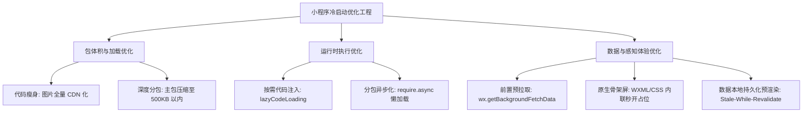

# 资深-冷启动性能全链路优化代码注入懒加载与骨架屏

在移动端小程序生态中，用户体验的“生死线”往往在打开应用的最初 1~2 秒内决定。统计表明，冷启动每延迟 1 秒，跳出率增加近 20%。小程序冷启动绝非单纯的“代码包下载”，而是横跨**客户端环境初始化**、**代码包网络拉取**、**JS 代码注入（Evaluation）**、**逻辑层/视图层双初始化**与**首屏数据请求与渲染**的复杂流水线。本文针对这一全链路进行拆解，并落地**代码注入懒加载（Lazy Code Loading）**、**原生静态骨架屏**与**网络请求前置预拉取**等极限优化手段。

---

## 一、核心底层机制与全景架构

### 1.1 小程序冷启动耗时全链路物理流水线

```mermaid
gantt
    title 小程序冷启动关键路径耗时分解 (优化前 vs 优化后)
    dateFormat  X
    axisFormat %s秒

    section 未优化前 (总耗时 ~2.8s)
    客户端环境准备 (Native App)       :a1, 0, 300
    下载全量大主包 (1.8MB)            :a2, 300, 1100
    全量 JS 编译与代码注入 (Evaluation) :a3, 1100, 1900
    逻辑层与视图层双线程初始化        :a4, 1900, 2200
    发送首屏接口请求并等待网络回包   :a5, 2200, 2700
    首屏 DOM 渲染完成 (白屏结束)     :a6, 2700, 2800

    section 资深全链路优化后 (总耗时 ~0.8s)
    客户端环境准备 (并行)             :b1, 0, 300
    精简轻量主包下载 (400KB)          :b2, 200, 500
    内联静态骨架屏 (0.4s 秒现首屏!)   :b3, 400, 600
    按需代码注入 lazyCodeLoading      :b4, 500, 700
    前置预拉取接口 (Pre-fetch 并行)   :b5, 200, 600
    首屏真实数据快速 Patch 上屏       :b6, 700, 800
```



### 1.2 核心优化技术矩阵与减耗原理



---

## 二、源码级实战推导：代码注入懒加载与前置预拉取

### 2.1 开启按需代码注入（Lazy Code Loading）

传统模式下，小程序打开首页时，会将主包内所有的 JS 文件（即使是其他页面的逻辑代码、未调用的深层工具类）一次性在 JSCore/V8 引擎中全部解析与执行（Evaluation），导致 CPU 占用率 100% 出现严重卡顿。

在 `manifest.json` 中配置按需注入：

```json
{
  "mp-weixin": {
    "lazyCodeLoading": "requiredComponents"
  }
}
```

> **底层物理效果**：基础库仅注入当前打开的首页页面代码及其显式引用的自定义组件代码，未被访问的页面和组件的 JS 脚本完全不执行编译和 Evaluation，**首屏 JS 注入耗时可直接减少 40%~60%**。

---

### 2.2 生产级前置预拉取与骨架屏秒开实战

#### 步骤 1：微信公众平台配置“数据预拉取”
在微信后台设置数据预拉取接口地址。微信客户端在用户点击小程序图标的瞬间（甚至在代码包下载之前），由微信客户端 Native 原生网络层直接向开发者服务器发起 HTTP 请求拉取首屏数据并缓存。

#### 步骤 2：业务代码消费预拉取缓存
```typescript
// pages/index/index.vue
import { onMounted, ref } from 'vue';

const listData = ref<any[]>([]);
const isSkeletonLoading = ref(true);

onMounted(async () => {
  // 1. 优先尝试提取微信原生客户端提前预拉取的数据
  // #ifdef MP-WEIXIN
  try {
    const prefetchData = (wx as any).getBackgroundFetchData?.({
      fetchType: 'pre'
    });
    if (prefetchData && prefetchData.fetchedData) {
      const parsed = JSON.parse(prefetchData.fetchedData);
      listData.value = parsed.bannerList;
      isSkeletonLoading.value = false;
      return;
    }
  } catch (e) {
    console.warn('读取预拉取数据失败，走正常接口流程');
  }
  // #endif

  // 2. 兜底正常网络请求
  fetchHomeData();
});

const fetchHomeData = async () => {
  const res = await uni.request({ url: 'https://api.corp.com/home' });
  listData.value = (res.data as any).bannerList;
  isSkeletonLoading.value = false;
};
```

#### 步骤 3：骨架屏原生内联展示
```vue
<template>
  <view class="container">
    <!-- 骨架屏占位：在数据加载中展示，与真实内容几何轮廓 1:1 吻合 -->
    <view v-if="isSkeletonLoading" class="skeleton-wrapper">
      <view class="skeleton-banner skeleton-animate"></view>
      <view class="skeleton-row skeleton-animate" v-for="i in 3" :key="i"></view>
    </view>

    <!-- 真实业务内容 -->
    <view v-else class="real-content">
      <swiper class="banner-swiper">
        <swiper-item v-for="item in listData" :key="item.id">
          <image :src="item.pic" class="banner-img" />
        </swiper-item>
      </swiper>
    </view>
  </view>
</template>

<style scoped>
.skeleton-wrapper {
  padding: 16px;
}
.skeleton-banner {
  width: 100%;
  height: 160px;
  border-radius: 8px;
  background-color: #f2f3f5;
}
.skeleton-row {
  width: 100%;
  height: 24px;
  margin-top: 12px;
  border-radius: 4px;
  background-color: #f2f3f5;
}
/* 骨架屏微光渐变微动效 */
.skeleton-animate {
  background: linear-gradient(90deg, #f2f3f5 25%, #e6e8eb 37%, #f2f3f5 63%);
  background-size: 400% 100%;
  animation: skeleton-loading 1.4s ease infinite;
}
@keyframes skeleton-loading {
  0% { background-position: 100% 50%; }
  100% { background-position: 0 50%; }
}
</style>
```

---

## 三、社招高频硬核连环追问

### 追问 1：既然骨架屏只是假象（Placeholders），它到底有没有缩短“真实首屏可交互时间（TTI - Time to Interactive）”？

> **考官意图**：考察候选人对性能指标维度（FCP vs TTI vs LCP）的辨析深度，是否懂得用户体验心理学与真实性能的权衡。

**回答硬核要点**：
1. **指标维度的客观事实**：
   - 从纯客观物理指标看，骨架屏**并没有减少**真实网络请求时间或 JS 逻辑执行时间，因此对真正的 `TTI`（页面完全可交互时延）几乎没有提前，甚至因为多引入了骨架屏 DOM 结构，带来微量的额外节点解析开销。
2. **感知性能（Perceived Performance）的决定性价值**：
   - 用户打开应用时，面对完全空白的白屏（White Blank），感知的等待心理时间是实际时间的 2~3 倍，极易被判定为应用崩溃而直接划掉退回。
   - 骨架屏极大提前了 **FCP（First Contentful Paint）**，以稳定、与内容轮廓吻合的占位给用户明确的心理预期，使感知加载速度成倍提升，有效将弃用率控制在最低范围。

---

### 追问 2：为什么很多大型工程在开启 `lazyCodeLoading: "requiredComponents"` 后，出现了部分全局组件未注册的诡异白屏？

> **考官意图**：考察按需代码注入的底层静态扫描机制与踩坑经验。

**回答硬核要点**：
- **静态分析与动态渲染的冲突**：
  - 小程序基础库为了实现“按需注入”，必须在编译期静态分析 WXML 模板中的标签依赖。
  - 如果工程中使用了动态组件渲染（如根据后端字段动态决定使用 `<component :is="currentComponent">`），或者在全局 `main.ts` 中通过代码动态挂载组件，小程序的静态扫描引擎无法在编译期确定组件依赖图。
- **排障解决方案**：
  - 对于动态加载的组件，必须在 `pages.json` 的 `usingComponents` 中进行**显式强声明**，或者使用微信官方提供的分包异步化 `componentPlaceholder` 占位语法，强制将其加入依赖注入树。

---

### 追问 3：除了预拉取，如何利用 `Stale-While-Revalidate`（SWR 策略）实现小程序“物理级秒开”？

> **考官意图**：考察前端高级缓存策略与离线可用性架构设计。

**回答硬核要点**：
- **SWR 执行时序**：
  1. **Stale（读取旧缓存立即渲染）**：页面 `onLoad` 时，首先同步读取 `uni.getStorageSync('HOME_FEED_CACHE')`。若存在旧数据，0ms 立即提交首屏渲染，让用户瞬间看到内容（秒开）。
  2. **Revalidate（后台异步拉取最新数据）**：在首屏秒开的同时，后台静默发起网络请求拉取最新数据。
  3. **差量更新**：最新数据返回后，与本地数据比对；若有新增或变动，平滑 Patch 更新列表并刷新本地缓存。
- **防坑设计**：针对时效性要求极高的价格、秒杀库存等敏感字段，必须独立标记，不走旧缓存或显示占位，防止用户误操作脏数据。

---

## 四、生产级避坑指南与排障 SOP

### 4.1 生产级冷启动优化排障对照表

| 优化维度 | 致命误区 | 工业级解决方案 |
| :--- | :--- | :--- |
| **App.onLaunch 塞满同步长耗时任务** | 在 `App.onLaunch` 中串行执行 5 个同步 Storage 读取与重度加解密，阻塞首屏 800ms | 仅保留核心鉴权与路由初始化，非关键埋点、日志上报异步化调度至后台执行 |
| **字体图标全量打包** | 将 5MB 的全套 TTF 字体文件打入小程序主包 | 仅提取常用字符子集（Font Subset），或将字体文件托管在 CDN 通过 `wx.loadFontFace` 异步按需加载 |
| **首屏接口数据庞大** | 首页一次性拉取 50 条详情并包含大量富文本 HTML | 接口分页规范：首屏仅拉取 8~10 条核心字段数据，剩余数据滚动触底再分页加载 |

### 4.2 微信官方启动性能大盘数据分析 SOP

```bash
# 1. 登录微信公众平台 (mp.weixin.qq.com) -> 开发 -> 运维中心 -> 性能监控
# 2. 切换至 "启动性能" 面板，重点监控四大核心分位值指标：
#    - 小程序冷启动耗时 (推荐 P50 < 1000ms, P90 < 2000ms)
#    - 下载耗时 (观察主包下载网络曲线)
#    - 代码注入耗时 (评估 lazyCodeLoading 落地成效)
#    - 首屏渲染耗时 (评估骨架屏与 setData 优化成效)
```
