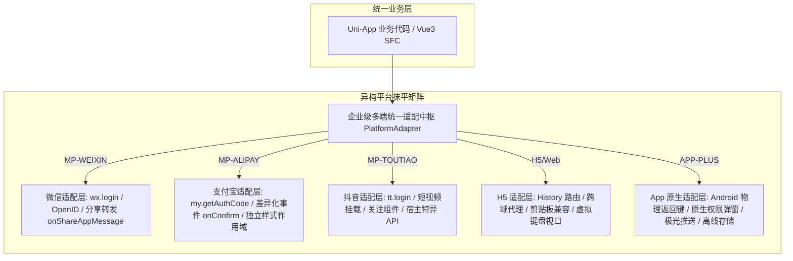

# 资深-多端兼容全矩阵微信-支付宝-抖音-App行为差异与抹平

“一套代码，编至多端”是 Uni-App 最具吸引力的核心卖点。然而在真实的商业级落地中，各大终端生态存在着深不可测的**平台壁垒与规范分裂**：微信小程序、支付宝小程序、抖音小程序、原生 App（iOS/Android）以及 H5/Web，在生命周期时序、组件事件语法、路由跳转行为、分享唤起机制、以及原生权限控制等方面存在数百项微妙差异。如果仅靠零散的 `#ifdef` 条件编译填充业务代码，工程很快会沦为不可维护的“代码迷宫”。设计一套**规范化、高内聚的多端兼容适配层（Polyfill & Platform Adapter）**，是跨端大厂架构师的核心基石。

---

## 一、核心底层机制与全景架构

### 1.1 多端异构生态全景兼容矩阵图



### 1.2 主流平台深度特性差异对比全矩阵

| 核心特性维度 | 微信小程序 (MP-WEIXIN) | 支付宝小程序 (MP-ALIPAY) | 抖音小程序 (MP-TOUTIAO) | H5 / 移动 Web | 原生 App (APP-PLUS) |
| :--- | :--- | :--- | :--- | :--- | :--- |
| **全局对象** | `wx` | `my` | `tt` | `window` / `document` | `plus` |
| **登录凭据获取** | `uni.login` $\to$ `code` (5分钟) | `my.getAuthCode` $\to$ `authCode` | `tt.login` $\to$ `code` | OAuth2 重定向 / 手机验证码 | 原生一键免密 / 微信 SDK |
| **组件事件命名** | `@tap` / `@click` (小驼峰) | `@tap` / `@onTap` (区分大小写规范) | `@tap` / `@click` | 标准 DOM 原生事件 | 原生手势事件 |
| **自定义组件样式隔离** | 默认 `isolated` (Shadow DOM) | 默认非严格隔离 (样式易全局穿透) | 默认 `isolated` | 无隔离 (需依赖 Scoped CSS) | 全局 CSS (NVue 严格受限) |
| **路由物理实体** | 真实多页面 WebView 栈 | 真实多页面 WebView 栈 | 真实多页面 WebView 栈 | 单页 SPA (Hash / History) | 多 Activity / Controller |
| **物理返回键处理** | 无 (依赖左上角胶囊返回) | 无 | 无 | `popstate` 事件监听 | 原生拦截 `onBackPress` 钩子 |

---

## 二、源码级实战推导：企业级多端统一适配层设计

### 2.1 抹平分享与登录差异的适配器模块

```typescript
// adapters/platformAdapter.ts

export interface UnifiedAuthResult {
  code: string;
  platform: 'weixin' | 'alipay' | 'toutiao' | 'app' | 'h5';
}

export class PlatformAdapter {
  /**
   * 1. 统一静默登录凭据提取
   */
  public static async getAuthCode(): Promise<UnifiedAuthResult> {
    // #ifdef MP-WEIXIN
    const [err, res] = await uni.login({ provider: 'weixin' });
    if (err || !res.code) throw new Error('微信登录失败');
    return { code: res.code, platform: 'weixin' };
    // #endif

    // #ifdef MP-ALIPAY
    return new Promise((resolve, reject) => {
      // 支付宝专有 API
      (my as any).getAuthCode({
        scopes: 'auth_base',
        success: (res: any) => resolve({ code: res.authCode, platform: 'alipay' }),
        fail: (err: any) => reject(err)
      });
    });
    // #endif

    // #ifdef MP-TOUTIAO
    const [ttErr, ttRes] = await uni.login({ provider: 'toutiao' });
    if (ttErr || !ttRes.code) throw new Error('抖音登录失败');
    return { code: ttRes.code, platform: 'toutiao' };
    // #endif

    // #ifdef APP-PLUS
    return { code: 'APP_NATIVE_SESSION', platform: 'app' };
    // #endif

    // #ifdef H5
    return { code: 'H5_WEB_COOKIE', platform: 'h5' };
    // #endif
  }

  /**
   * 2. 统一剪贴板写入（抹平各端安全提示与授权行为）
   */
  public static setClipboardData(text: string): Promise<boolean> {
    return new Promise((resolve) => {
      // #ifdef H5
      if (navigator.clipboard) {
        navigator.clipboard.writeText(text).then(() => {
          uni.showToast({ title: '已复制到剪贴板', icon: 'none' });
          resolve(true);
        }).catch(() => resolve(false));
        return;
      }
      // #endif

      // 小程序与 App 端通用接口
      uni.setClipboardData({
        data: text,
        showToast: false, // 阻止系统默认弹窗，由上层统一样式
        success: () => {
          uni.showToast({ title: '已复制到剪贴板', icon: 'none' });
          resolve(true);
        },
        fail: () => resolve(false)
      });
    });
  }
}
```

---

### 2.2 原生 App 物理返回键拦截（Android 连按两次退出）

在 App 端，如果不做物理返回键（Back Button）拦截，用户在首页点击返回会直接退出甚至杀死 App：

```vue
<script setup lang="ts">
import { onBackPress } from '@dcloudio/uni-app';

let lastBackTime = 0;

// 仅在 App 端与 H5 拦截原生物理返回键
// #ifdef APP-PLUS || H5
onBackPress((options) => {
  // options.from === 'backbutton' 表示物理按键或侧滑手势
  if (options.from === 'backbutton') {
    const now = Date.now();
    if (now - lastBackTime < 2000) {
      // 2秒内连续点击两次，允许正常退出应用
      plus.runtime.quit();
      return false;
    } else {
      lastBackTime = now;
      uni.showToast({
        title: '再按一次退出应用',
        icon: 'none'
      });
      return true; // 关键：返回 true 阻止默认的返回退出行为
    }
  }
  return false;
});
// #endif
</script>
```

---

## 三、社招高频硬核连环追问

### 追问 1：为什么在支付宝小程序中，很多基于 `uni.createSelectorQuery()` 的节点查询无法获取正确的尺寸，甚至直接返回 `null`？

> **考官意图**：考察候选人对微信与支付宝小程序底层渲染引擎与时序差异的深度排错经验。

**回答硬核要点**：
1. **渲染更新时序差异**：
   - 微信小程序的 `setData` 完成后，视图层会在下一个微任务/宏任务完成 DOM 树渲染。
   - 支付宝小程序底层由 UC 内核（AliPolymer / Lynx）驱动，`setData` 到真实节点上屏的耗时更长，且存在节点脱水过程。如果直接在 `onReady` 中同步调用 `createSelectorQuery()`，此时支付宝视图层节点物理尺寸很可能尚未 Flush。
2. **选择器语法与作用域差异**：
   - 支付宝小程序对部分 CSS 复杂选择器支持较弱，必须使用显式的 `.class` 或 `#id` 单一选择器；
   - 支付宝必须显式指定作用域或延迟执行（`setTimeout(() => { query.exec(...) }, 150)`），或在支付宝端使用 `my.createSelectorQuery()` 进行定向抹平。

---

### 追问 2：抖音小程序（字节跳动小程序）有何极其严苛的宿主特异性限制？在设计跨端方案时如何规避？

> **考官意图**：考察新兴大厂主流流量阵地（抖音、快手）的特殊平台合规与 API 差异。

**回答硬核要点**：
- **宿主生态严苛限制**：
  1. **iOS 虚拟支付全面封锁**：在抖音小程序 iOS 端，凡涉及虚拟课程、道具，不仅不允许微信/支付宝，连 Apple IAP 也会受到严格审核限制，部分品类甚至强制禁止下单。
  2. **路由栈深度限制更严格**：微信支持最多 10 层页面栈，抖音小程序在低端机型上超过 5 层即可能出现页面黑屏或强制重置。
  3. **强制隐私授权拦截**：调用相册、位置、麦克风等必须在 `manifest.json` 中配置严格的《用户隐私保护指引》，否则调用 API 直接抛出 `fail: privacy auth denied`。

---

### 追问 3：H5 端路由采用 `History` 模式时，在微信内置浏览器中二次分享、微信 JS-SDK 签名经常报 `invalid signature`，根本原因是什么？

> **考官意图**：考察 iOS WebKit 内核的历史遗留沙箱机制与微信 JS-SDK 鉴权精髓。

**回答硬核要点**：
- **iOS Safari / WKWebView 物理机制**：
  - 在 iOS 微信中，单页应用（SPA）不论路由如何通过 `pushState` 改变 URL，**微信客户端记录的真实签名基础 URL（Landing Page URL）始终是用户第一次进入该应用时的首个页面 URL**！
  - 而 Android 微信则会随着 `pushState` 实时更新签名 URL。
- **排障解决方案**：
  - 在 iOS 端，必须记录用户首次进入应用的落地页 URL（`window.entryUrl = location.href.split('#')[0]`），后续不论页面怎么跳转，向微信后端换取 JSAPI 签名时，**统一使用该 `entryUrl` 进行哈希加签**；在 Android 端则动态使用当前即时 `location.href`。

---

## 四、生产级避坑指南与排障 SOP

### 4.1 生产级多端兼容踩坑速查表

| 差异维度 | 平台 | 踩坑现象 | 工业级解决方案 |
| :--- | :--- | :--- | :--- |
| **自定义导航栏** | 支付宝 | 支付宝导航栏胶囊高度和位置与微信完全不同 | 通过 `my.getMenuButtonBoundingClientRect()` 动态计算胶囊边界，禁止写死 44px / 48px |
| **按钮 open-type** | 微信 vs 抖音 | 微信分享为 `share`，抖音有拍同款、私信分享等特殊值 | 在模板中使用条件编译差异化声明按钮属性：`<!-- #ifdef MP-TOUTIAO -->` |
| **Tabbar 样式** | App vs 小程序 | App 端原生 Tabbar 性能极高，但在 H5 端自定义样式容易产生白底遮挡 | H5 端统一由 Vue 路由组件模拟 Tabbar，原生 App 端保留配置在 `pages.json` 的原生 Tabbar |
| **CSS 阴影渲染** | 低端 Android | `box-shadow` 在部分旧 Android 内核上引发掉帧或撕裂 | 针对 Android 平台使用精简的伪元素边框或带渐变背景图片替代高模糊半降性能阴影 |

### 4.2 统一多端环境检测实用工具函数

```typescript
// utils/env.ts
export const isWeixinMP = () => {
  // #ifdef MP-WEIXIN
  return true;
  // #endif
  return false;
};

export const isAlipayMP = () => {
  // #ifdef MP-ALIPAY
  return true;
  // #endif
  return false;
};

export const isApp = () => {
  // #ifdef APP-PLUS
  return true;
  // #endif
  return false;
};

export const isH5 = () => {
  // #ifdef H5
  return true;
  // #endif
  return false;
};
```
