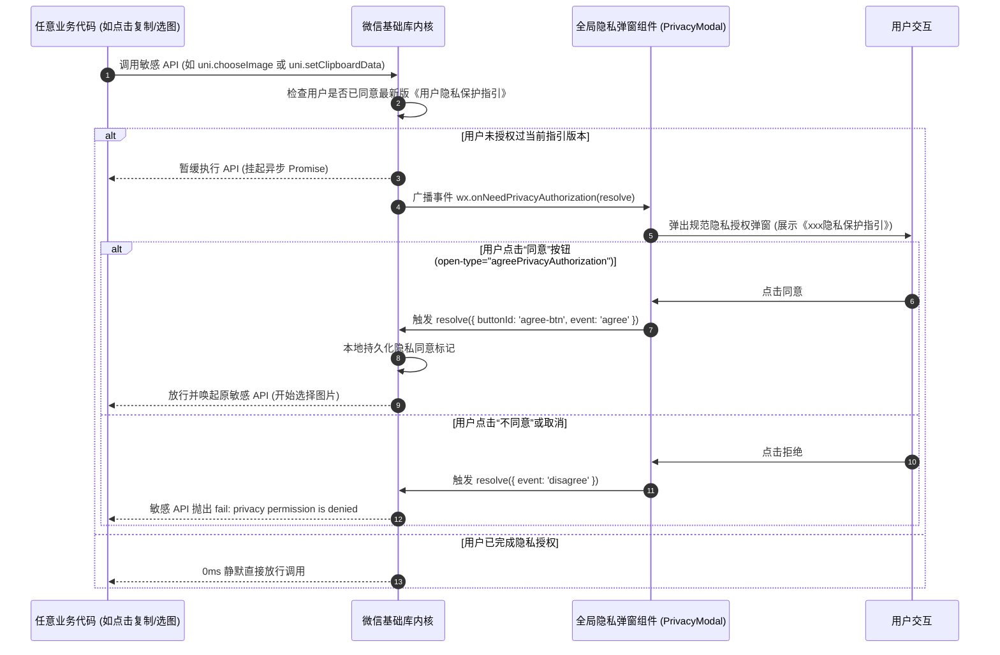

# 资深-大厂级小程序工程治理隐私协议合规与多团队协同规范

当一个小程序项目从“单兵作战”走向数十人跨团队协同、跨业务线联合作战时，面临的挑战将不再是单纯的语法或功能开发，而是**合规底线防御**与**大型工程治理**：国家网信办与微信官方对用户个人信息隐私合规（Privacy Compliance）的铁腕监管、数十个业务团队并发提交导致的代码冲突与包体积失控、以及线上发版灰度与瞬时灾备回滚机制。构建一套规范化、自动化、具备防御纵深的大厂级工程治理体系，是技术总监与资深架构师的最高阶考量。

---

## 一、核心底层机制与全景架构

### 1.1 大厂多业务线协同治理全景生命周期图

```mermaid
graph TD
    subgraph 规范准入与开发治理 (Dev Phase)
        A1[跨业务线开发: 业务A / 业务B / 核心基建] -->|独立 NPM / Git Subtree| B1[私有化跨端组件库 @corp/uni-ui]
        A1 --> B2[严格包体积预算管控 (Bundle Size Budget: 主包单次增量 <= 50KB)]
        A1 --> B3[隐私 API 拦截探针: 剪贴板 / 相册 / 位置 / 手机号]
    end

    subgraph CI/CD 质量门禁 (Gatekeeper Phase)
        B1 & B2 & B3 --> C[GitLab CI 流水线自动化检查]
        C --> D1[Lint & 类型检查: 阻止任何隐式 any]
        C --> D2[体积静态分析: 超出 1.8MB 自动中断合并并报警]
        C --> D3[合规性静态扫描: 检查隐私指引配置]
    end

    subgraph 生产发布与灰度防线 (Release Phase)
        D1 & D2 & D3 --> E[发布微信公众平台]
        E --> F1[全网全自动阶梯灰度 (Gradual Rollout: 5% -> 20% -> 100%)]
        E --> F2[APM 实时监控与异常率熔断]
        F2 -->|若异常率 > 0.5%| G[一键秒级紧急回滚 SOP (Rollback)]
    end
```

### 1.2 微信隐私协议拦截授权底层通信时序

从微信基础库 2.32.3+ 起，凡调用剪贴板、相册、麦克风等敏感 API，微信底层都会强制挂起调用，触发 `wx.onNeedPrivacyAuthorization` 事件。必须在前端构建**全局被动拦截弹窗管理器**：



---

## 二、源码级实战推导：企业级全局隐私拦截组件与状态封装

### 2.1 全局隐私授权被动拦截组件（零侵入式接入）

通过包装微信官方原生 `open-type="agreePrivacyAuthorization"` 按钮，实现业务零感知的自动弹窗拦截：

```vue
<!-- components/privacy-modal/privacy-modal.vue -->
<template>
  <view v-if="showModal" class="privacy-mask">
    <view class="privacy-dialog">
      <view class="dialog-title">用户隐私保护提示</view>
      <view class="dialog-content">
        感谢您使用本应用！在您使用过程中，我们需要申请部分系统权限。请您在使用前仔细阅读并充分理解
        <text class="privacy-link" @tap="openPrivacyContract">
          《{{ privacyContractName }}》
        </text>
        的内容。当您点击“同意并继续”即代表您已充分理解并同意该条款。
      </view>
      <view class="dialog-actions">
        <button class="btn btn-disagree" @tap="handleDisagree">不同意</button>
        <!-- 核心：必须使用微信专有开放属性 button open-type="agreePrivacyAuthorization" -->
        <button 
          id="agree-btn"
          class="btn btn-agree" 
          open-type="agreePrivacyAuthorization"
          @agreeprivacyauthorization="handleAgree"
        >
          同意并继续
        </button>
      </view>
    </view>
  </view>
</template>

<script setup lang="ts">
import { ref, onMounted } from 'vue';

const showModal = ref(false);
const privacyContractName = ref('小程序隐私保护指引');
let resolvePrivacyAuthorization: ((params: any) => void) | null = null;

onMounted(() => {
  // #ifdef MP-WEIXIN
  if (wx.onNeedPrivacyAuthorization) {
    // 注册底层敏感权限拦截监听
    wx.onNeedPrivacyAuthorization((resolve) => {
      resolvePrivacyAuthorization = resolve;
      showModal.value = true;
    });

    // 预拉取协议名称
    wx.getPrivacySetting({
      success: (res) => {
        if (res.privacyContractName) {
          privacyContractName.value = res.privacyContractName;
        }
      }
    });
  }
  // #endif
});

// 打开微信官方协议页面
const openPrivacyContract = () => {
  // #ifdef MP-WEIXIN
  wx.openPrivacyContract({
    fail: () => {
      uni.showToast({ title: '打开协议失败', icon: 'none' });
    }
  });
  // #endif
};

// 用户点击同意
const handleAgree = () => {
  showModal.value = false;
  if (resolvePrivacyAuthorization) {
    resolvePrivacyAuthorization({ buttonId: 'agree-btn', event: 'agree' });
    resolvePrivacyAuthorization = null;
  }
};

// 用户点击不同意
const handleDisagree = () => {
  showModal.value = false;
  if (resolvePrivacyAuthorization) {
    resolvePrivacyAuthorization({ event: 'disagree' });
    resolvePrivacyAuthorization = null;
  }
  uni.showToast({ title: '您已拒绝隐私协议，相关功能无法使用', icon: 'none' });
};
</script>

<style scoped>
.privacy-mask {
  position: fixed;
  top: 0; left: 0; right: 0; bottom: 0;
  background-color: rgba(0, 0, 0, 0.65);
  display: flex;
  align-items: center;
  justify-content: center;
  z-index: 99999;
}
.privacy-dialog {
  width: 580rpx;
  background-color: #ffffff;
  border-radius: 20rpx;
  padding: 40rpx;
  box-sizing: border-box;
}
.dialog-title {
  font-size: 34rpx;
  font-weight: bold;
  text-align: center;
  color: #333333;
  margin-bottom: 24rpx;
}
.dialog-content {
  font-size: 28rpx;
  line-height: 44rpx;
  color: #666666;
}
.privacy-link {
  color: #007aff;
  font-weight: bold;
}
.dialog-actions {
  display: flex;
  margin-top: 40rpx;
  gap: 20rpx;
}
.btn {
  flex: 1;
  height: 80rpx;
  line-height: 80rpx;
  font-size: 28rpx;
  border-radius: 40rpx;
}
.btn-disagree {
  background-color: #f5f5f5;
  color: #666666;
}
.btn-agree {
  background-color: #07c160;
  color: #ffffff;
}
</style>
```

---

## 三、社招高频硬核连环追问

### 追问 1：为什么在发布微信小程序新版本时，必须执行“全网阶梯式灰度发布（Gradual Release）”？如何防止致命 Bug 导致全量用户瘫痪？

> **考官意图**：考察候选人对待高可用发布的敬畏心与风险熔断机制。

**回答硬核要点**：
1. **全量发布灾难场景**：
   - 如果新版本存在致命白屏或闪退 Bug，直接全量 100% 发布会导致全网数百万用户在冷启动更新后瞬间集体中招，客诉爆炸并直接导致重大商业事故。
2. **阶梯式灰度模型（SOP）**：
   - **Day 1（比例 5%）**：低比例试水，研发与运维团队紧盯微信公众平台后台异常监控大盘与 APM 错误率走势；
   - **Day 2（比例 20%）**：覆盖大部分长尾低端机型与不同系统版本；
   - **Day 3（比例 50%）**：验证高并发负载与数据一致性；
   - **Day 4（比例 100%）**：全网平稳全量升级。
3. **紧急制动（Rollback）**：
   - 灰度过程中若发现严重 P0 故障，技术负责人可在微信后台点击**“暂停灰度”**或**“撤销发布”**，阻止故障扩散至更广范围。

---

### 追问 2：如果线上已经 100% 全量发布，才突发发现了致命资金计算 Bug，微信小程序最快如何止血？

> **考官意图**：考察线上重大 P0 故障应急救援与容灾体系（Disaster Recovery）。

**回答硬核要点**：
- **微信小程序的更新机制**：
  - 小程序客户端采用异步更新机制，已下载新包的用户下次启动依然会先运行缓存中的本地旧逻辑，常规提审修复需要等待微信审核（耗时 1~2 小时），无法瞬时止血。
- **三大应急止血 SOP**：
  1. **微信公众平台“版本回退”**：登录后台，点击当前全量版本的“回退”按钮，微信会瞬间将线上稳定版指向上一版本的代码包，耗时不到 1 分钟。
  2. **服务端功能动态降级（Feature Flag 开关）**：
     - 在业务接口层设计远程动态配置中枢（Apollo / Nacos）。发现 Bug 瞬间，通过服务端下发开关将故障模块强行关闭或展示“系统维护中”占位卡片，将资金损失降至 0。
  3. **加急审核通道（Emergency Expedited Review）**：每个小程序主体每年享有若干次微信官方绿色加急审核权益，紧急提审可在 15 分钟内完成过审发布。

---

### 追问 3：在数十人大型多团队协同开发中，如何通过 CI 严格控制“每个分包与主包的体积预算（Size Budget）”？

> **考官意图**：考察架构师的工程规范推行能力与自动化防腐败手段。

**回答硬核要点**：
- **预算预警契约（Budget Rules）**：
  - 在工程中建立 `size-budget.json`，严格分配各团队配额：
    ```json
    {
      "main": "1.2MB",
      "package_user": "2.0MB",
      "package_shop": "3.5MB"
    }
    ```
- **GitLab CI 流水线拦截门禁**：
  - 开发者发起 Merge Request（MR）时，CI 容器自动运行构建脚本分析各目录产物大小；
  - 若检测到该 PR 导致主包体积突破设定阈值（或单次 PR 增量超过 50KB），**CI 状态直接亮红退出，强制禁止代码合并进主分支**；
  - 自动在 PR 下方由 CI 机器人发表评论，列出体积超标的增量文件排行榜（如引入了未经压缩的 PNG 或未 Tree-Shaking 的第三方大包），倒逼业务方在开发期完成自律优化。

---

## 四、生产级避坑指南与排障 SOP

### 4.1 生产级工程协同与合规治理避坑表

| 治理维度 | 违规隐患 | 工业级解决方案 |
| :--- | :--- | :--- |
| **未配置隐私指引导致 API 报错** | 微信公众平台后台未更新《用户隐私保护指引》，敏感 API 无法调起 | 发布前必须先在公众平台维护指引，声明使用剪贴板、位置的具体业务目的并通过审核 |
| **组件库版本管理混乱** | 业务直接修改 `components/` 源码导致其他业务模块意外被改坏 | 抽离核心组件库为独立私有 NPM 包（SemVer 语义化版本约束），各业务按固定版本依赖 |
| **异步更新时用户被强制中断** | 调用 `updateManager.applyUpdate()` 时未弹窗直接强退重启应用 | 弹窗明确告知用户“发现新版本，点击确定立即体验最新功能”，待用户确认后再重启 |
| **全局 CSS 样式污染** | 某业务团队在公共样式表中写了 `view { margin: 0; }` 破坏全局组件布局 | 开启严格的代码评审（CR）机制，组件必须使用 Scoped CSS 或 CSS Modules 隔离 |

### 4.2 客户端版本更新检查完整 SOP

在 `App.vue` 的 `onLaunch` 阶段统一注入版本检查探针：

```typescript
// utils/updateChecker.ts
export function initUpdateChecker() {
  // #ifdef MP-WEIXIN
  if (!uni.canIUse('getUpdateManager')) return;

  const updateManager = uni.getUpdateManager();

  // 监听向微信后台请求检查更新结果事件
  updateManager.onCheckForUpdate((res) => {
    if (res.hasUpdate) {
      console.log('[版本检查] 检测到线上存在新版本，后台静默下载中...');
    }
  });

  // 监听新版本下载完成
  updateManager.onUpdateReady(() => {
    uni.showModal({
      title: '更新提示',
      content: '新版本已经准备好，是否立即重启应用体验最新特性？',
      showCancel: false,
      confirmText: '立即重启',
      success: (res) => {
        if (res.confirm) {
          // 清除旧缓存并立即热重启进入新版本
          updateManager.applyUpdate();
        }
      }
    });
  });

  // 监听新版本下载失败
  updateManager.onUpdateFailed(() => {
    uni.showModal({
      title: '更新提示',
      content: '新版本下载失败，请检查网络连接后稍后重试',
      showCancel: false
    });
  });
  // #endif
}
```
