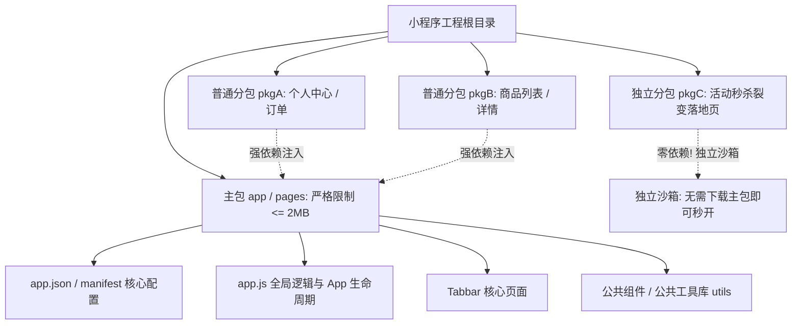
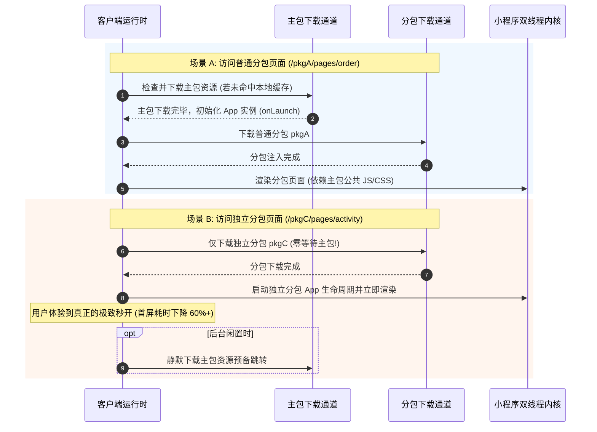

# 资深-突破2MB主包限制subPackages分包与独立分包架构

微信等主流小程序平台对代码包体积有着严格的物理红线：**单个主包不能超过 2MB，整包体积上限为 20MB**。随着企业级中后台或大型电商业务在小程序端的持续迭代，组件库、第三方 SDK、图标媒体与业务逻辑会迅速突破 2MB 限制，导致无法上传代码甚至触发发版阻断。深入理解主包、普通分包与**独立分包（Independent Subpackages）**的底层编译机制，配合**预下载规则（preloadRule）**，是资深前端架构师的必备核心能力。

---

## 一、核心底层机制与全景架构

### 1.1 小程序代码包物理架构拓扑

小程序在手机端运行时的物理包结构并不是扁平的单体包，而是按目录树进行隔离下载与沙箱注入：



### 1.2 普通分包 vs 独立分包加载生命周期对比



---

## 二、源码级实战推导：pages.json 工业级分包与预加载拓扑

### 2.1 生产级 `pages.json` 分包与预下载规则配置

在 Uni-App 中，通过 `pages.json` 的 `subPackages` 与 `preloadRule` 声明分包边界与依赖预载规则：

```json
{
  "pages": [
    {
      "path": "pages/index/index",
      "style": { "navigationBarTitleText": "首页" }
    },
    {
      "path": "pages/category/category",
      "style": { "navigationBarTitleText": "分类" }
    }
  ],
  "subPackages": [
    {
      "root": "packageA",
      "name": "packageA_user",
      "pages": [
        {
          "path": "pages/user/profile",
          "style": { "navigationBarTitleText": "用户中心" }
        },
        {
          "path": "pages/order/list",
          "style": { "navigationBarTitleText": "我的订单" }
        }
      ]
    },
    {
      "root": "packageActivity",
      "name": "package_activity",
      "independent": true,
      "pages": [
        {
          "path": "pages/seckill/detail",
          "style": { "navigationBarTitleText": "限时爆款秒杀" }
        }
      ]
    }
  ],
  "preloadRule": {
    "pages/index/index": {
      "network": "all",
      "packages": ["packageA_user"]
    },
    "packageActivity/pages/seckill/detail": {
      "network": "wifi",
      "packages": ["__APP__"]
    }
  }
}
```

### 2.2 独立分包沙箱环境下的全局状态陷阱与治理

独立分包中**不能直接读取主包定义的全局状态（如 Pinia、`getApp()` 全局挂载属性）**。必须通过防御式编程兼容独立分包启动场景：

```typescript
// packageActivity/utils/activitySafeContext.ts
export function getSafeGlobalContext() {
  const app = getApp({ allowDefault: true }); // 关键参数：防止在独立分包启动时报错
  
  if (app && app.globalData && app.globalData.userInfo) {
    return app.globalData.userInfo;
  }
  
  // 独立分包未加载主包时的本地沙箱降级上下文
  const cachedUser = uni.getStorageSync('SAFE_USER_INFO');
  return cachedUser ? JSON.parse(cachedUser) : { isGuest: true };
}
```

---

## 三、社招高频硬核连环追问

### 追问 1：为什么明明把页面拆分到了 `subPackages`，打包后主包体积依然严重超标（甚至突破 2MB）？

> **考官意图**：考察构建工具（Vite / Webpack）的依赖图分析（Dependency Graph）与公共模块提取机制（SplitChunks）。

**回答硬核要点**：
1. **公共依赖提升（Hoisting）机制**：
   - 如果一个公共模块（例如 `lodash-es`、自定义的大型工具库、或者 `assets/svg-icons`）被主包内的页面引用了，或者**被两个及以上的不同分包同时引用了**，打包编译器为了避免代码重复打包进各个分包，会默认将该公共模块**强制提升并打包到主包（vendor.js）中**。
2. **静态资源的隐形杀手**：
   - 放置在 `static/` 目录下的图片和媒体文件，默认会被全量拷贝并计入主包体积。
3. **架构排查治理**：
   - 执行编译分析：使用 `rollup-plugin-visualizer` 分析打包产物体积；
   - 资源云端化：所有静态大于 10KB 的图片、字体文件全面迁移至阿里云 OSS / 腾讯云 COS CDN；
   - 启用分包异步化（Subpackage Asynchronous Loading）。

---

### 追问 2：什么是“分包异步化”？它解决了什么普通分包无法解决的核心痛点？

> **考官意图**：考察微信小程序 2022+ 引入的高级特性“分包异步化”的理解。

**回答硬核要点**：
- **传统痛点**：
  - 在分包异步化之前，分包 A 严禁引用分包 B 的任何组件或 JS 函数；如果页面 A 要用页面 B 的某个商品卡片组件，该组件只能提升至主包，造成主包膨胀。
- **分包异步化机制**：
  - 允许跨分包进行异步组件渲染与异步 JS 导入（`require.async`）：
    ```json
    // packageA/pages/order/index.json
    {
      "usingComponents": {
        "goods-card": "/packageB/components/goods-card"
      },
      "componentPlaceholder": {
        "goods-card": "view" // 关键：指定占位节点，分包下载完成前不阻塞页面
      }
    }
    ```
  - 当页面进入渲染时，分包 B 未就绪前先渲染占位组件，并在后台静默拉取分包 B，就绪后无缝热替换为真实组件，从而彻底打破跨分包代码复用必须提升到主包的物理限制。

---

### 追问 3：独立分包 `independent: true` 有哪些绝对红线限制？如果盲目使用会导致什么生产灾难？

> **考官意图**：考察系统边界认知与权衡设计（Trade-off）。

**回答硬核要点**：
1. **无法直接依赖主包资源**：
   - 独立分包内部不能引用主包的公共 JS 模块（如主包的 `utils`）、插件、公共样式文件。如果引用，编译阶段会直接报错或导致分包体积冗余复制。
2. **全局 App 实例隔离**：
   - 独立分包首次启动时，主包的 `App.onLaunch` 不会执行，主包注册的全局路由拦截器、请求头统一注入逻辑全都不会生效！
   - 如果业务在 `app.vue` 中统一做了登录鉴权拦截，独立分包就会产生“鉴权真空漏洞”，导致未授权用户直接访问受限数据。

---

## 四、生产级避坑指南与排障 SOP

### 4.1 生产级分包治理与体积压缩排障速查表

| 优化维度 | 致命隐患 | 工业级解决方案 |
| :--- | :--- | :--- |
| **主包静态图片超标** | 开发者将 UI 设计图切图直接放在 `static/` 导致主包超 2MB | 配置 Vite 插件或 ESLint 规则：严禁 `static/` 存放超过 20KB 图片，构建时自动扫描并阻断提交 |
| **Tabbar 页面设计错误** | 将 Tabbar 页面配置到了分包中 | 小程序底层强制规范：所有 Tabbar 页面必须位于主包中，严禁放入分包 |
| **预下载规则（preloadRule）触发用户流量激增** | 将所有分包配置在首页进行 `network: "all"` 预加载 | 仅对最核心业务分包在 `wifi` 环境下预载；非核心分包禁用预载，按需加载 |
| **NPM 依赖按需引入失效** | 引入 `lodash` 导致整个库被打入主包 | 改用 `lodash-es` 细粒度导出（如 `import debounce from 'lodash-es/debounce'`），并开启 Vite Tree-Shaking |

### 4.2 微信开发者工具代码依赖分析与排查 SOP

在发布前，通过微信开发者工具的“代码依赖分析”面板进行体检：

```bash
# 1. 在 HBuilderX 或 Vite 编译终端输出构建产物
npm run build:mp-weixin

# 2. 打开微信开发者工具 -> 右上角详情 -> 本地代码 -> 代码依赖分析
# 重点检查：
# - 主包大小是否稳定保持在 1.5MB 以下（预留 0.5MB 给后续敏捷迭代）
# - common/vendor.js 中是否存在本应属于特定分包的大型三方库
# - static/ 目录下是否存在未使用的冗余废弃资源
```
