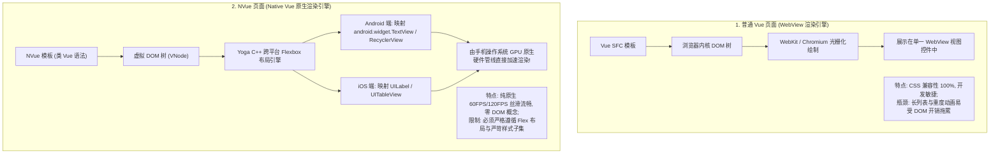
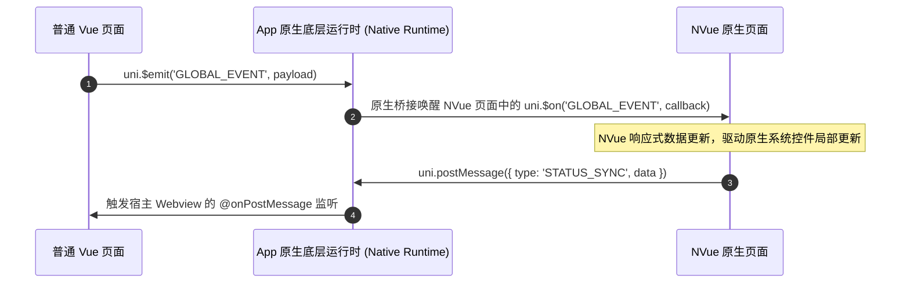

# 高级-App原生运行时架构Weex-NVue与WebView双渲染引擎

在基于 Uni-App 进行商业级原生 App（iOS / Android）开发时，仅仅将页面编译为移动端 WebView 网页并打包为混合应用（Hybrid App），在面对**高帧率短视频上下滑动联动（类似抖音）、亿级商品长列表即时惯性甩动、以及外接原生地图/直播推流原生控件**等高负载场景时，WebView 的渲染管线会受到 DOM 节点数与图层合成带宽的天然制约，不可避免地产生掉帧、发热与白屏。

为了在拥有跨端跨平台敏捷性的同时兼具媲美纯原生的 60FPS 极限性能，Uni-App 在 App 端内置了双轨渲染引擎——**`WebView` 网页渲染引擎** 与 基于原生控件的 **`NVue`（Native Vue，底层基于 Weex 增强内核）原生渲染引擎**。

在高级与资深架构师社招面试中，面试官将围绕 App 端的核心技术深度展开攻防：**NVue 是如何将 Vue 模板语法实时转译为 Android 原生 View 与 iOS 原生 UIView 的？NVue 与普通 Vue 页面在底层线程架构与样式限制上有何物理鸿沟？两者如何实现亚毫秒级的数据双向互通？**

---

## 1. 核心底层机制与全景架构

### 1.1 App 端双渲染引擎底层拓扑对比



### 1.2 核心特性与技术边界矩阵

| 对比维度 | 普通 `.vue` 页面 (App 端) | 原生 `.nvue` 页面 (App 端) |
| :--- | :--- | :--- |
| **渲染物理实体** | 运行在系统的 WebView 沙箱网页内 | **直接映射为操作系统底层的原生系统控件** |
| **滚动列表容器** | 基于 HTML 的 `scroll-view` 或页面滚动 | 映射底层的 **`list` / `recycle-list`（类似 Android 原生 RecyclerView）**，自带原生内存级复用 |
| **原生控件融合** | 嵌套地图（Map）、视频（Video）时容易发生层叠穿透 | **同层原生控件完美融合**，覆盖层级与原生无异 |
| **CSS 样式支持度** | **100% 完整 Web CSS 规范**（支持 Grid、媒体查询等） | **仅支持严苛的 CSS 子集**，必须全量采用 Flexbox 布局 |
| **跨端编译能力** | 可无缝编译为小程序、H5、App | 可作为 App 端专用页面，亦可降级为普通网页/小程序展示 |

---

## 2. 源码级/算法物理推导

### 2.1 NVue 严苛样式约束的物理成因推导

很多初次编写 `.nvue` 的开发者常被其严苛的报错所震撼：
1. **默认垂直排列**：在普通 Web 中，`display: flex` 默认是水平流（`flex-direction: row`）。而在 NVue 中，底层基于 Facebook 开源的 **Yoga 布局引擎**，其为了拟合移动设备竖屏物理特征，**默认的 `flex-direction` 恒定为 `column`（垂直排列）**！
2. **唯一选择器规则**：在 NVue 中，**仅且只能使用单一类选择器（Class Selector，如 `.box`）**！
   - 严禁后代选择器（`.parent .child`）；
   - 严禁标签选择器（`text`, `view`）；
   - 严禁属性选择器（`[type="button"]`）。
   - **底层物理成因**：由于原生 UI 树没有浏览器庞大的 CSS 级联样式表解析器，Yoga 引擎为了保证单帧 $O(1)$ 常数时间完成节点测量，要求样式表必须以扁平哈希表形式直接与类名 1:1 映射，坚决剔除任何复杂级联计算。

### 2.2 NVue 与 Vue 双向通信数据流推导

在一个中大型混合 App 中，通常是“大盘页面走普通 Vue，核心超高帧率页面走 NVue”。两者之间的通信依赖全局通道：



---

## 3. 社招/阶段必考高频硬核连环追问

### 追问 1：在 App 端开发类似抖音的“全屏沉浸式短视频上下滑动手势切换”业务时，为什么用普通 Vue 页面极易卡顿掉帧，而必须使用 NVue？

> **答辩深度闭环**：
> 1. **WebView 视频组件的图层穿透与合成负担**：在普通 Vue 页面中，`video` 组件底层是一个原生控件，为了让它嵌入在 WebView 内部并允许普通按钮浮在它上方，系统必须执行繁重的**图层动态切片与跨上下文混合合成（Hybrid Composition）**。当用户快速连续上下滑动时，WebView 视图层、Native 视频层以及逻辑层三方频繁发生同步阻塞，导致手势脱节、严重白屏。
> 2. **NVue 的纯原生降维打击**：在 NVue 中，视频播放器与上下滑动的列表容器（`list` / `cell`）**全部原生自洽于同一个操作系统视图树中**。列表基于原生系统的 `RecyclerView` 或 `UICollectionView` 实现，具备毫秒级视图复用与预加载能力，手势直接由原生线程驱动，帧率稳如磐石保持在 60FPS。

---

### 追问 2：为什么在 NVue 中给一个容器设置 `height: 100%` 经常失效，页面内容完全塌陷为 0？

> **答辩深度闭环**：
> 1. **Yoga 布局引擎的百分比计算基准**：在标准浏览器中，如果父容器没有显式高度，子元素的 `height: 100%` 会自适应回退计算。而在 Yoga 原生布局模型中，百分比高度的计算要求**其直接父容器必须拥有在当前帧即可完全确定的绝对物理尺寸（Definite Height）**。
> 2. **正确解法**：
>    - 方案 A：在根容器直接使用 **`flex: 1`** 弹性填满整屏空间（NVue 会将最外层的页面宿主窗口标记为撑满屏幕）。
>    - 方案 B：通过 `uni.getSystemInfoSync().windowHeight` 动态获取当前窗口物理高度并显式绑定（如 `:style="{ height: `${windowHeight}px` }"`）。

---

### 追问 3：同一个 Uni-App 项目中，能否部分页面是 `.vue`，部分页面是 `.nvue`？页面路由跳转有什么需要注意的？

> **答辩深度闭环**：
> 1. **完全无缝混用**：Uni-App 原生支持纯混合架构。在 `pages.json` 注册路由时，无需任何特殊声明，无论是 `pages/index/index.vue` 还是 `pages/video/index.nvue`，对上层路由系统而言都是完全平等的页面。
> 2. **页面栈统一调度**：调用 `uni.navigateTo`、`uni.redirectTo`、`uni.navigateBack` 在两类页面之间跳转时，Uni-App 底层统一管理原生 Native 容器栈，转场动画与生命周期完全平滑连贯。

---

## 4. 生产级避坑指南与排障 SOP

### 4.1 生产级 NVue 极速全屏短视频滑屏播放核心模板

```vue
<!-- pages/video/index.nvue (注意后缀必须是 .nvue) -->
<template>
  <view class="video-container" :style="{ height: `${windowHeight}px` }">
    <!-- 原生全屏滑动列表 (使用 swiper 实现纵向切页) -->
    <swiper
      class="video-swiper"
      :vertical="true"
      :style="{ height: `${windowHeight}px` }"
      @change="handleSwiperChange"
    >
      <swiper-item v-for="(item, index) in videoList" :key="item.id">
        <view class="video-item" :style="{ height: `${windowHeight}px` }">
          <!-- 原生视频组件 (在 NVue 下零图层层叠冲突) -->
          <video
            v-if="Math.abs(currentActiveIndex - index) <= 1"
            :id="`video_${item.id}`"
            class="native-video"
            :src="item.videoUrl"
            :controls="false"
            :autoplay="currentActiveIndex === index"
            :loop="true"
            object-fit="cover"
          />

          <!-- 右侧原生悬浮互动操作栏 -->
          <view class="right-action-bar">
            <view class="action-item" @click="handleLike(item)">
              <text class="icon">❤️</text>
              <text class="count">{{ item.likeCount }}</text>
            </view>
            <view class="action-item" @click="handleComment(item)">
              <text class="icon">💬</text>
              <text class="count">{{ item.commentCount }}</text>
            </view>
          </view>
        </view>
      </swiper-item>
    </swiper>
  </view>
</template>

<script setup lang="ts">
import { ref } from 'vue';

const windowHeight = ref(uni.getSystemInfoSync().windowHeight);
const currentActiveIndex = ref(0);

const videoList = ref([
  { id: 1, videoUrl: 'https://cdn.company.com/v1.mp4', likeCount: 1200, commentCount: 300 },
  { id: 2, videoUrl: 'https://cdn.company.com/v2.mp4', likeCount: 8800, commentCount: 950 },
]);

function handleSwiperChange(e: any) {
  currentActiveIndex.value = e.detail.current;
}

function handleLike(item: any) {
  item.likeCount++;
}

function handleComment(item: any) {
  // 唤起原生评论弹窗
  uni.$emit('OPEN_COMMENT_POPUP', item.id);
}
</script>

<style scoped>
/* ⚠️ 必须严格遵循 NVue CSS 规则: 单一类选择器, 默认 Flex 垂直排列 */
.video-container {
  width: 750rpx;
  background-color: #000000;
}

.video-swiper {
  width: 750rpx;
}

.video-item {
  width: 750rpx;
  position: relative;
}

.native-video {
  width: 750rpx;
  height: 100%;
}

.right-action-bar {
  position: absolute;
  right: 24rpx;
  bottom: 200rpx;
  align-items: center; /* NVue 原生支持的居中 */
}

.action-item {
  margin-bottom: 40rpx;
  align-items: center;
}

.icon {
  font-size: 60rpx;
  color: #ffffff;
}

.count {
  font-size: 24rpx;
  color: #ffffff;
  margin-top: 8rpx;
}
</style>
```

### 4.2 NVue 排错速查表

| 报错现象 | 物理根因 | 生产排查与根治 SOP |
| :--- | :--- | :--- |
| **样式不生效，编译控制台报警** | 使用了标签选择器（如 `text`）或后代选择器。 | 必须全量使用单一类名选择器（如 `.title`）。 |
| **文字样式未继承** | 在 NVue 中，父级 `view` 的文字颜色和字号**不会自动向下继承给子元素**。 | 所有与文字相关的样式必须直接写在 `<text class="...">` 标签自身上。 |
| **图片无法展示** | 缺少明确的宽高约束。在 NVue 中，图片若没有宽高，不会自适应，直接渲染为 0。 | 必须给每一个 `image` 组件明确指定具体的 `width` 和 `height`。 |
