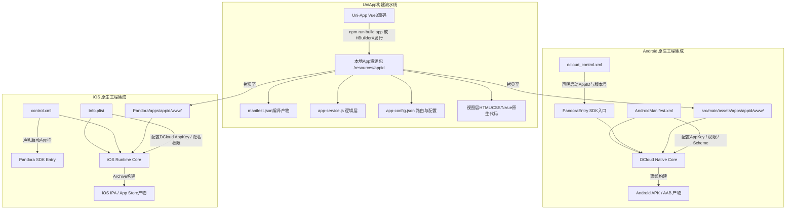
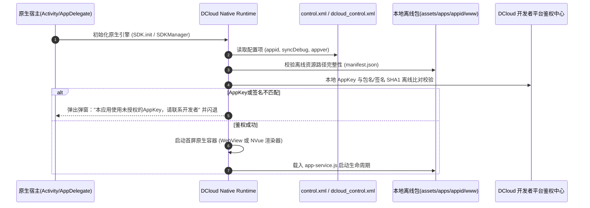

# 高级-App离线打包全流程Android-Studio与Xcode原生工程集成

在企业级大厂移动端混合应用（Hybrid App）开发中，依赖 HBuilderX 官方云端打包机往往存在严重瓶颈：排队耗时久、安全合规受限（核心商业私有 SDK 与应用签名证书不可外泄至公共云）、无法深度定制 Android 原生 Application/Activity 或 iOS AppDelegate 逻辑。离线打包（Local Native Packaging）是将 Uni-App 生成的本地静态资源包（www 资源）嵌入官方原生 App 运行时（Android Studio / Xcode 宿主工程）的核心必修技能。

---

## 一、核心底层机制与全景架构

### 1.1 离线打包运行时架构全景图

Uni-App 编译为 App 端时，本质是生成了符合 HTML5+（5+ Runtime）资源规范的离线静态包（包含 `app-service.js`、`app-config.json`、页面视图资源与 `__uniapppicker.html` 等）。本地原生工程作为外壳宿主，加载该资源并初始化 DCloud 原生内核。



### 1.2 离线资源加载与原生鉴权时序



---

## 二、Android 与 iOS 双端离线工程配置与源码推导

### 2.1 Android Studio 原生工程极速配置

#### 步骤 1：集成资源文件结构
将编译生成的 App 资源复制到 Android 工程的 `assets` 目录：
```text
app/src/main/assets/
└── data/
    └── dcloud_control.xml
└── apps/
    └── __UNI__XXXXXXX/
        └── www/
            ├── manifest.json
            ├── app-service.js
            ├── app-config.json
            └── ... (静态资源)
```

#### 步骤 2：配置 `dcloud_control.xml`
```xml
<hbuilder>
    <apps>
        <!-- appid 必须与 manifest.json 中的 id 完全一致 -->
        <app appid="__UNI__XXXXXXX" appver="1.0.0"/>
    </apps>
</hbuilder>
```

#### 步骤 3：`AndroidManifest.xml` 与 DCloud 开发者后台绑定 AppKey
```xml
<application
    android:name="io.dcloud.application.DCloudApplication"
    android:icon="@drawable/icon"
    android:label="@string/app_name">
    
    <!-- 替换为在 DCloud 开发者中心根据包名和签名 SHA1 申请的真实 AppKey -->
    <meta-data
        android:name="dcloud_appkey"
        android:value="d893fae9921bc4589d348911029e248b" />

    <activity
        android:name="io.dcloud.PandoraEntry"
        android:configChanges="orientation|keyboardHidden|screenSize|keyboard|navigation|strictMode"
        android:hardwareAccelerated="true"
        android:windowSoftInputMode="adjustResize"
        android:exported="true">
        <intent-filter>
            <action android:name="android.intent.action.MAIN" />
            <category android:name="android.intent.category.LAUNCHER" />
        </intent-filter>
    </activity>
    <activity
        android:name="io.dcloud.PandoraEntryActivity"
        android:configChanges="orientation|keyboardHidden|screenSize"
        android:hardwareAccelerated="true"
        android:theme="@style/TranslucentTheme"
        android:exported="false" />
</application>
```

---

### 2.2 iOS Xcode 原生工程集成关键配置

#### 步骤 1：集成静态资源
将 App 资源拖入 Xcode 工程的 `Pandora/apps/__UNI__XXXXXXX/www` 目录，务必选择 **"Create folder references"**（蓝色文件夹图标，保持物理相对路径结构不变）。

#### 步骤 2：配置 `control.xml`
```xml
<hbuilder>
    <apps>
        <app appid="__UNI__XXXXXXX" appver="1.0.0"/>
    </apps>
</hbuilder>
```

#### 步骤 3：配置 `Info.plist` 中的 `dcloud_appkey`
```xml
<key>dcloud_appkey</key>
<string>8f2a118837e29087c907bba09118c7d6</string>
```

---

## 三、社招高频硬核连环追问

### 追问 1：离线打包后启动 App 提示“未配置 AppKey 或 AppKey 不匹配”，底层校验逻辑是怎样的？

> **考官意图**：考察候选人对 DCloud 离线 SDK 安全防御机制与防盗用鉴权链路的掌握程度。

**回答硬核要点**：
1. **三元组绑定机制**：DCloud AppKey 在官方开放平台生成时，强绑定了三个参数：
   - Android：`AppId`（如 `__UNI__XXXXXXX`） + `PackageName`（如 `com.corp.app`） + `Keystore 签名证书的 SHA1 指纹`。
   - iOS：`AppId` + `Bundle Identifier`。
2. **底层反推验证**：
   - 运行时 `io.dcloud.feature.internal.sdk.SDK` 启动时，调用 `Context.getPackageManager().getPackageInfo(..., GET_SIGNATURES)` 提取当前运行环境 APK 的真实证书 SHA1。
   - 对 `(PackageName + SHA1 + AppId)` 进行加盐哈希，并与 `meta-data` 中的 `dcloud_appkey` 解密产物比对。
   - 若本地开发使用了 Android Debug 签名（`debug.keystore`），其 SHA1 与上线 Release 签名的 SHA1 不一致，就会直接拦截并提示弹窗。

---

### 追问 2：为什么离线打包时，部分 uni API（如 `uni.scanCode`、`uni.getLocation`、微信分享）直接报 “API not support” 或闪退？

> **考官意图**：考察原生插件、功能模块（Feature）在 Android Studio/Xcode 中的静态注册与 Gradle 依赖机制。

**回答硬核要点**：
- **静态 Feature 注册机制**：在 HBuilderX 云打包时，系统根据 `manifest.json` 中勾选的模块自动拉取对应的 AAR/Framework 并在 `assets/data/dcloud_properties.xml` 中写入映射关系。
- **离线工程的模块化加载**：
  - 离线打包工程不会自动按需引入。若需要扫码，必须手动在 `dcloud_properties.xml` 注册：
    ```xml
    <feature name="Barcode" value="io.dcloud.feature.barcode.BarcodeFeatureImpl"/>
    ```
  - 同时在 `build.gradle` 中手动添加对应的官方 AAR 依赖（如 `implementation fileTree(dir: 'libs', include: ['barcode-x.x.x.aar'])`），否则 Native 反射调用 `Class.forName()` 会因类缺失导致静默失败或闪退。

---

### 追问 3：离线工程如何做动态热更新（wgt）？原生 SDK 与 wgt 资源的版本兼容性如何治理？

> **考官意图**：考察大厂灰度发布、版本管理与动态热更新治理方案。

**回答硬核要点**：
1. **wgt 更新本质**：热更新文件本质是一个 ZIP 压缩包，内部包含修改后的 `www` 目录资源。原生 SDK 拦截 `plus.runtime.install()` 后，将压缩包解压覆盖至沙盒 `apps/__UNI__XXXXXXX/www/` 目录。
2. **基座版本（Base Version）墙**：
   - 原生层新增了原生插件或升级了底层 SDK 时，旧原生基座无法运行依赖新原生接口的 JS 代码。
   - **治理规范**：在服务端设计双重版本号比对：`nativeBuildVersion`（整包原生版本）与 `wgtVersion`（JS资源版本）。当检测到 `nativeBuildVersion` 跨大版本升级时，强制拦截 wgt 热更新，降级弹窗引导用户跳转应用市场下载整包 APK/IPA。

---

## 四、生产级避坑指南与排障 SOP

### 4.1 生产级崩溃与故障排查速查表

| 故障现象 | 根因深度剖析 | 排障与解决 SOP |
| :--- | :--- | :--- |
| **Android 启动黑屏或白屏死机** | `dcloud_control.xml` 中的 `appid` 与 assets 目录下目录名不一致 | 严格核对 `assets/apps/{appid}/www` 与 `dcloud_control.xml` 中的 `appid`，完全区分大小写 |
| **Android Release 签名打包后闪退** | Proguard 代码混淆将 DCloud SDK 原生反射类优化移除 | 在 `proguard-rules.pro` 中添加 `-keep class io.dcloud.** { *; }` 与 `-keep class com.taobao.weex.** { *; }` |
| **iOS 编译报错 missing required architecture arm64** | Xcode 14+ 移除了 32 位支持，且第三方旧库缺少 arm64 架构 | 升级 DCloud 官方最新 SDK Frameworks，确保 Build Settings 中 `Build Active Architecture Only` 正确设置 |
| **Android 13+ 图片选择权限崩溃** | 缺少 `READ_MEDIA_IMAGES` 新原生权限声明 | 在 `AndroidManifest.xml` 中根据 targetSdkVersion >= 33 动态补充对应细粒度媒体权限声明 |

### 4.2 Android 签名 SHA1 快速提取与校验脚本

在本地终端运行以下命令，快速比对发布密钥库签名指纹，杜绝 AppKey 鉴权异常：

```bash
# 提取本地 keystore 的 SHA1 指纹（用于在 DCloud 平台申请或核验 AppKey）
keytool -list -v -keystore ./my-release-key.keystore -alias my-alias -storepass your_password

# 提取已构建完成的 APK 内置签名的 SHA1 指纹
keytool -printcert -jarfile ./app-release.apk
```
