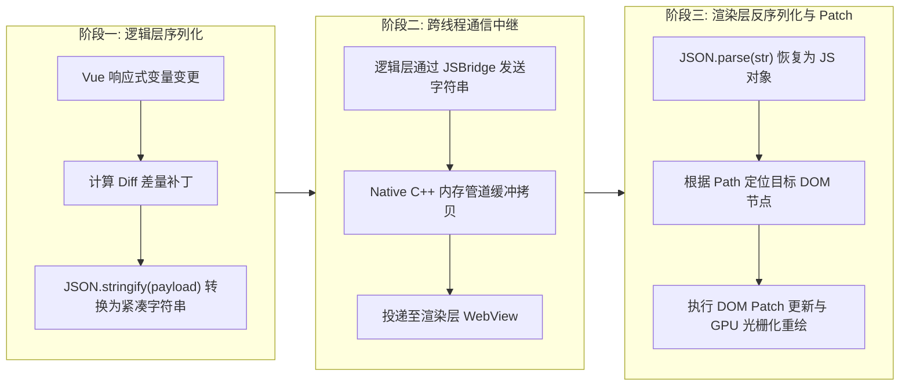
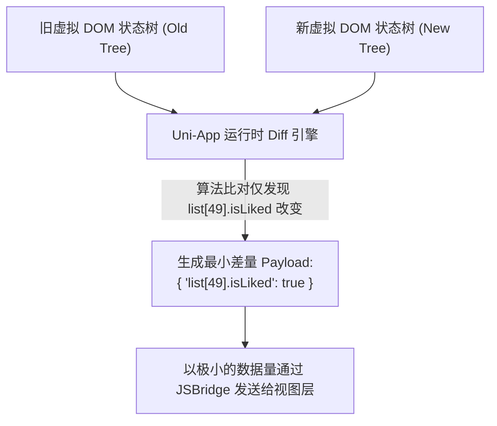

# 高级-setData底层序列化通信瓶颈与局部差量更新推导

在基于双线程模型的小程序与跨端架构中，**`setData`** 是连接逻辑层（JSCore）与渲染层（WebView）之间进行状态驱动界面的**唯一物理生命线**。在 Uni-App 中，虽然开发者享受着 Vue 3 响应式数据绑定（修改 `ref` 即可自动刷新 UI）的丝滑体验，但在编译为小程序运行时的底层，每一次界面更新最终都会被转换为底层的 `setData` 调用。

然而，`setData` 绝非免费的内存赋值。在亿级 DAU 的大厂核心业务中，90% 以上的小程序掉帧、滑动卡顿以及内存暴涨事故，根源都在于**对 `setData` 底层序列化开销与通信频次缺乏敬畏**。

在高级/资深架构师面试中，面试官将直击核心物理机制：**`setData` 端到端经历的三个物理阶段耗时占比是什么？Uni-App 运行时是如何通过虚拟 DOM 比对推导路径级局部差量更新（Diff Path）的？为什么单次数据包超过 256KB 就会触发微信的性能严重警告？**

---

## 1. 核心底层机制与全景架构

### 1.1 setData 执行的三大物理阶段解构

一次完整的 `setData` 调用，其端到端性能损耗由以下三个阶段累加决定：



### 1.2 物理瓶颈两大杀手：频率（Frequency）与体积（Payload Size）

| 瓶颈类型 | 触发临界阈值 | 物理破坏机理 | 界面典型故障现象 |
| :--- | :--- | :--- | :--- |
| **高频触发（High Frequency）** | 两次调用间隔 $< 16\text{ms}$（即一帧内多次调用） | 跨线程通信管道严重积压阻塞，逻辑层事件队列被打满。 | 手势滑动卡顿、按钮点击迟钝、动画掉帧严重。 |
| **超大体积（Massive Payload）** | 单次传输体积 $> 256\text{KB}$ 或 $> 1\text{MB}$ | `JSON.stringify` 与 `JSON.parse` 严重占据 CPU；跨进程数据拷贝开销暴增。 | 控制台黄色警告、低端机瞬间白屏、甚至引发内存溢出闪退。 |

---

## 2. 源码级/算法物理推导

### 2.1 全量替换 vs 路径级差量更新（Path-based Diff）推导

假设页面展示一个包含 100 条商品的列表，用户点击了第 50 项的点赞按钮将其置为 `true`：

#### 方案 A：粗暴的全量覆盖（Naive Full Update）
```javascript
// ❌ 传统全量覆盖：将整个 100 项的巨型数组重新下发
const newList = [...oldList];
newList[49].isLiked = true;
this.setData({ list: newList });
```
- **物理开销计算**：假设每条商品数据对象包含 20 个字段（标题、价格、富文本、图片等），单条大小约 2KB。整张列表全量序列化体积高达 **$200\text{KB}$**！为了修改一个布尔值，双线程管道被迫承受了 200KB 的跨线程内存传输，极其低效。

#### 方案 B：路径级精准差量更新（Diff Path Update）
```javascript
// ✅ 微信原生支持的 Key-Path 语法
this.setData({
  'list[49].isLiked': true
});
```
- **物理开销计算**：序列化下发的数据仅为 `{"list[49].isLiked": true}`，传输体积仅有 **几十个字节**！
- **渲染层寻址优化**：渲染层 WebView 接收到该字符串路径后，直接通过属性访问器（Property Accessor）定位到底层数组的第 49 项，**仅针对该项内部绑定的点赞图标执行局部 DOM 更新**，完全跳过其余 99 个兄弟节点的比对与重绘！



---

## 3. 社招/阶段必考高频硬核连环追问

### 追问 1：既然 Uni-App 底层具备 Diff 引擎，为什么在更新长列表时，依然经常看到控制台提示 `setData 数据传输长度为 xxx KB，存在性能瓶颈`？

> **答辩深度闭环**：
> 1. **全量对象重写破坏了 Diff 精度**：很多开发者习惯写 `goodsList.value[index] = { ...newGoods }`。这种粗暴替换整个对象引用的操作，会导致 Diff 引擎无法精确比对出单一字段的变化，被迫将该对象的所有字段（几十个属性）打包进差量补丁中。
> 2. **响应式变量中挂载了非渲染展示字段**：在请求分页接口时，服务端返回的很多内部数据（如 `createTime`、后台日志字段、原始未处理大 JSON）被一股脑赋值给了 Vue 绑定的 `list` 变量。即使模板中根本没用到这些字段，它们依然会被作为响应式属性纳入深层比对和序列化通信中，导致数据包严重虚胖。
> 3. **解决方案**：接口返回数据后，先进行 **“数据瘦身清洗（Data Sanitization）”**，仅保留模板真实渲染所需的最小字段集存入响应式变量。

---

### 追问 2：如果在 16ms 内（同一个事件循环中）连续调用了 10 次赋值操作，Uni-App 底层是如何调度 `setData` 的？会向原生底层发起 10 次跨线程通信吗？

> **答辩深度闭环**：
> 1. **异步批处理合并（Batching & Tick Debounce）**：绝对不会发起 10 次通信！
> 2. **调度原理推导**：Uni-App 继承了 Vue 3 的异步更新队列机制。当连续修改多个响应式属性时，每个修改仅会将对应的更新任务推入全局的异步调度队列（Queue）。
> 3. **微任务聚合刷新**：在当前 JavaScript 宏任务执行完毕前，引擎通过 `Promise.resolve().then()` 注册一个微任务（Microtask）。在微任务执行阶段，底层的 Diff 算法将所有散落的属性修改**集中进行一次性全局比对与差量打包**，最终在当前帧末尾仅向底层的原生小程序发起**一次且仅此一次**的 `setData` 调用！

---

### 追问 3：在什么极端情况下，即使进行了局部更新，`setData` 依然会引发视图层的严重掉帧卡顿？

> **答辩深度闭环**：
> 1. **视图层 DOM 节点数量突破物理极限（Too Many Nodes）**：如果长列表已经加载了 50 页，屏幕上积累了数万个真实的 DOM 节点。即使 `setData` 下发的数据包仅有 10 字节，渲染层在接收到数据后，对包含数万个节点的庞大 DOM 树执行样式重排与光栅化合成时，**WebView 自身的计算瓶颈依然会被击穿**，产生严重卡顿。
> 2. **破局解法**：当列表总数超过 100 项时，单靠优化 `setData` 已无济于事，必须引入 **虚拟列表（Virtual List）** 架构，保证屏幕上渲染的物理节点数始终恒定在 15~20 个以内。

---

## 4. 生产级避坑指南与排障 SOP

### 4.1 生产级长列表局部属性精准更新规范

```vue
<template>
  <view class="goods-list">
    <view v-for="(item, index) in goodsList" :key="item.id" class="goods-card">
      <text class="title">{{ item.title }}</text>
      <!-- 点赞交互 -->
      <view class="like-btn" @click="toggleLike(index)">
        <text :class="{ 'liked': item.isLiked }">
          {{ item.isLiked ? '❤️ 已赞' : '🤍 点赞' }} ({{ item.likeCount }})
        </text>
      </view>
    </view>
  </view>
</template>

<script setup lang="ts">
import { ref } from 'vue';

interface CleanGoodsItem {
  id: number;
  title: string;
  isLiked: boolean;
  likeCount: number;
}

const goodsList = ref<CleanGoodsItem[]>([]);

// 模拟接口加载
function initData() {
  goodsList.value = Array.from({ length: 50 }, (_, i) => ({
    id: i + 1,
    title: `优质商品推荐 #${i + 1}`,
    isLiked: false,
    likeCount: 10,
  }));
}
initData();

// ✅ 生产级精准局部修改范式
function toggleLike(index: number) {
  const currentItem = goodsList.value[index];
  
  // 乐观更新：仅直接修改具体字段属性，坚决不解构重写整条列表！
  // Uni-App 底层 Diff 引擎会自动提取最小补丁: { 'goodsList[index].isLiked': ..., 'goodsList[index].likeCount': ... }
  currentItem.isLiked = !currentItem.isLiked;
  currentItem.likeCount += currentItem.isLiked ? 1 : -1;
  
  // 异步上报服务端 (防抖)
  // syncLikeStatusToServer(currentItem.id, currentItem.isLiked);
}
</script>
```

### 4.2 非渲染临时数据与响应式解耦防线

在组件开发中，严禁将不需要参与视图渲染的大型数据挂在 `ref` 或 `reactive` 上：

```typescript
// ❌ 错误示范：将定时器句柄或庞大的图表实例塞入响应式
const timerId = ref<any>(null); // 引发不必要的深层劫持
const rawEchartsInstance = ref<any>(null); // 严重拖慢渲染管线

// ✅ 生产级规范：纯业务逻辑数据，使用普通变量或 shallowRef 存储！
let timerId: any = null; // 普通变量，完全脱离响应式与 setData
let rawEchartsInstance: any = null;
```
通过上述标准实践，可确保逻辑层派发给双线程通道的每个数据包均保持在数十字节到几 KB 的极致极简状态，彻底消灭控制台性能告警与滑动掉帧。
