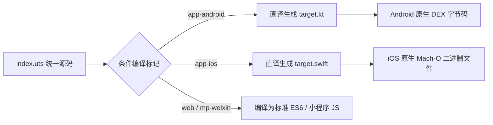

# 高级-原生插件开发机制与新一代UTS语言直译内核

在跨平台开发演进过程中，调用移动端底层硬件特异性能力（如低功耗蓝牙 BLE、外接指纹/红外扫描枪、自研 C++ 图像处理算法库、后台高精度常驻保活定位）是绕不开的刚需。Uni-App 提供了两套能力桥梁：基于传统 Native SDK 的**原生扩展插件机制（UniPlugin）**，以及彻底革新跨端架构的**新一代 UTS（Uni Type Script）直接编译内核**。

---

## 一、核心底层机制与全景架构

### 1.1 传统原生插件 vs 新一代 UTS 插件架构对比

```mermaid
graph TD
    subgraph 传统原生插件 (UniPlugin)
        A1[JavaScript 业务层] -->|JSON 序列化| B1[JSBridge / Weex Bridge]
        B1 -->|JNI / Objective-C Runtime 反射| C1[Android Java/Kotlin 插件]
        B1 -->|ObjC Runtime 消息转发| C2[iOS ObjC/Swift 插件]
        C1 & C2 -->|性能损耗: 跨语言Bridge通信与类型转换| D1[原生 OS API / 硬件]
    end

    subgraph 新一代 UTS 插件体系 (Uni Type Script)
        A2[UTS 统一源码 (.uts) TypeScript强类型语法] -->|UTS 静态编译前端 AST 分析| B2[UTS Compiler]
        B2 -->|直接直译输出| C3[纯原生 Kotlin 源码 (.kt)]
        B2 -->|直接直译输出| C4[纯原生 Swift 源码 (.swift)]
        C3 -->|Android 官方原生编译器 kotlinc| D2[无缝调用 Android SDK / 零 Bridge 损耗]
        C4 -->|Apple 官方原生编译器 swiftc| D3[无缝调用 iOS Cocoa SDK / 零 Bridge 损耗]
    end
```

### 1.2 UTS 语法直译与平台差异化条件编译流转

UTS 文件通过强类型 TypeScript 语法编写，并在编译器层面支持平台条件编译宏，在 AST 解析阶段直接转换为目标原生语言的代码块：



---

## 二、源码级实战推导：传统插件开发与 UTS 极简重构

### 2.1 传统 Android 原生插件（Java/Kotlin）开发范式

传统 Android 插件需继承 `UniModule` 并通过 `@UniJSMethod` 注解导出异步回调：

```java
package com.corp.plugin;

import io.dcloud.feature.uniapp.common.UniModule;
import io.dcloud.feature.uniapp.annotation.UniJSMethod;
import io.dcloud.feature.uniapp.bridge.UniJSCallback;
import com.alibaba.fastjson.JSONObject;

public class BatteryModule extends UniModule {
    
    // 异步方法暴露给 JS 调用
    @UniJSMethod(uiThread = false)
    public void getBatteryLevel(JSONObject options, UniJSCallback callback) {
        // 读取原生电池服务
        int level = 85; // 模拟读取电池电量
        
        JSONObject result = new JSONObject();
        result.put("code", 200);
        result.put("level", level);
        
        // 通过 UniJSCallback 将结果序列化跨线程回传给 JS 引擎
        if (callback != null) {
            callback.invoke(result);
        }
    }
}
```

在 `package.json` 中配置原生映射关系：
```json
{
  "name": "Corp-Battery",
  "id": "corp-battery",
  "version": "1.0.0",
  "description": "原生电池监控插件",
  "android": {
    "plugins": [
      {
        "type": "module",
        "name": "corp-battery",
        "class": "com.corp.plugin.BatteryModule"
      }
    ]
  }
}
```

---

### 2.2 新一代 UTS 插件极简实现（告别胶水层）

使用 UTS 无需编写繁杂的 JNI、ObjC Runtime 映射及 `package.json` 注册，代码直接声明，平台 SDK 零反射直调：

#### 文件结构：
```text
uni_modules/
└── uts-battery/
    ├── utssdk/
    │   ├── app-android/
    │   │   └── index.uts        # Android 平台特异实现 (编译为 Kotlin)
    │   ├── app-ios/
    │   │   └── index.uts        # iOS 平台特异实现 (编译为 Swift)
    │   └── common/
    │       └── index.uts        # 通用类型接口声明
    └── package.json
```

#### Android 端 UTS 实现（`utssdk/app-android/index.uts`）：
```typescript
import Context from "android.content.Context";
import BatteryManager from "android.os.BatteryManager";

export type BatteryResult = {
    code: number;
    level: number;
};

// 导出异步方法，UTS 直接编译为 Kotlin suspend 函数或标准原生回调
export function getBatteryLevel(): BatteryResult {
    // UTS 内部可以直接访问 Android 原生上下文 UTSAndroid.getAppContext()
    const context = UTSAndroid.getAppContext();
    if (context != null) {
        const batteryManager = context.getSystemService(Context.BATTERY_SERVICE) as BatteryManager;
        const level = batteryManager.getIntProperty(BatteryManager.BATTERY_PROPERTY_CAPACITY);
        return {
            code: 200,
            level: level
        };
    }
    return {
        code: 500,
        level: -1
    };
}
```

#### Vue3 页面直接调用：
```vue
<script setup lang="ts">
// 无需 uni.requireNativePlugin，直接作为 TypeScript 模块强类型引入
import { getBatteryLevel } from "@/uni_modules/uts-battery";

const fetchBattery = () => {
  // 享受完整的 IDE 类型提示与自动补全
  const res = getBatteryLevel();
  console.log('当前电池电量:', res.level);
};
</script>
```

---

## 三、社招高频硬核连环追问

### 追问 1：UTS 编译到底是在云端还是在本地完成的？它与 React Native TurboModule 或 Flutter FFI 有何本质区别？

> **考官意图**：考察候选人对主流跨端框架原生扩展底层原理的横向对比与技术广度。

**回答硬核要点**：
1. **编译机制**：
   - 本地开发使用 HBuilderX 自带的 UTS 编译器，直接在本地将 `.uts` 解析为 AST，并转译为目标平台的 `.kt` 与 `.swift` 源码，然后调用本地 Android SDK (`kotlinc`) 与 Xcode (`swiftc`) 完成编译链接。
2. **与 RN / Flutter 的本质区别**：
   - **React Native TurboModules**：依然依赖 C++ JSI（JavaScript Interface）作为中间宿主实现 JS 对象与 C++ 对象的内存绑定，底层需要维护一套复杂的 C++ Spec 胶水代码。
   - **Flutter FFI / Platform Channel**：Platform Channel 依赖 BinaryMessenger 序列化跨线程通信；FFI 适合 C/C++，但调用原生 Java/ObjC API 极其繁琐。
   - **UTS 架构颠覆性**：UTS **完全舍弃了中间运行时（No Intermediate Runtime）**，在语法层面直接降维转换为原生代码，生成物就是 100% 纯正的原生 Kotlin/Swift 代码，性能与手写原生代码毫无物理损耗。

---

### 追问 2：在传统 UniPlugin 原生插件中，如何在原生线程向前端主动持续推送事件（如蓝牙长连接数据推流）？

> **考官意图**：考察异步长连接、事件广播与 `UniJSCallback` 的回收机制。

**回答硬核要点**：
- **`keepAlive` 参数机制**：
  - 默认情况下，`UniJSCallback.invoke(data)` 被调用一次后，JSBridge 底层就会自动销毁前端关联的回调引用，防止内存泄漏。
  - 对于长连接流式数据（如蓝牙数据分包到达、原生传感器事件），必须调用带保持存活标记的接口：
    ```java
    // Android 端持续推流
    callback.invokeAndKeepAlive(data);
    ```
- **全局事件通道 `fireGlobalEventCallback`**：
  - 也可以通过 `mUniSDKInstance.fireGlobalEventCallback("onBluetoothData", params)` 触发宿主实例的全局事件，前端通过 `uni.requireNativePlugin('globalEvent').addEventListener('onBluetoothData', fn)` 进行消费监听。

---

### 追问 3：如果一个现有的第三方原生 SDK 只有 `.aar` 或 `.framework` 动态库，UTS 如何与其无缝混编调用？

> **考官意图**：考察企业现有私有资产复用与工业级工程落地可行性。

**回答硬核要点**：
1. **依赖放置规范**：
   - Android：将第三方 `.aar` 或 `.jar` 放置在 `utssdk/app-android/libs/` 目录下，并在 `utssdk/app-android/config.json` 中配置 Gradle 依赖。
   - iOS：将 `.framework` 或 `.xcframework` 放置在 `utssdk/app-ios/Frameworks/` 下。
2. **直接 Import 原生包名**：
   - 在 `.uts` 源码中，直接使用 TypeScript 的 `import` 语法引入 AAR 内部声明的 Java/Kotlin 类路径（如 `import ThirdPartyPayManager from "com.thirdparty.pay.PayManager";`）。
   - UTS 编译器在转译时会直接保留该导入声明，交由原生编译工具链完成符号解析与动态链接，完全零阻碍。

---

## 四、生产级避坑指南与排障 SOP

### 4.1 生产级开发与发布避坑矩阵

| 踩坑场景 | 根因与致命影响 | 工业级解决方案 |
| :--- | :--- | :--- |
| **Android 插件在 UI 线程执行长耗时任务导致 ANR** | `@UniJSMethod` 默认或设置 `uiThread = true` 阻塞了主线程 Looper | 耗时 I/O 或网络任务必须标记 `uiThread = false`，或在原生代码中使用线程池 / 协程调度至后台线程 |
| **UTS 转译 Swift 报错 Type Mismatch** | UTS 语法过于自由（如使用了 `any`），但 Swift 是极端严格的强类型编译 | 遵循 UTS 规范，显式定义 Interface 与 Type，避免隐式类型推导导致 Swift 编译失败 |
| **iOS 原生插件后台常驻任务被系统杀进程** | 未在 `Info.plist` 申请 `UIBackgroundModes` 并在原生侧开启后台任务句柄 | 离线工程配置 `Background Modes`（Audio/Location/VoIP），原生侧使用 `beginBackgroundTaskWithExpirationHandler` 保护任务闭环 |
| **多原生插件打包冲突 Duplicate Class** | 多个 AAR 内嵌了相同版本的支持库（如 `androidx.core` 或 `gson`） | 在原生插件的 `build.gradle` 中排除公共依赖：`implementation('com.some.sdk') { exclude group: 'com.google.code.gson' }` |

### 4.2 UTS 插件调试与编译排障 SOP

当本地运行 UTS 插件出现原生报错时，按以下流水线迅速定位：

```bash
# 1. 检查 UTS 编译产物是否正确转译为 Kotlin/Swift
# 产物路径通常位于工程的 unpackage/dist/dev/app-android/src/...
# 查看转译生成的 .kt 或 .swift 源码，对比语法是否合法

# 2. 检查 HBuilderX 控制台输出中的 Native 编译器日志
# 若报 ClassNotFoundException，核对 package.json 中的 class 映射与 AndroidManifest 中的包名

# 3. 本地自定义基座联调
# 制作自定义基座（包含最新原生插件代码），在真机上运行并查看 adb logcat 或 Xcode Console:
adb logcat -s DCloud:V UTS:V AndroidRuntime:E
```
