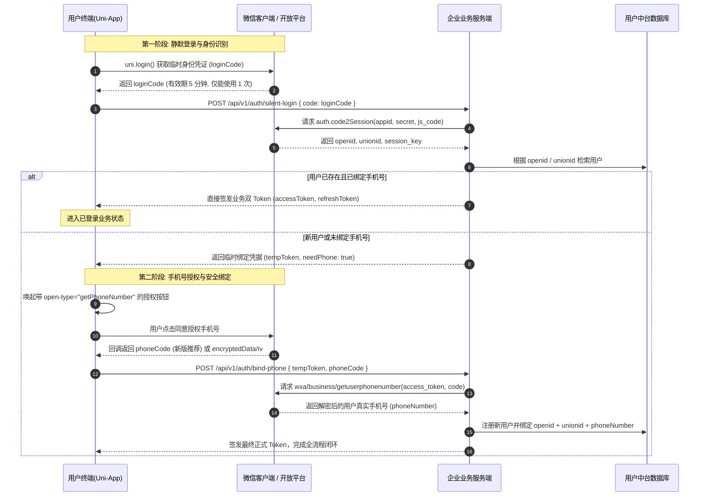
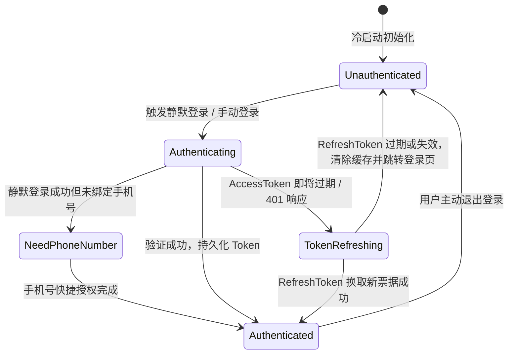
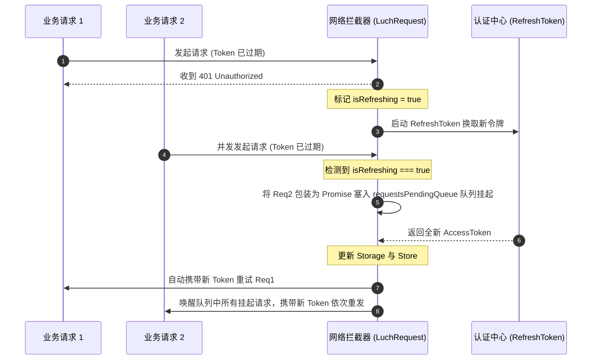

# 高级-多端登录鉴权状态机微信静默登录与手机号授权闭环

在企业级商业化跨端应用中，用户身份认证与登录鉴权是整个业务生态的基石。不同终端平台的账号体系存在巨大割裂：微信小程序依赖双重 Code 换取 OpenID 与手机号授权，App 依赖一键免密或微信 SDK 登录，Web/H5 则依赖 OAuth2.0 或短信验证码。设计一套**健壮的状态机鉴权模型**，实现多端统一登录、Token 自动续期与静默授权闭环，是高级前端架构师的核心考核点。

---

## 一、核心底层机制与全景架构

### 1.1 微信小程序双重凭证换取 JWT 全时序流转图

微信生态禁止在前端暴露敏感密钥（`AppSecret`）。完整的登录链路必须遵循“前端取 Code $\to$ 后端换 Session $\to$ 手机号凭证解密 $\to$ 签发业务 Token”的安全流水线：



### 1.2 多端登录鉴权状态机（Auth State Machine）

用户在应用生命周期中的认证状态转换，必须通过显式状态机进行严格约束，避免并发网络请求下的竞争条件（Race Condition）：



---

## 二、源码级实战推导：企业级登录状态机与微信鉴权闭环

### 2.1 鉴权状态机管理器（Pinia Store 驱动）

```typescript
// stores/useAuthStore.ts
import { defineStore } from 'pinia';
import { ref, computed } from 'vue';

export enum AuthState {
  UNAUTHENTICATED = 'UNAUTHENTICATED',
  AUTHENTICATING = 'AUTHENTICATING',
  NEED_PHONE = 'NEED_PHONE',
  AUTHENTICATED = 'AUTHENTICATED'
}

export const useAuthStore = defineStore('auth', () => {
  const currentState = ref<AuthState>(AuthState.UNAUTHENTICATED);
  const accessToken = ref<string>(uni.getStorageSync('ACCESS_TOKEN') || '');
  const refreshToken = ref<string>(uni.getStorageSync('REFRESH_TOKEN') || '');
  const tempBindToken = ref<string>(''); // 未绑定手机时的临时上下文

  const isLogin = computed(() => currentState.value === AuthState.AUTHENTICATED);

  // 1. 小程序端静默登录
  const silentLoginMP = async (): Promise<boolean> => {
    currentState.value = AuthState.AUTHENTICATING;
    try {
      // 获取微信登录 code
      const [loginErr, loginRes] = await uni.login({ provider: 'weixin' });
      if (loginErr || !loginRes.code) {
        throw new Error('微信登录失败');
      }

      // 请求后端服务换取身份
      const res = await uni.request({
        url: 'https://api.corp.com/api/v1/auth/silent-login',
        method: 'POST',
        data: { code: loginRes.code }
      });

      const body = res.data as any;
      if (body.code === 200) {
        if (body.data.needPhone) {
          tempBindToken.value = body.data.tempToken;
          currentState.value = AuthState.NEED_PHONE;
          return false; // 需要进一步授权手机号
        } else {
          saveTokens(body.data.accessToken, body.data.refreshToken);
          currentState.value = AuthState.AUTHENTICATED;
          return true;
        }
      } else {
        throw new Error(body.message);
      }
    } catch (e) {
      currentState.value = AuthState.UNAUTHENTICATED;
      return false;
    }
  };

  // 2. 授权手机号绑定闭环 (新版 phoneCode 协议)
  const bindPhoneNumber = async (phoneCode: string): Promise<boolean> => {
    try {
      const res = await uni.request({
        url: 'https://api.corp.com/api/v1/auth/bind-phone',
        method: 'POST',
        data: {
          tempToken: tempBindToken.value,
          code: phoneCode
        }
      });

      const body = res.data as any;
      if (body.code === 200) {
        saveTokens(body.data.accessToken, body.data.refreshToken);
        tempBindToken.value = '';
        currentState.value = AuthState.AUTHENTICATED;
        return true;
      }
      return false;
    } catch (e) {
      console.error('手机号绑定失败', e);
      return false;
    }
  };

  // 保存与更新 Token
  const saveTokens = (aToken: string, rToken: string) => {
    accessToken.value = aToken;
    refreshToken.value = rToken;
    uni.setStorageSync('ACCESS_TOKEN', aToken);
    uni.setStorageSync('REFRESH_TOKEN', rToken);
  };

  // 登出
  const logout = () => {
    accessToken.value = '';
    refreshToken.value = '';
    tempBindToken.value = '';
    currentState.value = AuthState.UNAUTHENTICATED;
    uni.removeStorageSync('ACCESS_TOKEN');
    uni.removeStorageSync('REFRESH_TOKEN');
  };

  return {
    currentState,
    accessToken,
    refreshToken,
    isLogin,
    silentLoginMP,
    bindPhoneNumber,
    logout
  };
});
```

---

### 2.2 微信手机号授权按钮与页面闭环

```vue
<template>
  <view class="login-container">
    <view class="logo-box">
      <image src="/static/logo.png" class="logo" />
      <text class="app-name">企业级跨端实战平台</text>
    </view>

    <!-- 状态 1: 未登录且需要授权手机号 -->
    <view v-if="authStore.currentState === AuthState.NEED_PHONE" class="auth-box">
      <text class="auth-tip">为了向您提供更好的服务，请授权微信绑定手机号</text>
      <!-- 必须使用微信原生开放能力按钮 -->
      <button 
        type="primary" 
        open-type="getPhoneNumber" 
        @getphonenumber="onGetPhoneNumber"
        class="login-btn"
      >
        微信一键绑定手机号
      </button>
    </view>

    <!-- 状态 2: 通用手机号验证码登录兜底 -->
    <view v-else-if="authStore.currentState === AuthState.UNAUTHENTICATED" class="pwd-box">
      <button type="primary" @tap="handleManualLogin" class="login-btn">
        手机验证码登录
      </button>
    </view>
  </view>
</template>

<script setup lang="ts">
import { onMounted } from 'vue';
import { useAuthStore, AuthState } from '@/stores/useAuthStore';

const authStore = useAuthStore();

onMounted(async () => {
  // #ifdef MP-WEIXIN
  // 微信端进入页面，自动触发静默登录
  const success = await authStore.silentLoginMP();
  if (success) {
    uni.showToast({ title: '登录成功', icon: 'success' });
    // 重定向至业务首页或来源页
  }
  // #endif
});

// 处理用户点击手机号授权结果
const onGetPhoneNumber = async (e: any) => {
  if (e.detail.errMsg && e.detail.errMsg.includes('ok')) {
    // 微信官方推荐：使用新版临时 code（有效期 5 分钟）
    const phoneCode = e.detail.code;
    uni.showLoading({ title: '授权验证中...' });
    const bindSuccess = await authStore.bindPhoneNumber(phoneCode);
    uni.hideLoading();

    if (bindSuccess) {
      uni.showToast({ title: '登录并绑定成功', icon: 'success' });
      uni.navigateBack();
    } else {
      uni.showToast({ title: '绑定失败，请重试', icon: 'none' });
    }
  } else {
    // 用户主动点击“拒绝”
    uni.showToast({ title: '您已拒绝授权，无法完成自动登录', icon: 'none' });
  }
};

const handleManualLogin = () => {
  uni.navigateTo({ url: '/pages/auth/sms-login' });
};
</script>
```

---

## 三、社招高频硬核连环追问

### 追问 1：为什么在调用 `uni.login()` 获取 `code` 之后，不能把 `code` 缓存在本地反复使用？

> **考官意图**：考察候选人对 OAuth2 / OIDC 协议中临时授权码时效性与重放攻击防御的认知。

**回答硬核要点**：
1. **微信安全机制**：
   - 微信开放平台的 `code` 是一个一次性凭证（One-Time Token），有效期仅为 **5 分钟**。
   - 一旦在微信服务端调用 `auth.code2Session` 成功消费该 `code`，微信后台会立即将其在 Redis 中标记失效。再次传入同一个 `code` 会直接返回 `40029 (invalid code)`。
2. **并发踩坑预防**：
   - 如果首屏有 5 个并发接口检测到未登录，同时触发了 5 次 `uni.login()`，后一次调用生成的 `code` 会导致前一个尚未换取完毕的 `code` 提前作废，造成 `code was used` 异常。
   - **架构解决方案**：必须在前端实现登录 Promise 单例互斥锁（Mutex），同一时间全局只允许一个 `uni.login()` 在 Pending，所有后续请求共享同一个 Promise 产物。

---

### 追问 2：微信官方废弃 `getUserInfo` 与 `getUserProfile` 接口后，目前如何合法、规范地获取用户头像和昵称？

> **考官意图**：考察候选人对微信隐私合规政策演进与最新规范的敏锐度。

**回答硬核要点**：
- **历史背景**：早年 `getUserInfo` 可静默弹窗拿昵称头像，后来被规范为必须点击按钮触发 `getUserProfile`，但自 2022 年底起，微信为了保护用户隐私，全面收回了通过 API 一键获取用户真实昵称和头像的权限。
- **最新官方标准方案（头像昵称填写能力）**：
  1. **头像选择**：使用 `<button open-type="chooseAvatar" @chooseavatar="onChooseAvatar">`，微信会弹出原生选择框让用户选择微信头像或上传新图片，回调中返回一个本地临时图片路径，前端上传到企业 CDN。
  2. **昵称填写**：使用 `<input type="nickname" />`，用户聚焦输入框时，键盘上方会自动浮现用户当前微信昵称的快速填入选项，由用户自主点击选填。

---

### 追问 3：在多端架构下，如何确保同一自然人在微信小程序、App 原生端、微信 H5 下识别为同一个唯一用户？

> **考官意图**：考察候选人对跨端统一账号中台、OpenID 与 UnionID 体系的架构设计能力。

**回答硬核要点**：
```mermaid
graph TD
    Corp[微信开放平台主账号 开发者资质认证] --> MP[微信小程序: 生成 OpenID_A]
    Corp --> App[移动端 App: 生成 OpenID_B]
    Corp --> H5[微信公众号 H5: 生成 OpenID_C]

    MP & App & H5 -->|同一个主体开放平台下映射同一用户| UnionID[全局唯一 UnionID]
    UnionID -->|绑定| Account[企业用户中心 UserID]
    Phone[真实手机号 (SMS / 一键免密)] -->|双因子绑定| Account
```
- **核心标识 `UnionID`**：
  - 只要微信小程序、App、微信公众号绑定在同一个**微信开放平台（open.weixin.qq.com）**开发者账号主体下，同一个微信用户在各应用中的 `OpenID` 虽然各不相同，但生成的 `UnionID` 绝对物理唯一。
- **手机号兜底机制**：
  - 对于非微信生态（如普通浏览器 H5、支付宝小程序、手机号密码登录），系统将**真实手机号**作为全局主键（Primary Key），与微信 `UnionID` 建立一对一唯一映射关系。

---

## 四、生产级避坑指南与排障 SOP

### 4.1 生产级登录鉴权避坑清单

| 隐患场景 | 根因与致命后果 | 工业级解决方案 |
| :--- | :--- | :--- |
| **手机号解密报 pad block corrupted** | 服务端使用旧版 AES 解密时，使用了过期的 `session_key` | 强保证 `uni.login()` 在获取手机号操作之前调用，或全面升级为微信新版 `phoneCode` 官方服务端直查接口 |
| **登录接口无限死循环** | 401 拦截器触发重新登录，但登录接口本身鉴权失败又返回 401 | 在网络拦截器中设置白名单（WhiteList），对 `/auth/login` 等认证接口跳过 401 拦截处理 |
| **Token 过期后并发请求触发多次刷新** | 页面加载时 10 个业务请求并发到达，各自触发一次 RefreshToken 导致互斥作废 | 采用发布订阅模式（Subscriber Queue），仅第一个 401 启动刷新，其余挂起进入等待队列 |
| **iOS 微信小程序无法获取登录态** | iOS 审核机制强制要求有独立游客或账户密码登录入口 | 提供“手机验证码/密码登录”或“游客模式”降级选项，禁止将微信登录作为唯一进入途径 |

### 4.2 Token 并发无感刷新互斥流转 SOP


