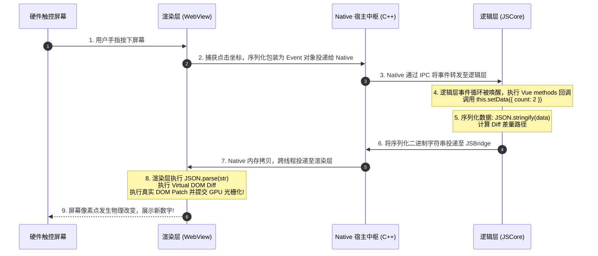
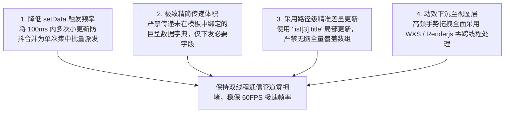

# 高级-小程序双线程架构逻辑层JSCore与渲染层WebView原理

在跨平台与大前端技术演进史上，**双线程架构（Dual-Thread Architecture）** 是微信团队与各大小程序厂商最具里程碑意义的核心架构创新。Uni-App 编译为各类小程序（微信、支付宝、抖音、百度）甚至 App 混合端时，其底层运行时均深度建立在这一模型之上。

传统 Web 前端开发者往往习惯了单线程浏览器中“JS 脚本执行、DOM 树解析、事件监听处于同一个渲染管线”的心智模型。然而一旦踏入小程序的高级深水区，面试官必考的硬核深度就会直击底层物理骨架：**为什么小程序要彻底封杀浏览器 DOM 操作并拆分为逻辑层与视图层？两个线程通过 Native JSBridge 交互的物理时序是怎样的？跨线程往返时延（Round-Trip Time）如何导致了跟手拖拽与高频动画的卡顿？**

---

## 1. 核心底层机制与全景架构

### 1.1 传统单线程 Webview vs 小程序双线程物理隔离模型

```mermaid
graph TD
    subgraph Browser_Single_Thread["传统浏览器 H5 (单线程模型 - 自由但高风险)"]
        HTML["DOM 树"] <--> JS_Engine["JavaScript 引擎 (可随意读写 window / document)"]
        JS_Engine <--> Render_Pipeline["样式计算与光栅化渲染 (同一线程互斥排队)"]
        Note_B["致命痛点: JS 密集计算会导致 UI 瞬间冻结假死;<br/>页面内可通过动态注入 JS 窃取 Cookie、劫持支付跳转 (安全失控)"]
    end

    subgraph MiniProgram_Dual_Thread["小程序双线程模型 (物理绝对隔离沙箱)"]
        subgraph View_Layer["渲染层 (View Thread / WebView)"]
            WXML["WXML 模板结构"]
            WXSS["WXSS 样式表"]
            VirtualDOM_View["视图层 Virtual DOM"]
        end

        subgraph Logic_Layer["逻辑层 (Service Thread / JSCore / V8)"]
            BusinessJS["业务 JS 逻辑代码"]
            VueRuntime["Vue 3 响应式运行时"]
            VirtualDOM_Logic["逻辑层 Virtual DOM"]
        end

        subgraph Native_Bridge["Native 宿主核心中枢 (WeChat Native Client / C++ 桥接)"]
            JSBridge["JSBridge 二进制异步通信管道"]
            PlatformAPI["原生能力 (相机、蓝牙、文件系统、网络发包)"]
        end

        View_Layer <-->|"1. 触控事件上报 / 渲染指令接收"| Native_Bridge
        Native_Bridge <-->|"2. 数据传输 (setData) / 原生接口调用"| Logic_Layer
    end
```

### 1.2 运行时物理宿主环境对比

| 核心分层 | iOS 生产物理环境 | Android 生产物理环境 | 微信开发者工具 (模拟环境) | 核心物理权限边界 |
| :--- | :--- | :--- | :--- | :--- |
| **逻辑层（Service）** | **JavaScriptCore** 独立沙箱 | **V8** 引擎独立进程 | Node.js / NW.js 独立线程 | **纯计算环境**。无 `window`、无 `document`、无真实 DOM 操作权限，无法调用底层系统 API。 |
| **渲染层（View）** | **WKWebView** | **XWeb**（腾讯自研定制内核） | Chromium 内核 WebView | **纯展示环境**。仅负责 HTML/WXML 节点的排版与 GPU 绘制，无法执行复杂的自定义业务逻辑脚本。 |
| **通信桥梁** | `WebKit.messageHandlers` 原生通信 | JNI / 映射 Prompt 接口通信 | WebSocket 本地全双工套接字 | 负责中转两个隔离线程间的所有数据对象与事件指令。 |

---

## 2. 源码级/算法物理推导

### 2.1 跨线程事件派发与响应的时钟时序推导

当用户在屏幕上点击一个按钮，触发 `setData` 改变文本，其端到端底层经历了漫长的 **“跨线程往返时延（Round-Trip Time）”**：

#### 物理延迟计算方程：
$$\text{Total Latency} = T_{\text{TouchToView}} + T_{\text{IPC(View}\to\text{Native)}} + T_{\text{IPC(Native}\to\text{Logic)}} + T_{\text{JS Exec}} + T_{\text{JSON.stringify}} + T_{\text{IPC(Logic}\to\text{View)}} + T_{\text{DOM Patch}}$$
- 在低端 Android 设备上，这一完整的跨线程往返闭环耗时往往在 **$20\text{ms} \sim 80\text{ms}$**！
- **致命瓶颈**：如果开发者试图在逻辑层监听 `@touchmove`，并在每次手指移动时都调用 `setData` 动态修改组件的 `left` 坐标来实现拖拽，由于**每一帧都要跨线程跑完上述 9 步流程**，必定导致位移严重滞后脱手，产生肉眼可见的剧烈掉帧卡顿。

---

## 3. 社招/阶段必考高频硬核连环追问

### 追问 1：为什么微信官方当初要大费周章设计这套复杂的“双线程架构”，而不直接沿用传统的单 Webview 浏览器体系？核心的设计哲学是什么？

> **答辩深度闭环**：
> 1. **管控与安全性（Security & Governance）**：在传统的开放单线程 Webview 中，第三方开发者可以通过注入 `document.cookie`、动态创建 `<script>` 标签加载恶意黑客脚本、或者直接操作 DOM 随意跳转外部不可控网页。双线程架构将逻辑层剥离在一个没有任何 DOM 操作权限的独立纯 JS 沙箱中，**从根本上彻底杜绝了 XSS 跨站脚本攻击与私自读取敏感 Cookie/存储的可能**。
> 2. **UI 渲染稳定性与防假死（UI Continuity）**：在单线程中，一段复杂的 CPU 死循环计算（如大型矩阵遍历）会直接挂起主线程，导致页面瞬间变成“假死态”，无法响应任何触摸与滚动。而在双线程架构下，**即使逻辑层被复杂的密集计算彻底阻塞卡死，渲染层依然可以独立保持顺畅的原生滚动与手势响应**，系统永远不会发生整屏白屏卡顿。

---

### 追问 2：双线程架构虽然换取了极致的安全与稳定性，但它在工程架构层面带来了哪些不可逆转的“代价（Trade-offs）”？

> **答辩深度闭环**：
> 1. **昂贵的跨线程通信开销（IPC Overhead）**：数据不能通过内存指针直接共享，每次传递数据必须经过“序列化 $\to$ 进程/线程通信 $\to$ 反序列化”，数据量大时严重耗费 CPU 算力。
> 2. **高频手势与复杂动效的天然短板**：无法在逻辑层实现跟手拖拽、阻尼回弹或视差滚动（逼出了 `wxs` / `renderjs` 这种打补丁的运行在视图层的脚本）。
> 3. **DOM 与标准生态断层**：海量原本成熟的 npm Web 开源库（如依赖 `document` 的 RichText 富文本编辑器、直接操作 Canvas DOM 的图表库）完全无法直接在小程序中使用，必须进行重度的定制重构。

---

### 追问 3：在小程序运行期间，如果“逻辑层”发生死循环崩溃，和“渲染层”发生 Webview 崩溃，手机界面上各自会呈现出什么截然不同的物理表现？

> **答辩深度闭环**：
> 1. **逻辑层崩溃（Service Crashed）**：
>    - 表现：**屏幕上的 UI 依然完全正常展示，页面依然可以正常上下滑动**；但用户点击任何按钮、表单输入、切换 Tab 时，**界面完全毫无反应**（因为逻辑层的事件循环已死，无法接收和处理任何回调）。
> 2. **渲染层崩溃（View/Webview Crashed）**：
>    - 表现：由于 WebView 进程遭遇底层内存溢出（OOM）或图形驱动崩溃，**手机界面瞬间变成纯白屏、纯黑屏，或者弹出宿主系统自带的“页面已崩溃，点击重新加载”原生警告框**，整棵视图树直接从操作系统中物理蒸发。

---

## 4. 生产级避坑指南与排障 SOP

### 4.1 生产级双线程通信减负核心准则

在日常开发中，架构师必须指导团队遵循以下双线程性能防线：

### 4.2 跨线程性能瓶颈诊断 SOP

在微信开发者工具中，通过内置的 **Audits（体验评分）** 面板精准揪出双线程通信违规代码：

1. 打开微信开发者工具，点击控制台的 **Audits** 选项卡。
2. 开启录制，在手机上连续执行滑动长列表、提交表单等高频交互，点击 **运行体验评分**。
3. 检查诊断报告中的红线警告项：
   - **`频繁调用 setData`**：报告会标出具体的调用间隔时间（如 $< 16\text{ms}$），定位到高频派发处并增加节流（Throttle）。
   - **`setData 传输数据量过大`**：报告会标出单次传输超过 $256\text{KB}$ 的严重违规调用，并打印具体超大对象树，顺藤摸瓜剥离冗余字段。
