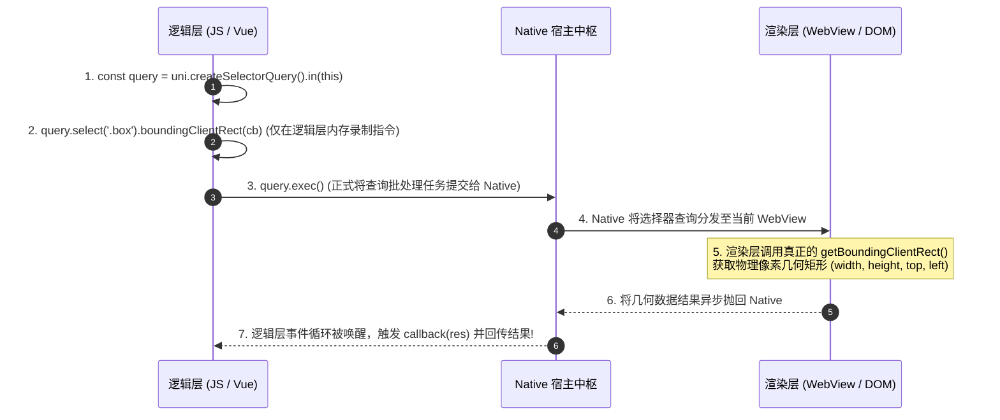
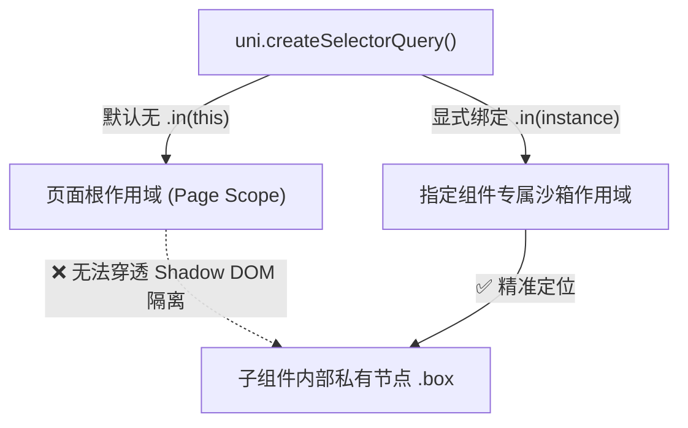

# 高级-无DOM环境下跨端节点查询uni-createSelectorQuery

在单线程标准的 Web 前端开发中，测量一个元素的物理尺寸或滚动位置只需简单调用 `document.querySelector('.card').getBoundingClientRect()`。然而，在小程序和跨端 App 的双线程架构中，**逻辑层根本没有任何真实的 DOM 树实体**。

为了使逻辑层的业务代码能够安全读取渲染层视图节点的几何尺寸（宽、高、屏幕坐标、滚动偏移量），Uni-App 与各大平台共同推行了统一的异步节点查询桥接接口——**`uni.createSelectorQuery()`**。

在社招高级技术面试中，面试官不仅考查基础查询 API，更会考核其中的底层跨线程通信与作用域壁垒：**为什么在子组件内部查询节点必须显式绑定 `.in(this)`？为什么 `createSelectorQuery` 采用“指令收集 + `.exec()` 批量提交”的设计模式？如何在 Vue 3 `<script setup>` 组合式 API 下安全获取当前组件实例并封装异步 Promise 查询器？**

---

## 1. 核心底层机制与全景架构

### 1.1 节点查询跨线程通信全景流转图

`createSelectorQuery` 并不是同步直接读取属性，而是经历了一整套**“指令录制 $\to$ 跨线程下发 $\to$ 视图层执行 $\to$ 异步回传”**的异步批处理过程：



### 1.2 核心查询链式 API 矩阵

| API 方法 | 物理查询目标 | 返回核心几何数据 |
| :--- | :--- | :--- |
| **`select(selector)`** | 在指定作用域内匹配**第一个**符合条件的节点 | 返回单个节点的 `NodesRef` |
| **`selectAll(selector)`** | 匹配**所有**符合条件的节点（如列表每一项） | 返回由多个节点矩形组成的数组 |
| **`selectViewport()`** | 选中**屏幕可视窗口视口自身** | 查询整个页面的滚动偏移量（`scrollLeft`, `scrollTop`） |
| **`boundingClientRect(cb)`** | 请求查询节点的几何尺寸与坐标 | `width`, `height`, `top`, `bottom`, `left`, `right` |
| **`fields(options, cb)`** | **高阶定制查询**（可组合选择查询项） | 支持查询 `size`, `rect`, `scrollOffset`, `node`, `computedStyle` |
| **`exec(callback)`** | **终极触发器**（提交执行管道） | **必须显式调用！** 否则前面的所有链式查询指令都不会真正发射！ |

---

## 2. 源码级/算法物理推导

### 2.1 为什么子组件内部必须显式绑定 `.in(this)`？

初学者在自定义组件中最常遇到的离奇 Bug：在子组件内部查询 `.card` 节点，代码完全正确却**永远返回 `null`**！

#### 物理作用域隔离推导：
- **默认全局作用域陷阱**：如果不加 `.in(this)`，`uni.createSelectorQuery()` 的默认查询作用域被锚定在**页面的最外层根作用域（Page Scope）**。
- **影子树（Shadow DOM）隔离**：在小程序底层，自定义组件拥有独立的上下文沙箱。父页面作用域的选择器引擎**根本无法穿透组件的边界直接窥探其内部的私有节点**！
- **`.in(componentInstance)` 的本质**：它为查询管道注入了当前组件的唯一标识符（`ComponentId`）。底层分发器据此精准切换到该组件自身的上下文（`this.selectComponent`），从而 100% 确保能命中组件内部的私有标签。



---

## 3. 社招/阶段必考高频硬核连环追问

### 追问 1：在 Vue 3 `<script setup>` 组合式写法中，由于没有传统的 `this` 指针，该如何向 `.in()` 传递正确的组件实例？

> **答辩深度闭环**：
> 1. **Vue 3 机制演进**：在 `<script setup>` 中，顶层不存在 `this`。
> 2. **正确解法（`getCurrentInstance`）**：
>    必须从 `vue` 核心库引入 `getCurrentInstance()` 钩子，并在组件顶层获取当前实例对象代理：
>    ```typescript
>    import { getCurrentInstance } from 'vue';
>    
>    const instance = getCurrentInstance();
>    // 核心传递: instance.proxy
>    const query = uni.createSelectorQuery().in(instance?.proxy);
>    ```
>    注意：`getCurrentInstance()` 必须在 `setup` 顶层执行，严禁在异步定时器或 Promise 回调中调用，否则会返回 `null`。

---

### 追问 2：为什么 `createSelectorQuery` 的末尾必须强制调用 `.exec()`？如果不写 `.exec()` 会发生什么？

> **答辩深度闭环**：
> 1. **设计模式（建造者模式 / 命令队列）**：`createSelectorQuery` 的设计遵循了 **“批处理命令队列（Command Queue）”** 思想。
> 2. **惰性记录**：调用 `.select()`、`.boundingClientRect()` 仅仅是在内存中追加一条“待执行指令描述”。
> 3. **发射器机制**：如果不调用 `.exec()`，底层的通信管道**根本不会向 Native 发射任何跨线程通信请求**，回调函数永远不会被触发！只有显式调用 `.exec()`，系统才会将队列里的全部查询命令打包成一个批处理任务（Batch Request）集中发送给渲染层，将跨线程通信损耗降到最低。

---

### 追问 3：在动态生成的瀑布流列表中，如何一次性批量获取所有商品卡片的高度？

> **答辩深度闭环**：
> 1. **使用 `selectAll()` 批量查询**：
>    ```javascript
>    uni.createSelectorQuery().selectAll('.goods-card').boundingClientRect((rects) => {
>      // rects 是一个包含所有匹配节点几何属性的有序数组
>      rects.forEach((rect, index) => {
>        console.log(`第 ${index} 个卡片高度: ${rect.height}px`);
>      });
>    }).exec();
>    ```
> 2. **性能优势**：严禁在 `v-for` 循环里针对每个子项单独调用一次 `createSelectorQuery()`。使用 `selectAll` 仅产生一次跨线程批处理通信，极大降低了双线程通信开销与卡顿。

---

## 4. 生产级避坑指南与排障 SOP

### 4.1 生产级异步 Promise 化节点查询封装（`queryRectAsync`）

将繁琐的链式调用与回调地狱，优雅包装为支持 `async/await` 的标准异步工具函数：

```typescript
// utils/queryNode.ts
import { getCurrentInstance } from 'vue';

export interface NodeRectInfo {
  width: number;
  height: number;
  top: number;
  bottom: number;
  left: number;
  right: number;
}

/**
 * 跨端安全查询单个节点几何矩形
 * @param selector CSS 选择器
 * @param customInstance 可选组件实例，如果不传默认自动捕获当前 Vue 上下文
 */
export function queryRect(
  selector: string,
  customInstance?: any
): Promise<NodeRectInfo | null> {
  return new Promise((resolve) => {
    // 自动捕获当前组件实例
    const currentInstance = customInstance || getCurrentInstance()?.proxy;
    let query = uni.createSelectorQuery();

    if (currentInstance) {
      query = query.in(currentInstance);
    }

    query
      .select(selector)
      .boundingClientRect((res) => {
        if (res) {
          resolve(res as NodeRectInfo);
        } else {
          resolve(null);
        }
      })
      .exec();
  });
}
```

#### 业务中使用示范：
```vue
<template>
  <view class="container">
    <view class="banner-box">广告轮播图</view>
  </view>
</template>

<script setup lang="ts">
import { onReady } from '@dcloudio/uni-app';
import { queryRect } from '@/utils/queryNode';

// 必须在 onReady 视图层渲染完毕后调用！
onReady(async () => {
  const rect = await queryRect('.banner-box');
  if (rect) {
    console.log('物理高度:', rect.height, '物理宽度:', rect.width);
  }
});
</script>
```

### 4.2 节点查询排错速查表

| 故障现象 | 物理根因 | 生产排查与根治 SOP |
| :--- | :--- | :--- |
| **查询结果恒为 null** | 在 `onLoad` 或 `created` 中调用，此时渲染层 WXML 根本尚未完成初次排版。 | 将查询代码严格移至 **`onReady`** 或 `nextTick` 之后执行。 |
| **子组件内查不到自身节点** | 漏掉了 `.in(this)`，选择器在页面根作用域中迷路。 | 在子组件内必须显式链式调用 `.in(getCurrentInstance()?.proxy)`。 |
| **回调函数始终不执行** | 链式调用的最后**漏写了 `.exec()`**。 | 必须且必须在末尾调用 `.exec()` 触发批处理提交。 |
