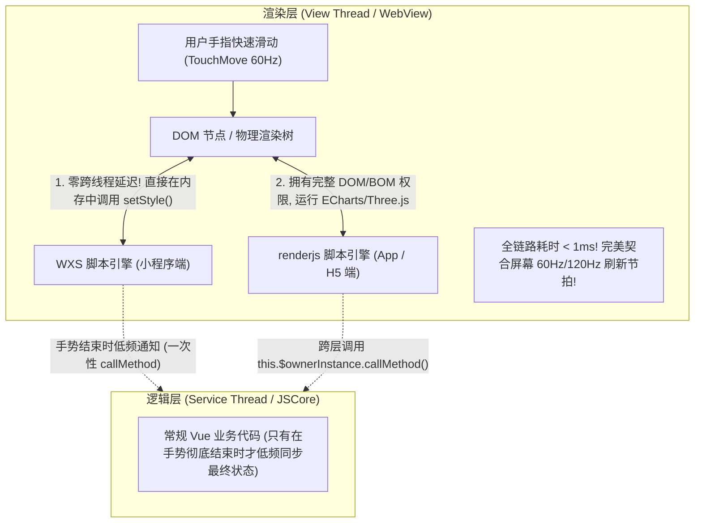
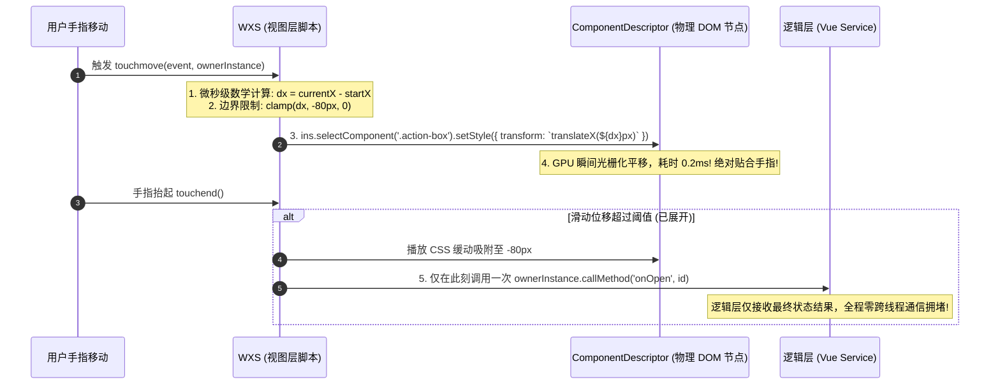

# 高级-极速视图交互wxs与renderjs零跨线程通信实战

在前面的双线程架构深度剖析中，我们已经推导出：任何从视图层（WebView）捕获的触控手势，如果经过 Native JSBridge 中继到达逻辑层，再通过 `setData` 序列化将样式写回视图层，必然存在 **$20\text{ms} \sim 80\text{ms}$ 的跨线程往返时延（Round-Trip Time）**。

这种时延在常规的按钮点击跳转中几乎不可感知；但在**高频连续手势交互**（如左滑删除列表项、下拉阻尼回弹、可拖拽排序看板、吸顶视差滚动）以及**复杂第三方图表渲染（如 ECharts、Three.js 3D）** 中，会导致致命的“手势严重脱节、卡顿跳帧、迟钝黏滞”。

为了打破双线程通信的物理天堑，微信小程序推出了 **`WXS`（WeiXin Script）**，而 Uni-App 在 App 端与 H5 端推出了更为强悍的 **`renderjs`**。

在高级/资深架构师面试中，面试官将考核你是否具备“视图层零跨线程通信”的底层黑魔法：**`WXS` 与 `renderjs` 的运行物理环境是什么？它们是如何直接绕过逻辑层直接操作 DOM 节点样式的？如何利用 WXS 徒手实现 60FPS 丝滑跟手的左滑删除组件？**

---

## 1. 核心底层机制与全景架构

### 1.1 WXS 与 renderjs 的物理运行层级全景

两者的核心物理特征：**它们直接寄生在渲染层（View Thread / WebView）中运行，与视图结构处于同一个物理线程！**



### 1.2 WXS 与 renderjs 核心特权与边界对比

| 技术方案 | 生效平台环境 | 运行宿主与权限 | 典型核心业务场景 |
| :--- | :--- | :--- | :--- |
| **`WXS`** | 微信等各平台小程序 | 运行在渲染层定制的纯洁沙箱中。**无法操作普通 DOM（无 window/document），但提供了专用的 `ComponentDescriptor`，可直接修改目标节点的 CSS Transform 与样式**。 | 高性能侧滑删除、拖拽排序、粘性吸顶渐变、自定义滚动条跟随。 |
| **`renderjs`** | App 原生端（WebView）、H5 网页 | **拥有完整的标准浏览器 DOM 与 BOM 环境**。可以使用 `window`、`document`，能无缝引入任何成熟的 Web 图表与动画库。 | App 端运行 ECharts 图表、Three.js 3D 模型预览、复杂 Canvas 签名板。 |

---

## 2. 源码级/算法物理推导

### 2.1 WXS 零延迟跟手拖拽算法推导

在实现跟手滑动时，WXS 通过捕获手指的位移增量 $dx$，直接在渲染层微秒级计算出变换矩阵，并直接调用底层原生接口：



---

## 3. 社招/阶段必考高频硬核连环追问

### 追问 1：WXS 在语法层面为什么不能使用 ES6 的 `async/await`、`Promise` 或者箭头函数？它的底层运行沙箱是什么？

> **答辩深度闭环**：
> 1. **定制化的独立语言内核**：WXS 并不是标准的 Node.js 或普通 V8 环境，而是微信团队基于安全和包体积考量自研的一套极其轻量的 **JavaScript 方言解析器**。
> 2. **语法局限**：WXS 的语法规范严格限制在 **ES5 标准**。它没有内置 ES6+ 的 Babel 转译器，因此不支持 `const`、`let`、箭头函数、`Class` 以及 `async/await`。
> 3. **独立沙箱机制**：WXS 严禁访问任何小程序的 API（如不能在 WXS 中调用 `wx.request` 或 `wx.navigateTo`），它只专注于纯粹的数据格式转换（如过滤器 Filter）和极致性能的视图节点操作。

---

### 追问 2：在 App 端使用 `renderjs` 渲染 ECharts 图表时，逻辑层的 Vue 数据发生了改变，如何将新数据无缝响应式推送到 `renderjs` 中？`renderjs` 处理完毕后又如何反向调用 Vue 方法？

> **答辩深度闭环**：
> 1. **从逻辑层向 renderjs 传递数据（监听器联动法）**：
>    在模板中使用特殊的属性监听语法：`:prop="chartData" :change:prop="renderScript.updateChart"`。当逻辑层的 `chartData` 发生改变时，渲染层的 `renderScript.updateChart(newValue)` 会被底层自动触发执行！
> 2. **从 renderjs 反向回调逻辑层（跨层通信）**：
>    在 `renderjs` 的方法内部，使用 Uni-App 提供的内部指针：
>    ```javascript
>    this.$ownerInstance.callMethod('handleChartClick', { dataIndex: 3 });
>    ```
>    系统底层会自动通过跨线程通信通道，触发逻辑层对应 methods 中的 `handleChartClick` 函数。

---

### 追问 3：既然 WXS 和 renderjs 这么快，为什么 Uni-App 不把所有的业务代码全部移入视图层运行？

> **答辩深度闭环**：
> 1. **职责分离架构设计**：渲染层的核心职责是“保持高帧率的光栅化渲染”。如果在渲染层执行繁重的业务网络请求、状态管理、大数组排序和加密计算，渲染线程自身会被这些业务逻辑阻塞，导致页面依然会发生卡顿掉帧。
> 2. **安全性红线**：渲染层依然具备 Webview 属性，开放全部业务执行权会破坏小程序原本的双线程沙箱安全架构。
> 3. **最佳工程分工**：**“计算归逻辑层，手势动效归视图层”**。高频手势渲染下沉到 WXS/renderjs，业务数据与流程状态保留在逻辑层，两者各司其职。

---

## 4. 生产级避坑指南与排障 SOP

### 4.1 生产级 60FPS 丝滑左滑删除（Swipe Action）组件源码（纯 WXS 驱动）

#### 1. WXS 核心手势逻辑模块（`swipe.wxs`）
```javascript
// swipe.wxs (必须严格遵循 ES5 规范)
var startX = 0;
var maxActionWidth = 80; // 侧滑展开的最大宽度 (80px)

function touchstart(event, ownerInstance) {
  var touch = event.touches[0];
  startX = touch.clientX;
}

function touchmove(event, ownerInstance) {
  var touch = event.touches[0];
  var dx = touch.clientX - startX;

  // 仅允许向左滑动 (dx < 0)，且限制最大位移
  if (dx > 0) dx = 0;
  if (dx < -maxActionWidth) dx = -maxActionWidth;

  // 核心黑魔法：直接在渲染层微秒级操作节点样式，零跨线程通信！
  var targetNode = ownerInstance.selectComponent('.swipe-content-box');
  if (targetNode) {
    targetNode.setStyle({
      transform: 'translateX(' + dx + 'px)',
      transition: 'none' // 跟手拖拽期间禁用动画过渡
    });
  }
}

function touchend(event, ownerInstance) {
  var touch = event.changedTouches[0];
  var dx = touch.clientX - startX;
  var targetNode = ownerInstance.selectComponent('.swipe-content-box');
  if (!targetNode) return;

  // 滑动超过一半距离 (40px) 则自动吸附展开，否则回弹关闭
  if (dx < -40) {
    targetNode.setStyle({
      transform: 'translateX(-' + maxActionWidth + 'px)',
      transition: 'transform 0.2s cubic-bezier(0.16, 1, 0.3, 1)'
    });
  } else {
    targetNode.setStyle({
      transform: 'translateX(0px)',
      transition: 'transform 0.2s cubic-bezier(0.16, 1, 0.3, 1)'
    });
  }
}

module.exports = {
  touchstart: touchstart,
  touchmove: touchmove,
  touchend: touchend
};
```

#### 2. Vue 页面中高效组装
```vue
<template>
  <view class="swipe-item-container">
    <!-- 引入 WXS 模块 -->
    <!-- #ifdef MP-WEIXIN -->
    <script lang="wxs" module="swipeWxs" src="./swipe.wxs"></script>
    <!-- #endif -->

    <!-- 底层红色删除操作按钮 (位于主内容卡片下方) -->
    <view class="action-delete-btn" @click="handleDelete">
      <text>删除</text>
    </view>

    <!-- 上层主内容卡片 (绑定 WXS 手势事件) -->
    <view
      class="swipe-content-box"
      @touchstart="swipeWxs.touchstart"
      @touchmove="swipeWxs.touchmove"
      @touchend="swipeWxs.touchend"
    >
      <text class="title">{{ item.title }}</text>
    </view>
  </view>
</template>

<script setup lang="ts">
const props = defineProps<{ item: { id: number; title: string } }>();
const emit = defineEmits(['delete']);

function handleDelete() {
  emit('delete', props.item.id);
}
</script>

<style lang="scss" scoped>
.swipe-item-container {
  position: relative;
  height: 120rpx;
  overflow: hidden;
  margin-bottom: 16rpx;
}

.action-delete-btn {
  position: absolute;
  top: 0;
  right: 0;
  width: 80px;
  height: 100%;
  background-color: #e64340;
  display: flex;
  align-items: center;
  justify-content: center;
  color: #ffffff;
  font-size: 28rpx;
}

.swipe-content-box {
  position: absolute;
  top: 0;
  left: 0;
  width: 100%;
  height: 100%;
  background-color: #ffffff;
  display: flex;
  align-items: center;
  padding: 0 32rpx;
  box-shadow: 0 2rpx 8rpx rgba(0, 0, 0, 0.04);
}
</style>
```

### 4.2 WXS 与 renderjs 避坑手册

| 常见故障 | 物理根因 | 生产排查与根治 SOP |
| :--- | :--- | :--- |
| **WXS 报 `SyntaxError: Unexpected token const`** | 在 WXS 文件中使用了 ES6+ 语法。 | 必须全量降级为纯 ES5 语法（`var`、普通 `function`、字符串拼接）。 |
| **App 端 renderjs 无法加载 ECharts** | 在 renderjs 中未正确引入在线 CDN 或本地静态 JS 文件。 | 在 `mounted` 生命周期中动态通过 DOM 创建 `<script>` 注入依赖。 |
| **编译到非微信小程序端报错** | WXS 属于微信小程序规范（支付宝对应 SJS，字节对应 BJS）。 | 必须在模板中使用条件编译标记：`<!-- #ifdef MP-WEIXIN -->`。 |
