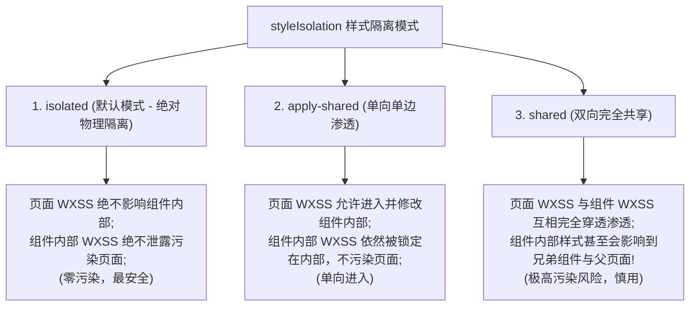
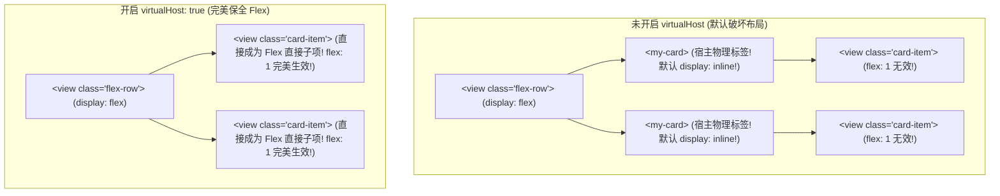

# 高级-自定义组件样式隔离styleIsolation与virtualHost配置

在跨端组件化工程落地中，**样式隔离（Style Isolation）** 与 **虚拟化宿主节点（Virtual Host）** 是每一个追求工业级严谨度的高级前端工程师必须逾越的核心门槛。

传统纯 Web 开发者在 Vue 时代习惯了通过 `scoped` 属性来防止样式污染；但在小程序与跨端运行时架构中，各自定义组件在底层深度映射为类似 Web Components 的**影子节点树（Shadow Tree）**。很多初中级开发者在集成第三方组件或封装公共业务组件时，常常遇到令人抓狂的诡异排版故障：**“父组件明明写了 `display: flex`，子组件设置 `flex: 1` 却死活无法平分宽度”、“在页面里覆写组件样式死活不生效，改了配置后却意外导致全局其他页面样式大面积被篡改污染”**。

在社招高级技术面试中，面试官将围绕小程序的组件层叠样式体系展开底层连环拷问：**`styleIsolation` 的三大隔离模式底层状态机是什么？`virtualHost: true` 是如何从物理上消除宿主标签对 CSS Flex/Grid 布局的破坏的？为什么 CSS 变量能天然穿透影子树而类名不行？**

---

## 1. 核心底层机制与全景架构

### 1.1 自定义组件的三大样式隔离模式（styleIsolation）

小程序官方为了在“防止样式交叉污染”与“支持外部主题定制”之间取得平衡，设计了三种隔离策略：



### 1.2 核心配置语法（Vue 3 组合式声明）

在 Uni-App 中，为自定义组件配置选项需在 `<script>` 中显式声明：

```vue
<script lang="ts">
export default {
  options: {
    // 样式隔离选项: 'isolated' | 'apply-shared' | 'shared'
    styleIsolation: 'apply-shared',
    // 开启虚拟宿主节点，消除多余包裹层
    virtualHost: true
  }
}
</script>
```

---

## 2. 源码级/算法物理推导

### 2.1 virtualHost: true 消除宿主标签破坏 Flex 布局推导

为什么父级 `display: flex`，自定义子组件写 `flex: 1` 经常失效？

#### 物理 DOM 渲染拓扑还原：
假设父组件代码如下：
```html
<view class="flex-row">
  <my-card class="card-item" />
  <my-card class="card-item" />
</view>
```
在微信小程序渲染层（WebView）中，底层真实生成的 DOM 树如下：



#### 物理机制解析：
- **致命夹心层**：在默认情况下，小程序会为自定义组件在外部生成一个真实的**宿主节点（Host Node）**（即 `<my-card>` 标签）。根据 CSS 规范，该宿主节点的默认样式是 **`display: inline`**！
- **Flex 断层**：父级 `display: flex` 的直接子项变成了 `<my-card>` 这个行内元素，而开发者写的带有 `flex: 1` 的内部真正容器被隔离在孙子节点中，导致弹性自适应彻底瘫痪！
- **`virtualHost: true` 的魔法**：它通知小程序的编译渲染引擎：**将 `<my-card>` 标记为虚拟占位节点，在最终光栅化布局时将其从 DOM 渲染树中物理抹除**，直接让组件内部的第一个根标签与父级 Flex 容器对接，完美复原标准 CSS 排版表现！

---

## 3. 社招/阶段必考高频硬核连环追问

### 追问 1：在团队开发中，如果为了方便修改样式，把所有自定义组件无脑设置成 `styleIsolation: 'shared'`，会导致什么严重的灾难性后果？

> **答辩深度闭环**：
> 1. **全局样式污染（Global Style Contamination）**：在 `shared` 模式下，组件内部编写的类名（如 `.title { color: red; font-size: 20px; }`）**会被直接合并到全局公共 CSS 样式表中**。
> 2. **幽灵覆盖事故**：当另一个团队成员在别的页面也定义了 `.title` 类名时，两者的样式会在全局发生竞态覆盖。某一天修改了“用户中心”某个小组件的样式，导致“收银台订单页”的标题突然变红变形，产生极度隐蔽、难以排查的“幽灵样式污染”事故！
> 3. **架构规范**：除了顶级的主题提供者组件（如 ConfigProvider），普通业务组件**坚决禁止开启 `shared`**！必须优先保持默认的 `isolated`，需要修改样式时使用 CSS 自定义属性（Variables）或外部传递 `class`。

---

### 追问 2：为什么 CSS 自定义属性（CSS Variables，如 `--primary-color: #2b9939;`）能够无视 `isolated` 样式隔离，直接从父页面穿透渗透进子组件内部？

> **答辩深度闭环**：
> 1. **W3C 规范与 Shadow DOM 特权**：根据 W3C Web Components 标准和微信小程序的隔离实现，样式隔离仅仅是阻断了 **“CSS 选择器（Class / Id / Tag Selector）”** 的级联匹配规则。
> 2. **属性继承性（Property Inheritance）**：CSS 自定义属性在计算机图形学与排版引擎中被定义为**天然具备继承特性的数据节点（Inherited Properties）**（类似 `color`、`font-family`）。它们伴随渲染上下文沿 DOM 树自顶向下自然流动，不会被影子树边界所拦截。
> 3. **架构指导**：跨组件进行主题颜色、圆角、字号定制时，**CSS 变量是兼具“绝对样式隔离安全”与“灵活穿透定制”的最佳物理途径**。

---

### 追问 3：为什么在小程序的自定义组件样式表中，直接写标签选择器（如 `view { margin: 0; }` 或 `text { color: #333; }`）会被微信编译器抛出警告？

> **答辩深度闭环**：
> 1. **性能与重排爆炸警告**：组件内部若声明了通用标签选择器，渲染层在处理组件重绘时，必须对组件子树中的每一个基础标签逐一进行选择器全量遍历匹配，极大拉低了渲染层光栅化性能。
> 2. **编译约束**：小程序编译器对此会直接输出警告：`Some selectors are not allowed in component wxss, including tag name selectors...`。在自定义组件中，**必须且只能使用类选择器（Class Selector，如 `.custom-view`）**。

---

## 4. 生产级避坑指南与排障 SOP

### 4.1 生产级标准无包裹宿主节点组件模板（`VirtualCard`）

```vue
<template>
  <!-- 当 virtualHost: true 时，本根节点将直接作为父级 Flex/Grid 的直接子项参与排版！ -->
  <view class="virtual-card-box">
    <image class="cover" :src="thumb" mode="aspectFill" />
    <view class="meta">
      <text class="title">{{ title }}</text>
      <text class="price">¥{{ price }}</text>
    </view>
  </view>
</template>

<script lang="ts">
// 必须使用独立的 script 标签声明组件元数据 options
export default {
  options: {
    // 1. 允许父页面样式单向渗透 (用于定制主题)
    styleIsolation: 'apply-shared',
    // 2. 核心：彻底消除外层多余的宿主物理节点，完美保全父级 Flex 布局！
    virtualHost: true,
  },
};
</script>

<script setup lang="ts">
defineProps<{
  thumb: string;
  title: string;
  price: number;
}>();
</script>

<style lang="scss" scoped>
.virtual-card-box {
  /* 支持在父级 flex: 1 弹性撑开 */
  flex: 1;
  display: flex;
  flex-direction: column;
  background-color: var(--card-bg-color, #ffffff); /* 接收外部 CSS 变量定制 */
  border-radius: 16rpx;
  overflow: hidden;
  box-shadow: 0 4rpx 12rpx rgba(0, 0, 0, 0.05);

  .cover {
    width: 100%;
    height: 240rpx;
  }

  .meta {
    padding: 16rpx;
    .title { font-size: 28rpx; color: #333; font-weight: bold; }
    .price { font-size: 32rpx; color: #e64340; margin-top: 8rpx; }
  }
}
</style>
```

#### 父页面中使用（Flex 布局完美自适应并排展示两列）：
```vue
<template>
  <view class="goods-grid-row">
    <!-- 两个子组件各自 flex: 1 平分 50% 宽度，零排版形变！ -->
    <VirtualCard title="商品 A" :price="99" thumb="/static/a.png" />
    <VirtualCard title="商品 B" :price="199" thumb="/static/b.png" />
  </view>
</template>

<style scoped>
.goods-grid-row {
  display: flex;
  gap: 20rpx;
  padding: 24rpx;
  /* 动态向子组件注入主题背景色，安全穿透！ */
  --card-bg-color: #fdfdfd;
}
</style>
```

### 4.2 样式隔离排错速查表

| 故障现象 | 物理根因 | 生产排查与根治 SOP |
| :--- | :--- | :--- |
| **Flex 自适应在子组件上不生效** | 缺少 `virtualHost: true`，中间多了一层默认 `display: inline` 的宿主标签。 | 在组件的 `options` 中显式配置 `virtualHost: true`。 |
| **修改子组件样式污染了全项目** | 滥用了 `styleIsolation: 'shared'`。 | 严禁滥用 `shared`，改用 `apply-shared` 或 CSS Variables 局部覆盖。 |
| **微信开发者工具报样式编译警告** | 组件内部样式表直接使用了 `div`、`view`、`span` 标签选择器。 | 全量重构为具体的类名选择器（`.box`、`.title`）。 |
